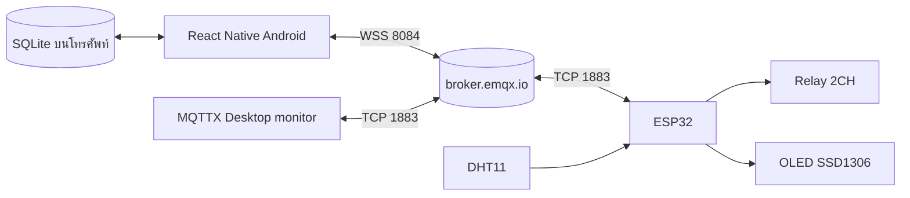
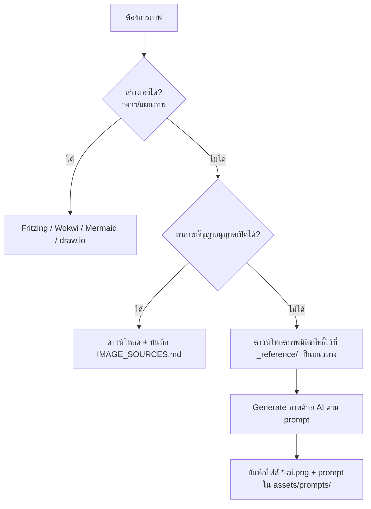

# Design — ESP32 IoT Lab Series

> ฉบับเผยแพร่สำหรับผู้เรียน: ประวัติการพัฒนาและโครงสร้างแอปอ้างอิงด้านล่างเป็นหลักฐาน/เกณฑ์สำหรับสร้างเอง source สำเร็จเก็บเฉพาะผู้สอน ดู [นโยบายเผยแพร่](PUBLISHING.md)


## 1. Lab Template (assets/templates/lab-template.md)

```markdown
# Lab XX: <ชื่อแล็บ>
> ระดับ: ⭐/⭐⭐/⭐⭐⭐ | เวลา: X ชม. | ต้องผ่าน: Lab YY

## 🎯 วัตถุประสงค์
## 🧰 อุปกรณ์ที่ใช้
| อุปกรณ์ | จำนวน | หมายเหตุ |

## ❓ คำถามก่อนเริ่มต้น
<details>
<summary><b>คลิกเพื่อดูคำถามก่อนเรียน</b></summary>

1. ...
2. ...
</details>

## 📖 ทฤษฎี
## 🔌 การต่อวงจร
(ภาพวงจร + ตาราง pin mapping)
## 🧪 การทดลอง
### การทดลองที่ X.1 ...
- ขั้นตอน
- โค้ด (ลิงก์ไปไฟล์ .ino + code block เต็ม)
- อธิบายโค้ด (ตาราง)
- ผลลัพธ์ที่คาดหวัง
- ภารกิจท้าทาย
## 🛠️ Troubleshooting
## 🔍 คำถามค้นคว้าหลังเรียน
## 📝 แบบทดสอบหลังเรียน (10 ข้อ)
## 📚 อ้างอิง
## ➡️ แล็บถัดไป
```

## 2. รูปแบบแบบทดสอบ

```markdown
**ข้อ 1 (ง่าย)** ESP32 ทำงานที่ระดับแรงดันลอจิกเท่าใด
- ก. 1.8V
- ข. 3.3V
- ค. 5V
- ง. 12V
```
- ความยาก: ข้อ 1–3 ง่าย (จำ/เข้าใจ), ข้อ 4–7 ปานกลาง (ประยุกต์/อ่านโค้ด), ข้อ 8–10 ยาก (วิเคราะห์/debug/ออกแบบ)
- เฉลยใน `answer-keys/labXX-answers.md`: ตาราง ข้อ | คำตอบ | เหตุผล

## 3. Pin Mapping มาตรฐาน — ESP32-S3

ใช้ [ตารางต่อสายคงที่ Lab02–07](assets/PINOUT.md) เป็นหลัก ยึดแล็บ7เดิมโดยไม่เปลี่ยนfirmware/เอกสารของLab07

| อุปกรณ์ | ESP32-S3 GPIO | หมายเหตุ |
|---|---|---|
| LED ภายนอกหลัก | 5 | ผ่านR220Ω; 02/03/06 |
| LED ภายนอกตัวที่สอง | 2 | ผ่านR220Ω; pattern03.5 ไม่ใช่onboardS3 |
| โมดูลปุ่ม OUT | 18 | VCC3V3/GND; INPUT มีRในโมดูล; pressedlevelปรับตามจริง |
| ไฟ RD/YL/GY | 10/11/12 | commonVCC3V3, Rจำกัดกระแสในโมดูล, baselineactiveLOW |
| OLED SDA/SCL | 8/9 | VCC3V3/GND ใช้ตัวเดียวร่วม04/07 |
| Relay IN1/IN2 | 16/17 | VCC5V/GNDร่วม, inputรองรับ3.3V ตามLab07 |
| HC-SR04 TRIG/ECHO | 6/7 | ECHOต้องผ่านdivider1kΩ/2kΩ |
| DHT11 DATA | 4 | VCC3V3/GND, pullup10kΩถ้าไม่มีในโมดูล |

S3ชุดOctal memoryของผู้สอนหลีกเลี่ยงGPIO26–37, nativeUSB19/20 และstrapping0/3/45/46 ไม่เหมารวมข้อห้ามFlashGPIO6–11ของWROOMมาใช้บนS3 โค้ดLab02–06แยกS3/WROOMตามCONFIG_IDF_TARGET; ตารางWROOMเดิมอยู่ในassets/PINOUT.mdแบบพับเก็บ เลือกESP32S3DevModule/CDCDisabledสำหรับCH343และตรวจFlash/PSRAMตามบอร์ดจริง

## 4. รายละเอียดแต่ละแล็บ

### Lab 01 — เริ่มต้นกับ ESP32
**ทฤษฎี**
- ไมโครคอนโทรลเลอร์คืออะไร เทียบกับ Arduino UNO / ESP8266 / Raspberry Pi
- ตระกูล Espressif (ตารางเปรียบเทียบ): ESP8266, ESP32, ESP32-S2, ESP32-S3, ESP32-C3, ESP32-C6, ESP32-H2, ESP32-P4
  คอลัมน์: CPU, Core, Clock, RAM, WiFi, BLE, จุดเด่น/การใช้งาน
- สถาปัตยกรรม ESP32: Xtensa LX6 dual-core 240MHz, 520KB SRAM, ROM, Flash ภายนอก (SPI),
  WiFi 802.11 b/g/n, Bluetooth Classic + BLE, ULP co-processor, RTC, peripherals
  (ทำแผนภาพ block diagram ด้วย Mermaid)
- ความต่างระหว่างชิป ESP32 / โมดูล WROOM-32 / บอร์ด DevKit
- Pinout DevKit V1: GPIO, ADC1/ADC2, DAC (25, 26), Touch, UART, I2C, SPI, PWM (ทุก output pin)
- ระบบไฟ: USB 5V → LDO (AMS1117) → 3.3V, ขา VIN/5V, 3V3, GND
- ข้อจำกัด: GPIO ไม่รองรับ 5V, กระแสต่อขา (แนะนำ ≤20mA, สูงสุด 40mA), ขา strapping/flash,
  ADC ไม่เป็นเชิงเส้น, ADC2 ชนกับ WiFi, การดึงกระแสสูงตอนส่ง WiFi
- ปุ่ม EN (reset) และ BOOT (GPIO0)

**การเตรียมความพร้อมบน Windows 10**
1. ตรวจสาย USB (ต้องเป็นสาย data ไม่ใช่สายชาร์จอย่างเดียว)
2. เปิด Device Manager → Ports (COM & LPT) ตรวจชิป USB-to-Serial (CP2102 / CH340)
3. ติดตั้งไดรเวอร์: CP210x (Silicon Labs) หรือ CH340 (WCH) แล้วตรวจหมายเลข COM
4. ดาวน์โหลด/ติดตั้ง Arduino IDE 2.x
5. File → Preferences → Additional boards manager URLs:
   `https://espressif.github.io/arduino-esp32/package_esp32_index.json`
6. Boards Manager → ติดตั้ง "esp32 by Espressif Systems"
7. ตั้งค่าที่เมนู Tools: Board = ESP32 Dev Module, Port = COMx, Upload Speed = 921600
   (ถ้าอัปโหลดล้มเหลวให้ลด 115200), Flash Size 4MB, Partition Scheme = Default
8. อัปโหลดโค้ดเริ่มต้น `lab01_chip_info.ino`: แสดง Chip model, revision, จำนวน core,
   CPU freq, Flash size, MAC address, free heap
9. ปัญหา "Failed to connect... Wrong boot mode" → กด BOOT ค้างตอนขึ้น Connecting...

**ภาพที่ต้องมี:** pinout, block diagram, Device Manager, หน้าจอ Preferences, Boards Manager,
เมนู Tools, ผลลัพธ์ Serial Monitor

### Lab 02 — หลักการเขียนโปรแกรมบน ESP32
- โครงสร้าง sketch: `setup()`, `loop()`, การ compile/upload, เบื้องหลังที่ FreeRTOS รัน loop
- 2.1 Blink (LEDภายนอก GPIO5 บนS3 ใช้พินเดียวทุกsketch) ด้วย `delay()`
- 2.2 Serial: `Serial.begin`, `print`, `println`, `printf`, Serial Monitor, Serial Plotter
- 2.3 Console log: `log_i/log_w/log_e` + การตั้ง Core Debug Level
- 2.4 Blink แบบ non-blocking ด้วย `millis()` (เทียบกับ `delay()`)
- 2.5 สั่ง LED ผ่าน Serial (พิมพ์ `on`/`off`)
- 2.6 PWM fade ด้วย `ledcAttach()` / `ledcWrite()` (API ของ core 3.x)
- ภารกิจ: ไฟกระพริบรหัส SOS

### Lab 03 — ตัวแปร เงื่อนไข ลูป ฟังก์ชัน (ปุ่มกด + LED)
- ชนิดข้อมูล (`int`, `float`, `bool`, `char`, `String`, `uint8_t`...), `const`, `#define`, scope, `static`, `volatile`
- `if/else`, `switch`, ตัวดำเนินการตรรกะ
- `for`, `while`, `do-while`, `break`/`continue`
- ฟังก์ชัน: พารามิเตอร์, ค่าที่ return, แยกโค้ดให้เป็นระเบียบ
- การทดลอง: อ่านโมดูลปุ่ม OUT18 (INPUT; INPUT_PULLUPเป็นทางเลือกสำหรับปุ่มเปล่า) → ตรวจขอบสัญญาณ (edge detection) → debounce ด้วย millis →
  กด toggle LED → นับจำนวนครั้ง → เลือกรูปแบบไฟด้วย switch → array ของ LED ใช้ for-loop →
  ทำ state machine
- ภารกิจ: เกมทดสอบความไวของการกด (reaction time)

### Lab 04 — OLED I2C และโมดูลปุ่มกด/ไฟสามสี
- OLED จีนประมาณ1นิ้ว เลือก baseline SSD1306 I2C128×64, address0x3C; ตรวจรุ่นและScannerก่อนใช้งาน ขนาดจอ/addressไม่ใช่หลักฐานระบุdriver
- โมดูลปุ่ม GND/VCC/OUT มีRในตัว ต่อ3V3/GND/OUT18 ใช้INPUT ไม่ต่อRภายนอก; อ่านrawและปรับBUTTON_PRESSED_LEVELก่อนdebounce40ms
- โมดูลไฟ8mm3สี VCC/RD/YL/GY (แดง/เหลือง/เขียวตามสกรีนผู้ใช้ ไม่มีช่องสีน้ำเงิน): VCC3V3/RD10/YL11/GY12 ค่าเริ่มต้นcommonpositive activeLOW ต้องตรวจแรงดัน/RจำกัดกระแสและกระแสGPIOของรุ่นจริงก่อนต่อ
- GPIO หลักใช้ ESP32-S3 ของผู้สอนและคงพิน OLED/Relay/DHT11 จาก Lab07; สาขาWROOMในโค้ดเลือกเลขพินรุ่นเดิมอัตโนมัติเมื่อเลือก targetนั้น
- ไลบรารี Adafruit SSD1306/GFX/BusIO; pixels0..127/0..63, framebuffer1024bytes, clearDisplay/draw/print/display และตรวจACKก่อนinit
- 4.1 Scanner → 4.2 OLEDอย่างเดียว → 4.3 ปุ่มอย่างเดียว → 4.4 ไฟแต่ละสี → 4.5 ปุ่มนับบนOLED → 4.6 กดวนOFF/RED/YELLOW/GREENพร้อมOLED/Serial
- ทุกชุดมีSerial115200, millis/debounce, pin/configในแต่ละsketch, จุดตรวจและผลคาดหวัง; จอไม่ตอบให้ชุดรวมยังทดสอบปุ่ม/ไฟผ่านSerialได้
- ภาพแยกpinout, OLED4สาย, ปุ่ม3สาย, ไฟ4สาย, วงจรรวมและหน้าจอจำลอง พร้อมตารางต่อจากพินไปพิน
- ทดสอบโมดูลละชุดก่อนรวม; คงสายอุปกรณ์แล็บอื่นได้เมื่อไม่ชนGPIO แต่ sketchนี้ไม่รับรองสถานะขาที่ไม่ได้กำหนดหรือช่วงresetของRelay/ไฟ ใช้โหลดRelayถอดออกระหว่างตรวจLab04
- OLED ใช้จอตัวเดียวร่วมLab07ได้ ไม่เพิ่มจอaddressซ้ำบนI2Cบัสเดียว; ถ้าdriverจริงเป็นSH1106หรือSSD1315ต้องปรับlibrary/โค้ดก่อนทดสอบ

### Lab 05 — Relay 2CH และ Ultrasonic
- Relay: ขดลวด, COM/NO/NC, optocoupler, ไดโอด flyback, jumper JD-VCC, การทำงานแบบ active LOW
- ⚠️ คำเตือนเรื่องความปลอดภัย: ห้ามใช้ 220V ในแล็บ
- HC-SR04: หลักการ ToF, `distance_cm = duration_us × 0.0343 / 2`, `pulseIn()` + timeout,
  วงจร voltage divider ที่ขา ECHO (หรือใช้รุ่น HC-SR04P ที่รองรับ 3.3V)
- กรองค่าด้วย moving average, hysteresis ป้องกัน relay สั่นเปิด-ปิดถี่
- การทดลองรวม: ระยะ < 20cm → Relay1 ON, < 10cm → Relay2 ON (ทางเลือก: แสดงผลบน OLED จาก Lab 4)
- ภารกิจ: ระบบแจ้งเตือนที่จอดรถ

### Lab 06 — WiFi และ MQTT
- WiFi STA mode, `WiFi.begin`, ตรวจสถานะ, การ reconnect, RSSI, IP
- แนวคิด MQTT: broker, publish/subscribe, topic, wildcard `+` `#`, QoS 0/1/2, retain, LWT, clientId
- ทำไม MQTTX Web ต้องใช้ WSS 8084 แต่ ESP32 ใช้ TCP 1883 (แผนภาพ Mermaid)
- การตั้งค่า MQTTX Web:
  | ช่อง | ค่า |
  |---|---|
  | Name | APP-PC |
  | Host | wss:// + broker.emqx.io |
  | Port | 8084 |
  | Path | /mqtt |
  | Client ID | mqttx_ ตามด้วยตัวสุ่ม (ห้ามซ้ำกับ ESP32) |
  | Username/Password | เว้นว่าง |
- ไลบรารี: PubSubClient (Nick O'Leary), ArduinoJson
- Topics:
  | Topic | ทิศทาง | Payload |
  |---|---|---|
  | esp32lab/{id}/status | ESP32 → | `online`/`offline` (retain + LWT) |
  | esp32lab/{id}/cmd/led | → ESP32 | `on`/`off`/`toggle` |
  | esp32lab/{id}/telemetry | ESP32 → | `{"uptime":..,"rssi":..,"heap":..}` |
  | esp32lab/{id}/chat | ↔ | ข้อความ |
- การทดลอง: 6.1 ต่อ WiFi → 6.2 ต่อ MQTT + heartbeat → 6.3 MQTTX สั่ง LED →
  6.4 ESP32 ส่งรายงาน JSON → 6.5 ส่งข้อความระหว่างคู่ (ESP32 ↔ ESP32 / ESP32 ↔ MQTTX) → 6.6 LWT
- ⚠️ public broker: ทุกคนเห็นข้อความ ห้ามส่งข้อมูลส่วนตัว

### Lab 07 — มินิโปรเจกต์ Smart Home + React Native



- 7.1 ทดสอบ OLED SSD1306 I2C 0x3C (Adafruit SSD1306/GFX)
- 7.2 ทดสอบ DHT11 อ่านทุก ≥2 s และจัดการ NaN
- 7.3 รวม firmware timer/reconnect, retained reported state, sensor valid/null/age; เลือก ESP32/S3 pin mapping และทดสอบได้ทั้งบอร์ดเปล่าหรือวงจรครบ โดยแยกหลักฐานตามอุปกรณ์จริง
- 7.4 เตรียมชุด Markdown `app-blueprint/` ให้คัดลอกไปโปรเจกต์ใหม่: README, AGENTS, requirements, design, implementation, mqtt-contract, data-model, test-plan และ opencode-prompts พร้อม assets ภาพจริง 4 หน้าและ MQTTX template; กำหนด STUDENT_ID/package/board ก่อนสร้าง
- 7.5 ผู้สอนพาผู้เรียนใช้ OpenCode สร้าง React Native + Expo + TypeScript ใน mobile/ ตาม Phase UI → SQLite → MQTT → commands → firmware/MQTTX → standalone APK ใช้ baseline/lockfile ของแอป 1.0.1 และวิธี build Windows ผ่าน path สั้น มีเส้นทางรัน source อ้างอิงจาก tag แยกจากการสร้างใหม่ด้วย Markdown
- 7.6 ตรวจแอปบน Android ร่วม ESP32/MQTTX และ persistence/offline/lifecycle จาก test-plan พร้อมหลักฐานจริง
- UI มี 4 หน้า: Dashboard เป็นหน้าแรก, Add Device, Edit Device, Settings ใช้พื้นขาว การ์ดมุมโค้ง ขอบคมบาง ไม่มีเงาฟุ้งรอบการ์ด/ปุ่ม icon font และข้อมูลคุณภาพ/สถานะที่อ่านเข้าใจ
- ข้อมูลหลักอยู่ใน SQLite บนโทรศัพท์: profiles/settings/sensor history/commands/events ไม่มี cloud database/login บังคับ
- ใช้ภาพจริง Samsung S25 Ultra ของแอป 1.0.1 เป็นแบบหลัก: border1dp #DCE3EC, radius16/14dp, elevation0; ภาพ AI เดิมเป็นประวัติการออกแบบ ไม่ใช่หลักฐานรัน
- แอปใช้ WSS `wss://broker.emqx.io:8084/mqtt`; ESP32 และ MQTTX Desktop ใช้ TCP1883; MQTTX เป็น client ของ broker ฟรี EMQX ตั้ง 6 exact topics/4สี: statusเขียว, sensorน้ำเงิน, commandส้ม, reported stateม่วง
- Topics: `home/{id}/relay/{1|2}/set` รับ ON/OFF ไม่ retain; `.../state` ส่ง ON/OFF retain; `.../sensor` ส่ง temp/hum/valid/uptime/age_s; `.../status` online/offline LWT
- แอปแยก broker connected/ESP32 presence, cached/retained/live, sensor invalid และ pending รายงาน; ไม่มี offline command replay
- ข้อกำหนด FW-01–10/MX-01–06 อยู่ใน mqtt-contract: reset RelayOFF, network loss คง state, ไม่มี sensor ส่ง null ไม่ปลอมค่า; คำสั่ง QoS0 timeout ไม่ยืนยันว่า GPIO ไม่ทำงาน และไม่มี contact feedback
- ขอบเขตผลจริง: Samsung/ESP32-S3 เปล่าทดสอบแล้ว; การอ่าน DHT ปกติ, OLED, หน้าสัมผัส Relay/โหลด, background service และ production signing ไม่ถือว่าผ่านจากผลนี้
- Rubric: firmware/วงจร, React Native UI, SQLite, MQTT/state, หลักฐานและการอธิบาย ไม่ประเมินจากภาพ mockup อย่างเดียว

### Lab 08 — ตรวจเช็กอุปกรณ์ก่อนใช้งาน (Hardware Check)

- เป็นแล็บพิเศษ ใช้ได้หลังเตรียมIDE/UploadในLab01 ก่อนเริ่มบทอื่น ไม่ต้องผ่านLab07ตามเลขบท
- มี6หัวข้อแยก: DHT11 DATA4, HC-SR04 TRIG6/ECHO7divider, ไฟRD10/YL11/GY12, Relay16/17, ปุ่มOUT18 และOLED8/9บนS3 ใช้พินคงที่ของคอร์ส ไม่แก้Lab07
- แต่ละหัวข้อมีภาพต่อสาย ตารางVCC/GND/สัญญาณ ปุ่มZIPรายโมดูล ลิงก์.ino โค้ดเต็ม ตารางอธิบาย ผลSerialคาดหวังและใบงานตรวจของจริง พร้อมZIPรวม6sketches
- โค้ดพื้นฐานแยกจากโจทย์ต่อยอด: DHTจุดเตือน/ข้อมูลผิดพลาด, ระยะแบ่งช่วง/timeout, ไฟALL/blink/chaseพร้อมSerialหยุด, ปุ่มtoggleON/OFFหนึ่งครั้งต่อขอบกด, OLEDUIชื่อกับuptimeและแถบDEMO; Relayไม่มีโจทย์เพิ่มนอกเปิด–ปิด
- ให้แนวคิดเรื่องstate/timer/ขอบเขต/การตรวจข้อมูลและกรณีทดสอบแก่โจทย์ต่อยอด ไม่แจกโค้ดเฉลยโจทย์; OLEDUIตัวอย่างเป็นส่วนที่ผู้สอนขอให้ทำไว้จริง
- ภาพ8คู่SVG/PNG (overview,6wiring,OLEDUIresult) และSVGปุ่มดาวน์โหลดสร้างเอง มีทะเบียนภาพและgenerator; ภาพUIเป็นภาพจำลองไม่ใช่ผลhardware
- อยู่ labs/lab08-hardware-check ตามtemplate มีPrelab6/Research4/Quiz10และเฉลยlocalที่ignore; compile6sketchesบนS3และตรวจลิงก์/ZIPตรงsourceก่อนเผยแพร่

## 5. Image Pipeline

- ตั้งชื่อไฟล์: `labXX-<คำอธิบาย>.png` (ตัวเล็กทั้งหมด, ใช้ขีดกลาง)
- คำบรรยายใต้ภาพที่ generate: "ภาพประกอบสร้างด้วย AI"
- `IMAGE_SOURCES.md`: | ไฟล์ | แหล่งที่มา | ผู้สร้าง | สัญญาอนุญาต | วันที่ | หมายเหตุ |

## 6. มาตรฐานโค้ด
- ส่วนหัวไฟล์ (header):
```cpp
/*
 * Lab XX.Y : <ชื่อ>
 * คำอธิบาย : ...
 * วงจร     : S3 LED -> GPIO5 (ผ่าน R 220Ω); WROOM เดิมใช้ GPIO16
 * ไลบรารี  : PubSubClient 2.8
 * Board    : ESP32S3 Dev Module (core 3.x); เลือก target ให้ตรงรุ่น
 */
```
- ใช้ `constexpr`/`const` สำหรับหมายเลขขา ไม่ hard-code ตัวเลขกระจายในโค้ด
- หลีกเลี่ยง `delay()` ตั้งแต่ Lab 3 เป็นต้นไป (ยกเว้นเพื่อการสาธิต)
- ข้อความบน Serial ขึ้นต้นด้วยแท็ก เช่น `[WIFI]`, `[MQTT]`, `[SENSOR]`

## Lab09 — S3 HomeGuard

- บทปฏิบัติต่อจากLab07: สำเนาแอป/rename/icon → ตรวจวงจร/crypto/TLS → ใช้OpenCodeพัฒนาP0–P9 → จับคู่สองวิธี → ย้ายbroker/ตรวจรับ ลดคำอธิบายตามผู้สอน
- ใช้พินเดิม: SH1106G8/9, DHT4, Relay16/17, ปุ่ม18; Arduino3sketchesแยกself-contained, fullcodeในdetails, Pythonreference+negativevectors และZIPไม่มีsecret
- app-blueprintกำหนดHG01–12/nativeKotlin/ESP-IDF/BLE+SoftAPSecurity2/manualcredential/Keystore/AEAD/session/brokerstage-test-confirm-commit พร้อมเครื่องมือสร้างสำเนาLab07เป็นstarterที่ไม่เรียกlegacyMQTTและexportเฉพาะpublicconfig
- มีPLAN/PROGRESS/DECISIONS/TEST_REPORT; ภาพSVG/PNGต้นฉบับ3คู่+icon1คู่แยกmockจากhardware, rootindexแสดงสถานะเริ่มต้นไม่อ้างsecureend-to-endพร้อมใช้

## 7. ชุดทดสอบโมดูลแยกสำหรับผู้สอน

- เก็บในmodule-tests/เพื่อหยิบใช้ทีละไฟล์ ไม่ใช่แล็บหมายเลขใหม่ มี6โฟลเดอร์ชื่อเดียวกับ.ino: esp32s3_dht11_test, esp32s3_ultrasonic_test, esp32s3_traffic_light_test, esp32s3_relay_2ch_test, esp32s3_button_module_test, esp32s3_oled_test
- เจาะจงESP32-S3ด้วยcompileguardและพิน4/6,7/10,11,12/16,17/18/8,9ตามลำดับ ทุกชุดSerial115200และheaderวงจรภาษาไทย; OLEDใช้SDA8/SCL9และSH1106/SH1106G I2C128×64ตามจอที่ผู้สอนยืนยัน ใช้Adafruit_SH110X/Adafruit_SH1106Gเป็นค่าเริ่มต้นและเลือกSSD1306ได้ด้วยOLED_DRIVER แสดงกรอบ/ชื่อdriver/address/ตัวอักษร/uptime ไม่มีแถบDEMOหรือการเลื่อนภาพ
- OLEDตรวจACK0x3C/0x3Dก่อนinit ไม่เดาcontrollerจากaddressหรือสี ใช้I2C100kHzทั้งสองdriver; คู่มือเปรียบเทียบdriver/libraryและผลบนจอจริง แยกจากตัวอย่างSSD1306เดิมในLab04/07/08
- DHTอ่านทุก2sและตรวจNaN; HCอ่านทุก500msและtimeout30000us; ไฟวนOFF/GREEN/YELLOW/RED/ALLทุก2s; RelayวนOFF/CH1/CH2/BOTHทุก2s; ปุ่มINPUTอ่านrawและdebounce40msนับขอบกด
- คู่มือระบุVCC/GND/divider/pull-up/activeLOWและตัวอย่างSerial; ZIPมี6sketchesพร้อมREADMEสำหรับแตกแล้วเปิดในIDEทีละโฟลเดอร์
- ตรวจcompile6ชุดบนcore3.x, ลิงก์/ZIP/sourceพินตรงกันก่อนcommit; การเตรียมชุดนี้ไม่uploadหรือเปลี่ยนLab07

### แอปและ runtime อ้างอิง Lab09

- app-blueprint/mobile/เป็นแอป React Native/Expo ที่สร้างจริง แยกจาก helper starter; native Kotlin ถือคีย์และทำ Security2/AEAD/TLS MQTT, SQLiteเก็บเฉพาะmetadata/เหตุการณ์
- หน้าหลักจัดการ์ดรีเลย์คู่และเลื่อนเนื้อหาในแนวตั้งพื้นที่เดียว การแตะรีเลย์ขณะล็อกเปิดหน้าต่างยืนยันของโทรศัพท์ เมื่อได้สถานะจากบอร์ดจึงแตะเพื่อสลับได้ แอป Android เปิดเต็มจอ เมนูห้าปุ่มใช้ Compact Center ตามตัวอย่างที่ 4 ใน FloatingNavDemoV.2: แถบขาวเต็มความกว้างสูง 78dp บวก safe area ขอบบนบาง ระยะด้านข้าง 24dp ปุ่มบวกวงกลม 50dp อยู่ตรงกลาง ไม่แสดงคำใต้ปุ่มกลาง แท็บด้านข้างใช้ไอคอนเดิมขนาด 20dp และข้อความ 10.5sp เปลี่ยนเป็นสีน้ำเงินเมื่อเลือก ไม่มีวงกลมไฮไลต์ เงา รอยเว้า หรือการเลื่อนตำแหน่งปุ่ม ปุ่มกลางใช้สีน้ำเงินเข้มเมื่อเลือกหรือกด ภาพบ้านวางจากขอบการ์ดถึงขอบอีกด้านตามสัดส่วนภาพเดิม
- code/lab09_s3_homeguard/ใช้ESP-IDF APIsในArduino3.3.13, Safety taskแยกจากnetwork, GPIOOFFก่อนเริ่ม, physicalwindow120s, lease30s, candidatebroker60sและrollbackเมื่อrebootก่อนcommit; NVSยังไม่เข้ารหัสในdevelopment
- รายงานผลบนSamsung/ESP32-S3บอร์ดเปล่าในTEST_REPORT โดยแยกเซ็นเซอร์/หน้าสัมผัสRelay/productionhardeningที่ยังไม่ทดสอบ ไม่แก้Lab07

- เอกสารพัฒนาLab09ใช้app-blueprint/READMEเป็นสารบัญงาน → BUILD_GUIDEสร้างRelease/ตรวจSRP → CONFIGURATIONกำหนดค่าตามsource → USER_GUIDEใช้จริง → KNOWN_ISSUESไล่สาเหตุและregression; requirements/design/implementation/contract/data-model/test-plan/promptsใช้เกณฑ์เดียวกัน PLAN/PROGRESS/TEST_REPORTแสดงสถานะปัจจุบันเหนือประวัติstarter
