# Lab 01: เริ่มต้นกับ ESP32

> ระดับ: ⭐ | เวลา: 2–3 ชม. | ต้องผ่าน: ไม่มี

ลองนึกถึงเครื่องรดน้ำอัตโนมัติ: ต้องมีตัวอ่านความชื้น ตัวตัดสินใจ และตัวสั่งปั๊ม ESP32 ทำหน้าที่เป็นตัวตัดสินใจที่เราเขียนโปรแกรมให้ได้ ในบทแรกเราจะยังไม่ต่อ sensor แต่จะฝึกส่งโปรแกรมจากคอมพิวเตอร์ให้บอร์ด แล้วให้บอร์ดส่งข้อความกลับมา วิธีนี้ช่วยตรวจว่าทั้งเครื่องมือ สาย และบอร์ดพร้อมสำหรับบทต่อไป

เริ่มจากสำรวจบอร์ดในมือ อ่านทฤษฎีเพื่อเข้าใจหน้าที่ของส่วนต่าง ๆ แล้วทำการทดลองตามลำดับ **ดาวน์โหลด IDE → เสียบ USB และหา Port → เพิ่ม ESP32 core → สร้าง sketch ทีละขั้น → อ่านข้อมูลชิป** ตารางตระกูลและ GPIO ใช้เปิดเทียบได้ระหว่างเรียน ไม่ต้องจำตัวเลขทั้งหมดก่อนเริ่ม

ในบทนี้มีไฟล์ `.ino` สำหรับดาวน์โหลดเพียงไฟล์เดียวคือ `lab01_chip_info.ino` ตัวอย่างระหว่างทางเป็นแต่ละช่วงของการพัฒนา sketch เดียวกัน ให้ลองพิมพ์และสังเกตผลก่อนดูฉบับเต็มท้ายการทดลอง

## 🎯 วัตถุประสงค์

เมื่อจบแล็บนี้ ผู้เรียนสามารถ:

- อธิบายความต่างระหว่าง microcontroller, microprocessor และ single-board computer ได้
- แยกความหมายของ ESP32 chip, ESP32-WROOM-32 module และ ESP32 DevKit V1 ได้
- เลือก GPIO โดยคำนึงถึง input only, strapping pins, Flash และข้อจำกัด ADC2 ได้
- ติดตั้ง Arduino IDE และ Arduino-ESP32 core 3.x บน Windows ได้
- เลือก Board, Port และค่าการอัปโหลดสำหรับ ESP32 DevKit V1 ได้
- อัปโหลด sketch และอ่านข้อมูลชิปผ่าน Serial Monitor ที่ 115200 baud ได้

## 🧰 อุปกรณ์ที่ใช้

| อุปกรณ์ | จำนวน | หมายเหตุ |
|---|---:|---|
| ESP32 DevKit V1 | 1 | รุ่น ESP32-WROOM-32 แบบ 30 หรือ 38 pin |
| สาย USB data | 1 | หัว Micro-USB หรือ USB-C ให้ตรงกับบอร์ด; ต้องส่งข้อมูลได้ |
| คอมพิวเตอร์ Windows | 1 | Windows 10/11 แบบ 64-bit และเชื่อมต่ออินเทอร์เน็ต |

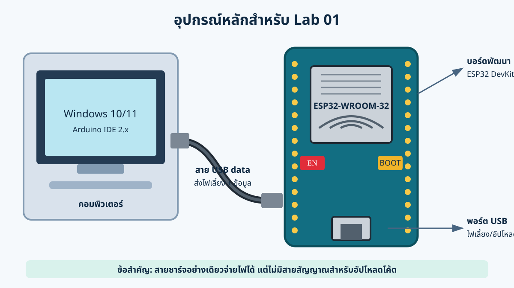

_ภาพ: ผลงานต้นฉบับของโครงการ ดูรายละเอียดใน [`assets/IMAGE_SOURCES.md`](../../assets/IMAGE_SOURCES.md)_

> [!IMPORTANT]
> GPIO ของ ESP32 ใช้ลอจิก 3.3V และไม่รองรับสัญญาณ 5V โดยตรง ห้ามต่อขา 5V ของ sensor เข้าขา GPIO

## ❓ คำถามก่อนเริ่มต้น

<details>
<summary><b>คลิกเพื่อดูคำถามก่อนเรียน</b></summary>

1. อุปกรณ์ใกล้ตัวชิ้นใดบ้างที่น่าจะมี microcontroller อยู่ภายใน?
2. เพราะเหตุใดบอร์ดพัฒนาจึงต้องมีทั้งปุ่ม EN และปุ่ม BOOT?
3. ถ้าสาย USB จ่ายไฟให้บอร์ดได้ เหตุใดสายเส้นนั้นจึงอาจใช้อัปโหลดโปรแกรมไม่ได้?
4. GPIO แบบ input และ output ต่างกันอย่างไร?
5. การทราบหมายเลข COM port ช่วยให้ Arduino IDE สื่อสารกับบอร์ดได้อย่างไร?
6. Wi-Fi และ Bluetooth ที่อยู่ในชิป ESP32 ช่วยลดอุปกรณ์ภายนอกในงาน IoT ได้อย่างไร?

</details>

## 📖 ทฤษฎี

### 1. Microcontroller คืออะไร

Microcontroller คือคอมพิวเตอร์ขนาดเล็กบนชิปเดียว โดยรวม CPU, memory และ peripheral เช่น GPIO, timer, ADC และ serial interface เหมาะกับงานควบคุมที่ทำซ้ำตามโปรแกรม เช่น อ่าน sensor แล้วสั่ง relay

ในตัวอย่างเครื่องรดน้ำ **input** คือค่าจาก sensor, **โปรแกรม** คือกติกาว่าเมื่อใดควรเปิดน้ำ และ **output** คือสัญญาณไปยังวงจรขับปั๊ม ESP32 ไม่รู้กติกาเหล่านี้เอง เราต้องเขียนคำสั่งแล้วบันทึกลง Flash บนบอร์ด เมื่อเสียบไฟครั้งถัดไปบอร์ดจะเริ่มโปรแกรมที่บันทึกไว้ได้ แม้ไม่ได้เปิด Arduino IDE อยู่

| แพลตฟอร์ม | ประเภท | ระบบปฏิบัติการ | การเชื่อมต่อไร้สายในตัว | เหมาะกับ |
|---|---|---|---|---|
| Arduino UNO R3 | บอร์ด microcontroller 8-bit | ไม่มี | ไม่มี | เรียนรู้ I/O พื้นฐาน งานควบคุมไม่ซับซ้อน |
| ESP8266 | Wi-Fi microcontroller | ไม่มี | Wi-Fi 2.4 GHz | IoT ที่ต้องการ Wi-Fi และ GPIO ไม่มาก |
| ESP32 | wireless microcontroller | ไม่มีระบบปฏิบัติการทั่วไป; core ใช้ FreeRTOS ภายใน | Wi-Fi + Bluetooth | IoT, sensor, control และงาน real-time |
| Raspberry Pi | single-board computer | Linux | ขึ้นกับรุ่น | UI, database, server และงานประมวลผลสูง |

Arduino UNO คือชื่อบอร์ดที่ใช้ชิป ATmega328P ส่วน “Arduino” ยังหมายถึง ecosystem ของ IDE, core และ library ได้ด้วย ในคอร์สนี้เราใช้ Arduino IDE เขียนโปรแกรมให้บอร์ด ESP32

### 2. ตระกูลชิปของ Espressif

ตารางนี้เป็นภาพรวมเพื่อช่วยเลือกตระกูล ไม่ใช่รายการย่อยของชิปทุก package ความจุ memory และ feature บางอย่างต่างกันตามรุ่นย่อย จึงควรตรวจ [ESP Product Selector](https://products.espressif.com/en/product-comparison) และ datasheet ก่อนออกแบบผลิตภัณฑ์จริง

| ตระกูล | CPU | Core | Clock สูงสุดโดยทั่วไป | SRAM บนชิปโดยสรุป | Wi-Fi | Bluetooth / 802.15.4 | จุดเด่น |
|---|---|---:|---:|---:|---|---|---|
| ESP8266 | Xtensa L106 | 1 | 160 MHz | ประมาณ 160 KB | Wi-Fi 4, 2.4 GHz | — | Wi-Fi IoT ราคาประหยัด รุ่นก่อน ESP32 |
| ESP32 | Xtensa LX6 | 2 | 240 MHz | 520 KB | Wi-Fi 4, 2.4 GHz | Bluetooth Classic + BLE 4.2 | งานทั่วไป มี ADC, DAC, touch และ peripheral หลากหลาย |
| ESP32-S2 | Xtensa LX7 | 1 | 240 MHz | 320 KB | Wi-Fi 4, 2.4 GHz | — | Native USB และ security; ไม่มี Bluetooth |
| ESP32-S3 | Xtensa LX7 | 2 | 240 MHz | 512 KB | Wi-Fi 4, 2.4 GHz | BLE 5 | Vector instructions, USB เหมาะกับ AIoT/HMI |
| ESP32-C3 | RISC-V | 1 | 160 MHz | 400 KB | Wi-Fi 4, 2.4 GHz | BLE 5 | RISC-V ขนาดเล็ก เหมาะกับอุปกรณ์ IoT ปริมาณมาก |
| ESP32-C6 | RISC-V + LP core | 1 + 1 | 160 MHz | 512 KB | Wi-Fi 6, 2.4 GHz | BLE 5 + IEEE 802.15.4 | รองรับ Thread/Zigbee และ Matter |
| ESP32-H2 | RISC-V + LP core | 1 + 1 | 96 MHz | 320 KB | — | BLE 5 + IEEE 802.15.4 | อุปกรณ์ Thread/Zigbee ที่ไม่ต้องใช้ Wi-Fi |
| ESP32-P4 | RISC-V + LP core | 2 + 1 | 400 MHz | memory หลายระดับ; ตรวจรุ่นย่อย | — | — | งาน HMI/vision ประสิทธิภาพสูง ใช้ radio ภายนอกเมื่อต้องการ |

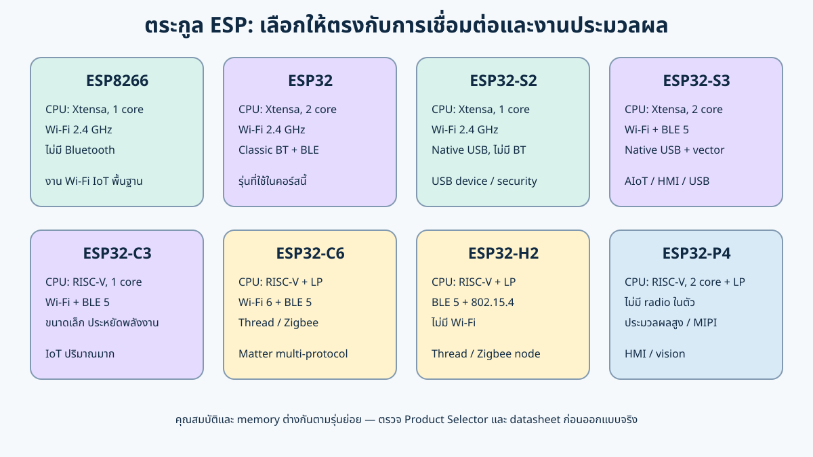

_ภาพ: ผลงานต้นฉบับของโครงการ ใช้สำหรับสรุปแนวทางเลือกตระกูล; ตรวจ datasheet รุ่นย่อยก่อนใช้งานจริง_

> Lab 01–07 ใช้ **ESP32 รุ่นดั้งเดิม (Xtensa LX6)** บนโมดูล ESP32-WROOM-32 ไม่ใช่ S2/S3/C3/C6/H2/P4 ดังนั้น pinout และความสามารถของบอร์ดอื่นใช้แทนกันไม่ได้ทันที

### 3. สถาปัตยกรรม ESP32 รุ่นดั้งเดิม

ESP32 รวม CPU Xtensa LX6 สูงสุด 2 core ที่ 240 MHz, ROM 448 KB, SRAM 520 KB, RTC memory, ULP co-processor, Wi-Fi 802.11 b/g/n และ Bluetooth Classic/BLE ไว้ใน SoC เดียว โปรแกรมเก็บใน SPI Flash ภายนอกที่ติดอยู่บนโมดูล

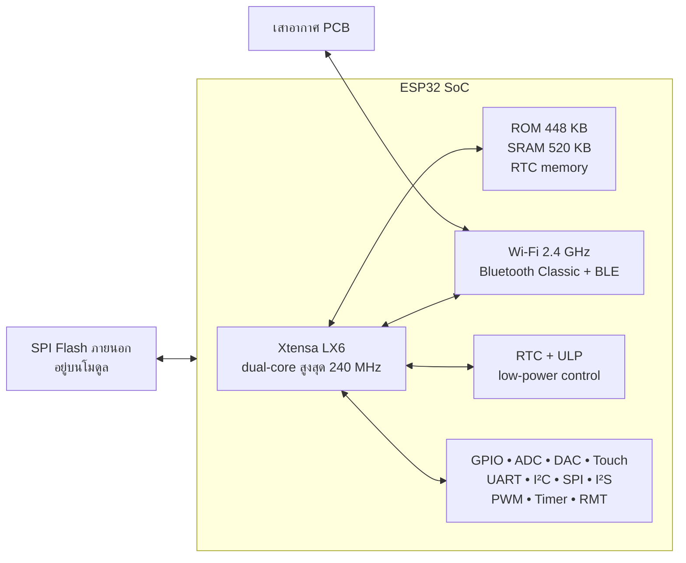

FreeRTOS ทำงานอยู่ภายใน Arduino-ESP32 core และเรียก `setup()` หนึ่งครั้งก่อนเรียก `loop()` ซ้ำ ผู้เริ่มต้นจึงยังใช้โครงสร้าง Arduino แบบเดิมได้โดยไม่ต้องจัดการ task เอง

### 4. ชิป โมดูล และบอร์ดพัฒนาต่างกันอย่างไร

| ระดับ | ตัวอย่าง | ภายในมีอะไร | หน้าที่ |
|---|---|---|---|
| Chip / SoC | ESP32-D0WD | CPU, memory, radio, peripheral | สมองหลักของระบบ |
| Module | ESP32-WROOM-32 | ชิป ESP32, SPI Flash, crystal, เสาอากาศและวงจร RF | ลดความซับซ้อนการออกแบบ RF |
| Development board | ESP32 DevKit V1 | โมดูล WROOM-32, USB-to-Serial, LDO 3.3V, ปุ่ม EN/BOOT และ header pins | เสียบ USB แล้วพัฒนา/ทดลองได้สะดวก |

คำว่า “ESP32 DevKit V1” ถูกใช้กับบอร์ดจากหลายผู้ผลิต จึงพบทั้งแบบ 30 pin และ 38 pin รวมถึงชิป USB-to-Serial ต่างกัน ต้องอ่านชื่อขาที่พิมพ์บนบอร์ดจริงทุกครั้ง

### 5. Pinout ของ ESP32 DevKit V1

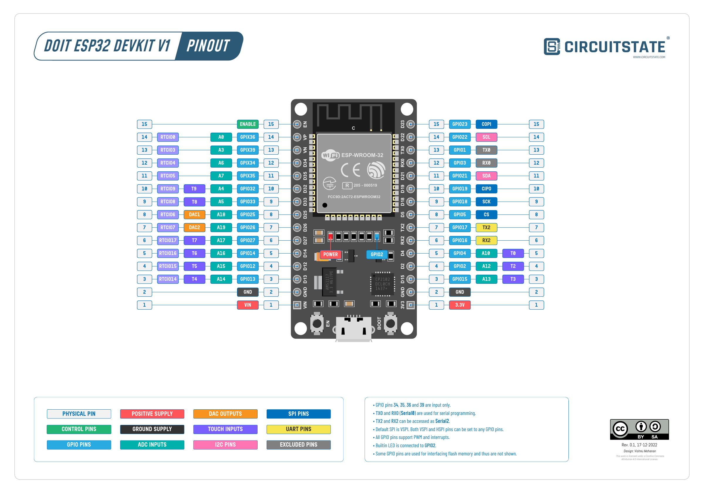

_ภาพ: Vishnu Mohanan / CIRCUITSTATE, [ต้นฉบับ PDF Rev. 0.1](https://www.circuitstate.com/wp-content/uploads/2022/12/ESP32-DevKit-V1-Pinout-r0.1-CIRCUITSTATE-Electronics.pdf), [CC BY 4.0](https://creativecommons.org/licenses/by/4.0/) ตามข้อความใน PDF; แปลงเป็น PNG โดยคงภาพและเครดิตเดิม บอร์ดที่แสดงเป็นแบบ 30 pin ให้เทียบสกรีนบนบอร์ดจริงก่อนต่อสาย_

**ลองชี้บนบอร์ดก่อนอ่านตาราง:** หันพอร์ต USB ลงล่างตามภาพ หาแผ่นโลหะ `ESP-WROOM-32`, เสาอากาศด้านบน, ปุ่ม `EN` และ `BOOT`, จากนั้นหา `3V3`, `GND` และ `VIN` ขอบบอร์ด ตัวเลข GPIO เป็นชื่อช่องสัญญาณของชิป ส่วนเลขลำดับขาในภาพเป็นตำแหน่งบน header จึงไม่ใช่ตัวเลขเดียวกัน

เช่น ถ้าบทต่อไปบอกให้ใช้ **GPIO16** ให้หาตัวอักษร `D16` หรือ `RX2` ที่ตรงกับ GPIO16 ตามผังของบอร์ดนั้น ไม่ใช่นับไปที่ขาที่ 16 GPIO34–39 รับสัญญาณได้อย่างเดียว จึงใช้ขับ LED ไม่ได้ แม้คำอธิบายทั่วไปในภาพจะกล่าวถึง PWM บน GPIO ก็ตาม

| กลุ่มขา | ขาที่สำคัญ | วิธีใช้/ข้อจำกัด |
|---|---|---|
| Digital I/O | GPIO4, 13–19, 21–23, 25–27, 32–33 | GPIO matrix ช่วยกำหนด peripheral ไปยังขาได้ยืดหยุ่น |
| Input only | GPIO34–39 | ใช้รับสัญญาณได้ แต่ขับ LED ไม่ได้ และไม่มี internal pull-up/down |
| ADC1 | GPIO32–39 | เหมาะกับ analog input เมื่อต้องใช้ Wi-Fi |
| ADC2 | GPIO0, 2, 4, 12–15, 25–27 | ADC2 ถูกใช้ร่วมกับ Wi-Fi; หลีกเลี่ยงการอ่าน ADC2 ขณะ Wi-Fi ทำงาน |
| DAC | GPIO25, GPIO26 | analog output 8-bit เฉพาะ ESP32 รุ่นดั้งเดิม |
| Touch | GPIO0, 2, 4, 12–15, 27, 32–33 | capacitive touch; บางขาเป็น strapping pin ด้วย |
| UART0 | GPIO1 (TX0), GPIO3 (RX0) | เชื่อม USB-to-Serial; ระวังอุปกรณ์ภายนอกรบกวนการอัปโหลด |
| I²C ของคอร์ส | GPIO21 (SDA), GPIO22 (SCL) | Arduino กำหนดขาอื่นได้ แต่คอร์สใช้คู่นี้ร่วมกันทุก Lab |
| SPI Flash | GPIO6–11 | โดยทั่วไปต่อกับ Flash บนโมดูล ห้ามนำมาใช้งานทั่วไป |
| Strapping | GPIO0, 2, 5, 12, 15 | ระดับลอจิกตอน reset มีผลต่อ boot configuration |

PWM ไม่ผูกกับขาเฉพาะ: output-capable GPIO ส่วนใหญ่ใช้ LEDC PWM ได้ ส่วน ADC ของ ESP32 รุ่นดั้งเดิมมีความไม่เป็นเชิงเส้นและควร calibrate เมื่อวัดค่าอย่างจริงจัง

### 6. ระบบไฟและปุ่มบนบอร์ด

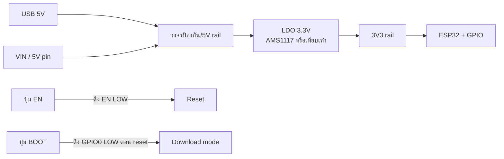

- USB หรือขา VIN/5V ป้อนไฟเข้า 5V rail แล้ว LDO ลดเป็น 3.3V ให้ชิป
- ขา 3V3 ใช้ไฟ 3.3V ที่ผ่าน regulator แล้ว ห้ามป้อน 5V เข้าขานี้
- อย่าออกแบบให้ GPIO source/sink กระแสเกิน 20 mA ต่อขา; ค่า 40 mA เป็นขีดบนที่ไม่ควรใช้เป็นกระแสทำงานปกติ
- Wi-Fi ทำให้กระแสพุ่งเป็นช่วง ๆ สาย USB คุณภาพต่ำหรือแหล่งจ่ายไม่พออาจทำให้เกิด brownout/reset
- ปุ่ม **EN** ใช้ reset ส่วนปุ่ม **BOOT** บังคับ GPIO0 ต่ำเพื่อเข้า download mode เมื่อวงจร auto-reset ทำงานไม่สำเร็จ

## 🔌 การต่อวงจร

Lab นี้ไม่ต้องต่อ sensor หรือ breadboard ให้เสียบบอร์ดเข้าคอมพิวเตอร์ด้วย **สาย USB data** เท่านั้น

| จุดเชื่อมต่อ | เชื่อมไปยัง | หน้าที่ |
|---|---|---|
| พอร์ต USB บน ESP32 | USB ของคอมพิวเตอร์ | จ่ายไฟ 5V, อัปโหลดโปรแกรม และรับส่ง Serial |
| USB-to-Serial บนบอร์ด | UART0 ของ ESP32 | แปลง USB เป็นสัญญาณ TX/RX 3.3V |
| ปุ่ม EN | EN/CHIP_PU | reset ชิป |
| ปุ่ม BOOT | GPIO0 | เข้า download mode เมื่อกดค้างระหว่าง reset |

ก่อนเสียบ ให้ตรวจว่าไม่มีสายหรือโลหะลัดวงจรระหว่าง `3V3`, `5V/VIN` และ `GND` และวางบอร์ดบนพื้นผิวที่ไม่นำไฟฟ้า

## 🧪 การทดลอง

### การทดลองที่ 1.1: จาก sketch ว่างสู่การอ่านข้อมูลชิป

เป้าหมายของการทดลองคือให้เห็นข้อความที่ **บอร์ดเป็นผู้ส่ง** กลับมายังคอมพิวเตอร์ ก่อนเริ่มแยกหน้าที่ของเครื่องมือสามชิ้นให้ได้: **IDE** คือโปรแกรมเขียน/สั่ง build, **core** คือชุดเครื่องมือสำหรับชิป ESP32 และ **driver** ทำให้ Windows มองเห็น USB-to-Serial เป็น COM port ทั้งสามอย่างทำหน้าที่ต่างกัน

#### ขั้นตอน A — ดาวน์โหลดและติดตั้ง Arduino IDE บน Windows

1. เปิด [หน้าดาวน์โหลด Arduino IDE อย่างเป็นทางการ](https://www.arduino.cc/en/software) เลือก **Arduino IDE 2.x สำหรับ Windows 64-bit** แบบ Installer (`.exe`) ให้ตรงกับระบบปฏิบัติการ ไม่เลือก Nightly build สำหรับแล็บนี้
2. เมื่อดาวน์โหลดเสร็จ เปิดโฟลเดอร์ Downloads และตรวจชื่อไฟล์ เช่น `arduino-ide_2.x.x_Windows_64bit.exe` หมายเลขรุ่นย่อยอาจต่างกัน
3. เปิด Installer อ่านเงื่อนไขแล้วเลือก **I Agree** จากนั้นเลือกติดตั้งเฉพาะผู้ใช้ปัจจุบันหรือทุกคนตามสิทธิ์ของเครื่อง เครื่องห้องเรียนที่ไม่มีสิทธิ์ติดตั้งให้ผู้ดูแลดำเนินการ
4. ใช้โฟลเดอร์ติดตั้งค่าเริ่มต้น กด **Install** รอจนเสร็จ แล้วเลือก **Run Arduino IDE → Finish** ชื่อปุ่มบางรุ่นอาจต่างเล็กน้อย แต่ลำดับหลักคือยอมรับเงื่อนไข → เลือกที่ติดตั้ง → ติดตั้ง → เปิดโปรแกรม
5. เปิด IDE จาก Start menu หากไม่ได้เปิดอัตโนมัติ รอการเตรียมเครื่องมือครั้งแรกให้เสร็จ ซึ่งอาจต้องใช้อินเทอร์เน็ต
6. ถ้ามี IDE 2.x ติดตั้งแล้ว ให้เปิด **Help → About Arduino IDE** ตรวจรุ่น แล้วเรียนต่อได้โดยไม่ต้องติดตั้งทับ

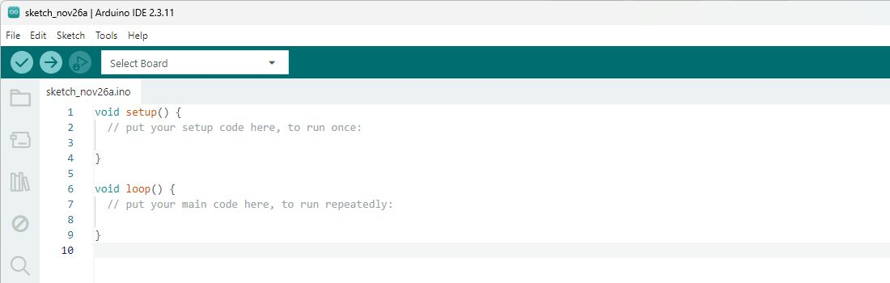

_ภาพหน้าจอจริงจาก Arduino IDE 2.3.11 บน Windows ตัดเฉพาะแถบเครื่องมือและโค้ดเริ่มต้น; ดู [คู่มือติดตั้งจาก Arduino](https://docs.arduino.cc/software/ide-v2/tutorials/getting-started/ide-v2-downloading-and-installing/) ประกอบได้_

ลองระบุตำแหน่งบนหน้าจอ: ปุ่ม **✓ Verify** ใช้แปลงและตรวจโค้ด, ปุ่ม **→ Upload** ใช้ส่งโปรแกรมลงบอร์ด, ช่อง **Select Board** ใช้เลือกชนิดบอร์ด/Port, พื้นที่ตรงกลางใช้เขียน sketch และแท็บ **Output** ด้านล่างแสดงข้อความจากเครื่องมือ build/upload

**จุดตรวจ A:** เปิด IDE และเห็น `void setup()` กับ `void loop()` ได้แล้ว ยังไม่ต้องลบหรือวางโค้ดเต็ม

#### ขั้นตอน B — เสียบ ESP32 และตรวจ COM port

1. วางบอร์ดบนพื้นผิวไม่นำไฟฟ้า สำรวจพอร์ต USB และปุ่ม EN/BOOT ตามภาพ pinout ข้างต้น บทนี้ใช้เพียงบอร์ดกับสาย USB ไม่ต้องต่อสาย GPIO
2. เปิด **Device Manager** โดยคลิกขวาปุ่ม Start → **Device Manager** หรือค้นชื่อนี้จากช่อง Search ของ Windows แล้วเปิดรายการ **Ports (COM & LPT)** ด้วยลูกศรด้านซ้าย
3. สังเกตรายการก่อนเสียบบอร์ด จากนั้นใช้ **สาย USB data** เสียบ ESP32 เข้าคอมพิวเตอร์ รอ Windows ตรวจอุปกรณ์ หากใช้สายชาร์จอย่างเดียว ไฟ Power อาจติดแต่จะไม่มี Port ใหม่
4. ดูชื่อที่เพิ่มขึ้นใต้ Ports เช่น `Silicon Labs CP210x USB to UART Bridge (COM5)` หรือ `USB-SERIAL CH340 (COM7)` จดทั้งชื่อและหมายเลขในวงเล็บ
5. ถ้าไม่แน่ใจว่าอันใดเป็นบอร์ดของเรา ให้ถอด USB สังเกตรายการที่หาย แล้วเสียบกลับ รายการที่กลับมาคือ Port ที่ต้องเลือกใน IDE หมายเลขอาจเปลี่ยนเมื่อเปลี่ยนช่อง USB/เครื่อง

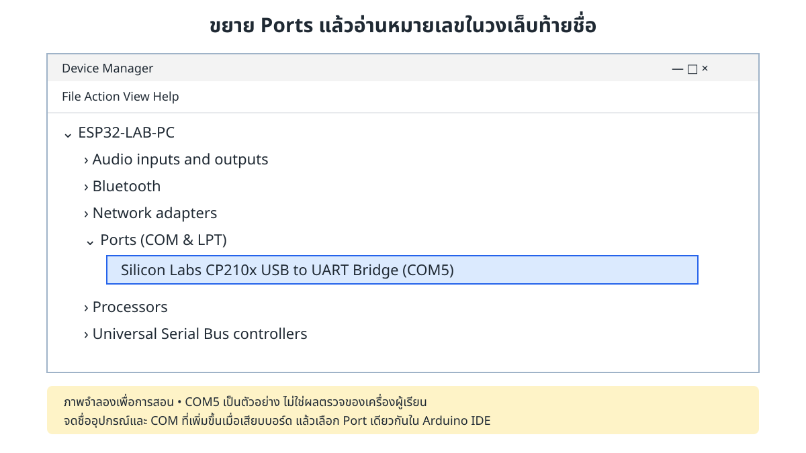

_ภาพประกอบจำลองหน้าต่าง Windows โดยโครงการ ไม่ใช่ผลตรวจจากบอร์ดจริง; COM5 เป็นตัวอย่าง ให้ใช้หมายเลขที่เครื่องของผู้เรียนแสดง_

ถ้าไม่มีรายการ **Ports** หรือมีเครื่องหมายตกใจใต้ **Other devices** ให้ลองสาย data และ USB ช่องอื่นก่อน จากนั้นตรวจชื่อชิป USB-to-Serial บนบอร์ดและดาวน์โหลด driver ให้ตรงรุ่น: [CP210x จาก Silicon Labs](https://www.silabs.com/software-and-tools/usb-to-uart-bridge-vcp-drivers) หรือ [CH340/CH341 จาก WCH](https://www.wch-ic.com/downloads/CH341SER_EXE.html) เปิดแพ็กเกจ ติดตั้งตามคู่มือผู้ผลิต แล้วถอด/เสียบใหม่ การลง core ใน IDE ไม่ได้ทดแทน driver ของ Windows

**จุดตรวจ B:** เขียนบันทึกของตนเอง `ชื่ออุปกรณ์ __________ / Port COM____` และเห็นรายการหาย/กลับมาตามการถอด/เสียบจริง

#### ขั้นตอน C — บอก IDE ว่าจะเขียนโปรแกรมให้ ESP32

1. ใน Arduino IDE เปิด **File → Preferences** หรือกด **Ctrl+,**
2. หา **Additional boards manager URLs** ด้านล่าง ช่องนี้เป็นที่อยู่รายการแพ็กเกจ ไม่ใช่ช่องพิมพ์โค้ด

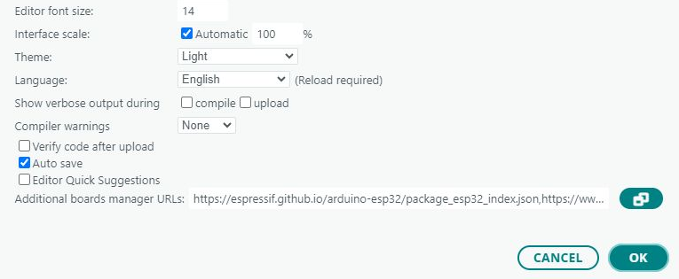

_ภาพหน้าจอจริง Arduino IDE 2.3.11 ตัดเฉพาะส่วนตั้งค่าและปุ่มยืนยัน_

3. กดปุ่มรูปหน้าต่างซ้อนทางขวาของช่อง URL เพื่อเปิดตัวแก้ไขหลายบรรทัด คัดลอก URL นี้ไปวาง **หนึ่งบรรทัด** หากมี URL ของบอร์ดอื่นอยู่แล้วให้เก็บไว้แล้วขึ้นบรรทัดใหม่

```text
https://espressif.github.io/arduino-esp32/package_esp32_index.json
```

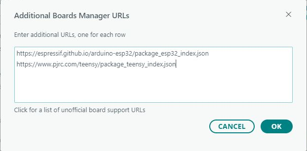

_ภาพหน้าจอจริง: URL ของ ESP32 อยู่บรรทัดแรก บรรทัดอื่นในภาพเป็นแพ็กเกจที่มีอยู่ก่อน ไม่จำเป็นต้องเพิ่มตาม_

4. ตรวจว่า URL ไม่มีช่องว่างคั่นกลาง แล้วกด **OK** ในหน้าต่าง URL และ **OK** ใน Preferences
5. เปิด **Tools → Board → Boards Manager** หรือคลิกไอคอนรูปบอร์ดที่แถบด้านซ้าย พิมพ์ `esp32` ในช่องค้นหา
6. เลือกรายการ **esp32 by Espressif Systems** ตรวจชื่อผู้พัฒนาให้ตรง เลือก Stable รุ่น **3.x** แล้วกด **Install** รอจนขึ้นว่าติดตั้งแล้ว/มีปุ่ม Remove อย่าปิด IDE ระหว่างดาวน์โหลด

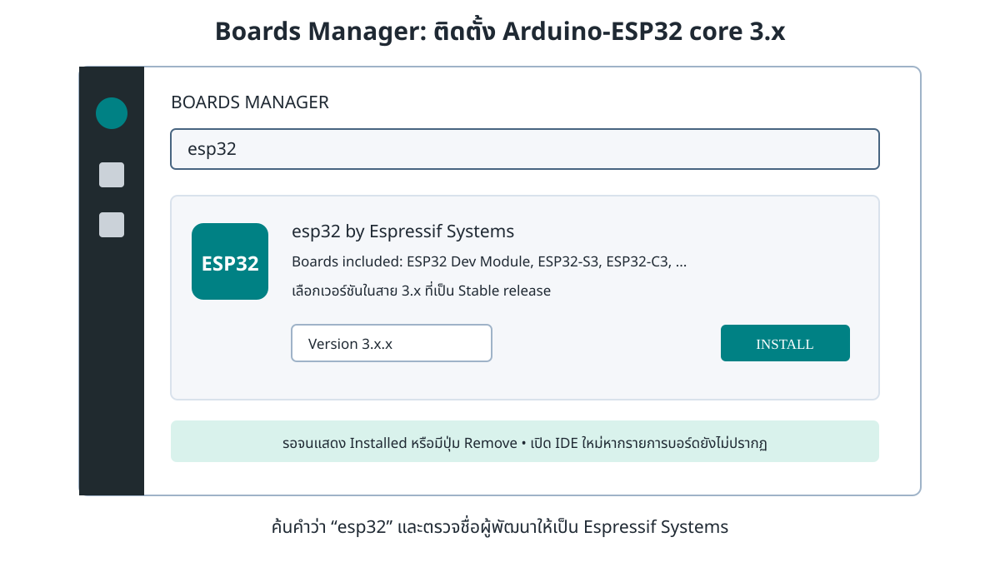

_ภาพประกอบจำลองตำแหน่งค้นหา เลือกรุ่น และ Install; หมายเลขรุ่นย่อยเปลี่ยนตาม release_

7. หากติดตั้งแล้วแต่ยังไม่พบรายการบอร์ด ให้ปิดแล้วเปิด IDE ใหม่ แล้วเปิดเมนู Board อีกครั้ง

ทำไมต้องลง core? โค้ด C++ ที่พิมพ์ยังไม่ใช่คำสั่งเครื่องที่ ESP32 รันได้ Core จัดเตรียม compiler, นิยามบอร์ด และ API เช่น `Serial`/`ESP` ให้ IDE แปลงโค้ดได้ถูกชิป รายละเอียดการติดตั้งอ้างอิง [เอกสาร Arduino-ESP32 ของ Espressif](https://docs.espressif.com/projects/arduino-esp32/en/latest/installing.html)

**จุดตรวจ C:** Boards Manager แสดง `esp32` ของ Espressif Systems รุ่น 3.x ว่าติดตั้งแล้ว

#### ขั้นตอน D — เลือก Board และ Port ให้ทำหน้าที่ตรงกัน

1. เปิด **Tools → Board → esp32 → ESP32 Dev Module** สำหรับ ESP32-WROOM-32 ในแล็บนี้
2. เลือก **Tools → Port → COMx** ให้ตรงกับที่จดจาก Device Manager ไม่ใช้ COM5 ตามภาพถ้าเครื่องของเราแสดงค่าอื่น
3. ตั้ง **Upload Speed = 921600** ถ้าอัปโหลดไม่เสถียรให้ลดเป็น **115200** ตัวเลขนี้เป็นความเร็วตอนส่ง firmware ซึ่งตั้งแยกจาก baud ของ Serial Monitor
4. สำหรับบอร์ด Flash 4MB ใช้ **Flash Size = 4MB** และ **Partition Scheme = Default** ของบอร์ดนั้น ตรวจขนาดจริงอีกครั้งจากผลโปรแกรม ถ้าบอร์ดคนละความจุให้เลือกตาม hardware
5. ค่าอื่นใช้ default ของ `ESP32 Dev Module` แล้วตรวจแถบสถานะว่ามีทั้งชื่อ Board และ COM

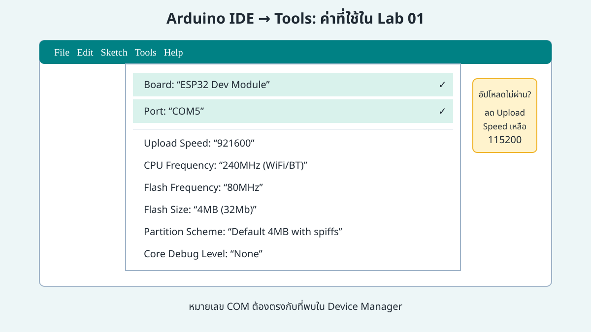

_ภาพประกอบจำลอง: ชื่อเมนู/Partition Scheme อาจต่างเล็กน้อยตาม core รุ่นย่อย_

**Board คือ “สร้างโปรแกรมสำหรับชิปใด” ส่วน Port คือ “ส่งไปที่สายเชื่อมต่อใด”** เลือก Board ถูกแต่ Port ผิดจะ build ได้แต่ส่งลงบอร์ดไม่ได้ เลือก Port ถูกแต่ Board คนละตระกูลอาจ build หรือ upload ผิดเป้าหมาย

#### ขั้นตอน E — เข้าใจโค้ดที่ IDE ใส่มาให้ก่อน

1. เลือก **File → New Sketch** เพื่อเริ่มหน้าว่าง แล้ว **File → Save As…** ตั้งชื่อ `lab01_chip_info` ไฟล์จะอยู่ในโฟลเดอร์ชื่อเดียวกัน
2. อ่านโครงเริ่มต้นด้านล่าง คำอธิบายหลัง `//` อาจเป็นภาษาอังกฤษใน IDE แต่ไม่ใช่คำสั่งที่บอร์ดจะรัน

```cpp
void setup() {
  // เตรียมงานครั้งเดียวหลังเปิดไฟหรือ reset
}

void loop() {
  // งานที่ให้ทำซ้ำหลัง setup จบ
}
```

| ส่วนของโค้ด | หน้าที่ |
|---|---|
| `void` | ฟังก์ชันนี้ไม่ส่งค่าผลลัพธ์กลับให้ผู้เรียก |
| `setup()` | ฟังก์ชันที่ Arduino core เรียกหนึ่งครั้งต่อการเริ่มโปรแกรม |
| `loop()` | ฟังก์ชันที่ core เรียกซ้ำต่อเนื่องหลัง `setup()` จบ |
| `()` | วงเล็บรับพารามิเตอร์; ในสองฟังก์ชันนี้ไม่ต้องรับข้อมูล |
| `{` และ `}` | ขอบเขตของชุดคำสั่งในฟังก์ชัน ต้องมีเปิดและปิดคู่กัน |
| `// ...` | comment ถึงท้ายบรรทัด ใช้บันทึกคำอธิบาย ไม่ถูกรัน |

ผลลัพธ์ Serial Monitor ของโครงว่าง:

```text
(ยังไม่มีข้อความจาก sketch เพราะยังไม่ได้สั่งพิมพ์)
```

เปรียบ `setup()` เป็นการจัดโต๊ะก่อนเริ่มงาน และ `loop()` เป็นงานประจำที่ทำรอบแล้วรอบเล่า เมื่อกด EN โปรแกรมเริ่มใหม่และกลับมาทำ `setup()` อีกครั้ง การปิด/เปิด Serial Monitor อย่างเดียวไม่ใช่คำสั่งในโค้ดให้ย้อนกลับไปทำ `setup()`

#### ขั้นตอน F — ให้บอร์ดพูดคำแรก แล้วทดสอบด้วยตัวเอง

1. แทนโครงว่างด้วยโค้ดสั้นนี้ใน sketch เดิม แล้วกด **✓ Verify** เพื่อเช็กวงเล็บ เครื่องหมาย `;` และชนิดบอร์ด
2. เมื่อ Verify สำเร็จ กด **→ Upload** รอข้อความจบการเขียน Flash และ reset ข้อความท้ายอาจเป็น `Hard resetting via RTS pin...` หรือข้อความใกล้เคียงตาม tool version
3. เปิด **Tools → Serial Monitor** หรือไอคอนมุมขวาบน ตั้ง **115200 baud** แล้วกด **EN** ที่บอร์ดหนึ่งครั้ง

```cpp
void setup() {
  Serial.begin(115200);
  delay(1000);
  Serial.println("[HELLO] Hello ESP32");
}

void loop() {
  delay(1000);
}
```

| ส่วนของโค้ด | หน้าที่ |
|---|---|
| `Serial.begin(115200);` | เริ่ม UART Serial ด้วยอัตรา 115200 bit/s; ตั้ง Monitor ให้ตรงกัน |
| `delay(1000);` | พักประมาณ 1000 ms หรือ 1 วินาที ช่วยเผื่อเวลาเปิด Monitor แต่ไม่ได้ตรวจว่า Monitor พร้อมจริง |
| `Serial.println("...");` | ส่งข้อความในเครื่องหมายคำพูดแล้วขึ้นบรรทัดใหม่ |
| `;` | จบคำสั่งในบรรทัด เช่น การเรียก `begin()` และ `println()` |
| `delay()` ใน `loop()` | พักในแต่ละรอบ ไม่มีคำสั่งพิมพ์ซ้ำใน loop นี้ |

ผลลัพธ์ที่คาดหวังหลัง EN แต่ละครั้ง:

```text
[HELLO] Hello ESP32
```

ข้อความนี้ออกจาก ESP32 ผ่าน UART → USB-to-Serial → สาย USB → Serial Monitor ถ้าเห็นข้อความได้ทั้ง compile, upload และช่องทางรับข้อมูลของเราทำงานครบแล้ว ข้อความ boot บางบรรทัดอาจมาก่อนข้อความ HELLO

4. ทดลองย้าย `Serial.println("[HELLO] Hello ESP32");` จาก `setup()` มาไว้ใน `loop()` ก่อน `delay(1000);` แล้ว upload ใหม่ จะเห็นข้อความซ้ำประมาณทุกวินาที จากนั้นย้ายกลับเพื่อเตรียมอ่านข้อมูลชิปครั้งเดียว
5. ถ้าค้าง `Connecting...` ให้กด BOOT ค้างระหว่างรอเชื่อมต่อ ปล่อยเมื่อเริ่มเขียน Flash; หากยังไม่เข้า ให้ถือ BOOT กด/ปล่อย EN แล้วปล่อย BOOT เมื่อเริ่มส่งข้อมูล

**จุดตรวจ F:** อธิบายได้ว่าเหตุใดข้อความพิมพ์ครั้งเดียว และทำนายได้ว่าการย้ายบรรทัดเข้า `loop()` จะเปลี่ยนผลอย่างไร

#### ขั้นตอน G — Preprocessor และ `#include` เตรียมอะไรให้เรา

เพิ่มสองบรรทัดนี้ที่ **บนสุดของไฟล์ ก่อนฟังก์ชันทั้งหมด** ยังเก็บโค้ด HELLO ไว้ด้านล่างได้

```cpp
#include <Arduino.h>
#include <esp_mac.h>
```

| ส่วนของโค้ด | หน้าที่ |
|---|---|
| `#` | เริ่ม preprocessor directive ซึ่งประมวลผลก่อนการ compile C++ |
| `#include <Arduino.h>` | นำ declaration/type ที่ใช้กับ Arduino API เช่น `Serial` และ `delay()` มาให้ compiler รู้จัก |
| `#include <esp_mac.h>` | ประกาศ API อ่าน MAC และค่าคงที่ที่เราจะใช้ในขั้นต่อไป |
| `<...>` และ `.h` | ระบุ header จากเส้นทาง include ของเครื่องมือ; ไม่ใช่คำสั่งให้ดาวน์โหลดไลบรารี |

ไฟล์ `.ino` ผ่านขั้นเตรียมของ Arduino ซึ่งโดยทั่วไปเพิ่ม `Arduino.h` ให้อัตโนมัติ จึงเขียน HELLO ก่อนหน้าได้โดยไม่ใส่ include เอง บทนี้เขียนให้เห็นชัดเพื่อเข้าใจที่มาของ API ส่วน `esp_mac.h` มีมากับ ESP32 core ไม่ต้องค้นติดตั้งจาก Library Manager

Directive ทั้งสองไม่มี `;` ต่อท้าย และไม่ได้ทำงานซ้ำใน `loop()` Header บอก compiler ว่าเรียกอะไรได้ ส่วนโค้ดที่นำมารวมจริงจะผ่านการ compile/link ตามระบบ build

ผลที่คาดหวังหลัง Verify/Upload: ยังได้ข้อความเดิม เพราะการเพิ่ม header ยังไม่สั่งพิมพ์ข้อมูลใหม่

```text
[HELLO] Hello ESP32
```

#### ขั้นตอน H — อ่านหนึ่งค่า เก็บในตัวแปร แล้วค่อยพิมพ์

1. ภายใน `setup()` หลัง `delay(1000);` เปลี่ยนบรรทัด HELLO เป็นสองบรรทัดด้านล่าง

```cpp
  const unsigned int revision = static_cast<unsigned int>(ESP.getChipRevision());
  Serial.printf("[CHIP] Revision : %u\n", revision);
```

| ส่วนของโค้ด | หน้าที่ |
|---|---|
| `ESP.getChipRevision()` | เรียกฟังก์ชันของ object `ESP` แล้วรับหมายเลข revision ของชิป |
| `unsigned int` | ชนิดจำนวนเต็มไม่ติดลบ เหมาะกับเลข revision |
| `revision` | ชื่อกล่องเก็บค่า อ่านชื่อนี้แทนการเรียก API ซ้ำได้ |
| `=` | ให้ตัวแปรรับค่าจากด้านขวา ณ ตอนประกาศ ไม่ใช่เครื่องหมายเปรียบเทียบ |
| `const` | ไม่ให้แก้ค่าตัวแปรนี้ภายหลังในโค้ด |
| `static_cast<unsigned int>(...)` | แปลงชนิดผลลัพธ์ให้ตรงชนิดที่ `%u` คาดหวังอย่างชัดเจน |
| `printf(..., revision)` | ใช้ format string ก่อน comma แล้วนำค่าหลัง comma มาแทนช่อง `%u` |
| `\n` | อักขระขึ้นบรรทัดใหม่; `printf()` ไม่เติมให้เองเหมือน `println()` |

ตัวแปรที่ประกาศใน `{ ... }` ของ `setup()` เป็น **local variable** ใช้ได้ภายในขอบเขตนั้น ไม่ใช่ชื่อตัวแปรที่เรียกจาก `loop()` ได้เสมอ การประกาศต้องมีชนิดและชื่อก่อนนำไปใช้ จึงห้ามสลับสองบรรทัดนี้

ผลลัพธ์ตัวอย่าง (ตัวเลขขึ้นกับชิป):

```text
[CHIP] Revision : 3
```

2. เพิ่มข้อมูลอื่นทีละรายการจากตารางนี้ กด Verify หลังเพิ่มแต่ละกลุ่มเพื่อหาจุดพิมพ์ผิดได้ง่าย ในฉบับเต็มจะส่งค่าที่อ่านเข้า `printf()` โดยตรงแทนการตั้งตัวแปรสำหรับทุกค่า ทั้งสองวิธีมีจุดประสงค์เดียวกัน

| ข้อมูล/API | ความหมายและสิ่งที่ต้องสังเกต |
|---|---|
| `ESP.getChipModel()` | ข้อความชื่อรุ่นชิป ใช้ `%s` ไม่ใช่ `%u` |
| `ESP.getChipCores()` | จำนวน CPU core ของชิป ไม่ใช่จำนวนโปรแกรมที่เปิดใน IDE |
| `ESP.getCpuFreqMHz()` | ความถี่ CPU ปัจจุบัน หน่วย MHz ไม่ใช่ความเร็ว Serial |
| `ESP.getFlashChipSize()` | ขนาด Flash เป็น byte จึงต้องแปลงหน่วยก่อนพิมพ์ MB |
| `ESP.getFreeHeap()` | RAM heap ที่ว่างขณะอ่าน ไม่ใช่ขนาด RAM ทั้งหมด และเปลี่ยนตามโปรแกรมได้ |

สูตร `bytes / (1024UL * 1024UL)` แปลงหน่วยฐานสองเป็น MiB ซึ่งใน API/เมนูบอร์ดมักแสดงสั้นว่า MB ตัวอักษร `UL` ให้เลขเป็น `unsigned long` และฉบับเต็ม cast ค่าให้ตรง `%lu` การจับคู่ format กับชนิดข้อมูลช่วยหลีกเลี่ยงค่าพิมพ์ผิดและ compiler warning

#### ขั้นตอน I — แยกงานอ่าน MAC เป็นฟังก์ชันย่อย

MAC address มี 6 byte แต่ละ byte แสดงเป็นเลขฐานสิบหก 2 หลัก เช่น `02:12:34:56:78:9A` ครั้งนี้เราอ่าน MAC ของ Wi-Fi station โดยไม่ต้องเชื่อม Wi-Fi โค้ดส่วนนี้ซับซ้อนขึ้น จึงแยกหน้าที่ออกจาก `setup()` เป็น `printMacAddress()`

1. ดูฟังก์ชัน `printMacAddress()` ในฉบับเต็มถัดไป แล้ววางทั้งฟังก์ชัน **หลัง include แต่ก่อน `setup()`**
2. ภายใน `setup()` เรียก `printMacAddress();` ที่ตำแหน่งต้องการแสดง MAC คำว่า “ประกาศฟังก์ชัน” กับ “เรียกใช้ฟังก์ชัน” ต่างกัน: การมีบล็อกฟังก์ชันเฉย ๆ ยังไม่ทำให้งานในนั้นถูกรัน
3. อ่านกลไกทีละส่วนจากตารางแล้วเทียบกับโค้ดฉบับเต็ม

| ส่วนของโค้ด | หน้าที่ |
|---|---|
| `void printMacAddress()` | ฟังก์ชันไม่มีค่าคืนและไม่รับพารามิเตอร์; หน้าที่คืออ่านแล้วพิมพ์ MAC |
| `uint8_t baseMac[6] = {0};` | array ของจำนวนเต็ม 8-bit ไม่ติดลบ 6 ช่อง; เริ่มต้นเป็นศูนย์ทุกช่อง |
| `baseMac[0]` ถึง `[5]` | ตำแหน่งสมาชิก array เริ่มนับจากศูนย์ ไม่ใช่ 1–6 |
| `esp_read_mac(baseMac, ESP_MAC_WIFI_STA)` | ให้ API เขียน MAC station ลง array และคืนรหัสผลสำเร็จ/ล้มเหลว |
| `const esp_err_t result` | เก็บรหัสสถานะที่คืนมา เพื่อเช็กก่อนใช้ข้อมูล |
| `if (result != ESP_OK)` | ถ้าผลไม่เท่ารหัสสำเร็จ ให้ทำบล็อก error; `!=` คือ “ไม่เท่ากับ” |
| `return;` | จบฟังก์ชันนี้ก่อนถึงคำสั่งพิมพ์ MAC; ผู้เรียกใน setup ทำงานต่อได้ |
| `%02X` | แสดง unsigned integer เป็นเลขฐานสิบหกตัวใหญ่ กว้างอย่างน้อย 2 หลัก เติม 0 ด้านหน้า |

ผลลัพธ์ที่คาดหวังเมื่อ API สำเร็จ:

```text
[CHIP] Wi-Fi STA MAC    : 02:12:34:56:78:9A
```

ตัวอย่าง MAC เป็นค่าที่แต่งขึ้นสำหรับสอน ไม่ต้องคัดลอกให้เหมือนกัน เมื่อมี 6 ช่อง `%02X` จึงต้องส่งค่าหลัง format ให้ครบ 6 ค่าและตามลำดับ เหตุผลที่ตรวจ error ก่อนพิมพ์คือไม่ควรแสดงค่าศูนย์เริ่มต้นว่าเป็นข้อมูลที่อ่านสำเร็จ

#### ขั้นตอน J — รวมเป็นโปรแกรมฉบับสมบูรณ์

1. เทียบ sketch ที่ต่อเติมมาตามขั้น E–I กับฉบับเต็มด้านล่าง ให้มี `setup()` และ `loop()` อย่างละหนึ่งฟังก์ชัน ไม่วางหลายโปรแกรมซ้อนกัน
2. จัดลำดับไฟล์เป็น **comment ส่วนหัว → include → ฟังก์ชันย่อย → setup → loop** ตัวอย่างก่อนหน้านี้จึงเป็นช่วงเรียนรู้ ไม่ใช่ไฟล์ `.ino` ที่ต้องเพิ่มหลายไฟล์
3. กด Verify แล้ว Upload เปิด Serial Monitor ที่ 115200 baud และกด EN เพื่อเริ่มพิมพ์รายงานใหม่

#### โค้ดฉบับสมบูรณ์ — ไฟล์เดียวของ Lab 01

ไฟล์: [`lab01_chip_info.ino`](code/lab01_chip_info/lab01_chip_info.ino)

```cpp
/*
 * Lab 01.1 : อ่านข้อมูลบอร์ด ESP32
 * คำอธิบาย : แสดงรุ่นชิป revision จำนวน core ความถี่ CPU ขนาด Flash
 *             MAC address ของ Wi-Fi station และ heap ที่ยังว่าง
 * วงจร     : ESP32 DevKit V1 ต่อคอมพิวเตอร์ด้วยสาย USB data
 * ไลบรารี  : ไม่ใช้ไลบรารีภายนอก (ใช้ Arduino-ESP32 core 3.x)
 * Board    : ESP32 Dev Module (core 3.x)
 */

#include <Arduino.h>
#include <esp_mac.h>

// อ่านและพิมพ์ MAC address ของ Wi-Fi station โดยไม่ต้องเชื่อมเครือข่าย
void printMacAddress() {
  uint8_t baseMac[6] = {0};
  const esp_err_t result = esp_read_mac(baseMac, ESP_MAC_WIFI_STA);

  if (result != ESP_OK) {
    Serial.println("[CHIP] อ่าน MAC address ไม่สำเร็จ");
    return;
  }

  Serial.printf(
      "[CHIP] Wi-Fi STA MAC    : %02X:%02X:%02X:%02X:%02X:%02X\n",
      baseMac[0], baseMac[1], baseMac[2],
      baseMac[3], baseMac[4], baseMac[5]);
}

void setup() {
  // เริ่ม Serial แล้วเผื่อเวลาเปิด Monitor 1 วินาที (ไม่ได้ตรวจว่า Monitor พร้อม)
  Serial.begin(115200);
  delay(1000);

  Serial.println();
  Serial.println("=== ESP32 Chip Information ===");

  // อ่านข้อมูลจาก Arduino-ESP32 core และพิมพ์ด้วยหน่วยที่เข้าใจง่าย
  Serial.printf("[CHIP] Model            : %s\n", ESP.getChipModel());
  Serial.printf("[CHIP] Revision         : %u\n",
                static_cast<unsigned int>(ESP.getChipRevision()));
  Serial.printf("[CHIP] CPU cores        : %u\n",
                static_cast<unsigned int>(ESP.getChipCores()));
  Serial.printf("[CHIP] CPU frequency    : %lu MHz\n",
                static_cast<unsigned long>(ESP.getCpuFreqMHz()));
  Serial.printf("[CHIP] Flash size       : %lu MB\n",
                static_cast<unsigned long>(
                    ESP.getFlashChipSize() / (1024UL * 1024UL)));
  printMacAddress();
  Serial.printf("[CHIP] Free heap        : %lu bytes\n",
                static_cast<unsigned long>(ESP.getFreeHeap()));

  Serial.println("=== Ready ===");
}

void loop() {
  // แล็บนี้อ่านข้อมูลเพียงครั้งเดียว จึงไม่มีงานที่ต้องทำซ้ำ
  delay(1000);
}
```

#### ทบทวนหน้าที่ของโค้ดฉบับเต็ม

| ส่วนของโค้ด | หน้าที่ |
|---|---|
| `#include <Arduino.h>` | เตรียม Arduino API เช่น `Serial`, `delay()` และ object `ESP` |
| `#include <esp_mac.h>` | เตรียม API `esp_read_mac()` และชนิด/ค่าคงที่สำหรับอ่าน MAC ของ Wi-Fi station |
| `printMacAddress()` | อ่าน byte ทั้ง 6 แล้วจัดรูปแบบเป็น `XX:XX:XX:XX:XX:XX` |
| `Serial.begin(115200)` | เปิด UART0 ที่ 115200 bit/s; Serial Monitor ต้องตั้งให้ตรงกัน |
| `ESP.getChipModel()` / `getChipRevision()` | อ่านชื่อรุ่นและ revision ของชิป |
| `ESP.getChipCores()` / `getCpuFreqMHz()` | อ่านจำนวน core และความถี่ CPU ปัจจุบัน |
| `ESP.getFlashChipSize()` | อ่านขนาด SPI Flash เป็น byte แล้วแปลงเป็น MB |
| `ESP.getFreeHeap()` | แสดง heap ที่ยังว่าง ณ เวลาที่เรียก |
| `loop()` | ไม่มีงานซ้ำ จึงหน่วงเวลาไว้เพื่อลดการใช้ CPU โดยไม่พิมพ์ข้อมูลซ้ำ |

#### ผลลัพธ์ที่คาดหวัง

```text
=== ESP32 Chip Information ===
[CHIP] Model            : ESP32-D0WDQ6
[CHIP] Revision         : 3
[CHIP] CPU cores        : 2
[CHIP] CPU frequency    : 240 MHz
[CHIP] Flash size       : 4 MB
[CHIP] Wi-Fi STA MAC    : 02:12:34:56:78:9A
[CHIP] Free heap        : 300000 bytes
=== Ready ===
```

ตัวเลขและ MAC ด้านบนเป็นตัวอย่าง ไม่ใช่ผลทดสอบกับบอร์ดที่เสียบในเครื่องผู้เขียน รุ่นชิป, revision, MAC และ free heap ของแต่ละบอร์ดอาจต่างกัน แต่ควรมีหัวข้อครบและอ่านข้อความได้ปกติ ถ้าเปิด Monitor หลังรายงานจบ ให้กด EN เพื่อรัน `setup()` ใหม่

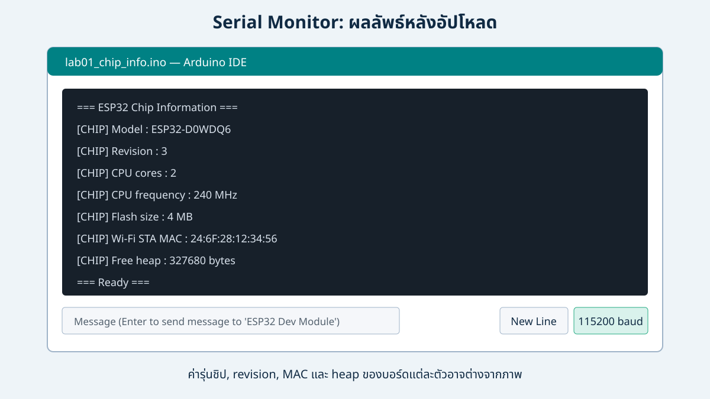

_ภาพจำลอง: ผลงานต้นฉบับของโครงการ MAC address ในภาพเป็นเพียงตัวอย่าง_

#### ภารกิจท้าทาย

เพิ่มบรรทัดแสดงขนาด Flash เป็นทั้ง byte และ MB พร้อมพิมพ์ `Sketch size` และ `Free sketch space` โดยค้นหา Arduino-ESP32 `ESP` object API แล้วอธิบายว่าค่าสองอย่างหลังต่างกันอย่างไร

#### ใบงานบันทึกผลและอธิบายด้วยตนเอง

| สิ่งที่สังเกต | ผลจากเครื่อง/บอร์ดของเรา |
|---|---|
| Arduino IDE / ESP32 core รุ่นที่ใช้ | __________ / __________ |
| ชื่อ USB-to-Serial และ Port | __________ / COM____ |
| Chip model / revision / cores | __________ / __________ / __________ |
| CPU frequency / Flash size | __________ MHz / __________ MB |
| Free heap หลัง reset | __________ bytes |
| ย้ายข้อความเข้า loop แล้วเกิดอะไรขึ้น | __________________________________ |

ก่อนจบบท ให้ชี้บนจอว่าเลือก Board/Port ที่ใด อธิบายด้วยคำของตนเองว่า `setup()` ต่างจาก `loop()` อย่างไร เหตุใด `#include` ไม่ได้พิมพ์ข้อความ และเหตุใดต้องตรวจ `ESP_OK` ก่อนแสดง MAC การบันทึกผลในที่สาธารณะไม่จำเป็นต้องเผยแพร่ MAC ของบอร์ดจริง

## 🛠️ Troubleshooting

| อาการ | สาเหตุที่เป็นไปได้ | วิธีแก้ |
|---|---|---|
| ไฟติดแต่ไม่มี COM port | ใช้สายชาร์จอย่างเดียวหรือสายเสีย | เปลี่ยนเป็นสาย USB data ที่ทดสอบส่งข้อมูลแล้ว และลองพอร์ต USB อื่น |
| มีอุปกรณ์ Unknown device | ยังไม่มี driver CP210x/CH340 | อ่านชื่อชิปบนบอร์ด ติดตั้ง driver จากผู้ผลิต แล้วถอด/เสียบใหม่ |
| Arduino IDE ไม่มี `ESP32 Dev Module` | ยังไม่เพิ่ม package URL หรือยังไม่ติดตั้ง core | ตรวจ Preferences URL แล้วติดตั้ง `esp32 by Espressif Systems` จาก Boards Manager |
| `Failed to connect... Wrong boot mode` | auto-reset ไม่พา GPIO0 เข้า download mode | กด BOOT ค้างระหว่าง `Connecting...` ปล่อยเมื่อเริ่มเขียน; ลองกด EN ก่อน Upload |
| `A fatal error occurred: Could not open COMx` | เลือก Port ผิดหรือโปรแกรมอื่นจับ port อยู่ | ปิด Serial Monitor/โปรแกรม terminal อื่น แล้วเลือก COM ให้ตรง Device Manager |
| อัปโหลดค้างหรือ checksum error ที่ 921600 | สาย/USB hub ไม่เสถียรหรือ baud สูงเกินไป | ต่อเข้าพอร์ตคอมพิวเตอร์โดยตรง เปลี่ยนสาย และลด Upload Speed เป็น 115200 |
| Serial Monitor แสดงอักขระอ่านไม่ออก | baud ไม่ตรงกับ `Serial.begin()` | เลือก 115200 baud แล้วกด EN เพื่อพิมพ์ใหม่ |
| Serial Monitor ว่างหลังอัปโหลด | เปิดช้ากว่าข้อความที่พิมพ์ครั้งเดียว | เปิด Serial Monitor ที่ 115200 แล้วกด EN หนึ่งครั้ง |
| บอร์ด reset ซ้ำและขึ้น `Brownout detector` | แรงดันตกจากสายหรือแหล่งจ่ายไม่พอ | ใช้สายสั้นคุณภาพดี ถอดโหลดภายนอก และลองพอร์ต USB ที่จ่ายกระแสได้เสถียร |
| Compile error เกี่ยวกับ `esp_mac.h` หรือ API ไม่พบ | ใช้ core เก่าหรือเลือก board package ผิด | ติดตั้ง/อัปเดต `esp32 by Espressif Systems` เป็น core 3.x แล้ว Verify ใหม่ |

## 🔍 คำถามค้นคว้าหลังเรียน

1. ULP co-processor ช่วยลดการใช้พลังงานของอุปกรณ์ sensor ที่ตื่นเป็นช่วง ๆ ได้อย่างไร?
   - 🔎 คำค้นแนะนำ: `ESP32 ULP coprocessor`, `ESP32 deep sleep sensor`
2. Strapping pins ถูกอ่านในช่วงใดของการ boot และตัวต้านทาน pull-up/pull-down บนบอร์ดมีผลอย่างไร?
   - 🔎 คำค้นแนะนำ: `ESP32 strapping pins`, `ESP32 boot mode GPIO0`
3. เพราะเหตุใด ADC ของ ESP32 รุ่นดั้งเดิมจึงต้อง calibrate และ attenuation เปลี่ยนช่วงแรงดันที่วัดอย่างไร?
   - 🔎 คำค้นแนะนำ: `ESP32 ADC calibration`, `Arduino ESP32 analog attenuation`
4. Native USB ของ ESP32-S2/S3 ต่างจาก USB-to-Serial บน ESP32 DevKit V1 อย่างไร?
   - 🔎 คำค้นแนะนำ: `ESP32-S3 native USB`, `CP2102 USB UART bridge`

## 📝 แบบทดสอบหลังเรียน

**ข้อ 1 (ง่าย)** ข้อใดอธิบาย microcontroller ได้ถูกต้องที่สุด?

- ก. อุปกรณ์เก็บข้อมูลที่ต้องเชื่อม CPU ภายนอกเสมอ
- ข. ชิปที่รวม CPU, memory และ peripheral สำหรับควบคุมงานเฉพาะ
- ค. ระบบปฏิบัติการสำหรับเขียนโปรแกรม Arduino
- ง. วงจรแปลง USB เป็นสัญญาณ Serial เท่านั้น

**ข้อ 2 (ง่าย)** ระดับแรงดันลอจิกของ GPIO บน ESP32 คือเท่าใด?

- ก. 1.8V
- ข. 2.5V
- ค. 3.3V
- ง. 5V

**ข้อ 3 (ง่าย)** ข้อใดเรียงความสัมพันธ์ได้ถูกต้อง?

- ก. ชิป ESP32 อยู่ในโมดูล ESP32-WROOM-32 และโมดูลอยู่บนบอร์ด DevKit
- ข. บอร์ด DevKit อยู่ภายในชิป ESP32 และชิปอยู่ในสาย USB
- ค. ESP32-WROOM-32 คือ driver บน Windows ส่วน DevKit คือ Arduino IDE
- ง. ทั้งสามชื่อหมายถึงอุปกรณ์ชิ้นเดียวกันทุกประการ

**ข้อ 4 (ปานกลาง)** เมื่อ Upload ค้างที่ `Connecting...` และขึ้น `Wrong boot mode` ควรทำสิ่งใดก่อน?

- ก. ต่อ GPIO34 เข้ากับ 5V
- ข. ลบ Arduino IDE แล้วเปลี่ยนไปใช้ Raspberry Pi
- ค. เปลี่ยน Serial Monitor เป็น 9600 baud
- ง. กด BOOT ค้างระหว่าง Connecting แล้วปล่อยเมื่อเริ่มอัปโหลด

**ข้อ 5 (ปานกลาง)** โค้ดมี `Serial.begin(115200);` แต่ Serial Monitor ตั้งไว้ 9600 ผลที่มีแนวโน้มเกิดขึ้นคือข้อใด?

- ก. Flash จะถูกลบทันที
- ข. ข้อความกลายเป็นอักขระอ่านไม่ออกเพราะ baud ไม่ตรงกัน
- ค. GPIO ทุกขาจะเปลี่ยนเป็น output
- ง. Wi-Fi จะเชื่อมต่อ broker อัตโนมัติ

**ข้อ 6 (ปานกลาง)** ต้องอ่าน analog sensor พร้อมใช้งาน Wi-Fi บน ESP32 รุ่นดั้งเดิม ควรเลือกแนวทางใด?

- ก. ใช้ขา ADC1 เช่น GPIO32 หรือ GPIO33
- ข. ใช้ GPIO6 เพราะอยู่ใกล้ Flash
- ค. ใช้ GPIO36 เป็น output จ่ายไฟให้ sensor
- ง. ใช้ ADC2 เท่านั้นเพราะ Wi-Fi ไม่เกี่ยวข้องกับ ADC2

**ข้อ 7 (ปานกลาง)** Sensor ส่งสัญญาณ HIGH 5V แต่ต้องต่อเข้าขา GPIO33 ของ ESP32 ควรทำอย่างไร?

- ก. ต่อตรงได้เพราะ GPIO33 เป็น ADC1
- ข. เพิ่ม baud rate เป็น 921600
- ค. ใช้ voltage divider หรือ logic level shifter ลดเป็นระดับ 3.3V
- ง. ย้ายสัญญาณไป GPIO34 แล้วต่อ 5V ได้โดยตรง

**ข้อ 8 (ยาก)** Port ถูกต้องและกด BOOT แล้ว แต่อัปโหลดที่ 921600 ขาดกลางทางบ่อย โดยเฉพาะเมื่อผ่าน USB hub วิธีวิเคราะห์ขั้นแรกที่เหมาะสมที่สุดคือข้อใด?

- ก. เปลี่ยน Partition Scheme เป็นขนาดใหญ่ที่สุด
- ข. เพิ่มความถี่ CPU เกิน 240 MHz
- ค. ต่อ 5V เข้าขา 3V3 เพื่อชดเชยแรงดันตก
- ง. ต่อ USB ตรง เปลี่ยนสาย และลด Upload Speed เป็น 115200

**ข้อ 9 (ยาก)** โปรแกรมสั่ง `pinMode(34, OUTPUT)` และ `digitalWrite(34, HIGH)` แต่ LED ไม่ติด ทั้งที่วงจรถูกต้อง สาเหตุใดสอดคล้องกับ pinout มากที่สุด?

- ก. GPIO34 เป็น DAC จึงใช้ digital output ไม่ได้
- ข. GPIO34 เป็น input only ควรย้าย LED ไป output-capable GPIO เช่น GPIO16
- ค. GPIO34 ต่อกับ SPI Flash จึงต้อง format Flash
- ง. GPIO34 ใช้ได้เฉพาะเมื่อเปิด Bluetooth Classic

**ข้อ 10 (ยาก)** บอร์ดทำงานปกติเมื่อพิมพ์ Serial แต่ reset เป็นช่วง ๆ เมื่อเริ่มส่ง Wi-Fi และขึ้นข้อความ brownout ควรแก้การออกแบบส่วนใดก่อน?

- ก. ใช้แหล่งจ่าย/สายที่แรงดันไม่ตกและมีความสามารถจ่ายกระแสพอ พร้อม decoupling ที่เหมาะสม
- ข. เปลี่ยน GPIO21 เป็น strapping pin
- ค. ลด Serial Monitor เหลือ 300 baud
- ง. ลบ MAC address ออกจาก eFuse

## 📚 อ้างอิง

- [ESP32 Series Datasheet — Espressif Systems](https://documentation.espressif.com/esp32_datasheet_en.pdf)
- [Arduino-ESP32: Installing](https://docs.espressif.com/projects/arduino-esp32/en/latest/installing.html)
- [Arduino-ESP32: Tools Menu](https://docs.espressif.com/projects/arduino-esp32/en/latest/guides/tools_menu.html)
- [ESP-IDF: ESP32 GPIO & RTC GPIO](https://docs.espressif.com/projects/esp-idf/en/latest/esp32/api-reference/peripherals/gpio.html)
- [Espressif SoC Product Comparison](https://products.espressif.com/en/product-comparison)
- [Arduino-ESP32 source code](https://github.com/espressif/arduino-esp32)
- [Arduino IDE downloads](https://www.arduino.cc/en/software)
- [Arduino IDE 2: ดาวน์โหลดและติดตั้ง](https://docs.arduino.cc/software/ide-v2/tutorials/getting-started/ide-v2-downloading-and-installing/)
- [Arduino Language Reference: setup()](https://docs.arduino.cc/language-reference/en/structure/sketch/setup/), [loop()](https://docs.arduino.cc/language-reference/en/structure/sketch/loop/), [#include](https://docs.arduino.cc/language-reference/en/structure/further-syntax/include/)

## ➡️ แล็บถัดไป

[Lab 02: หลักการเขียนโปรแกรมบน ESP32 — Blink, Serial และ Log](../lab02-blink-serial/)
