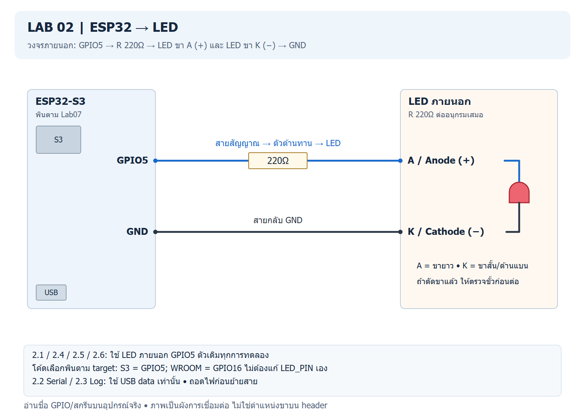
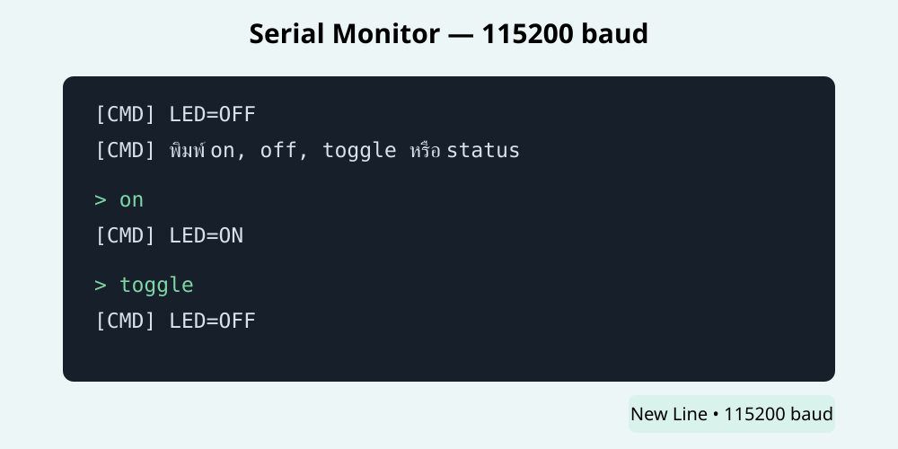
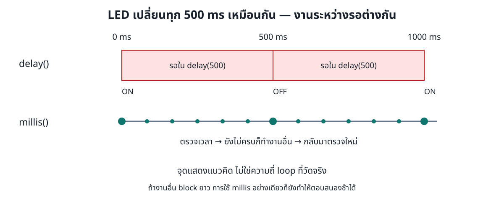
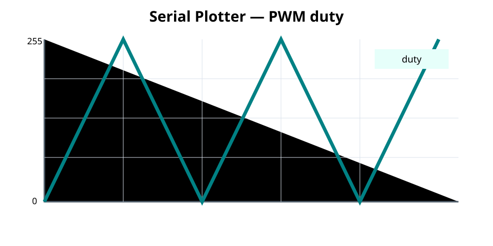

# Lab 02: Blink, Serial และ Log

> ระดับ: ⭐ | เวลา: 2–3 ชม. | ต้องผ่าน: [Lab 01](../lab01-esp32-introduction/)

ใน Lab 01 เราให้บอร์ดส่งข้อมูลกลับมาแล้ว บทนี้จะให้บอร์ดควบคุมสิ่งที่มองเห็นได้ เริ่มจากเปิด LED ค้างหนึ่งดวง แล้วค่อยทำให้กระพริบ รายงานสถานะ รับคำสั่ง และเปลี่ยนความสว่าง ทุกขั้นมีสิ่งให้ลองเปลี่ยน เพื่อเชื่อมคำสั่งบนจอกับสิ่งที่วงจรทำ

เรียนตามลำดับ 2.1–2.6 แต่ละการทดลองมี sketch ฉบับเต็มหนึ่งไฟล์ให้ดาวน์โหลด ตัวอย่างย่อยคือส่วนที่ค่อย ๆ เติมใน sketch นั้น ไม่ต้องสร้างไฟล์แยกทุกช่วง และไม่วางหลาย `setup()`/`loop()` ซ้อนกันในไฟล์เดียว

## 🎯 วัตถุประสงค์

- อธิบายลำดับ Verify, Upload, reset, `setup()` และ `loop()` ได้
- ประกาศหมายเลขขา กำหนด OUTPUT และควบคุม LED ด้วย HIGH/LOW ได้
- ใช้ Serial Monitor, Serial Plotter และ log level สังเกตการทำงานภายในได้
- เปรียบเทียบ `delay()` กับการจับเวลาด้วย `millis()` จากสิ่งที่ทดลองได้
- รับคำสั่งข้อความและทำ PWM fade ด้วย LEDC API ของ core 3.x ได้

## 🧰 อุปกรณ์ที่ใช้

| อุปกรณ์ | จำนวน | หมายเหตุ |
|---|---:|---|
| ESP32-S3 และ USB data | 1 ชุด | ใช้ core 3.x และ Serial 115200 baud; เลือก ESP32S3 Dev Module |
| LED ภายนอก | 1 | LED สีแดงเหมาะกับการเริ่มต้น |
| ตัวต้านทาน 220 Ω | 1 | ต่ออนุกรมกับ LED |
| Breadboard และสาย jumper | 1 ชุด | ใช้ GPIO5 และ GND |

ใช้ LED ภายนอก active HIGH ที่ **GPIO5** ชุดเดียวตลอดการทดลอง 2.1/2.4/2.5/2.6 และใช้ขาเดิมต่อถึง Lab06 โค้ดเลือกพินจากชนิดชิปที่ compile ให้อัตโนมัติ ไม่ต้องเปลี่ยน `LED_PIN` ระหว่างบท ดูวิธีเลือกบอร์ดและตั้งค่า USB ของ ESP32-S3 ใน [Lab07](../lab07-smart-home-project/) แล้วเทียบชื่อ GPIO กับสกรีนของบอร์ดจริง

## ❓ คำถามก่อนเริ่มต้น

<details>
<summary><b>คลิกเพื่อดูคำถามก่อนเรียน</b></summary>

1. โปรแกรมบน microcontroller ต่างจากโปรแกรมบนคอมพิวเตอร์อย่างไร?
2. เพราะเหตุใด LED จึงต้องมีตัวต้านทานอนุกรม?
3. การหยุดโปรแกรมด้วย `delay()` อาจกระทบงานอื่นอย่างไร?
4. Serial Monitor ช่วยสังเกตสิ่งที่เกิดภายในบอร์ดได้อย่างไร?
5. PWM ทำให้ LED ดูสว่างต่างกันได้อย่างไร?
6. ถ้า baud rate สองฝั่งไม่ตรงกัน ผู้เรียนคาดว่าจะเห็นอะไร?

</details>

## 📖 ทฤษฎี

### จากคำสั่งในไฟล์ไปถึงขาจริง

Verify คือ compile/link โค้ดกับ core แต่ยังไม่เปลี่ยนโปรแกรมในบอร์ด Upload จึงส่ง binary ลง Flash หลัง reset core เตรียมระบบ แล้วเรียก `setup()` หนึ่งครั้งและ `loop()` ซ้ำ แก้ตัวเลขบนจอแล้ว Save อย่างเดียว LED จึงยังทำแบบเดิมจนกว่าจะ Upload ใหม่


### Digital output กับ PWM

Digital output มีสองระดับ: HIGH ใกล้ 3.3V และ LOW ใกล้ 0V สำหรับวงจร GPIO → R → LED → GND ค่า HIGH ทำให้กระแสไหลและ LED ติด ต้องกำหนด `pinMode(pin, OUTPUT)` ก่อน `digitalWrite()` ขา GPIO เป็นขาสัญญาณ ไม่ใช่แหล่งจ่ายไฟกำลังสูง

PWM สลับ HIGH/LOW อย่างรวดเร็ว โดยปรับสัดส่วนเวลาที่ HIGH หรือ **duty cycle** LED จึงดูสว่างเฉลี่ยต่างกัน ไม่ได้เปลี่ยนขาให้จ่ายแรงดัน analog ค้างที่ 1.65V และความสว่างที่ตามนุษย์รู้สึกไม่จำเป็นต้องแปรตรงกับ duty

### เวลาและสถานะ

`delay(500)` พัก Arduino loop task ประมาณครึ่งวินาที งานที่เขียนต่อใน loop เดียวกันต้องรอ ส่วน `millis()` อ่านเวลาแล้วคืนค่าทันที เราเก็บเวลาที่ทำครั้งก่อนและสถานะ LED ไว้ถามว่าได้เวลาทำครั้งถัดไปหรือยัง FreeRTOS/งานระบบยังมีการทำงานของตนเอง คำว่า block ในบทนี้หมายถึงเส้นทางคำสั่งใน loop ของเรา

| ส่วนพื้นฐาน | ตัวอย่าง | เหตุผล |
|---|---|---|
| ค่าคงที่ | `LED_PIN` เลือกเป็น 5 เมื่อ compile สำหรับ S3 | หมายเลขขาไม่เปลี่ยนระหว่างรัน ใช้ชื่อเดียวในทุกคำสั่งควบคุมไฟ |
| สถานะ | `bool ledState = false;` | จำว่าเปิดหรือปิดอยู่ |
| เวลา | `uint32_t previousBlinkMs = 0;` | เก็บ ms แบบ unsigned เพื่อหาผลต่าง |
| เรียก API | `digitalWrite(LED_PIN, HIGH);` | ส่งหมายเลขขาและระดับเป็นพารามิเตอร์ |
| Header | `#include <Arduino.h>` | ให้ compiler รู้จัก Arduino API; ไม่มี library ภายนอก |

## 🔌 การต่อวงจร

### รู้จัก LED และต่อทีละเส้น



ภาพแสดง **ชื่อพินที่ต้องต่อถึงกัน** ให้หาขาที่สกรีน `5`/`IO5` และ `GND` บน ESP32-S3 จริง ไม่ใช่นับเป็นขาลำดับที่ 5 บนแถว header ตำแหน่งขาของบอร์ดแต่ละรุ่นอาจต่างกัน

1. ถอด USB ก่อนต่อสาย หา GPIO5 และ GND จากสกรีนบอร์ด
2. เสียบ LED ให้สองขาอยู่คนละแถว breadboard ขายาวมักเป็น anode (+) ส่วนขาสั้น/ด้านแบนเป็น cathode (−) ถ้าถูกตัดขาแล้วให้ตรวจด้วยมิเตอร์
3. ต่อ GPIO5 → R 220 Ω → anode LED จากนั้น cathode → GND ตัวต้านทานอยู่ด้าน anode หรือ cathode ก็ได้ถ้ายังอนุกรม
4. ตรวจว่าไม่มีสายลัดระหว่างขา LED แล้วจึงเสียบ USB เมื่อ output ยัง LOW ไฟควรดับ

| สาย/จุดต่อ | จากพินหรือขั้ว | ไปพินหรือขั้ว | วิธีต่อ |
|---|---|---|---|
| USB | ช่อง USB ของคอมพิวเตอร์ | ช่อง USB ของ ESP32 | ใช้สาย data เพื่อจ่ายไฟและรับส่ง Serial |
| สัญญาณ LED | ESP32-S3 `GPIO5` | ขาแรกของ R 220 Ω | ตัวต้านทานไม่มีขั้ว |
| ต่ออนุกรม | ขาที่สองของ R 220 Ω | LED ขา anode (+) | ขายาวเมื่อยังไม่ถูกตัด |
| ทางกลับ | LED ขา cathode (−) | ESP32 `GND` | ขาสั้น/ด้านแบนของตัว LED |

| การทดลอง | การเชื่อมต่อที่ใช้ตาม sketch ที่ให้ |
|---|---|
| 2.1 Blink และ 2.4 millis | USB + LED ภายนอก GPIO5 → R 220 Ω → anode; cathode → GND |
| 2.2 Serial และ 2.3 Log | USB data อย่างเดียว ไม่ใช้ LED ภายนอก |
| 2.5 คำสั่ง Serial และ 2.6 PWM | ใช้วงจร LED ภายนอก GPIO5 ชุดเดียวกับ 2.1/2.4 ไม่ต้องย้ายสาย |

การทดลองทั้งหมดใน Lab02 ยังไม่ใช้จอหรือ sensor และใช้ LED ภายนอกธรรมดาที่ HIGH แล้วติดตามวงจรนี้ ให้ต่อสายตามชนิดชิปที่เลือกใน IDE

<details>
<summary>สำหรับบอร์ดเดิม ESP32-WROOM-32</summary>

เลือก **ESP32 Dev Module** แล้วต่อ `GPIO16 → R220Ω → LED anode`, `LED cathode → GND` โค้ดส่วน `CONFIG_IDF_TARGET_ESP32` เลือก GPIO16 ให้อัตโนมัติ ใช้ LED ภายนอกชุดนี้เหมือนกันในทุกการทดลองที่ควบคุมไฟ ไม่ใช้ตำแหน่งขา S3 กับ WROOM สลับกัน

</details>

ตัวอย่าง LED แดงที่ตกคร่อม 2V: `I ≈ (3.3−2)/220 ≈ 5.9 mA` แรงดัน LED แต่ละสีต่างกัน ตัวเลขนี้ใช้เข้าใจหน้าที่ R ไม่ใช่ค่ากระแสที่วัดจริง

_ภาพวงจรและหน้าจอจำลองในบทนี้สร้างโดยโครงการ ดู [`IMAGE_SOURCES.md`](../../assets/IMAGE_SOURCES.md)_

## 🧪 การทดลอง

### เตรียม IDE ก่อนเริ่ม

1. เปิด Arduino IDE เลือก **ESP32S3 Dev Module**, Port ของบอร์ด และ Upload Speed **115200** ตามการตั้งค่า S3 ใน [Lab07](../lab07-smart-home-project/) ถ้าใช้ USB-to-UART CH343 ให้ปิด **USB CDC On Boot** เพื่ออ่าน `Serial` ทาง UART; ตั้ง Flash/PSRAM ให้ตรงรุ่นจริง
2. ใช้ **File → New Sketch → Save As…** เช่น `lab02_blink` หรือเปิดไฟล์ดาวน์โหลดที่ลิงก์ไว้ ชื่อโฟลเดอร์และ `.ino` ต้องตรงกัน
3. เพิ่ม declaration ก่อน setup และเติมคำสั่งในบล็อกที่ระบุ กด Verify หลังเติมแต่ละช่วง
4. เมื่อ Upload เสร็จ เปิด **Tools → Serial Monitor** ตั้ง 115200 baud ถ้าข้อความเริ่มต้นผ่านไปแล้วกด EN
5. แยกให้ได้ว่า Output แสดงข้อความจากเครื่องมือ build/upload ส่วน Serial Monitor แสดงข้อมูลที่ firmware ส่งกลับมา

### การทดลองที่ 2.1: LED ติดค้างก่อนทำ Blink

**วงจรที่ใช้:** USB + ESP32-S3 GPIO5 → R 220 Ω → LED anode; LED cathode → GND ใช้ LED ภายนอก active HIGH ชุดเดียวกับทุกการทดลองควบคุมไฟในบทนี้

**ทำนายก่อนลอง:** ถ้าเขียน HIGH ใน setup แล้วไม่เปลี่ยนอีก LED จะทำอะไร?

1. เริ่มจาก sketch ว่าง เพิ่ม `#include <Arduino.h>` และคัดลอกบล็อกเลือก `LED_PIN` ตามชิปจากฉบับเต็มไว้ก่อน setup เมื่อเลือก S3 จะได้ GPIO5; `constexpr` ทำให้ค่าคงที่ ส่วน `uint8_t` คือจำนวนเต็มไม่ติดลบ 8-bit
2. ใน setup ใส่ `Serial.begin(115200);`, `pinMode(LED_PIN, OUTPUT);`, `digitalWrite(LED_PIN, HIGH);` ตามลำดับ ปล่อย loop ว่าง Verify/Upload แล้วไฟควรติดค้างสำหรับวงจร active HIGH
3. เปลี่ยน HIGH เป็น LOW แล้ว Upload ไฟควรดับ ถ้าไม่เป็นเช่นนั้นตรวจสาย GPIO5, ตัวต้านทาน, ขั้ว LED และ GND ก่อนเรียนเรื่องเวลา
4. ใช้ฉบับเต็มด้านล่าง setup เตรียมขาและเริ่ม LOW ส่วน loop เปิด → รอ → ปิด → รอ

[ดาวน์โหลด `lab02_blink.ino`](code/lab02_blink/lab02_blink.ino)

```cpp
/*
 * Lab 02.1 : Blink แบบ delay
 * คำอธิบาย : กระพริบ LED ภายนอก ทุก 500 ms
 * วงจร     : ESP32-S3 GPIO5 / WROOM-32 GPIO16 -> R 220Ω -> LED anode; cathode -> GND
 * ไลบรารี  : ไม่ใช้ไลบรารีภายนอก
 * Board    : ESP32S3 Dev Module / ESP32 Dev Module (WROOM-32), core 3.x
 */
#include <Arduino.h>

// LED ภายนอก active HIGH; เลือกขาตามชิปโดยใช้สายเดิมตลอดแล็บ
#if defined(CONFIG_IDF_TARGET_ESP32S3)
constexpr uint8_t LED_PIN = 5;
#elif defined(CONFIG_IDF_TARGET_ESP32)
constexpr uint8_t LED_PIN = 16;
#else
#error "Lab02 supports ESP32-S3 and ESP32; define a verified pin mapping first."
#endif

void setup() {
  Serial.begin(115200);
  pinMode(LED_PIN, OUTPUT);
  digitalWrite(LED_PIN, LOW);
  Serial.println("[BLINK] เริ่มกระพริบ LED");
}

void loop() {
  // สั่ง HIGH ค้างครึ่งวินาที แล้วสั่ง LOW ค้างครึ่งวินาที จึงครบหนึ่งรอบ
  digitalWrite(LED_PIN, HIGH);
  Serial.println("[BLINK] ON");
  delay(500);
  digitalWrite(LED_PIN, LOW);
  Serial.println("[BLINK] OFF");
  delay(500);
}
```

| ส่วนของโค้ด | หน้าที่ |
|---|---|
| `LED_PIN` | ชื่อแทน GPIO ไม่ใช่เลขลำดับขาบน header |
| `pinMode(..., OUTPUT)` | ให้ขาขับระดับ digital ได้ |
| `digitalWrite(..., HIGH/LOW)` | เปลี่ยนระดับและคงไว้จนมีคำสั่งใหม่ |
| `Serial.println()` | รายงานคำสั่งที่เพิ่งทำ ไม่ได้ตรวจว่าไฟติดจริง |
| `delay(500)` สองครั้ง | ติด 500 ms ดับ 500 ms รวมคาบประมาณ 1000 ms หรือ 1 Hz |

ผลลัพธ์ Serial ที่คาดหวัง:

```text
[BLINK] ON
[BLINK] OFF
[BLINK] ON
```

**ลองเปลี่ยน:** ใช้ติด 100 ms ดับ 900 ms คาบยังประมาณ 1 วินาที แต่เวลาที่สว่างสั้นลง บันทึกความต่างระหว่าง “คาบ” กับ “เวลาติด”

**จุดตรวจ:** ชี้ได้ว่าบรรทัดใดเตรียมขา บรรทัดใดสั่งไฟ และทำไมแก้ delay แต่ไม่ Upload จึงไม่เปลี่ยนจังหวะ

**ภารกิจท้าทาย:** ทำ SOS: สั้น 3 ครั้ง ยาว 3 ครั้ง สั้น 3 ครั้ง แล้วเว้นช่วงก่อนวนใหม่

### การทดลองที่ 2.2: ใช้ Serial อธิบายสิ่งที่มองไม่เห็น

**วงจรที่ใช้:** ESP32 ต่อคอมพิวเตอร์ด้วย USB data เท่านั้น

1. เริ่มจากใน setup ลอง `Serial.print("A");` ตามด้วย `Serial.println("B");` หลังเริ่ม Serial เมื่อ Upload แล้วกด EN จะเห็น `AB` บรรทัดเดียว print ไม่เติมช่องว่างหรือขึ้นบรรทัดใหม่เอง
2. เพิ่ม `uint32_t messageCount = 0;` นอก setup/loop เพื่อเก็บตัวนับข้ามรอบ ใน loop ใช้ `messageCount++;` เพิ่มทีละหนึ่ง
3. ใช้ฉบับเต็ม อ่านค่าที่ส่งเข้าช่อง `%lu` แล้วเทียบกับข้อความจริง อย่าสับสน 115200 baud กับจำนวนข้อความต่อวินาที

[ดาวน์โหลด `lab02_serial_hello.ino`](code/lab02_serial_hello/lab02_serial_hello.ino)

```cpp
/*
 * Lab 02.2 : Serial Hello
 * คำอธิบาย : ทดลอง print, println และ printf พร้อมค่าที่เปลี่ยนแปลง
 * วงจร     : ESP32 ต่อคอมพิวเตอร์ด้วยสาย USB data
 * ไลบรารี  : ไม่ใช้ไลบรารีภายนอก
 * Board    : ESP32S3 Dev Module / ESP32 Dev Module (WROOM-32), core 3.x
 */
#include <Arduino.h>

uint32_t messageCount = 0;

void setup() {
  Serial.begin(115200);
  delay(500);
  Serial.println("[SERIAL] ESP32 พร้อมทำงาน");
}

void loop() {
  // ตัวนับอยู่นอก loop จึงเก็บค่าต่อเนื่องข้ามรอบได้
  messageCount++;
  Serial.print("[SERIAL] ข้อความครั้งที่ ");
  Serial.println(messageCount);
  // %lu รับ unsigned long; cast ให้ชนิดตรงกันและใช้ \n ขึ้นบรรทัดใหม่
  Serial.printf("[SERIAL] เวลา = %lu ms, heap = %lu bytes\n",
                static_cast<unsigned long>(millis()),
                static_cast<unsigned long>(ESP.getFreeHeap()));
  delay(1000);
}
```

| ส่วนของโค้ด | หน้าที่ |
|---|---|
| `messageCount` นอกฟังก์ชัน | global variable ไม่เริ่มศูนย์ใหม่ทุก loop |
| `++` | เพิ่มค่าที่เก็บหนึ่งหน่วย |
| `print` แล้ว `println` | พิมพ์ข้อความก่อนต่อด้วยตัวนับและขึ้นบรรทัดใหม่ |
| `printf` | รับ format string และค่าหลัง comma ตามลำดับ |
| `%lu`, `static_cast<unsigned long>` | จับคู่ช่องจำนวนเต็มกับชนิดค่าที่ส่งเข้าไป |
| `\n` | ขึ้นบรรทัดใหม่ให้ printf ซึ่งไม่เติมให้อัตโนมัติ |

ผลลัพธ์ตัวอย่าง (เวลา/heap เปลี่ยนตามการรัน):

```text
[SERIAL] ข้อความครั้งที่ 1
[SERIAL] เวลา = 500 ms, heap = 305000 bytes
[SERIAL] ข้อความครั้งที่ 2
[SERIAL] เวลา = 1501 ms, heap = 305000 bytes
```



_ภาพจำลองสำหรับสอนเมนู/การอ่านข้อความ ไม่ใช่ผลจาก hardware ในรอบเขียนเอกสาร_

**ลองเปลี่ยน:** ย้าย declaration ของ messageCount มาเป็นบรรทัดแรกใน loop ทุกครั้งจะกลับเป็น 1 แล้วจึงย้ายกลับ ตำแหน่งประกาศจึงมีผลต่ออายุของตัวแปร

**จุดตรวจ:** ทำนาย print/println ได้ และบอกได้ว่า uptime ไม่จำเป็นต้องตรงวินาทีพอดีเพราะมีเวลาทำคำสั่งอื่นร่วมด้วย

**ภารกิจท้าทาย:** เพิ่ม uptime เป็นวินาทีทศนิยมหนึ่งตำแหน่ง โดยหารด้วย `1000.0` และใช้ `%.1f`

### การทดลองที่ 2.3: Error, Warning และ Info

**วงจรที่ใช้:** ESP32 ต่อคอมพิวเตอร์ด้วย USB data เท่านั้น

1. เปิด **Tools → Core Debug Level → Info** เป็นค่าตอน build จึงต้อง Verify/Upload ใหม่ ไม่ใช่แค่เปลี่ยน baud หรือเปิด Monitor ใหม่
2. เติม `log_e()`, `log_w()`, `log_i()` ทีละตัวใน setup ตามฉบับเต็ม ข้อความด้านล่างเป็นการสาธิต ไม่ได้ตรวจว่า sensor เสียจริง
3. เปิด Monitor 115200 กด EN แล้วเทียบ prefix ระดับกับ uptime จาก loop
4. เปลี่ยน Debug Level เป็น Error แล้ว Upload ควรเหลือ Error จาก sketch นี้ กลับเป็น Info ก่อนทำต่อ

[ดาวน์โหลด `lab02_log_levels.ino`](code/lab02_log_levels/lab02_log_levels.ino)

```cpp
/*
 * Lab 02.3 : Console Log Levels
 * คำอธิบาย : แสดงข้อความระดับ Error, Warning และ Info
 * วงจร     : ESP32 ต่อคอมพิวเตอร์ด้วยสาย USB data
 * ไลบรารี  : ไม่ใช้ไลบรารีภายนอก
 * Board    : ESP32S3 Dev Module / ESP32 Dev Module (WROOM-32), core 3.x, Core Debug Level = Info
 */
#include <Arduino.h>

void setup() {
  Serial.begin(115200);
  delay(500);
  // ข้อความเหล่านี้เป็นการสาธิต ไม่ได้หมายความว่า hardware เกิดปัญหาจริง
  log_e("ตัวอย่าง Error: sensor ไม่ตอบสนอง");
  log_w("ตัวอย่าง Warning: ค่าใกล้ขีดจำกัด");
  log_i("ตัวอย่าง Info: ระบบเริ่มทำงานแล้ว");
}

void loop() {
  // ตั้ง Core Debug Level เป็น Info แล้ว compile/upload ใหม่เพื่อให้ log_i แสดง
  log_i("uptime = %lu ms", static_cast<unsigned long>(millis()));
  delay(3000);
}
```

| ส่วนของโค้ด | หน้าที่ |
|---|---|
| `log_e` | รายงานปัญหาที่ทำให้งานสำคัญล้มเหลวในระบบจริง |
| `log_w` | เตือนภาวะที่ยังทำงานต่อได้แต่ควรตรวจ |
| `log_i` | ข้อมูลปกติ เช่น เริ่มระบบและ uptime |
| Core Debug Level | Info รวม Error/Warning ด้วย เป็นการตั้งค่าของ build |
| `delay(3000)` | เว้นรายงาน 3 วินาที ยังเป็นตัวอย่างแบบ blocking |

รูปแบบผลลัพธ์เมื่อ build ระดับ Info (เวลา/ชื่อไฟล์/บรรทัดอาจต่างกัน):

```text
[E][...] ตัวอย่าง Error: sensor ไม่ตอบสนอง
[W][...] ตัวอย่าง Warning: ค่าใกล้ขีดจำกัด
[I][...] ตัวอย่าง Info: ระบบเริ่มทำงานแล้ว
[I][...] uptime = 500 ms
```

**จุดตรวจ:** อธิบายได้ว่าทำไม Serial.println ยังพิมพ์ได้เมื่อกรอง Info log และทำไมต้อง Upload หลังเปลี่ยนระดับ

**ภารกิจท้าทาย:** เพิ่ม `log_d()` แล้วทดลองระดับ Debug ที่ทำให้เห็นข้อความนั้น

### การทดลองที่ 2.4: เปลี่ยน “หยุดรอ” เป็น “ดูนาฬิกา”

**วงจรที่ใช้:** USB + LED ภายนอก GPIO5 ผ่าน R 220 Ω ลง GND เช่นเดียวกับ 2.1 ใช้บล็อกเลือกพินตามชิปเดิม ไม่ต้องย้ายสาย



**ทำนายก่อนลอง:** ถ้าอ่านปุ่มหลัง delay สองครั้งใน Blink ปุ่มอาจต้องรอคำสั่งใดบ้าง?

1. เริ่มจาก 2.1 เก็บหมายเลข LED เดิม เพิ่ม `BLINK_INTERVAL_MS` กับตัวแปรจำเวลาครั้งก่อน/สถานะ LED ก่อน setup
2. ลบ delay และวงจรเปิด/ปิดเดิมจาก loop แล้วอ่าน `const uint32_t now = millis();` เป็นเวลาของรอบปัจจุบัน
3. เพิ่ม `if (now - previousBlinkMs >= BLINK_INTERVAL_MS)` ถ้ายังไม่ครบจะข้ามบล็อกแล้วไปทำงานอื่น
4. ภายใน if บันทึกเวลาใหม่ก่อนสลับสถานะ ถ้าลืมบันทึก หลังครบกำหนดจะสลับทุก loop
5. Upload ฉบับเต็ม เทียบกับ 2.1: ไฟดูเหมือนเดิม แต่ loop ตรวจงานอื่นระหว่างรอได้

[ดาวน์โหลด `lab02_blink_millis.ino`](code/lab02_blink_millis/lab02_blink_millis.ino)

```cpp
/*
 * Lab 02.4 : Blink แบบ non-blocking
 * คำอธิบาย : กระพริบ LED ด้วย millis() โดยไม่หยุด loop()
 * วงจร     : ESP32-S3 GPIO5 / WROOM-32 GPIO16 -> R 220Ω -> LED anode; cathode -> GND
 * ไลบรารี  : ไม่ใช้ไลบรารีภายนอก
 * Board    : ESP32S3 Dev Module / ESP32 Dev Module (WROOM-32), core 3.x
 */
#include <Arduino.h>

// LED ภายนอก active HIGH; เลือกขาตามชิปโดยใช้สายเดิมตลอดแล็บ
#if defined(CONFIG_IDF_TARGET_ESP32S3)
constexpr uint8_t LED_PIN = 5;
#elif defined(CONFIG_IDF_TARGET_ESP32)
constexpr uint8_t LED_PIN = 16;
#else
#error "Lab02 supports ESP32-S3 and ESP32; define a verified pin mapping first."
#endif
constexpr uint32_t BLINK_INTERVAL_MS = 500;
uint32_t previousBlinkMs = 0;
bool ledState = false;

void setup() {
  Serial.begin(115200);
  pinMode(LED_PIN, OUTPUT);
  digitalWrite(LED_PIN, LOW);
  Serial.println("[BLINK] non-blocking พร้อมทำงาน");
}

void loop() {
  const uint32_t now = millis();
  // ตรวจเวลาที่ผ่านไป; เมื่อยังไม่ถึงกำหนด loop จะทำงานส่วนอื่นต่อได้
  if (now - previousBlinkMs >= BLINK_INTERVAL_MS) {
    previousBlinkMs = now;
    ledState = !ledState;
    digitalWrite(LED_PIN, ledState);
    Serial.printf("[BLINK] LED=%s uptime=%lu ms\n",
                  ledState ? "ON" : "OFF",
                  static_cast<unsigned long>(now));
  }

  // loop ยังหมุนต่อได้ จึงเพิ่มงานอื่นในส่วนนี้ได้ภายหลัง
}
```

| ส่วนของโค้ด | หน้าที่ |
|---|---|
| `previousBlinkMs` | จำเวลาที่เปลี่ยนไฟล่าสุด ไม่ใช่ตัวนับถอยหลัง |
| `now - previousBlinkMs` | เวลาที่ผ่านไป ใช้ unsigned ทั้งคู่และตรวจสม่ำเสมอ |
| `>= 500` | ครบอย่างน้อย 500 ms จึงเปลี่ยน LED |
| `previousBlinkMs = now` | เริ่มช่วงใหม่จากเวลาที่ทำจริง อาจมี drift เล็กน้อย |
| `ledState = !ledState` | กลับ false/true |
| `ledState ? "ON" : "OFF"` | เลือกข้อความตามเงื่อนไข |

ผลลัพธ์ตัวอย่าง:

```text
[BLINK] LED=ON uptime=500 ms
[BLINK] LED=OFF uptime=1000 ms
```

| now | previous ก่อนตรวจ | ผลต่าง | ทำอะไร |
|---:|---:|---:|---|
| 120 | 0 | 120 | ยังไม่ครบ ข้ามบล็อก |
| 500 | 0 | 500 | เปิดและบันทึก previous=500 |
| 650 | 500 | 150 | ไม่เปลี่ยน |
| 1000 | 500 | 500 | ปิดและบันทึก previous=1000 |

`millis()` แบบ 32-bit wrap ประมาณทุก 49.7 วัน unsigned subtraction ช่วยข้ามจุด wrap ได้เมื่อช่วงเวลาเหมาะสมและตรวจถี่กว่ารอบ wrap จึงใช้ผลต่างแทน `now >= previous + interval` ทั้งนี้ timer ไม่ช่วยถ้ามีคำสั่งอื่น block ยาวใน loop

**จุดตรวจ:** ลองข้ามบรรทัดบันทึก previous ชั่วคราว สังเกตหลัง 500 ms แล้วคืนโค้ดให้ถูก

**ภารกิจท้าทาย:** เพิ่ม heartbeat ทุก 2 วินาทีด้วยตัวแปร previous อีกชุด โดยไม่เปลี่ยนจังหวะ LED

### การทดลองที่ 2.5: ส่งคำสั่งจากคอมพิวเตอร์ให้ LED

**วงจรที่ใช้:** USB + GPIO5 → R 220 Ω → LED anode (+), LED cathode (−) → GND ตามแผนภาพต่อสายด้านบน

1. ถอด USB ตรวจ LED GPIO5 ชุดเดิมตามวงจร แล้วเสียบกลับ อ่าน `ledState` และ `applyLedState()` ก่อน ฟังก์ชันนี้เขียนสถานะไปขาจริงแล้วรายงาน ต้องเรียกใช้จึงทำงาน
2. ใน loop ตรวจ `Serial.available()` ว่ามี byte รอไหม ถ้าไม่มี `return;` จบรอบ loop นี้ แล้ว core จะเรียก loop ใหม่
3. เมื่อมีข้อมูล `readStringUntil('\n')` อ่านเป็น String จากนั้น `trim()` ตัดช่องว่าง/CR หัวท้าย และ `toLowerCase()` ทำให้ ON/on เปรียบเทียบเหมือนกัน
4. Upload แล้วเลือก **New Line** ใน Monitor พิมพ์คำสั่งไม่ใส่เครื่องหมายคำพูด กด Enter/Send

[ดาวน์โหลด `lab02_serial_command.ino`](code/lab02_serial_command/lab02_serial_command.ino)

```cpp
/*
 * Lab 02.5 : ควบคุม LED ผ่าน Serial
 * คำอธิบาย : รับคำสั่ง on, off, toggle และ status จาก Serial Monitor
 * วงจร     : ESP32-S3 GPIO5 / WROOM-32 GPIO16 -> R 220Ω -> LED anode; cathode -> GND
 * ไลบรารี  : ไม่ใช้ไลบรารีภายนอก
 * Board    : ESP32S3 Dev Module / ESP32 Dev Module (WROOM-32), core 3.x
 */
#include <Arduino.h>

// LED ภายนอก active HIGH; เลือกขาตามชิปโดยใช้สายเดิมตลอดแล็บ
#if defined(CONFIG_IDF_TARGET_ESP32S3)
constexpr uint8_t LED_PIN = 5;
#elif defined(CONFIG_IDF_TARGET_ESP32)
constexpr uint8_t LED_PIN = 16;
#else
#error "Lab02 supports ESP32-S3 and ESP32; define a verified pin mapping first."
#endif
bool ledState = false;

void applyLedState() {
  // แปลงสถานะในตัวแปรเป็นระดับที่ขาจริง แล้วรายงานกลับ
  digitalWrite(LED_PIN, ledState ? HIGH : LOW);
  Serial.printf("[CMD] LED=%s\n", ledState ? "ON" : "OFF");
}

void setup() {
  Serial.begin(115200);
  Serial.setTimeout(200);
  pinMode(LED_PIN, OUTPUT);
  applyLedState();
  Serial.println("[CMD] พิมพ์ on, off, toggle หรือ status แล้วกด Enter");
}

void loop() {
  if (!Serial.available()) {
    return;
  }

  // อ่านข้อความจนพบ newline หรือรออักขระจน timeout; ช่วงนี้ยัง block ได้
  String command = Serial.readStringUntil('\n');
  command.trim();
  command.toLowerCase();

  if (command == "on") {
    ledState = true;
    applyLedState();
  } else if (command == "off") {
    ledState = false;
    applyLedState();
  } else if (command == "toggle") {
    ledState = !ledState;
    applyLedState();
  } else if (command == "status") {
    applyLedState();
  } else {
    Serial.printf("[CMD] ไม่รู้จักคำสั่ง: %s\n", command.c_str());
  }
}
```

| ส่วนของโค้ด | หน้าที่ |
|---|---|
| `Serial.setTimeout(200)` | กำหนดช่วงรอข้อมูล Stream เป็น 200 ms คำสั่งอ่านยัง block ได้ |
| `String command` | local variable เก็บข้อความหนึ่งคำสั่ง |
| `==` | เปรียบเทียบข้อความ ต่างจาก `=` ที่กำหนดค่า |
| if / else if / else | เลือกเพียงทางที่ตรง on/off/toggle/status หรือแจ้งไม่รู้จัก |
| `command.c_str()` | ส่งข้อความแบบ C string ให้ `%s` |
| `applyLedState()` | ลดคำสั่งซ้ำและให้รายงานตามสถานะที่เขียนขา |

ผลเมื่อส่งตามลำดับ (`>` คือสิ่งที่ผู้เรียนส่ง):

```text
> on
[CMD] LED=ON
> status
[CMD] LED=ON
> toggle
[CMD] LED=OFF
> hello
[CMD] ไม่รู้จักคำสั่ง: hello
```

**ลองเปลี่ยน:** ส่ง ` ON ` แล้วดูผล trim/toLowerCase จากนั้นลอง No line ending เทียบเวลาตอบสนอง คำสั่งอาจทำงานเมื่อ timeout จึงควรส่ง newline ให้จบชัดเจน ถ้า byte ทยอยเข้าต่อเนื่อง การอ่านแบบนี้อาจรอนานขึ้น ระบบหลายงานควรพัฒนา parser ทีละอักขระต่อไป

**จุดตรวจ:** บอกได้ว่า Serial สองทิศทางต่างจาก Lab 01 อย่างไร และทำไม status ไม่ควรสลับ LED

**ภารกิจท้าทาย:** เพิ่มคำสั่ง `blink 200` โดยใช้ timer แทน delay

### การทดลองที่ 2.6: PWM Fade และกราฟความสว่าง

**วงจรที่ใช้:** ใช้ LED ภายนอก GPIO5 ผ่าน R 220 Ω ลง GND ชุดเดิมจาก 2.5 ไม่ต้องย้ายสาย

1. ใช้ LED GPIO5 เดิม คงบล็อกเลือก pin ตามชิปและประกาศ frequency/resolution ตามฉบับเต็ม core 3.x ใช้ `ledcAttach(pin, freq, resolution)` ครั้งเดียวใน setup
2. ก่อนทำ fade ลอง `ledcWrite(LED_PIN, 128);` ค้างใน loop เทียบ duty 0, 128, 255 โดย Upload หลังแก้แต่ละครั้ง ช่วงนี้สำหรับ core 3.x ความละเอียด 8-bit
3. เพิ่ม `duty` และ `step` เริ่ม 0 เพิ่มทีละ 5 จนถึง 255 แล้วกลับทิศ ใช้ if/constrain กันเกินช่วง
4. Upload ฉบับเต็ม เปิด Monitor ดู `duty:ตัวเลข` จากนั้นปิด Monitor แล้วเปิด **Tools → Serial Plotter** ตั้ง 115200 baud
5. Plotter ใช้ตัวเลขรายบรรทัด `duty:128` ให้ชื่อเส้นว่า duty รอข้อความเริ่มต้นผ่านไปแล้วกราฟจะขึ้นลงพร้อม LED

[ดาวน์โหลด `lab02_pwm_fade.ino`](code/lab02_pwm_fade/lab02_pwm_fade.ino)

```cpp
/*
 * Lab 02.6 : PWM Fade
 * คำอธิบาย : เพิ่ม/ลดความสว่าง LED ด้วย LEDC API ของ core 3.x
 * วงจร     : ESP32-S3 GPIO5 / WROOM-32 GPIO16 -> R 220Ω -> LED anode; cathode -> GND
 * ไลบรารี  : ไม่ใช้ไลบรารีภายนอก
 * Board    : ESP32S3 Dev Module / ESP32 Dev Module (WROOM-32), core 3.x
 */
#include <Arduino.h>

// LED ภายนอก active HIGH; เลือกขาตามชิปโดยใช้สายเดิมตลอดแล็บ
#if defined(CONFIG_IDF_TARGET_ESP32S3)
constexpr uint8_t LED_PIN = 5;
#elif defined(CONFIG_IDF_TARGET_ESP32)
constexpr uint8_t LED_PIN = 16;
#else
#error "Lab02 supports ESP32-S3 and ESP32; define a verified pin mapping first."
#endif
constexpr uint32_t PWM_FREQUENCY_HZ = 5000;
constexpr uint8_t PWM_RESOLUTION_BITS = 8;
constexpr uint16_t PWM_MAX = 255;
int duty = 0;
int step = 5;

void setup() {
  Serial.begin(115200);
  // core 3.x กำหนด PWM ด้วยหมายเลข pin และเลือก channel ให้อัตโนมัติ
  if (!ledcAttach(LED_PIN, PWM_FREQUENCY_HZ, PWM_RESOLUTION_BITS)) {
    Serial.println("[PWM] กำหนด LEDC ไม่สำเร็จ");
    while (true) {
      delay(1000);
    }
  }
  Serial.println("[PWM] เริ่ม fade 0–255");
}

void loop() {
  ledcWrite(LED_PIN, duty);
  // รูปแบบ label:value ใช้ดูตัวเลขใน Monitor และวาดกราฟใน Plotter ได้
  Serial.printf("duty:%d\n", duty);

  duty += step;
  // กลับทิศเมื่อถึงปลายช่วง 0 หรือ 255 ของความละเอียด 8-bit บน core 3.x
  if (duty >= PWM_MAX || duty <= 0) {
    duty = constrain(duty, 0, PWM_MAX);
    step = -step;
  }
  delay(30);
}
```

| ส่วนของโค้ด | หน้าที่ |
|---|---|
| 5000 Hz | พัลส์ HIGH/LOW 5000 คาบต่อวินาที ไม่ใช่อัตราเปลี่ยน duty |
| 8-bit / 255 | ช่วง duty 0–255 ที่ใช้ในตัวอย่าง core 3.x |
| ผลคืน `ledcAttach()` | ตรวจการตั้งค่า ถ้าไม่สำเร็จรายงานและหยุดตัวอย่าง |
| `ledcWrite(LED_PIN, duty)` | ตั้ง duty ให้ hardware สร้างพัลส์ต่อเอง |
| `duty += step` | เพิ่ม/ลดเป้าความสว่างทีละ 5 |
| `step = -step` | กลับทิศที่ปลายช่วง |
| `delay(30)` | เว้นการปรับ duty 30 ms ตัวอย่าง fade นี้ยัง blocking |

ผล Monitor หลังข้อความเริ่มต้น:

```text
duty:0
duty:5
duty:10
duty:15
```



_ภาพกราฟจำลองแสดงแนวโน้มของ duty ไม่ใช่ waveform PWM 5 kHz ที่วัดด้วย oscilloscope แกนนอนเป็นตัวอย่างที่รับเข้ามา_

**จุดตรวจ:** แยก PWM 5000 Hz, การเปลี่ยน duty ทุก 30 ms และกราฟใน Plotter ได้ เอกสาร latest อาจกล่าวถึง core 4.x ให้ยึด core 3.x ที่บทนี้กำหนด

**ภารกิจท้าทาย:** เปลี่ยน fade เป็น millis เพื่อรับ Serial พร้อมกันแล้วเทียบความไวในการตอบคำสั่ง

### ใบงานบันทึกผล

| สิ่งที่บันทึก | ผลของผู้เรียน |
|---|---|
| IDE/core และ Port ที่ใช้ | __________ |
| Blink: ติด / ดับ / คาบ | ____ ms / ____ ms / ____ ms |
| print ต่างจาก println จากสิ่งที่เห็นอย่างไร | __________ |
| Debug Level ที่ทำให้เห็น Info | __________ |
| ลืมอัปเดต previous แล้วเกิดอะไรขึ้น | __________ |
| on → toggle → status ได้สถานะใด | __________ |
| duty 0/128/255 กับความสว่างที่สังเกต | __________ |

เก็บโค้ดที่ปรับและอธิบายเหตุผลต่อผลที่เห็น ตัวอย่าง Serial/ภาพใน README เป็นผลคาดหวังสำหรับเทียบ ไม่ใช่หลักฐานว่าบอร์ดของผู้เรียนทำงานแล้ว

## 🛠️ Troubleshooting

| อาการ | สาเหตุ | วิธีแก้ |
|---|---|---|
| LED ไม่ตอบสนอง | เลือก target ผิดหรือเดินสายคนละ GPIO | เลือก ESP32S3 Dev Module และตรวจสาย GPIO5 ให้ตรงกับ LED_PIN ที่เลือกอัตโนมัติ |
| LED ภายนอกไม่ติด | ขั้วกลับ/ไม่มี GND ร่วม | ตรวจ GPIO5→R→LED→GND |
| Serial อ่านไม่ออก | baud ไม่ตรง | ตั้ง 115200 แล้วกด EN |
| คำสั่งไม่ตอบสนอง | line ending ไม่ใช่ New Line | เลือก New Line |
| `log_i` ไม่แสดง | Debug Level ต่ำ | ตั้ง Core Debug Level = Info |
| PWM compile ไม่ผ่าน | ใช้ API core 2.x | ใช้ core 3.x และ `ledcAttach` |
| loop ตอบสนองช้า | มี `delay()` ยาว | ใช้ timer ด้วย `millis()` |

## 🔍 คำถามค้นคว้าหลังเรียน

1. `millis()` overflow หลังประมาณกี่วัน และ unsigned subtraction ช่วยอย่างไร?
   - 🔎 คำค้นแนะนำ: `Arduino millis overflow`, `unsigned subtraction timer`
2. FreeRTOS task ที่เรียก Arduino `loop()` เกี่ยวข้องกับ `delay()` อย่างไร?
   - 🔎 คำค้นแนะนำ: `Arduino ESP32 loopTask`, `FreeRTOS vTaskDelay`
3. ความถี่ PWM ส่งผลต่อ LED และเสียงรบกวนอย่างไร?
   - 🔎 คำค้นแนะนำ: `ESP32 LEDC frequency resolution`, `LED PWM flicker`
4. Log level ต่างจาก Serial ธรรมดาอย่างไรในงาน production?
   - 🔎 คำค้นแนะนำ: `ESP32 log level`, `core debug level`

## 📝 แบบทดสอบหลังเรียน

**ข้อ 1 (ง่าย)** `setup()` ทำงานเมื่อใด?
- ก. ทุกครั้งที่ `loop()` จบ
- ข. หนึ่งครั้งหลังบูต/reset
- ค. เมื่อเปิด Serial Monitor
- ง. ทุกวินาที

**ข้อ 2 (ง่าย)** GPIO ของ ESP32 ใช้แรงดันลอจิกใด?
- ก. 1.8V
- ข. 5V
- ค. 3.3V
- ง. 12V

**ข้อ 3 (ง่าย)** ฟังก์ชันใดขึ้นบรรทัดใหม่หลังพิมพ์?
- ก. `Serial.println()`
- ข. `Serial.available()`
- ค. `pinMode()`
- ง. `millis()`

**ข้อ 4 (ปานกลาง)** เหตุใด `millis()` จึงเหมาะกับหลายงานพร้อมกันกว่า `delay()`?
- ก. เพิ่ม CPU clock
- ข. เปลี่ยน GPIO เป็น analog
- ค. ป้องกัน Flash เต็ม
- ง. ตรวจเวลาโดยไม่หยุด `loop()`

**ข้อ 5 (ปานกลาง)** `readStringUntil('\n')` หยุดเมื่อใด?
- ก. GPIO เป็น HIGH
- ข. พบ newline หรือ timeout
- ค. Wi-Fi เชื่อมต่อ
- ง. PWM ครบคาบ

**ข้อ 6 (ปานกลาง)** API PWM core 3.x ที่ถูกต้องคือข้อใด?
- ก. `ledcAttach(pin,freq,res)` แล้ว `ledcWrite(pin,duty)`
- ข. `analogRead(pin,duty)`
- ค. `ledcSetup()` อย่างเดียว
- ง. `digitalRead(freq,res)`

**ข้อ 7 (ปานกลาง)** `log_i` ไม่แสดงแต่ `log_e` แสดง ควรตรวจอะไร?
- ก. สี LED
- ข. Partition อย่างเดียว
- ค. Core Debug Level
- ง. MQTT broker

**ข้อ 8 (ยาก)** timer แบบ `millis() >= previous + interval` เสี่ยงอะไร?
- ก. ADC กลายเป็น DAC
- ข. LED รับ 5V
- ค. baud เปลี่ยนเอง
- ง. ผิดเมื่อ overflow; ควรใช้ผลต่างเวลา

**ข้อ 9 (ยาก)** LED ภายนอกต่อ GPIO5 ของ ESP32-S3 โดยไม่มี R ผิดสำคัญอย่างไร?
- ก. ต้องใช้ GPIO34
- ข. เสี่ยงกระแสเกินทำลาย GPIO/LED
- ค. ต้องเปิด Wi-Fi
- ง. ต้องใช้ 9600 baud

**ข้อ 10 (ยาก)** ต้องรับ Serial พร้อม fade LED ควรออกแบบอย่างไร?
- ก. ใช้ state/timer `millis()` แทน `delay()`
- ข. เพิ่ม `delay(5000)`
- ค. ปิด `loop()`
- ง. ย้ายไป GPIO6

## 📚 อ้างอิง

- [Arduino-ESP32 GPIO](https://docs.espressif.com/projects/arduino-esp32/en/latest/api/gpio.html)
- [Arduino-ESP32 LEDC](https://docs.espressif.com/projects/arduino-esp32/en/latest/api/ledc.html)
- [LEDC API ของ Arduino-ESP32 3.3.13 ที่ใช้ตรวจ compile](https://github.com/espressif/arduino-esp32/blob/3.3.13/cores/esp32/esp32-hal-ledc.h)
- [Arduino Serial](https://docs.arduino.cc/language-reference/en/functions/communication/serial/)

## ➡️ แล็บถัดไป

[Lab 03: Programming Basics](../lab03-programming-basics/)
