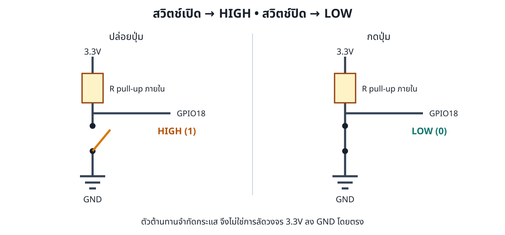
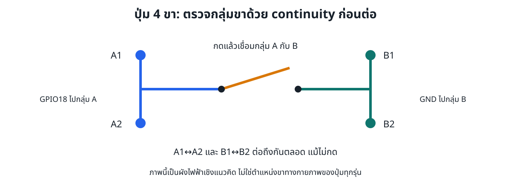
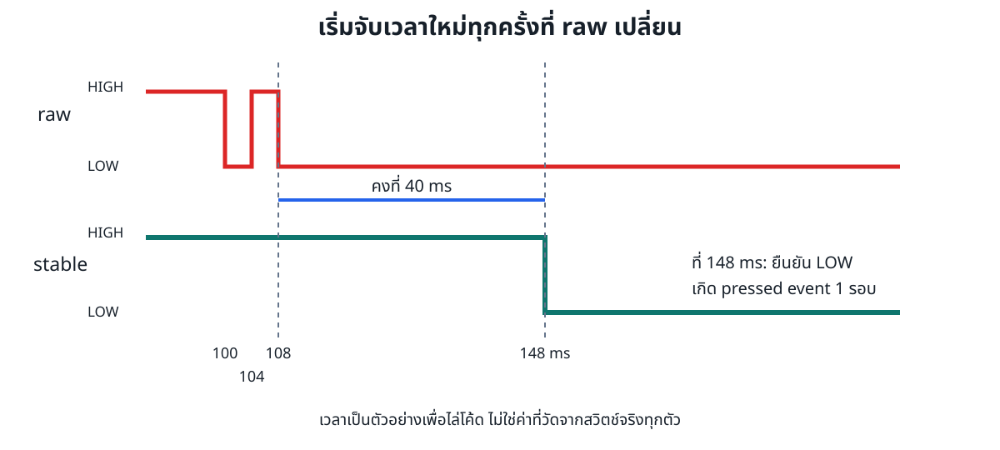
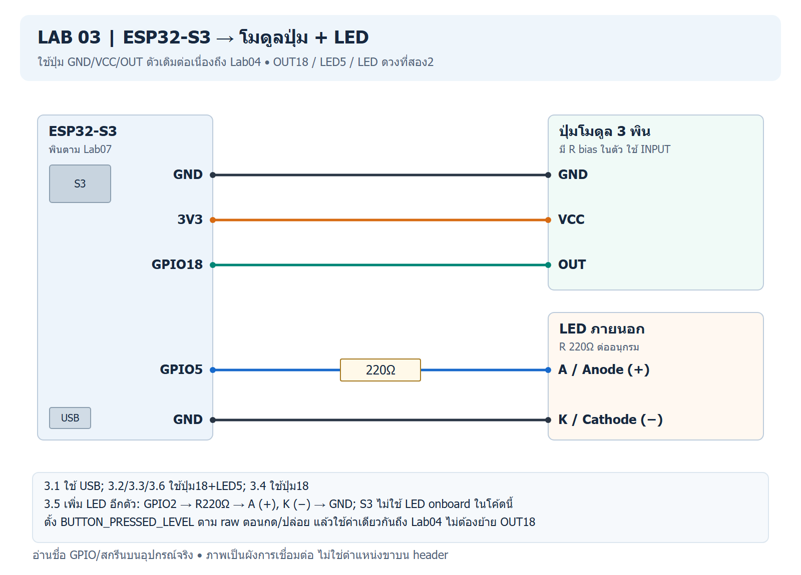
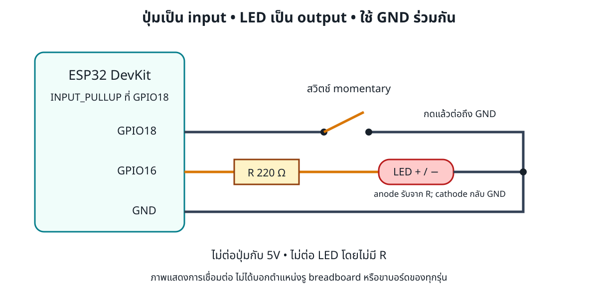
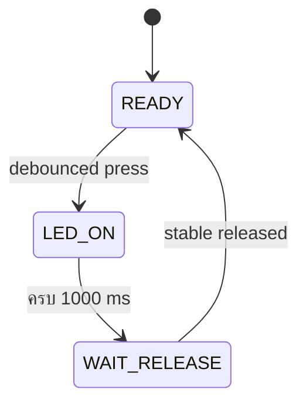

# Lab 03: ตัวแปร เงื่อนไข ลูป และฟังก์ชัน

> ระดับ: ⭐⭐ | เวลา: 2–3 ชม. | ต้องผ่าน: [Lab 02](../lab02-blink-serial/)

ใน Lab 02 เราสั่ง LED จากเวลาและ Serial บทนี้จะให้ปุ่มเป็นผู้เริ่มงาน แต่ปุ่มหนึ่งครั้งไม่ได้มีเพียงคำถามว่า “กดอยู่ไหม” เราต้องแยก “เพิ่งกด” จาก “ยังกดค้าง” และรับมือหน้าสัมผัสเด้ง ก่อนนำเหตุการณ์ไปนับ เลือกรูปแบบไฟ และควบคุมงานหลายขั้น

เรียนตามลำดับ **ตัวแปร/ฟังก์ชัน → ค่าปุ่มดิบ → edge → debounce → ตัวนับ → array/switch → state machine** แต่ละการทดลองมี `.ino` ฉบับเต็มหนึ่งไฟล์ โค้ดย่อยในคำอธิบายคือส่วนที่เติม/แก้ใน sketch นั้น ไม่ต้องสร้างไฟล์ใหม่ทุกช่วง

## 🎯 วัตถุประสงค์

- เลือกชนิดข้อมูล ประกาศ/กำหนดค่าตัวแปร และอธิบาย global/local scope ได้
- อ่านเงื่อนไข `if/else`, ตรรกะ และ `switch` แล้วทำนายทางที่โปรแกรมทำได้
- ใช้ฟังก์ชัน พารามิเตอร์ ค่าคืน array และ for-loop ลดงานซ้ำได้
- แยก raw level, edge และ debounced event จากการกดปุ่มจริงได้
- ออกแบบ state machine พร้อม timer โดยไม่หยุดรอใน loop ได้

## 🧰 อุปกรณ์ที่ใช้

| อุปกรณ์ | จำนวน | หมายเหตุ |
|---|---:|---|
| ESP32-S3 และ USB data | 1 ชุด | ใช้บอร์ดและช่อง USB เดียวกับ Lab07; core 3.x, Serial 115200 baud |
| โมดูลปุ่ม GND/VCC/OUT | 1 | มี R pull-up/pull-down ในตัว, ใช้ไฟ 3.3V, OUT→GPIO18 |
| LED ภายนอกและ R 220 Ω | 2 ชุด | LED หลัก GPIO5 จาก Lab02 และ LED ดวงที่สอง GPIO2 สำหรับ 3.5 |
| Breadboard และ jumper | 1 ชุด | LED แต่ละดวงต้องมี R ของตัวเองและ GND ร่วม |

ใช้ **ESP32-S3 เป็นเส้นทางหลัก** ตลอด Lab02–07: LED หลักคง GPIO5 และปุ่มโมดูลคง OUT→GPIO18 เหมือน Lab04 ไม่ต้องเปลี่ยนเป็นปุ่มเปล่าระหว่างบท GPIO2 ใน 3.5 เป็น LED ภายนอกเพิ่มอีกดวง ไม่ได้อ้างว่าเป็น LED onboard ของ S3

โค้ดเลือกพินตาม target ที่เลือกใน Arduino IDE อัตโนมัติ: `CONFIG_IDF_TARGET_ESP32S3` ใช้ S3 ส่วน `CONFIG_IDF_TARGET_ESP32` รองรับบอร์ด ESP32-WROOM-32 เดิมในรายละเอียดวงจรด้านล่าง เลือก Board ให้ตรงฮาร์ดแวร์ก่อน Upload

## ❓ คำถามก่อนเริ่มต้น

<details>
<summary><b>คลิกเพื่อดูคำถามก่อนเรียน</b></summary>

1. ตัวแปรและค่าคงที่ต่างกันอย่างไร?
2. ปุ่มกดหนึ่งครั้งอาจถูกอ่านเป็นหลายครั้งได้เพราะอะไร?
3. ขอบสัญญาณกดต่างจากการตรวจว่าปุ่มยังถูกกดอย่างไร?
4. ฟังก์ชันช่วยลดโค้ดซ้ำได้อย่างไร?
5. `switch` เหมาะกับปัญหาแบบใด?
6. state machine ช่วยให้งานหลายขั้นไม่ต้องใช้ `delay()` ได้อย่างไร?

</details>

## 📖 ทฤษฎี

### 1. ตัวแปรเก็บอะไร และมีชีวิตอยู่ตรงไหน

สมมติเราต้องนับผู้เข้าห้อง หมายเลขขาปุ่มไม่ควรเปลี่ยนระหว่างรัน จึงเป็นค่าคงที่ ส่วนจำนวนคนต้องเพิ่มได้ จึงเป็นตัวแปร เมื่อเขียน `uint32_t count = 0;` เราบอกทั้งชนิด ชื่อ และค่าเริ่มต้น ส่วน `count = count + 1;` เปลี่ยนค่าของตัวแปรที่มีอยู่แล้ว

| ชนิด/คำสั่ง | ใช้กับข้อมูลแบบใด | ตัวอย่างที่เกี่ยวกับบทนี้ |
|---|---|---|
| `bool` | true/false | ปุ่มถูกกดหรือไม่, LED เปิดอยู่หรือไม่ |
| `uint8_t` | จำนวนเต็ม 0–255 | หมายเลขขาและ mode 0–2 |
| `uint32_t` | จำนวนเต็มไม่ติดลบ 32-bit | ตัวนับและค่าเวลาจาก millis |
| `int` | จำนวนเต็มมีเครื่องหมาย | จำนวนก้าวที่เพิ่มหรือลดได้ |
| `float` | จำนวนทศนิยม | ค่าอุณหภูมิจำลองและผลแปลงหน่วย |
| `char` / `String` | อักขระหนึ่งตัว / ข้อความ | `'A'` ต่างจาก `"AUTO"` ที่เป็นข้อความ |
| `const` | ค่าที่แก้ไม่ได้หลัง initialization | ค่าที่อ่านมาแล้วคงไว้ในรอบนั้น |
| `constexpr` | ค่าคงที่ที่คำนวณได้ตอน compile | pin และ interval |
| `#define` | macro แทนข้อความก่อน compile | ใช้ได้ แต่ค่าคงที่แบบมีชนิดมักอ่าน/ตรวจง่ายกว่า |

Global variable ประกาศนอกฟังก์ชัน เก็บค่าข้ามการเรียก loop ได้ ส่วน local variable ประกาศในบล็อก `{...}` และมองเห็นในขอบเขตนั้น การประกาศตัวนับ local ธรรมดาเป็นศูนย์ทุก loop จึงนับต่อไม่ได้ ฟังก์ชันรับค่าผ่าน **พารามิเตอร์** และคืนผลด้วย **return** ช่วยให้เราแยกการคำนวณจากการพิมพ์ได้

`static` local ใช้เก็บค่าข้ามการเรียกฟังก์ชันโดยยังจำกัดชื่อไว้ในฟังก์ชันนั้น ส่วน `volatile` เกี่ยวกับค่าที่อาจเปลี่ยนนอกเส้นทางปกติ เช่น ISR แต่ไม่ทำให้การเพิ่มตัวนับเป็น atomic และไม่ใช่ตัวล็อกระหว่าง task โค้ดในบทนี้ใช้ polling จึงยังไม่ต้องใช้ volatile หรือ interrupt

### 2. การกำหนดค่า เงื่อนไข และตัวดำเนินการ

`ledOn = true;` เป็นการเขียนค่า แต่ `ledOn == true` เป็นคำถามที่ได้ผล true/false สำหรับโมดูลปุ่มเราเขียน `pressed = digitalRead(BUTTON_PIN) == BUTTON_PRESSED_LEVEL` เพื่อแปลระดับไฟฟ้าเป็นความหมายของปุ่ม ค่าเริ่มต้นคือ LOW และเปลี่ยนเป็น HIGH ได้ถ้าผลทดสอบโมดูลเป็นอีกแบบ

| สัญลักษณ์ | อ่านว่า | ใช้คิดกับปุ่มอย่างไร |
|---|---|---|
| `==` / `!=` | เท่ากับ / ไม่เท่ากับ | raw เปลี่ยนจากครั้งก่อนหรือไม่ |
| `<`, `>=` | น้อยกว่า / มากกว่าหรือเท่ากับ | คงที่ครบ 40 ms หรือยัง |
| `&&` | ต้องจริงทั้งคู่ | ก่อนหน้าไม่ใช่ระดับกด และตอนนี้เป็นระดับกด |
| `||` | จริงอย่างน้อยหนึ่งเงื่อนไข | ยังไม่ครบเวลา หรือยังเป็น stable ค่าเดิม |
| `!` | กลับค่าตรรกะ | toggle LED หรือถามว่าไม่ถูกกด |
| `%` | เศษจากการหาร | `(mode+1)%3` วน 0→1→2→0 |

`if` ทำบล็อกเมื่อเงื่อนไขจริง `else if/else` เลือกทางถัดไปเมื่อทางก่อนหน้าไม่ตรง ส่วน `switch` เหมาะกับ state/mode ที่มีค่าชัดเจน ใช้ `break` จบแต่ละ case เพื่อไม่ไหลลง case ถัดไป

### 3. for-loop ต่างจาก Arduino loop() อย่างไร

`loop()` เป็นฟังก์ชันที่ core เรียกซ้ำ แต่ `for/while/do-while` เป็นโครงสร้างทำซ้ำ **ภายในการเรียกฟังก์ชันรอบหนึ่ง** การวน for ตั้งขา LED สองดวงใช้เวลาไม่นาน จึงเหมาะกับ setup แต่การ while รอปุ่มปล่อยอาจขวางงานอื่นไม่มีกำหนด

| โครงสร้าง | ใช้เมื่อ | จุดที่ต้องระวัง |
|---|---|---|
| `for` | รู้จำนวนครั้ง เช่น LED 2 ดวง | array เริ่ม index 0 และหยุดก่อนขนาด |
| `while` | ตรวจเงื่อนไขก่อนแต่ละรอบ | ถ้าค่าไม่เปลี่ยน อาจวนไม่จบ |
| `do...while` | ต้องทำก่อนอย่างน้อย 1 ครั้ง | ยัง block ได้ถ้าวนรอ hardware |
| `break` | ออกจาก loop/switch ที่ครอบอยู่ชั้นในสุด | ไม่ได้แปลว่าจบ Arduino loop() เสมอ |
| `continue` | ข้ามงานที่เหลือไป iteration ถัดไป | ไม่ใช่การคืนค่าจากฟังก์ชัน |
| `return` | จบการเรียกฟังก์ชันนี้ | core ยังเรียก Arduino loop รอบใหม่ต่อ |

### 4. แปลระดับ OUT ของโมดูลเป็นสถานะกด

โมดูลปุ่มหลักมีพิน GND/VCC/OUT และตัวต้านทานกำหนดระดับ input อยู่บนโมดูล ใช้ VCC=3.3V และ `pinMode(BUTTON_PIN, INPUT)` แล้วอ่าน OUT ที่ GPIO18 อย่าเดาระดับกดจากสีของบอร์ด ให้ใช้ 3.2 ดู raw ตอนปล่อย/กดค้าง แล้วตั้ง `BUTTON_PRESSED_LEVEL` ให้ตรงกันทุก sketch รวมถึง Lab04

| สิ่งที่เกิด | raw ของตัวอย่าง active LOW | ความหมาย pressed |
|---|---|---|
| ปล่อย | HIGH | false |
| กด | LOW | true |

ถ้ากดแล้ว raw=HIGH ให้ตั้ง `BUTTON_PRESSED_LEVEL = HIGH` เงื่อนไขขอบกดและรอปล่อยในตัวอย่างจะใช้ค่าคงที่นี้ จึงไม่ต้องแก้เงื่อนไขหลายจุด เริ่มตัวแปร raw/stable จากพินจริงใน setup เพื่อไม่สร้างขอบกดจากค่าเริ่มต้นที่เดาไว้ หากกดค้างตอนเปิดเครื่อง ให้ปล่อยก่อนแล้วจึงเริ่มกดครั้งแรก

<details>
<summary><b>ทางเลือกเพื่อศึกษาหลักการ: ปุ่มเปล่ากับ INPUT_PULLUP</b></summary>

เส้นทางหลักของคอร์สใช้โมดูลสามพินต่อค้างไว้ ส่วนนี้อธิบายวงจรปุ่มเปล่าสำหรับผู้ที่ต้องการทดลองเพิ่มเติม และเป็นบริบทของข้อสอบที่ระบุ `INPUT_PULLUP`

1. ถอด USB และถอด OUT ของโมดูลออกจาก GPIO18 ก่อนใช้ปุ่มเปล่าที่พินเดียวกัน
2. ต่อ GPIO18 ↔ ปุ่มเปล่า ↔ GND แล้วเปลี่ยน `pinMode(BUTTON_PIN, INPUT)` ใน sketch เป็น `INPUT_PULLUP`; กำหนด `BUTTON_PRESSED_LEVEL = LOW`
3. ตัวต้านทานภายในดึง input ไป 3.3V ตอนปล่อยจึงอ่าน HIGH และเมื่อกดลง GND จึงอ่าน LOW ปุ่มเปล่าไม่ต้องมีสาย VCC
4. ปุ่ม 4 ขาต้องตรวจ continuity ขณะถอดไฟ: เลือก GPIO/GND จากคนละกลุ่มหน้าสัมผัสที่ต่อถึงกันเฉพาะเมื่อกด





เมื่อกลับเส้นทางหลัก ให้ถอดปุ่มเปล่า ต่อ OUT ของโมดูลที่ GPIO18 และคืน `INPUT` พร้อมตั้งระดับกดจากผลทดสอบโมดูล

</details>

### 5. หนึ่งครั้งในชีวิตจริงมีหลาย edge ได้

หน้าสัมผัสกลไกอาจสั่นเปิด/ปิดในช่วงสั้น ๆ ตอนกดหรือปล่อย เรียก contact bounce แม้โค้ดตรวจขอบกดก็ยังอาจเห็นหลายขอบ การกรองในบทนี้จึงรีเซ็ตเวลาเมื่อ raw เปลี่ยน แล้วรอให้ค่าเดิมคงอยู่อย่างน้อย 40 ms ก่อนยอมรับ stable ใหม่



40 ms เป็นค่าตั้งต้นสำหรับทดลอง ไม่ใช่ค่าที่ใช้ได้เหมาะกับสวิตช์ทุกชนิด ต้องแลกความไวกับการกรอง และการแตะสั้นกว่าช่วงนี้อาจไม่ถูกยอมรับ

## 🔌 การต่อวงจร

### วงจรหลัก ESP32-S3: โมดูลปุ่ม + LED ภายนอก



ภาพแสดงชื่อ GPIO ที่ต้องต่อถึงกัน ให้หาสกรีน `5`/`IO5`, `2`/`IO2`, `18`/`IO18`, `3V3` และ `GND` ของบอร์ดจริง หมายเลข GPIO ไม่ใช่ลำดับรู header ใช้บอร์ด S3 และ pin mapping เดียวกับ Lab07; GPIO5 เป็นขา LED เสริมสำหรับ Lab02/03/06 ที่ไม่ชนอุปกรณ์หลักของ Lab07

| สาย/จุดต่อ | จากพินหรือขั้ว | ไปพินหรือขั้ว | วิธีต่อ |
|---|---|---|---|
| USB | คอมพิวเตอร์ | ช่อง USB ของ ESP32-S3 | ใช้สาย data และช่องเดียวกับที่ใช้ใน Lab07 |
| ไฟโมดูลปุ่ม | ESP32-S3 `3V3` | ปุ่ม `VCC` | ใช้โมดูลที่รองรับ 3.3V และมี R ในตัว |
| กราวด์โมดูลปุ่ม | ESP32-S3 `GND` | ปุ่ม `GND` | GND ร่วมกับบอร์ดและ LED |
| สัญญาณปุ่ม | ปุ่ม `OUT` | ESP32-S3 `GPIO18` | ใช้ `INPUT`; OUT ต้องไม่เกิน 3.3V |
| LED หลัก | ESP32-S3 `GPIO5` | R 220 Ω ตัวที่ 1 → LED1 anode (+) | คงวงจรเดียวกับ Lab02 |
| ทางกลับ LED1 | LED1 cathode (−) | ESP32-S3 `GND` | ขาสั้น/ด้านแบนเมื่อยังระบุขั้วได้ |
| LED ดวงที่สอง | ESP32-S3 `GPIO2` | R 220 Ω ตัวที่ 2 → LED2 anode (+) | เพิ่มสำหรับ 3.5; LED ภายนอก active HIGH |
| ทางกลับ LED2 | LED2 cathode (−) | ESP32-S3 `GND` | ใช้ R แยกจาก LED1 |

1. ถอด USB ก่อนต่อหรือแก้สาย ใช้ LED1 ที่ GPIO5 จาก Lab02 ต่อค้างไว้
2. ต่อโมดูลปุ่มตามชื่อสกรีน `GND/VCC/OUT` ไม่เดาตำแหน่งขาจากสีหรือรูปโมดูล แล้วตรวจ VCC=3V3 และ OUT=GPIO18
3. ต่อ LED2 ที่ GPIO2 ผ่าน R 220 Ω ของตนเองถ้าจะทำ 3.5 ขา LED แต่ละคู่ต้องอยู่คนละแถว breadboard
4. ตรวจสายแล้วเสียบ USB ใช้ 3.2 อ่าน raw ตอนปล่อย/กดค้าง จากนั้นตั้ง `BUTTON_PRESSED_LEVEL` ให้ตรงโมดูลก่อนทำ 3.3–3.6
5. เมื่อไป Lab04 คงโมดูลปุ่มเดิมที่ GPIO18 และ LED เดิมไว้ ไม่เพิ่มปุ่มอีกตัวบน OUT18 และคง LED หลักที่ GPIO5/ดวงที่สองที่ GPIO2 ตามผังเดียวกัน

| การทดลอง | วงจรที่ใช้ตาม sketch ที่ให้บน S3 |
|---|---|
| 3.1 ตัวแปร | USB data อย่างเดียว; ค่าอุณหภูมิจำลอง ไม่ใช้ DHT11 |
| 3.2 อ่านปุ่ม, 3.3 Toggle และ 3.6 State machine | โมดูลปุ่ม VCC3V3/GND/OUT18 + LED1 GPIO5 ผ่าน R 220 Ω ลง GND |
| 3.4 นับจำนวนครั้ง | โมดูลปุ่มเดิม OUT18; ไม่จำเป็นต้องใช้ LED |
| 3.5 Pattern | โมดูลปุ่มเดิม OUT18 + LED1 GPIO5 + LED2 ภายนอก GPIO2 ผ่าน R แยกกัน |

<details>
<summary><b>รองรับ ESP32-WROOM-32 เดิม: ตารางและภาพวงจร legacy</b></summary>

โค้ดส่วน `#elif defined(CONFIG_IDF_TARGET_ESP32)` ใช้ mapping ของ ESP32 รุ่นเดิมเมื่อเลือก **ESP32 Dev Module** เท่านั้น ไม่ใช้พินชุดนี้แทน S3

| อุปกรณ์ | ESP32-WROOM-32 | วิธีต่อ |
|---|---|---|
| LED หลัก | GPIO16 | GPIO16 → R 220 Ω → anode; cathode→GND |
| LED ดวงที่สอง | GPIO2 | LED ภายนอก+R 220 Ω อีกชุด; ใช้ onboard ได้เฉพาะบอร์ดที่ยืนยัน GPIO2/active HIGH |
| โมดูลปุ่ม | OUT→GPIO18 | VCC→3V3, GND→GND, `INPUT` และตั้งระดับกดให้ตรงโมดูล |



ภาพ legacy แสดงปุ่มเปล่าลง GND หากใช้ภาพนี้ต้องใช้ทางเลือก `INPUT_PULLUP` ตามหัวข้อทฤษฎี ส่วนเส้นทางโมดูลสามพินยังต่อ VCC3V3/GND/OUT18 และใช้ `INPUT` ไม่ต้องเปลี่ยนสายไปปุ่มเปล่า ดูสกรีนบอร์ดเดิมจาก [pinout Lab01](../lab01-esp32-introduction/images/lab01-pinout-circuitstate.png)

</details>

_ภาพของโครงการมีทะเบียนใน [`IMAGE_SOURCES.md`](../../assets/IMAGE_SOURCES.md) วงจรหลักและภาพ legacy แยกบอร์ด/ชนิดปุ่มชัดเจน ไม่ใช่ผังรู breadboard ของทุกรุ่น_

## 🧪 การทดลอง

### เตรียม sketch และหลักฐานการเรียน

1. เลือก **ESP32S3 Dev Module** และ Port ของบอร์ดจริง เครื่องอ้างอิงใน Lab07 ใช้ USB-to-Serial CH343 ที่ COM7 โดยตั้ง **USB CDC On Boot: Disabled**, Upload Speed 115200 และ Serial Monitor 115200; เลือก COM ให้ตรงเครื่องของตน
2. ตั้ง Flash Size/PSRAM ตามโมดูลจริง เช่นโปรไฟล์บอร์ดอ้างอิง Lab07 ใช้ Flash16MB/OPI PSRAM ไม่กำหนดค่านี้ให้ S3 ทุกรุ่น หากใช้ WROOM เดิมให้เลือก ESP32 Dev Module และใช้ตาราง legacy
3. เริ่ม New Sketch แล้ว Save As ชื่อการทดลอง หรือดาวน์โหลดไฟล์ `.ino` ที่ลิงก์ไว้ โค้ดเต็มแต่ละชุดมี setup/loop อย่างละหนึ่ง
4. ก่อน Upload อ่านคำถาม “ทำนาย” แล้วบันทึกผลคาดการณ์ หลัง Upload ลองเปลี่ยนเพียงหนึ่งอย่างและเทียบกับผลจริง
5. ค่าตัวเลขและ Serial ใน README เป็นตัวอย่างคาดหวัง ไม่ใช่หลักฐานว่าผู้เขียนทดสอบวงจรจริงในรอบปรับปรุงนี้

### การทดลองที่ 3.1: ตัวแปรที่จำค่า และฟังก์ชันที่คำนวณค่า

**วงจรที่ใช้:** USB data อย่างเดียว ไม่ต้องต่อ sensor; ค่าอุณหภูมิในโค้ดเป็นค่าจำลอง

**ทำนาย:** ถ้าประกาศตัวนับเป็นศูนย์ภายใน loop ธรรมดา จะนับ 1,2,3 ต่อกันได้หรือไม่?

1. เริ่มจาก Serial sketch ของ Lab 02 ประกาศ `reportCount` และ `previousReportMs` ก่อน setup เพื่อเก็บข้ามรอบ และกำหนด interval คงที่ 2000 ms
2. ใน loop อ่าน now แล้วใช้ if/return ข้ามรอบที่ยังไม่ครบ 2 วินาที บันทึก previous และเพิ่ม reportCount เมื่อถึงเวลาเท่านั้น
3. ประกาศ local `celsius` จากสูตร `25.0F + reportCount*0.1F` ตัวอักษร F หมายถึง float literal ค่านี้จำลอง ไม่ได้อ่านจาก sensor
4. แยกสูตรแปลงเป็นฟังก์ชันก่อน setup โดย `float celsiusToFahrenheit(float celsius)` รับหนึ่งค่า แล้ว return `celsius*1.8F+32.0F`
5. เรียกฟังก์ชันใน loop เก็บค่าคืนเป็น fahrenheit แล้วพิมพ์ทั้งสามค่า เทียบกับตารางและผลด้านล่าง

[ดาวน์โหลด `lab03_variables.ino`](code/lab03_variables/lab03_variables.ino)

```cpp
/*
 * Lab 03.1 : ตัวแปรและฟังก์ชัน
 * คำอธิบาย : สร้างอุณหภูมิจำลองและแปลง Celsius เป็น Fahrenheit ทุก 2 วินาที
 * วงจร     : ESP32 ต่อคอมพิวเตอร์ด้วย USB data ไม่ต้องใช้ sensor
 * ไลบรารี  : ไม่ใช้ไลบรารีภายนอก
 * Board    : ESP32S3 Dev Module; ESP32 Dev Module ใช้ได้ (core 3.x)
 */
#include <Arduino.h>

constexpr uint32_t REPORT_INTERVAL_MS = 2000;
uint32_t previousReportMs = 0;
uint32_t reportCount = 0;

// celsius เป็นพารามิเตอร์ local; return ส่งค่าคำนวณกลับผู้เรียก
float celsiusToFahrenheit(float celsius) {
  return celsius * 1.8F + 32.0F;
}

void setup() {
  Serial.begin(115200);
  Serial.println("[VAR] อุณหภูมิจำลอง ไม่ใช่ค่าจาก sensor");
}

void loop() {
  const uint32_t now = millis();
  if (now - previousReportMs < REPORT_INTERVAL_MS) {
    return;  // ยังไม่ถึงเวลา จบรอบนี้โดยไม่หยุดรอ
  }
  previousReportMs = now;
  reportCount++;

  // ค่าจำลองเปลี่ยนทีละ 0.1 C เพื่อให้เห็นความสัมพันธ์ของตัวแปร
  const float celsius = 25.0F + reportCount * 0.1F;
  const float fahrenheit = celsiusToFahrenheit(celsius);
  Serial.printf("[VAR] count=%lu C=%.1f F=%.1f\n",
                static_cast<unsigned long>(reportCount), celsius, fahrenheit);
}
```

| ส่วนของโค้ด | หน้าที่ |
|---|---|
| `constexpr REPORT_INTERVAL_MS` | ช่วงรายงานคงที่ ตรวจได้ตอน compile |
| `reportCount++` | เปลี่ยน global state เมื่อถึงรอบรายงาน |
| `const float celsius` ใน loop | ค่าของรอบนี้ เกิดใหม่ทุกครั้งที่เข้าถึงบรรทัดนี้ |
| พารามิเตอร์ celsius ในฟังก์ชัน | รับสำเนาค่าจากผู้เรียก มี scope ของฟังก์ชันตนเอง |
| `return ...;` | คืนผลคำนวณ ไม่ได้พิมพ์ Serial เอง |
| `%.1f` | แสดงทศนิยม 1 ตำแหน่ง ไม่ได้เพิ่มความแม่นของค่าจำลอง |

ผลลัพธ์ประมาณทุก 2 วินาที:

```text
[VAR] count=1 C=25.1 F=77.2
[VAR] count=2 C=25.2 F=77.4
```

**ลองเปลี่ยน:** ย้าย `reportCount = 0` ไปประกาศใน loop แล้วดูตัวนับกลับเป็น 1 จากนั้นคืนตำแหน่งเดิม ลองเพิ่ม 0.5F แทน 0.1F แล้วคำนวณผล Fahrenheit ก่อนดูจอ

**จุดตรวจ:** แยก “ประกาศฟังก์ชัน” จาก “เรียกฟังก์ชัน” ได้ และอธิบายได้ว่าทำไมตัวนับต้องจำค่าข้ามรอบ แต่ celsius ของรอบนี้เป็น local ได้

**ภารกิจท้าทาย:** เพิ่มฟังก์ชันแปลง Fahrenheit กลับเป็น Celsius แล้วทดสอบกับค่าที่รู้ผล

### การทดลองที่ 3.2: ระดับค้าง กับขอบกด เป็นคนละข้อมูล

**วงจรที่ใช้:** S3: โมดูลปุ่ม VCC3V3/GND/OUT→GPIO18 และ GPIO5 → R 220 Ω → LED anode, cathode→GND; WROOM ใช้ LED16 ตามตาราง legacy

1. ต่อโมดูลปุ่ม/LED ตามวงจรหลัก ใน setup กำหนด `pinMode(BUTTON_PIN, INPUT)` เพราะโมดูลมี R ในตัว เริ่ม `previousLevel` จากค่าพินจริง และกำหนด LED เป็น OUTPUT
2. Upload ฉบับเต็มแล้วดู raw ที่รายงานทุก 500 ms ขณะปล่อยและกดค้าง ตัวอย่าง active LOW จะปล่อย=1 กด=0 โค้ดใช้ millis จึงไม่ต้องเพิ่ม delay เพื่ออ่านข้อความ
3. ถ้ากดได้ LOW ใช้ค่าตั้งต้น ถ้ากดได้ HIGH เปลี่ยน `BUTTON_PRESSED_LEVEL` เป็น HIGH แล้ว Upload ใหม่ จากนั้นตรวจขอบกดด้วยก่อนหน้าไม่ใช่ระดับกดและตอนนี้เป็นระดับกด (falling edge สำหรับตัวอย่าง active LOW)
4. หลังตรวจเงื่อนไขจึงอัปเดต previous เป็น current หากอัปเดตก่อน ทั้งสองจะเท่ากันและมองไม่เห็น edge
5. กดค้าง 2 วินาทีแล้วปล่อย LED ติดตามระดับกด ส่วน Serial มี raw เป็นระยะและข้อความ pressed/released เฉพาะเมื่อเกิด edge

[ดาวน์โหลด `lab03_button_read.ino`](code/lab03_button_read/lab03_button_read.ino)

```cpp
/*
 * Lab 03.2 : อ่านปุ่มดิบและตรวจ edge
 * คำอธิบาย : LED ติดขณะกด รายงาน raw ทุก 500 ms และ edge ตอนเปลี่ยนระดับ; ยังไม่ debounce
 * วงจร     : S3: GPIO5 -> R220Ω -> LED -> GND; WROOM: GPIO16; ปุ่มโมดูล VCC3V3/GND/OUT18
 * ไลบรารี  : ไม่ใช้ไลบรารีภายนอก
 * Board    : ESP32S3 Dev Module (หลัก) / ESP32 Dev Module (WROOM), core 3.x
 */
#include <Arduino.h>

#if defined(CONFIG_IDF_TARGET_ESP32S3)
constexpr uint8_t LED_PIN = 5;  // LED ภายนอกหลัก คงขานี้จาก Lab02
constexpr uint8_t BUTTON_PIN = 18;
#elif defined(CONFIG_IDF_TARGET_ESP32)
constexpr uint8_t LED_PIN = 16;  // สำหรับ ESP32-WROOM-32 รุ่นเดิม
constexpr uint8_t BUTTON_PIN = 18;
#else
#error "Select ESP32S3 Dev Module or ESP32 Dev Module"
#endif
constexpr uint8_t BUTTON_PRESSED_LEVEL = LOW;  // ถ้ากดแล้ว raw=HIGH ให้เปลี่ยนเป็น HIGH
bool previousLevel = HIGH;
constexpr uint32_t REPORT_INTERVAL_MS = 500;
uint32_t previousReportMs = 0;

void setup() {
  Serial.begin(115200);
  pinMode(BUTTON_PIN, INPUT);  // โมดูลมี R pull-up/pull-down ในตัว
  previousLevel = digitalRead(BUTTON_PIN);
  pinMode(LED_PIN, OUTPUT);
  digitalWrite(LED_PIN, LOW);
  Serial.printf("[BUTTON] pin=%u LED=%u pressedLevel=%u; ตรวจ raw ตอนปล่อย/กด\n",
                BUTTON_PIN, LED_PIN, BUTTON_PRESSED_LEVEL);
}

void loop() {
  const bool currentLevel = digitalRead(BUTTON_PIN);
  const bool pressed = currentLevel == BUTTON_PRESSED_LEVEL;
  digitalWrite(LED_PIN, pressed ? HIGH : LOW);

  // ต้องมีค่าก่อนหน้าเพื่อแยก "เพิ่งกด" ออกจาก "ยังกดค้าง"
  if (previousLevel != BUTTON_PRESSED_LEVEL && currentLevel == BUTTON_PRESSED_LEVEL) {
    Serial.println("[BUTTON] pressed raw edge");
  } else if (previousLevel == BUTTON_PRESSED_LEVEL && currentLevel != BUTTON_PRESSED_LEVEL) {
    Serial.println("[BUTTON] released raw edge");
  }
  previousLevel = currentLevel;
  const uint32_t now = millis();
  if (now - previousReportMs >= REPORT_INTERVAL_MS) {
    previousReportMs = now;
    Serial.printf("[BUTTON] raw=%u pressed=%u\n", currentLevel, pressed);
  }
}
```

| ส่วนของโค้ด | หน้าที่ |
|---|---|
| `currentLevel == BUTTON_PRESSED_LEVEL` | แปลระดับ OUT เป็น bool pressed ตามโมดูลที่ตรวจแล้ว |
| ก่อนหน้าไม่ใช่ระดับกด `&&` ตอนนี้เป็นระดับกด | ต้องจริงทั้งสองส่วนจึงเป็นขอบกด |
| `else if` กลับทิศ | แยกขอบปล่อย; ตัวอย่าง active LOW คือ LOW→HIGH |
| `previousLevel = currentLevel` ท้าย loop | เตรียมอดีตของรอบถัดไป |
| รายงาน raw ทุก 500 ms | ใช้เทียบระดับปล่อย/กดของโมดูลก่อนตั้ง BUTTON_PRESSED_LEVEL |
| ไม่มี debounce | หนึ่งกดจริงยังอาจเกิด raw edge หลายครั้งจาก bounce |

ตัวอย่างตารางขอบสัญญาณเมื่อ `BUTTON_PRESSED_LEVEL = LOW`:

| previous | current | เหตุการณ์ |
|---|---|---|
| HIGH | HIGH | ปล่อยค้าง |
| HIGH | LOW | ขอบกด |
| LOW | LOW | กดค้าง |
| LOW | HIGH | ขอบปล่อย |

ผลตัวอย่างบน S3 เมื่อปล่อย/กด/ปล่อยหนึ่งครั้งแบบ active LOW:

```text
[BUTTON] pin=18 LED=5 pressedLevel=0; ตรวจ raw ตอนปล่อย/กด
[BUTTON] raw=1 pressed=0
[BUTTON] pressed raw edge
[BUTTON] raw=0 pressed=1
[BUTTON] released raw edge
```

**สังเกตเพิ่ม:** ถ้าข้อความออกหลายบรรทัดเร็วมากแม้กดครั้งเดียว อย่าเพิ่งสรุปว่า if ผิด เราจะตรวจเรื่อง bounce ต่อใน 3.3 การไม่พบ bounce ชัดในบางครั้งก็ไม่ได้พิสูจน์ว่าสวิตช์ไม่มี bounce

**จุดตรวจ:** บอกได้ว่าการกดค้างไม่ควรสร้าง “ขอบกด” ทุก loop แต่ raw bounce ยังทำให้มีหลายขอบได้

**ภารกิจท้าทาย:** เพิ่มตัวนับ raw edge แล้วเปรียบเทียบกับจำนวนการกดที่ใช้มือจริง

### การทดลองที่ 3.3: Debounce ก่อน Toggle

**วงจรที่ใช้:** โมดูลปุ่ม OUT18 และ LED ภายนอกหลัก GPIO5 บน S3 ชุดเดิมจาก 3.2 ไม่ต้องย้ายสาย; WROOM ใช้ LED16

1. เริ่มจากแนวคิด 3.2 แยกสถานะสามอย่าง: raw ปัจจุบัน, raw ครั้งก่อน และ stable ที่ยืนยันแล้ว อย่าใช้ตัวแปรเดียวแทนทั้งหมด
2. เมื่อ raw เปลี่ยนให้บันทึก `lastRawChangeMs = now` ทุกครั้ง ไม่ใช่เฉพาะขอบกด การ bounce จึงเริ่มนับเวลาคงที่ใหม่
3. ถ้ายังไม่ครบ 40 ms **หรือ** raw เท่ากับ stable เดิม ให้คืน false ออกจากฟังก์ชัน ยังไม่ใช่เหตุการณ์ใหม่
4. เมื่อครบและเปลี่ยนจริง อัปเดต stable แล้วคืน true เฉพาะเมื่อค่าใหม่เท่ากับ `BUTTON_PRESSED_LEVEL` การปล่อยต้องอัปเดต stable เช่นกันแต่ไม่สั่ง toggle
5. ใน loop เรียก `pressedEdge(now)` ทุกครั้ง ถ้าคืน true จึงกลับค่า ledOn ด้วย `!` เขียนขาจริง แล้วรายงาน

[ดาวน์โหลด `lab03_debounce_toggle.ino`](code/lab03_debounce_toggle/lab03_debounce_toggle.ino)

```cpp
/*
 * Lab 03.3 : Debounce และ toggle
 * คำอธิบาย : ยืนยันค่าที่คงที่ 40 ms แล้วสลับ LED เฉพาะขอบกด
 * วงจร     : S3: GPIO5 -> R220Ω -> LED -> GND; WROOM: GPIO16; ปุ่มโมดูล VCC3V3/GND/OUT18
 * ไลบรารี  : ไม่ใช้ไลบรารีภายนอก
 * Board    : ESP32S3 Dev Module (หลัก) / ESP32 Dev Module (WROOM), core 3.x
 */
#include <Arduino.h>

#if defined(CONFIG_IDF_TARGET_ESP32S3)
constexpr uint8_t LED_PIN = 5;  // LED ภายนอกหลัก คงขานี้จาก Lab02
constexpr uint8_t BUTTON_PIN = 18;
#elif defined(CONFIG_IDF_TARGET_ESP32)
constexpr uint8_t LED_PIN = 16;  // สำหรับ ESP32-WROOM-32 รุ่นเดิม
constexpr uint8_t BUTTON_PIN = 18;
#else
#error "Select ESP32S3 Dev Module or ESP32 Dev Module"
#endif
constexpr uint8_t BUTTON_PRESSED_LEVEL = LOW;  // ถ้ากดแล้ว raw=HIGH ให้เปลี่ยนเป็น HIGH
constexpr uint32_t DEBOUNCE_MS = 40;
bool lastRawLevel = HIGH;
bool stableLevel = HIGH;
bool ledOn = false;
uint32_t lastRawChangeMs = 0;

// คืน true เฉพาะรอบที่ยืนยันขอบกดใหม่ ไม่คืน true ซ้ำระหว่างกดค้าง
bool pressedEdge(uint32_t now) {
  const bool rawLevel = digitalRead(BUTTON_PIN);
  if (rawLevel != lastRawLevel) {
    lastRawChangeMs = now;
    lastRawLevel = rawLevel;
  }
  if (now - lastRawChangeMs < DEBOUNCE_MS || rawLevel == stableLevel) {
    return false;
  }
  stableLevel = rawLevel;
  return stableLevel == BUTTON_PRESSED_LEVEL;
}

void setup() {
  Serial.begin(115200);
  pinMode(BUTTON_PIN, INPUT);  // โมดูลมี R ในตัว ใช้ระดับ OUT ที่ไม่เกิน 3.3V
  // เริ่ม raw/stable จากขาจริง กดค้างขณะเปิดเครื่องไม่สร้างขอบกดปลอม
  lastRawLevel = digitalRead(BUTTON_PIN);
  stableLevel = lastRawLevel;
  lastRawChangeMs = millis();
  pinMode(LED_PIN, OUTPUT);
  digitalWrite(LED_PIN, LOW);
  Serial.println("[BUTTON] debounce 40 ms พร้อมทำงาน");
}

void loop() {
  const uint32_t now = millis();
  if (pressedEdge(now)) {
    ledOn = !ledOn;
    digitalWrite(LED_PIN, ledOn ? HIGH : LOW);
    Serial.printf("[BUTTON] LED=%s\n", ledOn ? "ON" : "OFF");
  }
}
```

| ส่วนของโค้ด | หน้าที่ |
|---|---|
| `lastRawLevel` | ค่าที่อ่านครั้งก่อน ใช้รู้ว่าเมื่อใดเริ่มคงที่ใหม่ |
| `stableLevel` | ค่าที่ผ่านเงื่อนไขเวลา ไม่จำเป็นต้องเท่ากับ raw ทุกขณะ |
| `lastRawChangeMs` | เวลาเปลี่ยน raw ครั้งล่าสุด |
| เงื่อนไข `||` | ทางใดทางหนึ่งจริงก็ยังไม่ยอมรับการเปลี่ยนใหม่ |
| `return stableLevel == BUTTON_PRESSED_LEVEL` | ส่ง event true หนึ่งรอบเมื่อ stable เปลี่ยนเป็นระดับกดที่ตั้งไว้ |
| `ledOn = !ledOn` | สลับสถานะ LED เฉพาะ event ไม่ใช่ทุก loop ที่กดค้าง |

ตัวอย่างไล่เวลาสำหรับโมดูล active LOW (`BUTTON_PRESSED_LEVEL = LOW`):

| เวลา (ตัวอย่าง) | raw | การทำงาน |
|---:|---|---|
| 100 ms | LOW | เปลี่ยน raw เริ่มจับใหม่ |
| 104 ms | HIGH | bounce เริ่มจับใหม่ |
| 108 ms | LOW | เริ่มจับใหม่อีกครั้ง |
| 130 ms | LOW | คงที่ 22 ms ยังไม่รับ |
| 148 ms | LOW | ครบ 40 ms ยืนยันกดและ toggle หนึ่งครั้ง |
| 200 ms | LOW | stable เดิม จึงไม่ toggle ซ้ำ |

ผลเมื่อกด–ปล่อยสองครั้ง โดยปล่อยแต่ละครั้งให้ผ่าน debounce:

```text
[BUTTON] LED=ON
[BUTTON] LED=OFF
```

**ลองเปลี่ยน:** ทดลอง 5, 40, 200 ms กดปกติและแตะเร็ว เปรียบเทียบการนับซ้ำกับการตอบสนอง ค่า debounce ที่มากขึ้นไม่ใช่ดีกว่าเสมอ

**จุดตรวจ:** อธิบายได้ว่าเหตุใดต้องยืนยันขอบปล่อยด้วย แม้เราใช้เฉพาะขอบกดมาสั่ง LED

**ภารกิจท้าทาย:** เพิ่มรายงานขอบปล่อยที่ผ่าน debounce โดยยังไม่ toggle ตอนปล่อย

### การทดลองที่ 3.4: เปลี่ยน event เป็นตัวนับ

**วงจรที่ใช้:** โมดูลปุ่ม GND/VCC3V3/OUT18 โดยใช้ `INPUT` และค่าระดับกดที่ตรวจใน 3.2; sketch นี้รายงานทาง Serial จึงไม่จำเป็นต้องใช้ LED

1. คง `pressedEdge()` จาก 3.3 เพิ่ม `uint32_t pressCount = 0;` นอก loop
2. เปลี่ยนงานภายใน if จาก toggle LED เป็น `pressCount++` แล้วพิมพ์ตัวนับ
3. Upload กด–ปล่อยช้า ๆ 10 ครั้ง เทียบกับตัวนับ จากนั้นกดค้าง 3 วินาทีและตรวจว่าเพิ่มเพียงหนึ่งครั้ง
4. กด EN เพื่อเริ่มโปรแกรมใหม่ สังเกตว่าตัวนับเริ่มศูนย์ เพราะไม่ได้บันทึกลง Flash โค้ดนี้ไม่ใช่เครื่องนับถาวรหลังดับไฟ

[ดาวน์โหลด `lab03_press_counter.ino`](code/lab03_press_counter/lab03_press_counter.ino)

```cpp
/*
 * Lab 03.4 : นับจำนวนกดหลัง debounce
 * คำอธิบาย : เพิ่มตัวนับครั้งละหนึ่งเมื่อยืนยันขอบกดใหม่
 * วงจร     : S3/WROOM: โมดูลปุ่ม GND->GND, VCC->3V3, OUT->GPIO18; ไม่จำเป็นต้องต่อ LED
 * ไลบรารี  : ไม่ใช้ไลบรารีภายนอก
 * Board    : ESP32S3 Dev Module (หลัก) / ESP32 Dev Module (WROOM), core 3.x
 */
#include <Arduino.h>

#if defined(CONFIG_IDF_TARGET_ESP32S3)
constexpr uint8_t BUTTON_PIN = 18;
#elif defined(CONFIG_IDF_TARGET_ESP32)
constexpr uint8_t BUTTON_PIN = 18;
#else
#error "Select ESP32S3 Dev Module or ESP32 Dev Module"
#endif
constexpr uint8_t BUTTON_PRESSED_LEVEL = LOW;  // ถ้ากดแล้ว raw=HIGH ให้เปลี่ยนเป็น HIGH
constexpr uint32_t DEBOUNCE_MS = 40;
bool lastRawLevel = HIGH;
bool stableLevel = HIGH;
uint32_t lastRawChangeMs = 0;
uint32_t pressCount = 0;

// ใช้กติกา debounce เดียวกับการทดลอง 3.3
bool pressedEdge(uint32_t now) {
  const bool rawLevel = digitalRead(BUTTON_PIN);
  if (rawLevel != lastRawLevel) {
    lastRawChangeMs = now;
    lastRawLevel = rawLevel;
  }
  if (now - lastRawChangeMs < DEBOUNCE_MS || rawLevel == stableLevel) {
    return false;
  }
  stableLevel = rawLevel;
  return stableLevel == BUTTON_PRESSED_LEVEL;
}

void setup() {
  Serial.begin(115200);
  pinMode(BUTTON_PIN, INPUT);  // โมดูลมี R ในตัว ใช้ระดับ OUT ที่ไม่เกิน 3.3V
  // เริ่ม raw/stable จากขาจริง กดค้างขณะเปิดเครื่องไม่สร้างขอบกดปลอม
  lastRawLevel = digitalRead(BUTTON_PIN);
  stableLevel = lastRawLevel;
  lastRawChangeMs = millis();
  Serial.println("[COUNT] ready: count=0");
}

void loop() {
  if (pressedEdge(millis())) {
    pressCount++;
    Serial.printf("[COUNT] %lu\n", static_cast<unsigned long>(pressCount));
  }
}
```

| ส่วนของโค้ด | หน้าที่ |
|---|---|
| `pressCount` | state ของงานนับ แยกจาก state ของตัวกรองปุ่ม |
| `pressedEdge(millis())` | ส่งค่าเวลาปัจจุบันเป็นพารามิเตอร์ให้ตัวกรอง |
| `pressCount++` ภายใน if | เพิ่มเมื่อมี event เท่านั้น |
| cast + `%lu` | ให้ชนิดตัวนับตรง format ที่พิมพ์ |

ผลตัวอย่างหลังสามการกด:

```text
[COUNT] 1
[COUNT] 2
[COUNT] 3
```

**จุดตรวจ:** เปรียบเทียบกับ 3.2 แล้วบอกได้ว่า edge detection อย่างเดียวต่างจาก debounce อย่างไร และค่าที่จำใน RAM หายเมื่อใด

**ภารกิจท้าทาย:** ออกแบบกดค้าง 2 วินาทีเพื่อล้างตัวนับ โดยไม่ใช้ delay และไม่ล้างซ้ำทุกรอบ

### การทดลองที่ 3.5: Array, for-loop และ switch เลือกรูปแบบไฟ

**วงจรที่ใช้:** S3: โมดูลปุ่ม OUT18 + LED ภายนอกหลัก GPIO5 และ LED ภายนอกดวงที่สอง GPIO2 แต่ละดวงมี R 220 Ω ลง GND; ทั้งคู่ active HIGH

1. ใช้ LED ภายนอกสองดวงตามวงจรหลัก S3 ตั้ง `LED_PINS[] = {SECOND_LED_PIN, LED_PIN}` สมาชิก `[0]` คือ GPIO2 และ `[1]` คือ GPIO5 ไม่ใช่ขาลำดับ 0/1 บนบอร์ด WROOM เลือก GPIO2/16 อัตโนมัติจาก target
2. ใน setup ใช้ `for (size_t i=0; i<LED_COUNT; i++)` โดยเริ่ม i=0 ตรวจเงื่อนไขก่อนทำบล็อก แล้วเพิ่ม i จัดทุกขาเป็น OUTPUT และ LOW
3. คง debounce จาก 3.3 เมื่อกดครั้งใหม่คำนวณ `(mode+1)%3` ให้เลือก 0,1,2 วนกลับ 0
4. ทุก 250 ms กลับ phaseOn แล้วใช้ switch: mode0 ดับทั้งหมด, mode1 ติด/ดับพร้อมกัน, mode2 สลับดวง
5. Upload แล้วกด–ปล่อยทีละครั้ง กดค้างไม่ควรเปลี่ยนหลาย mode ตัวกรองยังทำงานทุก loop ก่อนตรวจ timer ของ pattern

[ดาวน์โหลด `lab03_led_patterns_switch.ino`](code/lab03_led_patterns_switch/lab03_led_patterns_switch.ino)

```cpp
/*
 * Lab 03.5 : Array, for และ switch
 * คำอธิบาย : กดปุ่มเลือกดับทั้งหมด/กระพริบพร้อมกัน/กระพริบสลับกัน
 * วงจร     : S3: LED+R220Ω ที่ GPIO2/5; WROOM: GPIO2/16; โมดูลปุ่ม VCC3V3/GND/OUT18
 * ไลบรารี  : ไม่ใช้ไลบรารีภายนอก
 * Board    : ESP32S3 Dev Module (หลัก) / ESP32 Dev Module (WROOM), core 3.x
 */
#include <Arduino.h>

#if defined(CONFIG_IDF_TARGET_ESP32S3)
constexpr uint8_t LED_PIN = 5;  // LED ภายนอกหลัก คงขานี้จาก Lab02
constexpr uint8_t SECOND_LED_PIN = 2;  // LED ภายนอกดวงที่สอง ไม่ใช่ onboard S3
constexpr uint8_t BUTTON_PIN = 18;
#elif defined(CONFIG_IDF_TARGET_ESP32)
constexpr uint8_t LED_PIN = 16;  // สำหรับ ESP32-WROOM-32 รุ่นเดิม
constexpr uint8_t SECOND_LED_PIN = 2;  // LED ภายนอก หรือ onboard ที่ยืนยัน active HIGH
constexpr uint8_t BUTTON_PIN = 18;
#else
#error "Select ESP32S3 Dev Module or ESP32 Dev Module"
#endif
constexpr uint8_t BUTTON_PRESSED_LEVEL = LOW;  // ถ้ากดแล้ว raw=HIGH ให้เปลี่ยนเป็น HIGH
constexpr uint8_t LED_PINS[] = {SECOND_LED_PIN, LED_PIN};
constexpr size_t LED_COUNT = sizeof(LED_PINS) / sizeof(LED_PINS[0]);
constexpr uint32_t DEBOUNCE_MS = 40;
constexpr uint32_t STEP_INTERVAL_MS = 250;
uint8_t mode = 0;
bool phaseOn = false;
bool lastRawLevel = HIGH;
bool stableLevel = HIGH;
uint32_t lastRawChangeMs = 0;
uint32_t previousStepMs = 0;

bool pressedEdge(uint32_t now) {
  const bool rawLevel = digitalRead(BUTTON_PIN);
  if (rawLevel != lastRawLevel) {
    lastRawChangeMs = now;
    lastRawLevel = rawLevel;
  }
  if (now - lastRawChangeMs < DEBOUNCE_MS || rawLevel == stableLevel) {
    return false;
  }
  stableLevel = rawLevel;
  return stableLevel == BUTTON_PRESSED_LEVEL;
}

void setup() {
  Serial.begin(115200);
  // index เริ่ม 0 และหยุดก่อน LED_COUNT จึงไม่ออกนอก array
  for (size_t i = 0; i < LED_COUNT; i++) {
    pinMode(LED_PINS[i], OUTPUT);
    digitalWrite(LED_PINS[i], LOW);
  }
  pinMode(BUTTON_PIN, INPUT);  // โมดูลมี R ในตัว ใช้ระดับ OUT ที่ไม่เกิน 3.3V
  // เริ่ม raw/stable จากขาจริง กดค้างขณะเปิดเครื่องไม่สร้างขอบกดปลอม
  lastRawLevel = digitalRead(BUTTON_PIN);
  stableLevel = lastRawLevel;
  lastRawChangeMs = millis();
  Serial.println("[PATTERN] mode=0 (all off)");
}

void loop() {
  const uint32_t now = millis();
  if (pressedEdge(now)) {
    mode = (mode + 1) % 3;
    Serial.printf("[PATTERN] mode=%u\n", static_cast<unsigned int>(mode));
  }
  if (now - previousStepMs < STEP_INTERVAL_MS) {
    return;
  }
  previousStepMs = now;
  phaseOn = !phaseOn;

  // เลือกเพียงหนึ่ง case; break ออกจาก switch ไม่ใช่ออกจาก loop()
  switch (mode) {
    case 0:
      for (size_t i = 0; i < LED_COUNT; i++) {
        digitalWrite(LED_PINS[i], LOW);
      }
      break;
    case 1:
      for (size_t i = 0; i < LED_COUNT; i++) {
        digitalWrite(LED_PINS[i], phaseOn ? HIGH : LOW);
      }
      break;
    case 2:
      digitalWrite(LED_PINS[0], phaseOn ? HIGH : LOW);
      digitalWrite(LED_PINS[1], phaseOn ? LOW : HIGH);
      break;
  }
}
```

| ส่วนของโค้ด | หน้าที่ |
|---|---|
| `sizeof(array)/sizeof(array[0])` | จำนวนสมาชิก; ใช้กับ array ที่ประกาศตรงนี้ |
| `i < LED_COUNT` | หยุดก่อน index หลุดขอบ `[0]` และ `[1]` |
| `% 3` | วน mode 0→1→2→0 |
| timer 250 ms | เปลี่ยน phase ตามเวลา ไม่ใช้ while/delay รอ |
| `switch(mode)` | เลือกหนึ่งพฤติกรรมตามค่าปัจจุบัน |
| `break` | ออกจาก switch ป้องกันทำ case ถัดไปโดยไม่ตั้งใจ |
| phase กลับกันใน case2 | ดวงแรก HIGH เมื่ออีกดวง LOW |

ผลหลังเริ่มโปรแกรมและกด–ปล่อยสามครั้ง:

```text
[PATTERN] mode=0 (all off)
[PATTERN] mode=1
[PATTERN] mode=2
[PATTERN] mode=0
```

รูปแบบที่เลือกมีผลในรอบ timer ถัดไป จึงอาจหน่วงไม่เกินประมาณ 250 ms ถ้า loop ไม่มีงาน block เพิ่ม เส้นทาง S3 ใช้ LED ภายนอก active HIGH ทั้งสองดวง ส่วน WROOM ที่เลือกใช้ onboard ต้องยืนยัน GPIO2/active HIGH ก่อน

**ลองเปลี่ยน:** ลองทำ for ด้วยมือ: i=0 ใช้ขาใด, i=1 ใช้ขาใด, i=2 ต้องเข้าบล็อกหรือไม่ จากนั้นลองเอา break ออกหนึ่งจุดแล้วอ่านผล ก่อนใส่กลับ โครง range-for เช่น `for (uint8_t pin : LED_PINS)` เป็นอีกวิธีเมื่อไม่ต้องใช้ index

**จุดตรวจ:** แยก for-loop ที่ทำสองครั้งเร็ว ๆ จาก Arduino loop ที่ทำซ้ำตลอด และบอกผลของการลืม break ได้

**ภารกิจท้าทาย:** เพิ่ม mode SOS พร้อม timer โดยปรับจำนวน mode ใน `%` ให้ตรงด้วย

### การทดลองที่ 3.6: วางกติกาก่อนเขียน State machine

**วงจรที่ใช้:** โมดูลปุ่ม OUT18 + LED ภายนอกหลัก GPIO5 ผ่าน R 220 Ω ลง GND บน S3 เช่นเดียวกับ 3.2/3.3; WROOM ใช้ LED16

ต้องการ “กดหนึ่งครั้ง → ไฟติด 1 วินาที → ดับ → รอปล่อย → พร้อมรอบใหม่” การใช้ delay เปิดไฟอาจทำให้ตรวจ input/Serial ระหว่างนั้นไม่ได้ เราจึงจำว่าตอนนี้อยู่ขั้นใด พร้อมเวลาเริ่มขั้นนั้น



| State | LED | อนุญาตให้ไปต่อเมื่อ |
|---|---|---|
| READY | ดับ | เกิดขอบกดที่ผ่าน debounce |
| LED_ON | ติด | เวลาจากเข้า state ครบ 1000 ms |
| WAIT_RELEASE | ดับ | ระดับปุ่มที่ยืนยันแล้วไม่เท่ากับ BUTTON_PRESSED_LEVEL |

1. ประกาศ `enum class State` เพื่อให้ชื่อขั้นชัด แล้วตั้ง state เริ่มต้น READY ค่าพวกนี้ไม่ใช่หมายเลข GPIO
2. สร้าง `changeState(next, now)` ให้รวมการบันทึก state/เวลาเข้า การเขียน LED และ log ไว้จุดเดียว
3. ใน loop เรียกตัวกรองปุ่มก่อน switch **ทุก state** เพื่อให้ stable อัปเดตได้ตลอด แม้ระหว่างติดไฟ
4. ในแต่ละ case ทำเพียงตรวจเงื่อนไข หากยังไม่ครบให้จบรอบ loop ไปทำงานอื่น ไม่มี while รอใน state
5. Upload แล้วทดลองกดสั้นและกดค้าง 3 วินาที ไฟต้องดับเมื่อครบเวลา ไม่ติดรอบใหม่จนกว่าจะปล่อยและกดใหม่

[ดาวน์โหลด `lab03_state_machine.ino`](code/lab03_state_machine/lab03_state_machine.ino)

```cpp
/*
 * Lab 03.6 : State machine แบบ non-blocking
 * คำอธิบาย : กดเพื่อเปิด LED 1 วินาที แล้วรอปล่อยก่อนรับรอบใหม่
 * วงจร     : S3: GPIO5 -> R220Ω -> LED -> GND; WROOM: GPIO16; ปุ่มโมดูล VCC3V3/GND/OUT18
 * ไลบรารี  : ไม่ใช้ไลบรารีภายนอก
 * Board    : ESP32S3 Dev Module (หลัก) / ESP32 Dev Module (WROOM), core 3.x
 */
#include <Arduino.h>

#if defined(CONFIG_IDF_TARGET_ESP32S3)
constexpr uint8_t LED_PIN = 5;  // LED ภายนอกหลัก คงขานี้จาก Lab02
constexpr uint8_t BUTTON_PIN = 18;
#elif defined(CONFIG_IDF_TARGET_ESP32)
constexpr uint8_t LED_PIN = 16;  // สำหรับ ESP32-WROOM-32 รุ่นเดิม
constexpr uint8_t BUTTON_PIN = 18;
#else
#error "Select ESP32S3 Dev Module or ESP32 Dev Module"
#endif
constexpr uint8_t BUTTON_PRESSED_LEVEL = LOW;  // ถ้ากดแล้ว raw=HIGH ให้เปลี่ยนเป็น HIGH
constexpr uint32_t DEBOUNCE_MS = 40;
constexpr uint32_t ON_INTERVAL_MS = 1000;
enum class State { READY, LED_ON, WAIT_RELEASE };
State state = State::READY;
uint32_t enteredStateMs = 0;
bool lastRawLevel = HIGH;
bool stableLevel = HIGH;
uint32_t lastRawChangeMs = 0;

bool pressedEdge(uint32_t now) {
  const bool rawLevel = digitalRead(BUTTON_PIN);
  if (rawLevel != lastRawLevel) {
    lastRawChangeMs = now;
    lastRawLevel = rawLevel;
  }
  if (now - lastRawChangeMs < DEBOUNCE_MS || rawLevel == stableLevel) {
    return false;
  }
  stableLevel = rawLevel;
  return stableLevel == BUTTON_PRESSED_LEVEL;
}

// รวมการเปลี่ยน state บันทึกเวลา และ output ไว้ที่เดียว
void changeState(State next, uint32_t now) {
  state = next;
  enteredStateMs = now;
  digitalWrite(LED_PIN, state == State::LED_ON ? HIGH : LOW);
  switch (state) {
    case State::READY: Serial.println("[STATE] READY"); break;
    case State::LED_ON: Serial.println("[STATE] LED_ON"); break;
    case State::WAIT_RELEASE: Serial.println("[STATE] WAIT_RELEASE"); break;
  }
}

void setup() {
  Serial.begin(115200);
  pinMode(BUTTON_PIN, INPUT);  // โมดูลมี R ในตัว ใช้ระดับ OUT ที่ไม่เกิน 3.3V
  // เริ่ม raw/stable จากขาจริง กดค้างขณะเปิดเครื่องไม่สร้างขอบกดปลอม
  lastRawLevel = digitalRead(BUTTON_PIN);
  stableLevel = lastRawLevel;
  lastRawChangeMs = millis();
  pinMode(LED_PIN, OUTPUT);
  changeState(State::READY, millis());
}

void loop() {
  const uint32_t now = millis();
  // อัปเดตตัวกรองทุกรอบและทุก state แม้ยังไม่พร้อมรับขอบกดใหม่
  const bool newPress = pressedEdge(now);
  switch (state) {
    case State::READY:
      if (newPress) {
        changeState(State::LED_ON, now);
      }
      break;
    case State::LED_ON:
      if (now - enteredStateMs >= ON_INTERVAL_MS) {
        changeState(State::WAIT_RELEASE, now);
      }
      break;
    case State::WAIT_RELEASE:
      if (stableLevel != BUTTON_PRESSED_LEVEL) {
        changeState(State::READY, now);
      }
      break;
  }
}
```

| ส่วนของโค้ด | หน้าที่ |
|---|---|
| `enum class State` | รวมชุดค่าที่เป็นสถานะ ใช้ชื่อ `State::READY` ฯลฯ |
| `enteredStateMs` | จำเวลาเข้า state ไม่ใช่เวลาที่เปลี่ยน raw ของปุ่ม |
| `pressedEdge(now)` นอก switch | ให้ตัวกรองเห็นทั้งกดและปล่อยตลอดทุกขั้น |
| `newPress` | event มีอายุหนึ่ง loop; กดระหว่าง LED_ON จะไม่คิวเก็บไว้ |
| `now-enteredStateMs` | วัดเวลาที่อยู่ใน LED_ON โดยไม่หยุด loop |
| `stableLevel != BUTTON_PRESSED_LEVEL` | ปลดล็อกหลังปล่อยตามลอจิกโมดูล ไม่ใช้ raw ที่ยัง bounce |

ผลตัวอย่างหนึ่งรอบ:

```text
[STATE] READY
[STATE] LED_ON
[STATE] WAIT_RELEASE
[STATE] READY
```

ถ้าปล่อยไปแล้วระหว่าง LED_ON เมื่อครบเวลาจะผ่าน WAIT_RELEASE กลับ READY ในรอบถัดไปได้ หากยังกดค้างจะอยู่ WAIT_RELEASE จนปล่อย การกดใหม่ระหว่างช่วงติดไฟถูกละทิ้งตามกติกานี้ ไม่ใช่บั๊กที่ปุ่มไม่ตอบทุกจังหวะ

**จุดตรวจ:** ลากเส้นทาง state สำหรับกดค้าง 3 วินาที และกดสั้น 0.2 วินาที อธิบายว่า LED ติดนานเท่ากันเพราะจับเวลาเริ่มหลังยืนยันกด ไม่ได้ใช้เวลาที่กดค้างเป็นเวลาติด

**ภารกิจท้าทาย:** ทำเกม reaction time เพิ่ม RANDOM_WAIT และ MEASURE โดยกำหนดพฤติกรรมกดก่อนเวลาให้ชัดก่อนเขียนโค้ด

### ใบงานบันทึกและทดสอบกติกา

| สิ่งที่ตรวจ | ผล/คำอธิบายของผู้เรียน |
|---|---|
| ปล่อย/กด GPIO18 อ่านค่าใด | __________ |
| raw edge จากกดจริง 10 ครั้ง | __________ |
| debounce 5/40/200 ms ให้ผลต่างอย่างไร | __________ |
| กดค้าง 3 วินาที ตัวนับเพิ่มกี่ครั้ง | __________ |
| mode หลังสามการกดจากค่าเริ่มต้น | __________ |
| LED_ON ครบเวลาแต่ยังกดค้าง อยู่ state ใด | __________ |
| ตัวแปรใดต้องจำข้าม loop และเพราะอะไร | __________ |

ส่งโค้ดที่ปรับ พร้อมภาพวงจรและข้อความ Serial ที่ผู้เรียนบันทึกเอง การ compile ผ่านช่วยตรวจภาษา/API แต่ผลด้าน bounce และการเดินสายต้องทดสอบกับอุปกรณ์จริงด้วย

## 🛠️ Troubleshooting

| อาการ | สาเหตุ | วิธีแก้ |
|---|---|---|
| กดแล้วอ่านกลับด้าน | ระดับ OUT ของโมดูลต่างจากค่าตั้งต้น | อ่าน raw ใน 3.2 แล้วตั้ง BUTTON_PRESSED_LEVEL ให้ตรงทุก sketch; โมดูลใช้ INPUT |
| หนึ่งครั้งนับหลายครั้ง | contact bounce | debounce 30–50 ms |
| LED ไม่ติด | เลือก target หรือขั้ว/R ผิด | S3 ตรวจ GPIO5→R→LED→GND; 3.5 เพิ่ม GPIO2 อีกชุด; WROOM ใช้ GPIO16 |
| state ค้าง WAIT_RELEASE หลังปล่อยแล้ว | OUT ค้างหรือกำหนดระดับกดผิด | ตรวจ raw ตอนปล่อยต้องไม่เท่ากับ BUTTON_PRESSED_LEVEL และ GND ร่วม; ถ้ายังกดค้างเป็นพฤติกรรมปกติ |
| pattern เปลี่ยนหลาย mode | bounce เกินช่วงตั้ง/สายหลวม/ใช้โค้ด raw เก่า | ตรวจว่าใช้ pressedEdge ที่กรองแล้ว ตรวจสายและปรับ DEBOUNCE_MS ตามสวิตช์ |
| timer ไม่ทำงานนาน ๆ | ใช้การบวกเวลา | ใช้ `now-previous >= interval` |
| แตะเร็วแล้วไม่นับ | ปุ่มคงที่สั้นกว่า debounce interval | เทียบกับการกดช้าแล้วปรับช่วงให้เหมาะ ไม่ตัดตัวกรองทิ้งทันที |
| count กลับเป็น 1 ทุกครั้ง | ประกาศตัวนับ local ธรรมดาแล้วตั้งศูนย์ทุก loop | ย้ายตัวนับที่ต้องจำข้ามรอบออกนอก loop |
| raw ค้างตลอดแม้กด/ปล่อย | โมดูลไม่มีไฟ/OUT ผิดขา/ไม่มี GND ร่วม | ตรวจ GND/VCC3V3/OUT18; ถ้าใช้ปุ่มเปล่าทางเลือกให้ตรวจกลุ่มหน้าสัมผัสและ INPUT_PULLUP |

## 🔍 คำถามค้นคว้าหลังเรียน

1. `volatile` จำเป็นใน ISR เมื่อใดและไม่ทำให้ operation atomic เพราะอะไร?
   - 🔎 คำค้นแนะนำ: `ESP32 volatile ISR`, `atomic operation C++`
2. Hardware debounce ต่างจาก software debounce อย่างไร?
   - 🔎 คำค้นแนะนำ: `RC debounce circuit`, `software debounce millis`
3. Moore และ Mealy state machine ต่างกันอย่างไร?
   - 🔎 คำค้นแนะนำ: `Moore Mealy machine`, `embedded state machine`
4. `uint32_t` เหมาะกับเวลา `millis()` เพราะอะไร?
   - 🔎 คำค้นแนะนำ: `Arduino millis uint32_t`, `unsigned integer overflow`

## 📝 แบบทดสอบหลังเรียน

**ข้อ 1 (ง่าย)** INPUT_PULLUP อ่านค่าใดเมื่อกดปุ่มไป GND?

- ก. HIGH
- ข. LOW
- ค. 5V
- ง. floating

**ข้อ 2 (ง่าย)** คำใดใช้ประกาศค่าคงที่ compile-time?

- ก. `while`
- ข. `switch`
- ค. `constexpr`
- ง. `break`

**ข้อ 3 (ง่าย)** โครงสร้างใดเหมาะเลือกหนึ่ง mode จากหลายค่า?

- ก. `switch`
- ข. `delay`
- ค. `Serial.begin`
- ง. `pinMode`

**ข้อ 4 (ปานกลาง)** edge HIGH→LOW ของปุ่ม INPUT_PULLUP หมายถึงอะไร?

- ก. ปล่อยปุ่ม
- ข. reset
- ค. LED ดับเสมอ
- ง. เริ่มกดปุ่ม

**ข้อ 5 (ปานกลาง)** debounce ด้วยเวลาใช้เงื่อนไขใด?

- ก. อ่านครั้งเดียวแล้วเชื่อทันที
- ข. ค่ายังคงเดิมครบช่วงกำหนด
- ค. ต่อ GPIO กับ 5V
- ง. delay ตลอด 10 วินาที

**ข้อ 6 (ปานกลาง)** `count++` ทำอะไร?

- ก. เพิ่มหนึ่ง
- ข. ลดหนึ่ง
- ค. ล้างค่า
- ง. เปลี่ยนชนิดข้อมูล

**ข้อ 7 (ปานกลาง)** ข้อดีของ array ขา LED คืออะไร?

- ก. เพิ่มแรงดัน
- ข. ป้องกัน bounce
- ค. loop จัดการหลายขาโดยไม่เขียนซ้ำ
- ง. เปิด Wi-Fi

**ข้อ 8 (ยาก)** ปุ่มกดครั้งเดียวเปลี่ยน mode สองครั้ง จุดแก้เหมาะที่สุดคือ?

- ก. ย้ายการเพิ่ม mode ไป setup เพื่อให้ทำงานครั้งเดียว
- ข. หน่วง 1 ms หลังเปลี่ยน mode แต่ใช้ raw edge เหมือนเดิม
- ค. อัปเดต previous เท่ากับ current ก่อนตรวจ edge
- ง. debounce ก่อนยอมรับ edge

**ข้อ 9 (ยาก)** state machine ค้างเพราะ transition ใช้ `delay(5000)` ควรแก้อย่างไร?

- ก. เปลี่ยนเป็น while รอให้ครบเวลาอยู่ใน case เดิม
- ข. เก็บเวลาเข้า state แล้วตรวจผลต่าง `millis()`
- ค. เปลี่ยน enum เป็นตัวแปร bool แต่เก็บ delay เดิม
- ง. ย้ายเฉพาะ Serial.println ออกนอก switch แต่เก็บ delay เดิม

**ข้อ 10 (ยาก)** ใน 3.6 เริ่มจาก READY แล้วกดค้าง 3 วินาที หลัง LED_ON ครบ 1 วินาทีแต่ยังไม่ปล่อย ควรเกิดอะไร?

- ก. LED ดับและอยู่ WAIT_RELEASE จนปล่อยผ่าน debounce แล้วจึงกลับ READY
- ข. กลับ READY ทันทีและเปิดรอบใหม่ทุกวินาทีขณะกดค้าง
- ค. LED ติดอยู่ใน LED_ON จนปล่อย โดยไม่สนใจ timer
- ง. สลับ READY กับ LED_ON ทุกรอบ loop เพราะ input ยัง LOW

## 📚 อ้างอิง

- [Arduino-ESP32 GPIO](https://docs.espressif.com/projects/arduino-esp32/en/latest/api/gpio.html)
- [Arduino Language Reference](https://docs.arduino.cc/language-reference/)
- [Arduino: Debounce example](https://docs.arduino.cc/built-in-examples/digital/Debounce/)

## ➡️ แล็บถัดไป

[Lab 04: OLED และโมดูลปุ่ม/ไฟสามสี](../lab04-lcd-i2c/)
