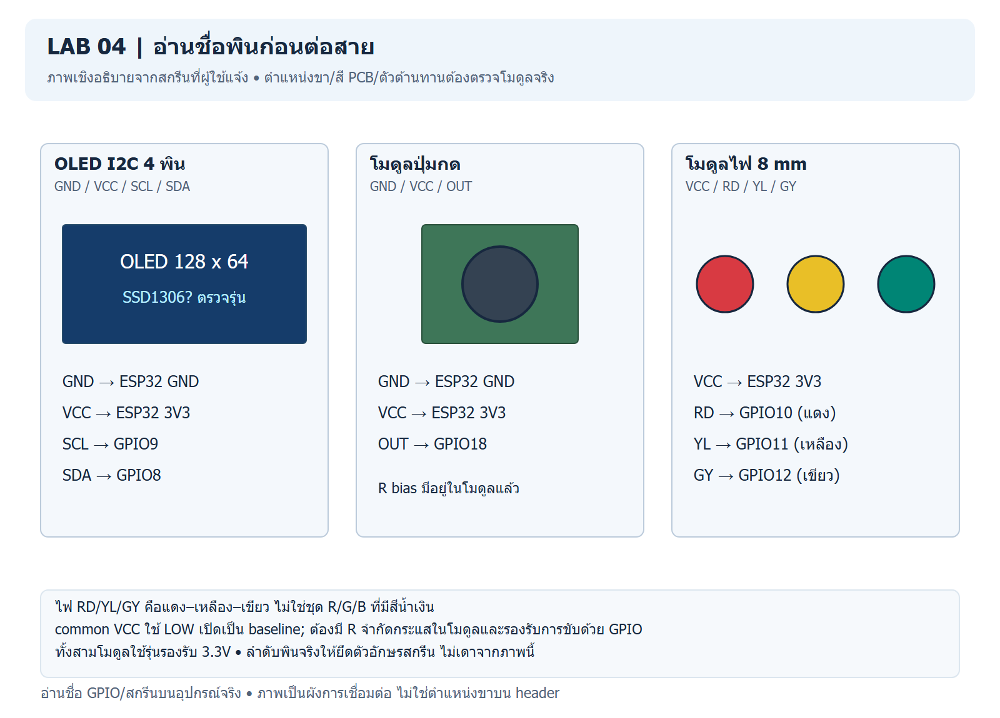
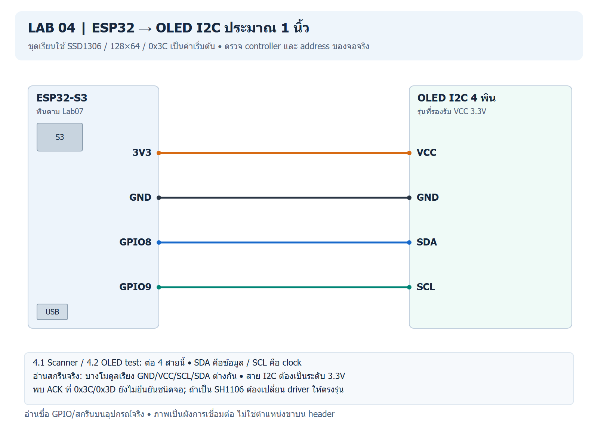
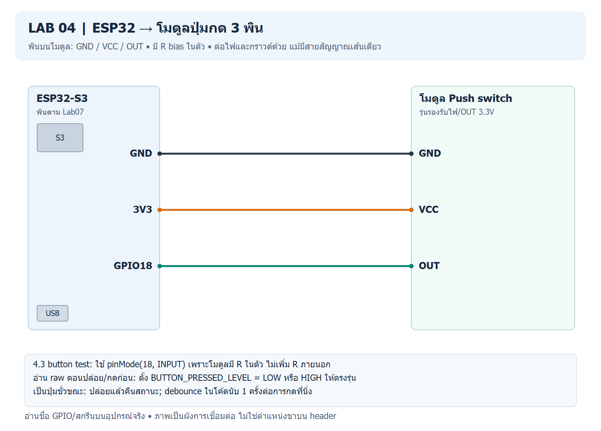
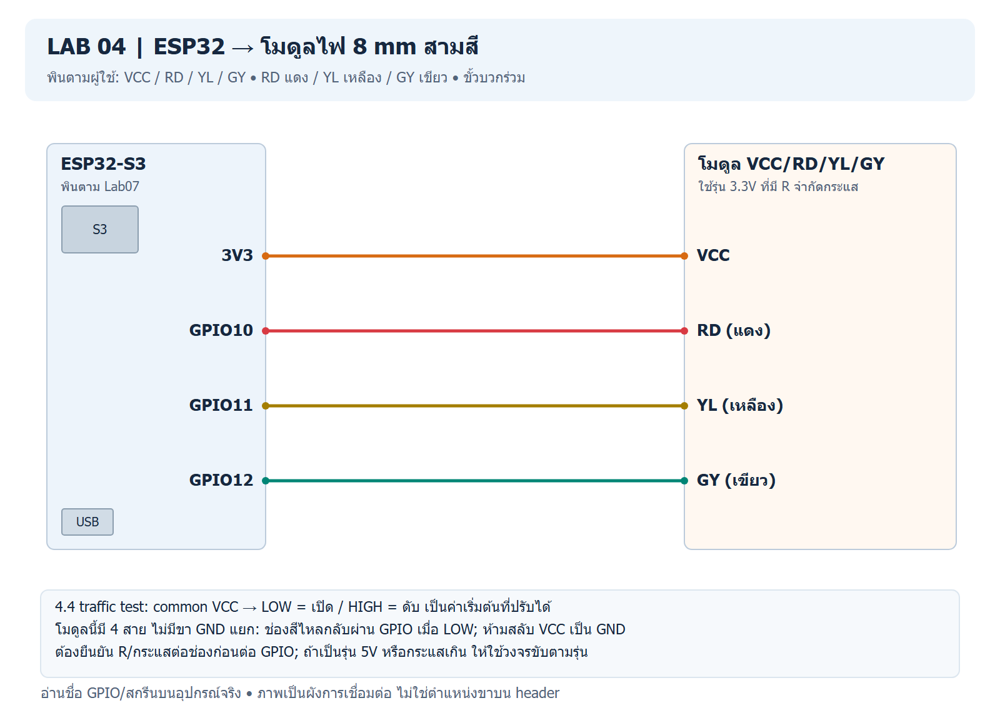
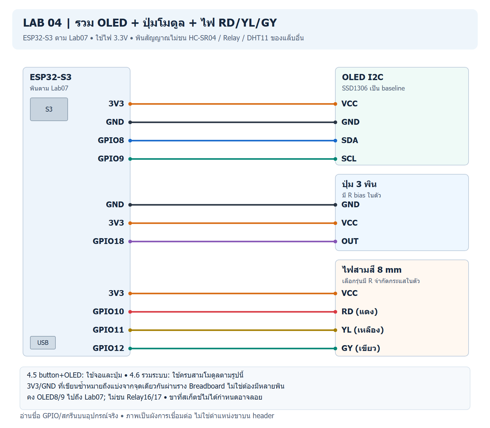
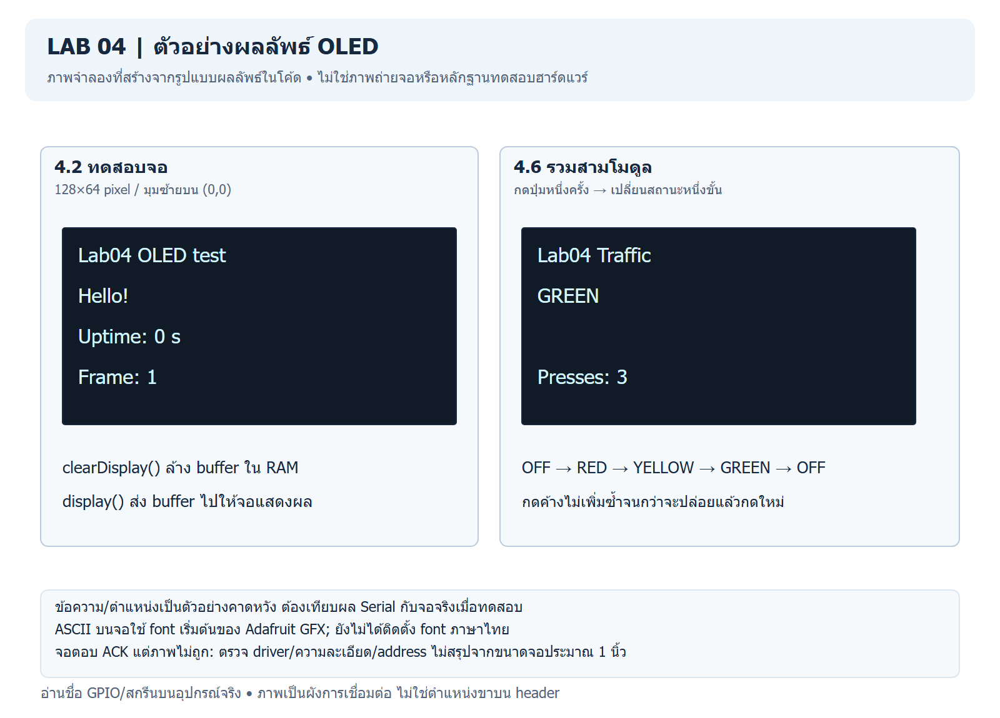

# Lab 04: OLED I2C และโมดูลปุ่มกด/ไฟสามสี

> ระดับ: ⭐⭐ | เวลา: 2–3 ชม. | ต้องผ่าน: [Lab 03](../lab03-programming-basics/)

## 🎯 วัตถุประสงค์

ผู้เรียนจะตรวจพินและ address ของ OLED, แสดงข้อความด้วย buffer, อ่านปุ่มโมดูลสามพินพร้อม debounce, ทดสอบไฟแดง–เหลือง–เขียวทีละช่อง และรวมปุ่ม/จอ/ไฟเป็นระบบที่เปลี่ยนสถานะได้หนึ่งขั้นต่อการกด

บทนี้ใช้ **OLED จีนขนาดประมาณ 1 นิ้ว** โดยใช้ **SSD1306 I2C 128×64** เป็นค่าเริ่มต้นตามที่ผู้สอนเลือก ขนาดจอเพียงอย่างเดียวระบุ controller ไม่ได้ ถ้าของจริงเป็น SH1106/SSD1315 หรือความละเอียดอื่น ต้องเลือก driver/ขนาดให้ตรงก่อนทดสอบภาพ

## 🧰 อุปกรณ์ที่ใช้

| อุปกรณ์ | จำนวน | ข้อกำหนดชุดเรียน |
|---|---:|---|
| ESP32-S3 | 1 | core 3.x; ใช้ชุดพินเดียวกับ Lab07 |
| สาย USB data | 1 | จ่ายไฟและ Serial Monitor 115200 baud |
| OLED I2C ประมาณ 1 นิ้ว 4 พิน | 1 | baseline SSD1306/128×64, รองรับ VCC 3.3V, SDA/SCL ระดับ 3.3V |
| โมดูลปุ่ม Push switch | 1 | พิน `GND/VCC/OUT`, รองรับ 3.3V, มี R bias ในตัวตามอุปกรณ์ผู้สอน |
| โมดูลไฟ 8 mm แดง–เหลือง–เขียว | 1 | พิน `VCC/RD/YL/GY`; วงจรในบทใช้รุ่น 3.3V ขั้วบวกร่วมและมี R จำกัดกระแสในตัว |
| Breadboard และสาย Jumper | 1 ชุด | แบ่งราง 3V3/GND ให้ถึงกัน |
| มัลติมิเตอร์ | ถ้ามี | ตรวจแรงดัน OUT/ชนิดขั้วร่วม/ค่า R ตามคู่มือขณะเตรียมวงจร |



ชื่อพินปุ่มและไฟในภาพมาจากข้อมูลผู้สอน ส่วนตำแหน่งขาและรูปร่างเป็นภาพเชิงอธิบาย ให้ต่อโดยอ่านตัวอักษรบนอุปกรณ์จริง ปุ่มไม่ต้องเพิ่ม R ภายนอก ส่วนไฟต้องตรวจว่ามี **R จำกัดกระแสต่อช่อง** และกระแสเหมาะกับ GPIO ก่อนใช้วงจรขับตรงนี้ ถ้าไม่มี R หรือเป็นโมดูล 5V/กระแสสูง ให้เตรียมวงจรจำกัดกระแสและวงจรขับตามรุ่นก่อนต่อ

## ❓ คำถามก่อนเริ่มต้น

<details>
<summary><b>คลิกเพื่อดูคำถามก่อนเรียน</b></summary>

1. จอแสดงผลช่วยให้เครื่องมือที่ไม่มีคอมพิวเตอร์ต่ออยู่บอกสถานะกับผู้ใช้ได้อย่างไร?
2. ก่อนต่อจอขนาดประมาณหนึ่งนิ้ว เราควรหาข้อมูลใดจากตัวโมดูลหรือผู้ขายบ้าง?
3. ขนาดของจอที่ระบุเป็นนิ้วกับจำนวนพิกเซลสัมพันธ์กันอย่างไร?
4. ปุ่มเปล่ากับปุ่มที่ติดตั้งบนแผงโมดูลอาจมีการต่อสายต่างกันอย่างไร?
5. ถ้าใช้ปุ่มหนึ่งตัวเปลี่ยนไฟแดง เหลือง และเขียว โปรแกรมควรจำข้อมูลอะไรไว้ระหว่างการกดแต่ละครั้ง?
6. เมื่อปุ่ม ไฟ และจอทำงานร่วมกันแล้วมีเพียงส่วนเดียวไม่ทำงาน เราจะวางแผนตรวจหาสาเหตุอย่างไร?

</details>

## 📖 ทฤษฎี

### 1. OLED แบบกราฟิกและ I2C

จอ monochrome 128×64 มี 128 คอลัมน์ × 64 แถว pixel พิกัดเริ่ม `(0,0)` มุมซ้ายบน ไปถึง `(127,63)` มุมขวาล่าง ใช้ `SDA` ส่งข้อมูลและ `SCL` เป็น clock; นอกจากสายสองเส้นนี้ยังต้องมี VCC และ GND รวมเป็นสี่สาย

I2C Scanner ตรวจว่า address 7-bit ใดตอบ ACK จอ SSD1306 หลายรุ่นใช้ `0x3C` หรือ `0x3D` แต่ **พบ address ไม่ได้ยืนยัน controller หรือความละเอียด** และ `display.begin()` สำเร็จไม่ได้ยืนยันว่าภาพบนจอถูกต้อง โค้ดจึงตรวจ ACK ก่อน แล้วให้ผู้เรียนตรวจภาพจริงอีกขั้น

วงจรชุดเรียนจ่าย VCC จาก `3V3` และใช้ OLED ที่รองรับแรงดันนี้ จึงต่อ SDA/SCL ระดับ 3.3V เข้าบอร์ดได้ตามตาราง หากโมดูลอื่นดึง I2C ขึ้น 5V ต้องแก้ระดับสัญญาณให้เหมาะสมก่อน ไม่ใช้แรงดัน 5V เข้าขา GPIO

### 2. วาดใน buffer แล้วจึงส่งไปจอ

Adafruit SSD1306 เก็บภาพใน RAM ก่อนส่งไปจอ สำหรับ 128×64 แบบหนึ่งบิตต่อ pixel ใช้ข้อมูลภาพ `128×64÷8 = 1024 bytes` คำสั่งวาดหรือพิมพ์จึงยังไม่ทำให้ภาพบนจอเปลี่ยนจนเรียก `display()`

| คำสั่ง/ส่วน | หน้าที่ |
|---|---|
| `Wire.begin(8,9,100000)` | เริ่ม SDA8/SCL9 ที่ clock 100 kHz |
| `Adafruit_SSD1306 display(128,64,&Wire,-1)` | กำหนดขนาดจอและใช้บัส Wire; โมดูล 4 พินไม่มีสาย reset แยก |
| `display.begin(SSD1306_SWITCHCAPVCC, OLED_ADDRESS)` | เตรียม buffer และส่งชุดคำสั่ง SSD1306 ตาม address ที่เลือก |
| `clearDisplay()` | ล้างภาพใน buffer; ยังไม่ล้างภาพบนจอทันที |
| `setTextSize(1)` / `setTextColor(SSD1306_WHITE)` | กำหนดรูปแบบข้อความ |
| `setCursor(x,y)` / `print(...)` | วาดข้อความลง buffer ที่พิกัด pixel |
| `display()` | ส่ง buffer ไปแสดงบนจอ |

เมื่อเลขลดจากหลายหลักเหลือหลักเดียว ให้ล้าง buffer และวาดหน้าใหม่ก่อนส่งทั้งภาพ เพื่อไม่เหลือเลขเก่า ตัวอย่างใช้ ASCII ของ font เริ่มต้น ไม่ได้ติดตั้ง font ภาษาไทย การวาดใหม่ไม่จำเป็นต้องทำทุกรอบ loop ให้ใช้ timer หรือเหตุการณ์กดปุ่ม

### 3. โมดูลปุ่ม GND/VCC/OUT

ปุ่มชนิด momentary คืนตำแหน่งเดิมเมื่อปล่อย ส่วน R bias บนโมดูลช่วยกำหนดระดับ OUT ขณะไม่กด บทนี้จึงใช้ `pinMode(BUTTON_PIN, INPUT)` และไม่เพิ่ม R ภายนอก การต่อ OUT เพียงเส้นเดียวโดยไม่ต่อ VCC/GND ไม่ครบวงจรของโมดูล

ระดับกดอาจเป็น LOW หรือ HIGH ตามวงจรผู้ผลิต เริ่มด้วยการอ่าน `raw` ใน 4.3 ขณะปล่อยและกด แล้วตั้ง `BUTTON_PRESSED_LEVEL` ให้ตรง ของที่กด LOW ใช้ค่า `LOW`; ของที่กด HIGH เปลี่ยนเป็น `HIGH` และ Upload ใหม่ LED เล็กบนโมดูลปุ่มถ้ามีเป็นตัวบอกสถานะตามวงจรโมดูล ไม่ใช้แทนการวัด OUT

หน้าสัมผัสยังเกิด bounce ได้แม้มี R ในตัว โค้ดรอให้ระดับนิ่ง 40 ms แล้วตรวจการเปลี่ยนจากปล่อยเป็นกด จึงนับหนึ่งครั้งเมื่อกดค้าง และรอให้ปล่อยก่อนรับการกดใหม่

### 4. ไฟ VCC/RD/YL/GY และ active LOW

โมดูลนี้เป็น **ไฟสามสีแดง–เหลือง–เขียว** ตามที่ผู้สอนระบุ: `RD=แดง`, `YL=เหลือง`, `GY=เขียว` ใช้สี่พินร่วมกัน ไม่ใช่ชุดสี R/G/B ที่มีน้ำเงิน ให้ตรวจสีจริงด้วยโค้ดทีละช่อง

วงจร baseline ใช้ **ขั้วบวกร่วม VCC=3.3V** เมื่อ GPIO ของช่องสีเป็น LOW จะรับกระแสผ่าน LED/R ของโมดูลลงกราวด์ผ่าน GPIO จึงเปิดไฟ; เมื่อ HIGH จึงดับ ไม่มีพิน GND แยกบนโมดูลสี่พินนี้ ไม่ต้องนำสายสีใดไปเป็นกราวด์ถาวร

โค้ดรวมกติกาไว้ที่ `LED_ON_LEVEL` และ `LED_OFF_LEVEL` หากตรวจรุ่นแล้วเป็นวงจรชนิดอื่น ต้องปรับทั้งการต่อไฟและระดับสั่งให้ตรงคู่มือ ไม่แก้เฉพาะระดับในโค้ดแล้วต่อ VCC เป็น GND การมีขั้ว VCC ไม่ได้ยืนยันว่ามี R/วงจรขับภายในเหมาะกับ GPIO เสมอไป

### 5. รวมงานด้วย millis และสถานะ

ระบบรวมใช้การกดที่ผ่าน debounce เปลี่ยน `OFF → RED → YELLOW → GREEN → OFF` แล้วส่งสถานะเดียวกันไป GPIO, OLED และ Serial เมื่อ OLED ไม่ตอบ โค้ดยังให้ทดสอบปุ่ม/ไฟผ่าน Serial ได้ แต่รายงานชัดว่าจอไม่พร้อม และไม่อ้างว่าภาพแสดงผลผ่านแล้ว

## 🔌 การต่อวงจร

ใช้ **ESP32-S3** ตามชุดพินของ Lab07: [ตารางพินคงที่ทั้งคอร์ส](../../assets/PINOUT.md) เลือก **ESP32S3 Dev Module**; บอร์ด CH343 ของผู้สอนตั้ง **USB CDC On Boot = Disabled** และ Serial 115200; Flash/PSRAM เลือกตามบอร์ดจริง ไม่ต้องแก้เลขพินในโค้ดเมื่อเปลี่ยนบท

### ตารางพินรวม — ESP32-S3

| สาย | จาก ESP32 | ไปอุปกรณ์/พิน | หน้าที่ |
|---|---|---|---|
| O1 | `3V3` | OLED `VCC` | ไฟเลี้ยงจอ 3.3V |
| O2 | `GND` | OLED `GND` | กราวด์ร่วม |
| O3 | `GPIO8` | OLED `SDA` | ข้อมูล I2C |
| O4 | `GPIO9` | OLED `SCL` | clock I2C |
| B1 | `GND` | ปุ่ม `GND` | กราวด์ร่วม |
| B2 | `3V3` | ปุ่ม `VCC` | ไฟเลี้ยงปุ่ม 3.3V |
| B3 | `GPIO18` | ปุ่ม `OUT` | อ่านระดับดิจิทัล; ใช้ INPUT |
| L1 | `3V3` | ไฟ `VCC` | ขั้วบวกร่วมของโมดูลที่ตรง baseline |
| L2 | `GPIO10` | ไฟ `RD` | สั่งสีแดง |
| L3 | `GPIO11` | ไฟ `YL` | สั่งสีเหลือง |
| L4 | `GPIO12` | ไฟ `GY` | สั่งสีเขียว |

GPIO คือเลขที่สกรีนบนบอร์ด เช่น `18`/`IO18`/`D18` ไม่ใช่ขาลำดับที่ 18 ของ header ภาพเป็นผังการเชื่อมต่อ ไม่อ้างตำแหน่งขาเหมือนกันทุกบอร์ด ขา 3V3/GND ในภาพที่เขียนซ้ำแบ่งผ่านราง Breadboard จุดเดียวกันได้

### A. สาย OLED



### B. สายโมดูลปุ่ม



### C. สายโมดูลไฟสามสี



### D. วงจรรวมสามโมดูล



1. ถอด USB/แหล่งจ่ายก่อนเดินสาย ยืนยันบอร์ดเป็น ESP32-S3 และโมดูลทั้งสามรองรับไฟ/สัญญาณ 3.3V ตามชุดเรียน
2. อ่านพินโมดูลจริงให้ครบ ตรวจ R จำกัดกระแส/ขั้วร่วมของโมดูลไฟก่อนต่อ GPIO แล้วต่อ O1–O4, B1–B3 และ L1–L4 ตามชุดที่กำลังทดลอง
3. เริ่มทดสอบแยก: จอใน 4.1–4.2, ปุ่มใน 4.3 และไฟใน 4.4 จากนั้นถอดไฟก่อนรวมสายเพื่อทำ 4.5–4.6
4. ต่อ VCC และ GND ให้โมดูลปุ่มครบ ไม่เพิ่ม R เพราะมีในตัว ใช้โมดูลปุ่มตัวเดิมจาก Lab03 ที่ OUT=GPIO18 คง VCC/GND เดิม ไม่เพิ่มปุ่มอีกตัวทับพิน
5. เปิด Serial 115200 ทดสอบ raw ของปุ่ม แล้วเปลี่ยน `BUTTON_PRESSED_LEVEL` ให้ตรงกันในทั้งสาม sketch ที่ใช้ปุ่ม ทดสอบไฟทีละสีด้วยชื่อ RD/YL/GY ก่อนทดสอบรวม
6. หาก Scanner พบ `0x3D` ให้เปลี่ยน `OLED_ADDRESS` ในทั้งสาม sketch ที่ใช้จอจาก `0x3C` เป็น `0x3D` หากพบ address อื่น/จอไม่เป็น SSD1306 ให้ตรวจรุ่นก่อนเลือก driver ไม่เดาจากขนาด
7. เมื่อใช้ครบสามโมดูล ตรวจสายอีกครั้งแล้ว Upload 4.6 กด–ปล่อย 4 ครั้ง ต้องเห็น OFF→RED→YELLOW→GREEN→OFF และนับเพิ่ม 4 ครั้ง

| การทดลอง | วงจรที่ใช้ | ไฟล์ |
|---|---|---|
| 4.1 I2C Scanner | OLED O1–O4 | [lab04_i2c_scanner.ino](code/lab04_i2c_scanner/lab04_i2c_scanner.ino) |
| 4.2 OLED test | OLED O1–O4 | [lab04_oled_test.ino](code/lab04_oled_test/lab04_oled_test.ino) |
| 4.3 Button module test | ปุ่ม B1–B3 | [lab04_button_module_test.ino](code/lab04_button_module_test/lab04_button_module_test.ino) |
| 4.4 Traffic light test | ไฟ L1–L4 | [lab04_traffic_light_test.ino](code/lab04_traffic_light_test/lab04_traffic_light_test.ino) |
| 4.5 Button + OLED | OLED และปุ่ม | [lab04_button_oled.ino](code/lab04_button_oled/lab04_button_oled.ino) |
| 4.6 รวมสามโมดูล | วงจร D ครบ 11 สาย | [lab04_oled_button_traffic.ino](code/lab04_oled_button_traffic/lab04_oled_button_traffic.ino) |

**เตรียมต่อค้างร่วมแล็บอื่น:** GPIO10/11/12 ของไฟเว้นจาก GPIO5 ของ LED เดิม, GPIO6/7 ของ HC-SR04, GPIO16/17 ของ Relay และ GPIO4 ของ DHT11 ใช้ OLED ตัวเดียวร่วม Lab04/07 ได้ ไม่ต้องต่อจอสองตัว address ซ้ำกัน การ Upload sketch ใหม่แทนที่ชุดเดิม ขาที่ sketch ไม่กำหนดอาจลอย จึงไม่รับรองว่าไฟหรือ Relay ที่ยังต่อค้างจะ OFF ระหว่าง Reset/ก่อน setup หรือขณะรันแล็บอื่น ให้เริ่มทดสอบ Lab04 โดยถอดโหลด Relay และใช้วงจรตามแต่ละการทดลองก่อนรวมระบบจริง

ตารางหลักนี้ใช้ ESP32-S3 ตาม Lab07 โดยคง SDA8/SCL9 และ Relay16/17 เดิม ไม่ใช้ GPIO26–37 ที่เกี่ยวกับ Flash/PSRAM และกำหนดไฟสามสีเป็น GPIO10/11/12 เพื่อไม่ชน Relay16/17

_ภาพทั้งหมดสร้างเองจาก SVG ตามตารางพิน เป็นภาพอธิบาย/ผลคาดหวัง ไม่มีการอ้างว่าได้ทดสอบอุปกรณ์จริง ดู [ทะเบียนภาพ](../../assets/IMAGE_SOURCES.md)_

<details>
<summary><b>เฉพาะผู้ใช้ ESP32-WROOM-32 รุ่นเดิม</b></summary>

โค้ดเลือกพินตาม target ตอน compile อัตโนมัติ ตารางและภาพหลักของบทนี้สำหรับ ESP32-S3 ตามบอร์ดผู้สอน หากใช้ ESP32-WROOM-32 ให้ใช้พินของรุ่นเดิมดังนี้ และไม่สลับตารางระหว่างบท

| อุปกรณ์ | ESP32-WROOM-32 |
|---|---|
| LED ภายนอก | GPIO16 |
| ปุ่ม OUT | GPIO18 |
| OLED SDA/SCL | GPIO21/22 |
| ไฟ RD/YL/GY | GPIO17/23/32 |
| Relay IN1/IN2 | GPIO26/27 |
| HC-SR04 TRIG/ECHO | GPIO25/33; ECHO ผ่าน divider |
| DHT11 DATA | GPIO4 |

</details>

## 🧪 การทดลอง

### เตรียม Arduino IDE และ library

1. เลือก ESP32S3 Dev Module, COM ของบอร์ด และ core3.x ตาม Lab01 แล้วเปิด Serial Monitor 115200 baud
2. ใน Library Manager ติดตั้ง **Adafruit SSD1306**, **Adafruit GFX Library** และ dependency **Adafruit BusIO** ตามคำแนะนำของ IDE; `Wire`/`Arduino` มากับ core อยู่แล้ว ปุ่มและไฟไม่ต้องใช้ library เพิ่ม
3. เปิด `.ino` ที่ลิงก์ของการทดลองนั้น ไฟล์และโฟลเดอร์ต้องชื่อเดียวกัน แต่ละชุด self-contained มี setup/loop ของตัวเอง ไม่วางหลาย sketch รวมแท็บเดียว
4. ต่ออุปกรณ์เฉพาะชุดที่ใช้ Verify ก่อน Upload จากนั้นจดผลจริงลงใบงาน บทนี้เตรียมโค้ดและภาพไว้ก่อนการต่ออุปกรณ์ของผู้สอน

### การทดลองที่ 4.1: I2C Scanner: หาที่อยู่ OLED

**วงจรที่ใช้:** ภาพ A / สาย O1–O4: OLED VCC3V3/GND/SDA8/SCL9 ยังไม่ต้องต่อปุ่มหรือไฟ

**ขั้นตอน**

1. ถอด USB แล้วต่อ OLED VCC→3V3, GND→GND, SDA→GPIO8 และ SCL→GPIO9 ตามชื่อสกรีนจริง
2. ใช้ OLED I2C ที่รองรับไฟและ pull-up 3.3V เปิด Serial Monitor ที่ 115200 baud แล้ว Upload
3. บันทึก address ที่มี ACK เช่น 0x3C หรือ 0x3D เพื่อนำไปตั้ง OLED_ADDRESS ในการทดลองถัดไป ACK ยังไม่ยืนยันชนิด driver หรือขนาดจอ

[ดาวน์โหลด `lab04_i2c_scanner.ino`](code/lab04_i2c_scanner/lab04_i2c_scanner.ino)

```cpp
/*
 * Lab 04.1 : I2C Scanner สำหรับ OLED
 * คำอธิบาย : ตรวจ ACK ของ address 7-bit ช่วง 0x08-0x77 ทุก 3 วินาที
 * วงจร     : OLED I2C: VCC->3V3, GND->GND, SDA->GPIO8, SCL->GPIO9 บน S3 (ESP32 เดิม 21/22) (pull-up ฝั่ง 3.3V)
 * ไลบรารี  : Wire มากับ core; ไม่ใช้ library จอ
 * Board    : ESP32S3 Dev Module; เลือกพิน ESP32-WROOM-32 อัตโนมัติเมื่อใช้ target ESP32 (core 3.x)
 */
#include <Arduino.h>
#include <Wire.h>

#if defined(CONFIG_IDF_TARGET_ESP32S3)
constexpr uint8_t SDA_PIN = 8;
constexpr uint8_t SCL_PIN = 9;
#elif defined(CONFIG_IDF_TARGET_ESP32)
constexpr uint8_t SDA_PIN = 21;
constexpr uint8_t SCL_PIN = 22;
#else
#error "Use ESP32-S3 or ESP32 with the verified course pin map"
#endif
constexpr uint32_t I2C_CLOCK_HZ = 100000;
constexpr uint32_t SCAN_INTERVAL_MS = 3000;
uint32_t previousScanMs = 0;
bool firstScan = true;
bool busReady = false;

void scanBus() {
  uint8_t found = 0;
  for (uint8_t address = 0x08; address <= 0x77; address++) {
    Wire.beginTransmission(address);
    const uint8_t error = Wire.endTransmission();
    if (error == 0) {
      Serial.printf("[I2C] ACK at 0x%02X\n", address);
      found++;
    }
  }
  Serial.printf("[I2C] total=%u\n", found);
  if (found == 0) Serial.println("[I2C] no ACK: ตรวจ 3V3/GND/SDA/SCL");
  // ACK บอกว่ามีอุปกรณ์ตอบ ไม่ยืนยันว่าเป็น SSD1306 หรือขนาดจอใด
}

void setup() {
  Serial.begin(115200);
  busReady = Wire.begin(SDA_PIN, SCL_PIN, I2C_CLOCK_HZ);
  Wire.setTimeOut(50);
  if (!busReady) Serial.println("[I2C] เริ่มบัสไม่สำเร็จ");
}

void loop() {
  if (!busReady) return;
  const uint32_t now = millis();
  if (firstScan || now - previousScanMs >= SCAN_INTERVAL_MS) {
    firstScan = false;
    previousScanMs = now;
    scanBus();
  }
}
```

| ส่วนของโค้ด | หน้าที่ |
|---|---|
| `Wire.begin(8,9,100000)` | เริ่มบัส I2C ฝั่ง 3.3V ที่ 100 kHz |
| `beginTransmission/endTransmission` | ตรวจ ACK ของ address แบบ 7-bit |
| `millis + firstScan` | สแกนทันทีหนึ่งรอบแล้วเว้น 3 วินาทีโดยไม่ใช้ delay |

**ผลลัพธ์ที่คาดหวัง** (ตัวเลขเวลาเป็นตัวอย่าง ต้องตรวจจอ/สีจริงบนอุปกรณ์)

```text
[I2C] ACK at 0x3C
[I2C] total=1
```

**ภารกิจท้าทาย:** ถอดไฟก่อนถอดสายจอ แล้ว Upload/Reset ใหม่ เปรียบเทียบ no ACK กับกรณีจอต่อครบ

### การทดลองที่ 4.2: ทดสอบข้อความและ buffer ของ OLED

**วงจรที่ใช้:** ภาพ A / สาย O1–O4 เช่นเดียวกับ4.1; ตั้ง OLED_ADDRESS ตาม Scanner

**ขั้นตอน**

1. ใช้วงจร OLED ชุดเดิมจาก 4.1 และติดตั้ง Adafruit SSD1306 กับ Adafruit GFX Library
2. ตั้ง OLED_ADDRESS เป็นค่าที่ Scanner พบ โค้ดนี้สมมติ SSD1306 128×64 ต้องตรวจรุ่นจอจริงก่อน
3. Upload แล้วสังเกต Hello!, uptime และ frame ที่เปลี่ยนทุกวินาที เทียบกับ Serial
4. ถ้า no ACK ให้ตรวจสายและ address; ถ้า ACK แต่จอว่างให้ตรวจ driver/ขนาดจอ ไม่ใช้ begin สำเร็จเป็นหลักฐานว่าจอทำงาน

[ดาวน์โหลด `lab04_oled_test.ino`](code/lab04_oled_test/lab04_oled_test.ino)

```cpp
/*
 * Lab 04.2 : ทดสอบ OLED SSD1306
 * คำอธิบาย : แสดงข้อความและ uptime โดยวาด buffer ใหม่ทุกวินาที; ไม่มีจอยังรายงาน Serial
 * วงจร     : OLED I2C: VCC->3V3, GND->GND, SDA->GPIO8, SCL->GPIO9 บน S3 (ESP32 เดิม 21/22) (pull-up ฝั่ง 3.3V)
 * ไลบรารี  : Wire, Adafruit SSD1306, Adafruit GFX Library
 * Board    : ESP32S3 Dev Module; เลือกพิน ESP32-WROOM-32 อัตโนมัติเมื่อใช้ target ESP32 (core 3.x)
 */
#include <Arduino.h>
#include <Wire.h>
#include <Adafruit_GFX.h>
#include <Adafruit_SSD1306.h>

#if defined(CONFIG_IDF_TARGET_ESP32S3)
constexpr uint8_t SDA_PIN = 8;
constexpr uint8_t SCL_PIN = 9;
#elif defined(CONFIG_IDF_TARGET_ESP32)
constexpr uint8_t SDA_PIN = 21;
constexpr uint8_t SCL_PIN = 22;
#else
#error "Use ESP32-S3 or ESP32 with the verified course pin map"
#endif
constexpr uint8_t OLED_ADDRESS = 0x3C;  // เปลี่ยนเป็น 0x3D ตามผล I2C Scanner
constexpr uint32_t I2C_CLOCK_HZ = 100000;
constexpr int SCREEN_WIDTH = 128;
constexpr int SCREEN_HEIGHT = 64;
static_assert(OLED_ADDRESS == 0x3C || OLED_ADDRESS == 0x3D,
              "Use the 7-bit OLED address 0x3C or 0x3D");

// ไม่ใช้ขา reset; กำหนด clock ระหว่างและหลังส่งภาพเป็น 100 kHz
Adafruit_SSD1306 display(SCREEN_WIDTH, SCREEN_HEIGHT, &Wire, -1,
                        I2C_CLOCK_HZ, I2C_CLOCK_HZ);
bool oledReady = false;

bool initOled() {
  if (!Wire.begin(SDA_PIN, SCL_PIN, I2C_CLOCK_HZ)) {
    Serial.println("[OLED] เริ่ม I2C ไม่สำเร็จ; ดูข้อมูลทาง Serial ต่อได้");
    return false;
  }
  Wire.setTimeOut(50);
  // ตรวจ ACK แยกจาก begin(): begin สำเร็จอย่างเดียวไม่ยืนยันว่าจอต่ออยู่
  Wire.beginTransmission(OLED_ADDRESS);
  const uint8_t error = Wire.endTransmission();
  if (error != 0) {
    Serial.printf("[OLED] no ACK at 0x%02X (error=%u); ตรวจไฟ/สาย/address\n",
                  OLED_ADDRESS, error);
    return false;
  }
  // ACK ยืนยันการตอบบนบัส ไม่ได้ระบุ driver; sketch นี้ใช้ SSD1306 128x64
  if (!display.begin(SSD1306_SWITCHCAPVCC, OLED_ADDRESS, true, false)) {
    Serial.println("[OLED] init ไม่สำเร็จ; อาจจัดสรร buffer ไม่ได้");
    return false;
  }
  display.setTextColor(SSD1306_WHITE);
  display.setTextWrap(false);
  Serial.printf("[OLED] ACK at 0x%02X; init=OK; ตรวจข้อความบนจอจริง\n",
                OLED_ADDRESS);
  return true;
}

constexpr uint32_t DISPLAY_INTERVAL_MS = 1000;
uint32_t previousDisplayMs = 0;
uint32_t frameCount = 0;
bool firstFrame = true;

void showFrame(uint32_t now) {
  if (!oledReady) return;
  // ล้าง buffer ทุกครั้ง ป้องกันตัวเลขใหม่ที่สั้นกว่าทิ้งเศษข้อความเดิม
  display.clearDisplay();
  display.setTextSize(1);
  display.setCursor(0, 0);
  display.println("Lab04 OLED test");
  display.setTextSize(2);
  display.setCursor(0, 18);
  display.println("Hello!");
  display.setTextSize(1);
  display.setCursor(0, 44);
  display.print("Uptime: ");
  display.print(now / 1000);
  display.println(" s");
  display.print("Frame: ");
  display.print(frameCount);
  display.display();  // ส่ง buffer จาก RAM ไปยังจอจริง
}

void setup() {
  Serial.begin(115200);
  oledReady = initOled();
}

void loop() {
  const uint32_t now = millis();
  if (firstFrame || now - previousDisplayMs >= DISPLAY_INTERVAL_MS) {
    firstFrame = false;
    previousDisplayMs = now;
    frameCount++;
    showFrame(now);
    Serial.printf("[OLED] frame=%lu uptime=%lu s init=%s\n",
                  static_cast<unsigned long>(frameCount),
                  static_cast<unsigned long>(now / 1000), oledReady ? "OK" : "FAILED");
  }
}
```

| ส่วนของโค้ด | หน้าที่ |
|---|---|
| `initOled` | ตรวจการเริ่มบัสและ ACK ก่อนเรียก library |
| `clearDisplay/setCursor/print` | วาดข้อความใหม่ใน RAM และล้างเศษตัวเลขเดิม |
| `display.display()` | ส่ง buffer ไปยังจอ |
| `oledReady` | ถ้าจอไม่พร้อมยังรายงาน uptime ทาง Serial |

**ผลลัพธ์ที่คาดหวัง** (ตัวเลขเวลาเป็นตัวอย่าง ต้องตรวจจอ/สีจริงบนอุปกรณ์)

```text
[OLED] ACK at 0x3C; init=OK; ตรวจข้อความบนจอจริง
[OLED] frame=1 uptime=0 s init=OK
[OLED] frame=2 uptime=1 s init=OK
```

**ภารกิจท้าทาย:** เพิ่มข้อความบรรทัดใหม่ในพื้นที่จอโดยไม่ทับ uptime แล้วอธิบายว่าถ้าเอา display.display() ออกจะเกิดอะไร

### การทดลองที่ 4.3: ทดสอบและเทียบระดับโมดูลปุ่ม 3 ขา

**วงจรที่ใช้:** ภาพ B / สาย B1–B3: ปุ่ม GND→GND, VCC→3V3, OUT→GPIO18 ไม่มี R ภายนอก

**ขั้นตอน**

1. ถอด USB ต่อ GND ของโมดูล→GND, VCC→3V3 และ OUT→GPIO18 ตรวจลำดับพินตามสกรีน
2. ใช้โมดูลที่มี R pull-up/pull-down ในตัวและ OUT ไม่เกิน 3.3V โค้ดจึงใช้ INPUT
3. Upload ดู raw ทุก 500 ms ขณะปล่อยและกดค้าง ถ้ากดได้ HIGH เปลี่ยน BUTTON_PRESSED_LEVEL เป็น HIGH แล้ว Upload ใหม่
4. กดแล้วปล่อย 5 ครั้ง เทียบ press count; กดค้าง 2 วินาทีต้องไม่นับซ้ำ การปล่อยกับการกดต้องนิ่งอย่างน้อย 40 ms

[ดาวน์โหลด `lab04_button_module_test.ino`](code/lab04_button_module_test/lab04_button_module_test.ino)

```cpp
/*
 * Lab 04.3 : ทดสอบโมดูลปุ่ม 3 ขา
 * คำอธิบาย : ดูระดับ raw/stable ทุก 500 ms และนับขอบกดหลัง debounce 40 ms
 * วงจร     : ปุ่มโมดูล 3 ขา: GND->GND, VCC->3V3, OUT->GPIO18; ใช้โมดูลที่ OUT ไม่เกิน 3.3V
 * ไลบรารี  : ไม่ใช้ library ภายนอก
 * Board    : ESP32S3 Dev Module; เลือกพิน ESP32-WROOM-32 อัตโนมัติเมื่อใช้ target ESP32 (core 3.x)
 */
#include <Arduino.h>

constexpr uint8_t BUTTON_PIN = 18;
constexpr uint8_t BUTTON_PRESSED_LEVEL = LOW;  // ถ้ากดแล้วอ่าน HIGH ให้เปลี่ยนเป็น HIGH
constexpr uint32_t DEBOUNCE_MS = 40;
bool previousRawLevel = HIGH;
bool stableButtonLevel = HIGH;
uint32_t lastRawChangeMs = 0;
uint32_t pressCount = 0;

void initButton() {
  // โมดูลมีตัวต้านทาน pull-up/pull-down ของตัวเอง จึงใช้ INPUT
  pinMode(BUTTON_PIN, INPUT);
  previousRawLevel = digitalRead(BUTTON_PIN);
  stableButtonLevel = previousRawLevel;
  lastRawChangeMs = millis();
}

bool buttonPressed(uint32_t now) {
  const bool rawLevel = digitalRead(BUTTON_PIN);
  if (rawLevel != previousRawLevel) {
    previousRawLevel = rawLevel;
    lastRawChangeMs = now;  // raw เปลี่ยนต้องเริ่มนับช่วงนิ่งใหม่
  }
  if (rawLevel != stableButtonLevel && now - lastRawChangeMs >= DEBOUNCE_MS) {
    stableButtonLevel = rawLevel;
    // รับเฉพาะขอบเปลี่ยนเข้าสู่สถานะกด; กดค้างไม่เพิ่มจำนวน
    if (stableButtonLevel == BUTTON_PRESSED_LEVEL) {
      pressCount++;
      return true;
    }
  }
  return false;
}

constexpr uint32_t REPORT_INTERVAL_MS = 500;
uint32_t previousReportMs = 0;

void setup() {
  Serial.begin(115200);
  initButton();
  Serial.println("[BUTTON] ปล่อย/กดค้างเพื่อเทียบ raw; ตั้ง BUTTON_PRESSED_LEVEL ให้ตรงโมดูล");
  Serial.printf("[BUTTON] configured pressed level=%u\n", BUTTON_PRESSED_LEVEL);
}

void loop() {
  const uint32_t now = millis();
  if (buttonPressed(now)) {
    Serial.printf("[BUTTON] press count=%lu\n", static_cast<unsigned long>(pressCount));
  }
  if (now - previousReportMs >= REPORT_INTERVAL_MS) {
    previousReportMs = now;
    Serial.printf("[BUTTON] raw=%u stable=%u count=%lu\n",
                  previousRawLevel, stableButtonLevel, static_cast<unsigned long>(pressCount));
  }
}
```

| ส่วนของโค้ด | หน้าที่ |
|---|---|
| `BUTTON_PRESSED_LEVEL` | เลือก LOW/HIGH ให้ตรงโมดูลหลังตรวจ raw |
| `initButton/INPUT` | ใช้ตัวต้านทานบนโมดูล ไม่เปิด INPUT_PULLUP เพิ่ม |
| `buttonPressed` | รับขอบกดเมื่อระดับนิ่งครบ 40 ms |
| `รายงานทุก 500 ms` | อ่าน raw/stable และ count เพื่อเทียบการต่อกับลอจิก |

**ผลลัพธ์ที่คาดหวัง** (ตัวเลขเวลาเป็นตัวอย่าง ต้องตรวจจอ/สีจริงบนอุปกรณ์)

```text
[BUTTON] configured pressed level=0
[BUTTON] raw=1 stable=1 count=0
[BUTTON] press count=1
[BUTTON] raw=0 stable=0 count=1
```

**ภารกิจท้าทาย:** ลองเปลี่ยน debounce เป็น 10 และ 80 ms แล้วบันทึกผลแตะสั้นกับการกดปกติ ก่อนคืน 40 ms

### การทดลองที่ 4.4: ทดสอบโมดูลไฟจราจร RD/YL/GY

**วงจรที่ใช้:** ภาพ C / สาย L1–L4: VCC→3V3, RD→10, YL→11, GY→12; โมดูลมี R จำกัดกระแสในตัวและรับกระแส GPIO ได้

**ขั้นตอน**

1. ตรวจว่าเป็นโมดูล common VCC ที่รองรับ 3.3V และมี R จำกัดกระแสในตัวแต่ละสี ห้ามใช้ LED เปล่าต่อ GPIO ตรง
2. ถอด USB ต่อ VCC→3V3, RD→GPIO10, YL→GPIO11 และ GY→GPIO12 (GY คือสีเขียวตามโมดูลที่ใช้) โมดูล 4 ขานี้ไม่มีขา GND แยก
3. ตรวจ TRAFFIC_ACTIVE_LOW=true สำหรับ common VCC; ถ้ารุ่นจริงเป็น common GND ต้องเปลี่ยนการต่อขาร่วมและตั้ง false ให้ตรงคู่มือก่อนจ่ายไฟ
4. Upload ตรวจเริ่ม OFF แล้ววน RED/YELLOW/GREEN/ALL/OFF ทุก 1.5 วินาที เทียบกับชื่อใน Serial

[ดาวน์โหลด `lab04_traffic_light_test.ino`](code/lab04_traffic_light_test/lab04_traffic_light_test.ino)

```cpp
/*
 * Lab 04.4 : ทดสอบโมดูลไฟจราจร
 * คำอธิบาย : วน OFF/RED/YELLOW/GREEN/ALL ด้วย millis เพื่อทดสอบขั้วและแต่ละสี
 * วงจร     : ไฟจราจร 4 ขา common VCC->3V3, RD->GPIO10, YL->GPIO11, GY->GPIO12 (เขียว) บน S3 (ESP32 เดิม 17/23/32); ใช้โมดูล 3.3V ที่มี R จำกัดกระแสในตัวเท่านั้น
 * ไลบรารี  : ไม่ใช้ library ภายนอก
 * Board    : ESP32S3 Dev Module; เลือกพิน ESP32-WROOM-32 อัตโนมัติเมื่อใช้ target ESP32 (core 3.x)
 */
#include <Arduino.h>

#if defined(CONFIG_IDF_TARGET_ESP32S3)
constexpr uint8_t RED_PIN = 10;
constexpr uint8_t YELLOW_PIN = 11;
constexpr uint8_t GREEN_PIN = 12;
#elif defined(CONFIG_IDF_TARGET_ESP32)
constexpr uint8_t RED_PIN = 17;
constexpr uint8_t YELLOW_PIN = 23;
constexpr uint8_t GREEN_PIN = 32;
#else
#error "Use ESP32-S3 or ESP32 with the verified course pin map"
#endif
constexpr bool TRAFFIC_ACTIVE_LOW = true;  // common VCC: LOW=ติด, HIGH=ดับ
constexpr uint8_t LED_ON_LEVEL = TRAFFIC_ACTIVE_LOW ? LOW : HIGH;
constexpr uint8_t LED_OFF_LEVEL = TRAFFIC_ACTIVE_LOW ? HIGH : LOW;
constexpr uint8_t TRAFFIC_PINS[] = {RED_PIN, YELLOW_PIN, GREEN_PIN};

void initTraffic() {
  // ผูกพินกับ GPIO ด้วย INPUT ก่อน จึงตั้ง latch OFF แล้วค่อยเปิด OUTPUT
  // ขั้นนี้เริ่มทำงานเมื่อเข้า setup แล้ว ไม่รับรองระดับขาขณะ reset/ก่อน setup
  for (uint8_t pin : TRAFFIC_PINS) {
    pinMode(pin, INPUT);
    digitalWrite(pin, LED_OFF_LEVEL);
    pinMode(pin, OUTPUT);
  }
}

void writeTraffic(bool redOn, bool yellowOn, bool greenOn) {
  digitalWrite(RED_PIN, redOn ? LED_ON_LEVEL : LED_OFF_LEVEL);
  digitalWrite(YELLOW_PIN, yellowOn ? LED_ON_LEVEL : LED_OFF_LEVEL);
  digitalWrite(GREEN_PIN, greenOn ? LED_ON_LEVEL : LED_OFF_LEVEL);
}

constexpr uint32_t STATE_INTERVAL_MS = 1500;
constexpr uint8_t STATE_COUNT = 5;
const char* const STATE_NAMES[] = {"OFF", "RED", "YELLOW", "GREEN", "ALL"};
uint8_t trafficState = 0;
uint32_t previousStateMs = 0;

void applyTraffic() {
  writeTraffic(trafficState == 1 || trafficState == 4,
               trafficState == 2 || trafficState == 4,
               trafficState == 3 || trafficState == 4);
  Serial.printf("[TRAFFIC] state=%s activeLow=%u\n",
                STATE_NAMES[trafficState], TRAFFIC_ACTIVE_LOW);
}

void setup() {
  Serial.begin(115200);
  initTraffic();
  applyTraffic();  // เริ่มด้วยทุกสีดับ ไม่ใช้ delay
  previousStateMs = millis();
}

void loop() {
  const uint32_t now = millis();
  if (now - previousStateMs >= STATE_INTERVAL_MS) {
    previousStateMs = now;
    trafficState = (trafficState + 1) % STATE_COUNT;
    applyTraffic();
  }
}
```

| ส่วนของโค้ด | หน้าที่ |
|---|---|
| `TRAFFIC_ACTIVE_LOW` | กำหนดระดับสั่งติดและดับให้ตรงขั้วโมดูล |
| `initTraffic` | ตั้ง INPUT เพื่อผูก GPIO แล้วเขียน latch OFF ก่อนตั้ง OUTPUT; ไม่รับรองช่วง reset |
| `writeTraffic` | เปลี่ยนแต่ละสีผ่าน GPIO10/11/12 |
| `STATE_INTERVAL_MS` | จับเวลาวนทดสอบ 5 สถานะด้วย millis |

**ผลลัพธ์ที่คาดหวัง** (ตัวเลขเวลาเป็นตัวอย่าง ต้องตรวจจอ/สีจริงบนอุปกรณ์)

```text
[TRAFFIC] state=OFF activeLow=1
[TRAFFIC] state=RED activeLow=1
[TRAFFIC] state=YELLOW activeLow=1
[TRAFFIC] state=GREEN activeLow=1
[TRAFFIC] state=ALL activeLow=1
[TRAFFIC] state=OFF activeLow=1
```

**ภารกิจท้าทาย:** เปลี่ยนระยะเวลาแต่ละสถานะให้สีแดงนานกว่าสีอื่นโดยไม่ใช้ delay และคงเริ่มต้นทุกสีดับ

### การทดลองที่ 4.5: นับปุ่มแล้วแสดงจำนวนบน OLED

**วงจรที่ใช้:** ภาพ A+B: OLED O1–O4 และปุ่ม B1–B3 ใช้ address/ระดับกดที่ตรวจจาก4.1/4.3

**ขั้นตอน**

1. ใช้ OLED วงจร4.1 และปุ่มวงจร4.3 พร้อม GND ร่วม ตั้ง address กับ pressed level ตามผลที่ทดสอบแยกแล้ว
2. Upload จอต้องเริ่มแสดง 0 กดแล้วปล่อยครั้งละหนึ่งครั้ง จำนวนบนจอและ Serial ต้องเพิ่มตรงกัน
3. ลองกดค้างเพื่อตรวจว่านับเพียงครั้งเดียว และกดช้าให้เห็น raw/stable ทุก 500 ms
4. ถ้าจอไม่พร้อม ให้ตรวจการนับผ่าน Serial ก่อน การทดสอบนี้ไม่ต้องต่อโมดูลไฟจราจร

[ดาวน์โหลด `lab04_button_oled.ino`](code/lab04_button_oled/lab04_button_oled.ino)

```cpp
/*
 * Lab 04.5 : ปุ่มนับจำนวนบน OLED
 * คำอธิบาย : นับหนึ่งครั้งต่อขอบกดแล้ววาดจอใหม่; OLED ไม่พร้อมยังนับและรายงาน Serial
 * วงจร     : OLED I2C: VCC->3V3, GND->GND, SDA->GPIO8, SCL->GPIO9 บน S3 (ESP32 เดิม 21/22) (pull-up ฝั่ง 3.3V); ปุ่มโมดูล 3 ขา: GND->GND, VCC->3V3, OUT->GPIO18
 * ไลบรารี  : Wire, Adafruit SSD1306, Adafruit GFX Library
 * Board    : ESP32S3 Dev Module; เลือกพิน ESP32-WROOM-32 อัตโนมัติเมื่อใช้ target ESP32 (core 3.x)
 */
#include <Arduino.h>
#include <Wire.h>
#include <Adafruit_GFX.h>
#include <Adafruit_SSD1306.h>

#if defined(CONFIG_IDF_TARGET_ESP32S3)
constexpr uint8_t SDA_PIN = 8;
constexpr uint8_t SCL_PIN = 9;
#elif defined(CONFIG_IDF_TARGET_ESP32)
constexpr uint8_t SDA_PIN = 21;
constexpr uint8_t SCL_PIN = 22;
#else
#error "Use ESP32-S3 or ESP32 with the verified course pin map"
#endif
constexpr uint8_t OLED_ADDRESS = 0x3C;  // เปลี่ยนเป็น 0x3D ตามผล I2C Scanner
constexpr uint32_t I2C_CLOCK_HZ = 100000;
constexpr int SCREEN_WIDTH = 128;
constexpr int SCREEN_HEIGHT = 64;
static_assert(OLED_ADDRESS == 0x3C || OLED_ADDRESS == 0x3D,
              "Use the 7-bit OLED address 0x3C or 0x3D");

// ไม่ใช้ขา reset; กำหนด clock ระหว่างและหลังส่งภาพเป็น 100 kHz
Adafruit_SSD1306 display(SCREEN_WIDTH, SCREEN_HEIGHT, &Wire, -1,
                        I2C_CLOCK_HZ, I2C_CLOCK_HZ);
bool oledReady = false;

bool initOled() {
  if (!Wire.begin(SDA_PIN, SCL_PIN, I2C_CLOCK_HZ)) {
    Serial.println("[OLED] เริ่ม I2C ไม่สำเร็จ; ดูข้อมูลทาง Serial ต่อได้");
    return false;
  }
  Wire.setTimeOut(50);
  // ตรวจ ACK แยกจาก begin(): begin สำเร็จอย่างเดียวไม่ยืนยันว่าจอต่ออยู่
  Wire.beginTransmission(OLED_ADDRESS);
  const uint8_t error = Wire.endTransmission();
  if (error != 0) {
    Serial.printf("[OLED] no ACK at 0x%02X (error=%u); ตรวจไฟ/สาย/address\n",
                  OLED_ADDRESS, error);
    return false;
  }
  // ACK ยืนยันการตอบบนบัส ไม่ได้ระบุ driver; sketch นี้ใช้ SSD1306 128x64
  if (!display.begin(SSD1306_SWITCHCAPVCC, OLED_ADDRESS, true, false)) {
    Serial.println("[OLED] init ไม่สำเร็จ; อาจจัดสรร buffer ไม่ได้");
    return false;
  }
  display.setTextColor(SSD1306_WHITE);
  display.setTextWrap(false);
  Serial.printf("[OLED] ACK at 0x%02X; init=OK; ตรวจข้อความบนจอจริง\n",
                OLED_ADDRESS);
  return true;
}

constexpr uint8_t BUTTON_PIN = 18;
constexpr uint8_t BUTTON_PRESSED_LEVEL = LOW;  // ถ้ากดแล้วอ่าน HIGH ให้เปลี่ยนเป็น HIGH
constexpr uint32_t DEBOUNCE_MS = 40;
bool previousRawLevel = HIGH;
bool stableButtonLevel = HIGH;
uint32_t lastRawChangeMs = 0;
uint32_t pressCount = 0;

void initButton() {
  // โมดูลมีตัวต้านทาน pull-up/pull-down ของตัวเอง จึงใช้ INPUT
  pinMode(BUTTON_PIN, INPUT);
  previousRawLevel = digitalRead(BUTTON_PIN);
  stableButtonLevel = previousRawLevel;
  lastRawChangeMs = millis();
}

bool buttonPressed(uint32_t now) {
  const bool rawLevel = digitalRead(BUTTON_PIN);
  if (rawLevel != previousRawLevel) {
    previousRawLevel = rawLevel;
    lastRawChangeMs = now;  // raw เปลี่ยนต้องเริ่มนับช่วงนิ่งใหม่
  }
  if (rawLevel != stableButtonLevel && now - lastRawChangeMs >= DEBOUNCE_MS) {
    stableButtonLevel = rawLevel;
    // รับเฉพาะขอบเปลี่ยนเข้าสู่สถานะกด; กดค้างไม่เพิ่มจำนวน
    if (stableButtonLevel == BUTTON_PRESSED_LEVEL) {
      pressCount++;
      return true;
    }
  }
  return false;
}

constexpr uint32_t REPORT_INTERVAL_MS = 500;
uint32_t previousReportMs = 0;

void drawCounter() {
  if (!oledReady) return;
  display.clearDisplay();
  display.setTextSize(1);
  display.setCursor(0, 0);
  display.println("Lab04 Button count");
  display.setTextSize(2);
  display.setCursor(0, 22);
  display.print(pressCount);
  display.setTextSize(1);
  display.setCursor(0, 53);
  display.print("GPIO18 / debounce40ms");
  display.display();
}

void setup() {
  Serial.begin(115200);
  initButton();
  oledReady = initOled();
  drawCounter();
  Serial.println("[COUNT] ready count=0; กดค้างต้องไม่นับซ้ำ");
}

void loop() {
  const uint32_t now = millis();
  if (buttonPressed(now)) {
    drawCounter();
    Serial.printf("[COUNT] press count=%lu oledInit=%s\n",
                  static_cast<unsigned long>(pressCount), oledReady ? "OK" : "FAILED");
  }
  if (now - previousReportMs >= REPORT_INTERVAL_MS) {
    previousReportMs = now;
    Serial.printf("[COUNT] raw=%u stable=%u count=%lu\n",
                  previousRawLevel, stableButtonLevel, static_cast<unsigned long>(pressCount));
  }
}
```

| ส่วนของโค้ด | หน้าที่ |
|---|---|
| `buttonPressed` | กรองขอบกดด้วย debounce40ms และเพิ่ม pressCount |
| `drawCounter` | ล้าง buffer แล้ววาดจำนวนทั้งหมดใหม่ |
| `oledReady guard` | ข้ามวาดภาพเมื่อจอไม่พร้อมโดยยังอ่านปุ่มต่อ |
| `REPORT_INTERVAL_MS` | ส่ง raw/stable/count ทุก500ms เพื่อวินิจฉัยปุ่ม |

**ผลลัพธ์ที่คาดหวัง** (ตัวเลขเวลาเป็นตัวอย่าง ต้องตรวจจอ/สีจริงบนอุปกรณ์)

```text
[COUNT] ready count=0; กดค้างต้องไม่นับซ้ำ
[COUNT] press count=1 oledInit=OK
[COUNT] press count=2 oledInit=OK
```

**ภารกิจท้าทาย:** เพิ่มการรีเซ็ตจำนวนด้วยการกดค้าง โดยแยก event กดสั้น/กดค้างและไม่ใช้ delay

### การทดลองที่ 4.6: รวม OLED + โมดูลปุ่ม + ไฟจราจร

**วงจรที่ใช้:** ภาพ D: OLED + ปุ่ม + ไฟครบทั้งสามโมดูล O1–O4/B1–B3/L1–L4

**ขั้นตอน**

1. ใช้ทั้งสามวงจรที่ผ่านการทดสอบแล้ว: OLED8/9, ปุ่ม OUT18 และไฟ RD10/YL11/GY12; ต่อไฟและGNDตามตารางโมดูล
2. ตั้ง OLED_ADDRESS, BUTTON_PRESSED_LEVEL และ TRAFFIC_ACTIVE_LOW ให้ตรงกับผลทดสอบแยกก่อน Upload
3. เปิดเครื่องต้องเริ่ม OFF กดแล้วปล่อยแต่ละครั้งให้วน OFF→RED→YELLOW→GREEN→OFF ตรวจสีจริงเทียบจอกับ Serial
4. ถ้า OLED no ACK ปุ่มและไฟยังต้องทำงานและส่ง state ทาง Serial ให้แยกแก้สายจอจากวงจรปุ่มและไฟ

[ดาวน์โหลด `lab04_oled_button_traffic.ino`](code/lab04_oled_button_traffic/lab04_oled_button_traffic.ino)

```cpp
/*
 * Lab 04.6 : ปุ่มเลือกไฟและแสดงสถานะ OLED
 * คำอธิบาย : หนึ่งขอบกดวน OFF/RED/YELLOW/GREEN; OLED ไม่พร้อมยังทดสอบปุ่มและไฟได้
 * วงจร     : OLED I2C: VCC->3V3, GND->GND, SDA->GPIO8, SCL->GPIO9 บน S3 (ESP32 เดิม 21/22) (pull-up ฝั่ง 3.3V); ปุ่มโมดูล 3 ขา: GND->GND, VCC->3V3, OUT->GPIO18; ไฟจราจร 4 ขา common VCC->3V3, RD->GPIO10, YL->GPIO11, GY->GPIO12 (เขียว) บน S3 (ESP32 เดิม 17/23/32)
 * ไลบรารี  : Wire, Adafruit SSD1306, Adafruit GFX Library; ไฟต้องมี R จำกัดกระแสในตัว
 * Board    : ESP32S3 Dev Module; เลือกพิน ESP32-WROOM-32 อัตโนมัติเมื่อใช้ target ESP32 (core 3.x)
 */
#include <Arduino.h>
#include <Wire.h>
#include <Adafruit_GFX.h>
#include <Adafruit_SSD1306.h>

#if defined(CONFIG_IDF_TARGET_ESP32S3)
constexpr uint8_t SDA_PIN = 8;
constexpr uint8_t SCL_PIN = 9;
#elif defined(CONFIG_IDF_TARGET_ESP32)
constexpr uint8_t SDA_PIN = 21;
constexpr uint8_t SCL_PIN = 22;
#else
#error "Use ESP32-S3 or ESP32 with the verified course pin map"
#endif
constexpr uint8_t OLED_ADDRESS = 0x3C;  // เปลี่ยนเป็น 0x3D ตามผล I2C Scanner
constexpr uint32_t I2C_CLOCK_HZ = 100000;
constexpr int SCREEN_WIDTH = 128;
constexpr int SCREEN_HEIGHT = 64;
static_assert(OLED_ADDRESS == 0x3C || OLED_ADDRESS == 0x3D,
              "Use the 7-bit OLED address 0x3C or 0x3D");

// ไม่ใช้ขา reset; กำหนด clock ระหว่างและหลังส่งภาพเป็น 100 kHz
Adafruit_SSD1306 display(SCREEN_WIDTH, SCREEN_HEIGHT, &Wire, -1,
                        I2C_CLOCK_HZ, I2C_CLOCK_HZ);
bool oledReady = false;

bool initOled() {
  if (!Wire.begin(SDA_PIN, SCL_PIN, I2C_CLOCK_HZ)) {
    Serial.println("[OLED] เริ่ม I2C ไม่สำเร็จ; ดูข้อมูลทาง Serial ต่อได้");
    return false;
  }
  Wire.setTimeOut(50);
  // ตรวจ ACK แยกจาก begin(): begin สำเร็จอย่างเดียวไม่ยืนยันว่าจอต่ออยู่
  Wire.beginTransmission(OLED_ADDRESS);
  const uint8_t error = Wire.endTransmission();
  if (error != 0) {
    Serial.printf("[OLED] no ACK at 0x%02X (error=%u); ตรวจไฟ/สาย/address\n",
                  OLED_ADDRESS, error);
    return false;
  }
  // ACK ยืนยันการตอบบนบัส ไม่ได้ระบุ driver; sketch นี้ใช้ SSD1306 128x64
  if (!display.begin(SSD1306_SWITCHCAPVCC, OLED_ADDRESS, true, false)) {
    Serial.println("[OLED] init ไม่สำเร็จ; อาจจัดสรร buffer ไม่ได้");
    return false;
  }
  display.setTextColor(SSD1306_WHITE);
  display.setTextWrap(false);
  Serial.printf("[OLED] ACK at 0x%02X; init=OK; ตรวจข้อความบนจอจริง\n",
                OLED_ADDRESS);
  return true;
}

constexpr uint8_t BUTTON_PIN = 18;
constexpr uint8_t BUTTON_PRESSED_LEVEL = LOW;  // ถ้ากดแล้วอ่าน HIGH ให้เปลี่ยนเป็น HIGH
constexpr uint32_t DEBOUNCE_MS = 40;
bool previousRawLevel = HIGH;
bool stableButtonLevel = HIGH;
uint32_t lastRawChangeMs = 0;
uint32_t pressCount = 0;

void initButton() {
  // โมดูลมีตัวต้านทาน pull-up/pull-down ของตัวเอง จึงใช้ INPUT
  pinMode(BUTTON_PIN, INPUT);
  previousRawLevel = digitalRead(BUTTON_PIN);
  stableButtonLevel = previousRawLevel;
  lastRawChangeMs = millis();
}

bool buttonPressed(uint32_t now) {
  const bool rawLevel = digitalRead(BUTTON_PIN);
  if (rawLevel != previousRawLevel) {
    previousRawLevel = rawLevel;
    lastRawChangeMs = now;  // raw เปลี่ยนต้องเริ่มนับช่วงนิ่งใหม่
  }
  if (rawLevel != stableButtonLevel && now - lastRawChangeMs >= DEBOUNCE_MS) {
    stableButtonLevel = rawLevel;
    // รับเฉพาะขอบเปลี่ยนเข้าสู่สถานะกด; กดค้างไม่เพิ่มจำนวน
    if (stableButtonLevel == BUTTON_PRESSED_LEVEL) {
      pressCount++;
      return true;
    }
  }
  return false;
}

#if defined(CONFIG_IDF_TARGET_ESP32S3)
constexpr uint8_t RED_PIN = 10;
constexpr uint8_t YELLOW_PIN = 11;
constexpr uint8_t GREEN_PIN = 12;
#elif defined(CONFIG_IDF_TARGET_ESP32)
constexpr uint8_t RED_PIN = 17;
constexpr uint8_t YELLOW_PIN = 23;
constexpr uint8_t GREEN_PIN = 32;
#else
#error "Use ESP32-S3 or ESP32 with the verified course pin map"
#endif
constexpr bool TRAFFIC_ACTIVE_LOW = true;  // common VCC: LOW=ติด, HIGH=ดับ
constexpr uint8_t LED_ON_LEVEL = TRAFFIC_ACTIVE_LOW ? LOW : HIGH;
constexpr uint8_t LED_OFF_LEVEL = TRAFFIC_ACTIVE_LOW ? HIGH : LOW;
constexpr uint8_t TRAFFIC_PINS[] = {RED_PIN, YELLOW_PIN, GREEN_PIN};

void initTraffic() {
  // ผูกพินกับ GPIO ด้วย INPUT ก่อน จึงตั้ง latch OFF แล้วค่อยเปิด OUTPUT
  // ขั้นนี้เริ่มทำงานเมื่อเข้า setup แล้ว ไม่รับรองระดับขาขณะ reset/ก่อน setup
  for (uint8_t pin : TRAFFIC_PINS) {
    pinMode(pin, INPUT);
    digitalWrite(pin, LED_OFF_LEVEL);
    pinMode(pin, OUTPUT);
  }
}

void writeTraffic(bool redOn, bool yellowOn, bool greenOn) {
  digitalWrite(RED_PIN, redOn ? LED_ON_LEVEL : LED_OFF_LEVEL);
  digitalWrite(YELLOW_PIN, yellowOn ? LED_ON_LEVEL : LED_OFF_LEVEL);
  digitalWrite(GREEN_PIN, greenOn ? LED_ON_LEVEL : LED_OFF_LEVEL);
}

constexpr uint8_t STATE_COUNT = 4;
const char* const STATE_NAMES[] = {"OFF", "RED", "YELLOW", "GREEN"};
uint8_t trafficState = 0;
constexpr uint32_t REPORT_INTERVAL_MS = 500;
uint32_t previousReportMs = 0;

void drawTraffic() {
  if (!oledReady) return;
  display.clearDisplay();
  display.setTextSize(1);
  display.setCursor(0, 0);
  display.println("Lab04 Traffic");
  display.setTextSize(2);
  display.setCursor(0, 20);
  display.println(STATE_NAMES[trafficState]);
  display.setTextSize(1);
  display.setCursor(0, 50);
  display.print("Presses: ");
  display.print(pressCount);
  display.display();
}

void applyTraffic() {
  writeTraffic(trafficState == 1, trafficState == 2, trafficState == 3);
  drawTraffic();
  Serial.printf("[SYSTEM] state=%s count=%lu oledInit=%s\n",
                STATE_NAMES[trafficState], static_cast<unsigned long>(pressCount),
                oledReady ? "OK" : "FAILED");
}

void setup() {
  Serial.begin(115200);
  initTraffic();  // ปิดไฟก่อนเริ่ม I2C หรือทำงานส่วนอื่น
  initButton();
  oledReady = initOled();
  applyTraffic();
}

void loop() {
  const uint32_t now = millis();
  if (buttonPressed(now)) {
    trafficState = (trafficState + 1) % STATE_COUNT;
    applyTraffic();
  }
  if (now - previousReportMs >= REPORT_INTERVAL_MS) {
    previousReportMs = now;
    Serial.printf("[SYSTEM] raw=%u stable=%u state=%s\n",
                  previousRawLevel, stableButtonLevel, STATE_NAMES[trafficState]);
  }
}
```

| ส่วนของโค้ด | หน้าที่ |
|---|---|
| `trafficState/STATE_NAMES` | เก็บสถานะและชื่อ 4 แบบ |
| `buttonPressed` | หนึ่งขอบกดเปลี่ยนสถานะเพียงครั้งเดียว |
| `applyTraffic` | อัปเดต GPIO จอ และ Serial จากสถานะเดียวกัน |
| `initTraffic ก่อน initOled` | เตรียมไฟทุกสีดับก่อนเริ่มงานจอ |

**ผลลัพธ์ที่คาดหวัง** (ตัวเลขเวลาเป็นตัวอย่าง ต้องตรวจจอ/สีจริงบนอุปกรณ์)

```text
[SYSTEM] state=OFF count=0 oledInit=OK
[SYSTEM] state=RED count=1 oledInit=OK
[SYSTEM] state=YELLOW count=2 oledInit=OK
[SYSTEM] state=GREEN count=3 oledInit=OK
[SYSTEM] state=OFF count=4 oledInit=OK
```

**ภารกิจท้าทาย:** เพิ่มโหมด AUTO ที่วนไฟตามเวลาแต่ยังอ่านปุ่มได้ และกำหนดวิธีกลับ OFF ให้ชัดเจน

## 🛠️ Troubleshooting

| อาการ | สาเหตุที่ควรตรวจ | วิธีแก้ |
|---|---|---|
| Scanner ไม่พบจอ | สลับ SDA/SCL, VCC/GND ผิด, สายหลวม | ถอดไฟ ตรวจ O1–O4 จากสกรีนจริง แล้ว scan ใหม่ |
| พบ ACK แต่จอว่าง/ภาพเพี้ยน | address/driver/ความละเอียดไม่ตรง หรือไม่ได้ส่ง buffer | ตั้ง OLED_ADDRESS ตามผล scan ตรวจรุ่นและเรียก display(); ACK ไม่ระบุ controller |
| เปลี่ยนข้อความแล้วจอไม่เปลี่ยน | วาดใน RAM แต่ไม่ส่งไปจอ | เรียก display.display() หลังวาดเสร็จ |
| ตัวเลขเก่าค้างเมื่อเลขสั้นลง | พิมพ์ทับโดยไม่ล้าง buffer | clearDisplay() แล้ววาดทั้งหน้าและส่งใหม่ |
| ปุ่มอ่านกลับด้าน | โมดูลใช้ pressed HIGH ต่างจากค่าเริ่มต้น | อ่าน raw ขณะปล่อย/กดใน4.3 แล้วตั้ง BUTTON_PRESSED_LEVEL ให้ตรงทุกชุด |
| OUT ค้าง/ลอย | ไม่ต่อ VCC/GND หรือแรงดันโมดูลไม่ตรง | ตรวจครบ GND/VCC/OUT และระดับสัญญาณ3.3V; ไม่เพิ่ม R สุ่มแทนการตรวจสาย |
| กดหนึ่งครั้งนับหลายครั้ง | bounce หรือแก้ timer ไม่ถูก | ใช้ stable level หลังนิ่ง40ms และตรวจขอบกด; R ในโมดูลไม่แทน debounce |
| สีผิดช่อง/เปิดดับกลับกัน | สลับ RD/YL/GY หรือชนิดขั้วร่วมต่างจาก baseline | ทดสอบทีละช่อง ตรวจขั้ว VCC และ TRAFFIC_ACTIVE_LOW และ LED_ON_LEVEL/LED_OFF_LEVEL ตามคู่มือ ไม่สลับสายไฟแบบเดา |
| เปิดทุกสีแล้วไฟอ่อน/บอร์ดรีเซ็ต | กระแส/แรงดันไม่เหมาะ, ลัดวงจร, R ไม่ตรง | ถอดไฟ ตรวจวงจรจำกัดกระแสและแหล่งจ่าย ใช้ driver หากโมดูลเกินขีดจำกัด GPIO |
| เปลี่ยน sketch แล้วไฟอื่นติดเอง | พินที่ไม่ได้กำหนดหรือช่วง Reset เป็น high impedance | ใช้วงจรเฉพาะชุดตอนแยกทดสอบ; ถ้าต้องการ default OFF ต้องออกแบบ bias/driver ของฮาร์ดแวร์ให้เหมาะสม |



### ใบงานตรวจรับเมื่อพร้อมต่อฮาร์ดแวร์

ช่องต่อไปนี้เว้นว่างไว้สำหรับผลจริง ไม่ใช่ผล compile หรือภาพจำลอง

| รายการ | คาดหวัง | ผลจริงของผู้เรียน |
|---|---|---|
| รุ่น/ความละเอียดจอและ address | ระบุจากข้อมูลโมดูลและ Scanner | ______ |
| 4.2 OLED | มีข้อความ/กราฟิกตรง layout และเปลี่ยนตาม timer | ______ |
| 4.3 OUT ปล่อย/กด | จด raw ทั้งสองระดับและตั้ง pressed level | ปล่อย____ กด____ |
| กด–ปล่อย5ครั้ง/กดค้าง | countเพิ่ม5ครั้ง; ค้างไม่เพิ่มซ้ำ | ______ |
| 4.4 ไฟแต่ละช่อง | RDแดง/YLเหลือง/GYเขียว และ OFFดับทุกช่อง | ______ |
| 4.5 ปุ่มกับจอ | ตัวนับตรง Serial และ OLED | ______ |
| 4.6 รวม | OFF→RED→YELLOW→GREEN→OFF ทีละการกด | ______ |
| ถอด OLED ก่อนเปิด4.6 | Serialรายงานจอไม่พร้อม แต่ปุ่ม/ไฟยังทดสอบได้ | ______ |
| Reset/ต่อค้างแล็บอื่น | ตรวจสถานะจริงแยกจาก OFFหลังsetup | ______ |

## 🔍 คำถามค้นคว้าหลังเรียน

1. เปรียบเทียบ OLED ที่ใช้ SSD1306 กับ SH1106 ว่าต้องตรวจข้อมูลใดก่อนเลือก library และเหตุใด I2C Scanner เพียงอย่างเดียวจึงระบุ controller ไม่ได้?
   - 🔎 คำค้นแนะนำ: `SSD1306 SH1106 controller difference`, `I2C address device identification`
2. จอ monochrome 128×64 ต้องใช้ RAM สำหรับเก็บภาพแบบหนึ่งบิตต่อพิกเซลเท่าใด และการส่ง buffer ทั้งภาพมีผลต่อการอัปเดตหน้าจอและงานใน loop อย่างไร?
   - 🔎 คำค้นแนะนำ: `Adafruit SSD1306 display buffer`, `I2C OLED frame transfer time`
3. ค้นผังของ button module ที่มี GND/VCC/OUT อย่างน้อยสองรุ่น แล้วเปรียบเทียบ pull-up/pull-down ระดับสัญญาณขณะกด และวิธีทดสอบว่าต้อง debounce เพิ่มหรือไม่?
   - 🔎 คำค้นแนะนำ: `button module schematic pull up pull down`, `switch contact debounce measurement`
4. เปรียบเทียบโมดูลไฟจราจรแบบขั้วบวกร่วมกับขั้วลบร่วม โดยตรวจตัวต้านทานจำกัดกระแส แรงดันที่รองรับ และวิธีสั่งเปิดแต่ละสีด้วย GPIO ของ ESP32?
   - 🔎 คำค้นแนะนำ: `traffic light module common anode common cathode`, `ESP32 GPIO LED current limiting resistor`

## 📝 แบบทดสอบหลังเรียน

**ข้อ 1 (ง่าย)** ในการสื่อสาร I2C สาย SDA และ SCL มีหน้าที่ตามข้อใด?

- ก. SDA เป็นนาฬิกา ส่วน SCL เป็นข้อมูล
- ข. SDA เป็นข้อมูล ส่วน SCL เป็นนาฬิกา
- ค. SDA เป็นไฟเลี้ยงจอ ส่วน SCL เป็นข้อมูล
- ง. SDA และ SCL เป็นข้อมูลสองช่องที่ส่งแยกจากกันได้อิสระ

**ข้อ 2 (ง่าย)** คำว่า 128×64 ของจอ OLED monochrome ในตัวอย่างหมายถึงอะไร?

- ก. แสดงตัวอักษรได้แถวละ 128 ตัว จำนวน 64 แถวเสมอ
- ข. ใช้ I2C address ได้ตั้งแต่ 0x64 ถึง 0x128
- ค. มีพื้นที่แสดงผลกว้าง 128 พิกเซลและสูง 64 พิกเซล
- ง. ต้องตั้ง clock ของ I2C เป็น 128 kHz และ Serial เป็น 64 baud

**ข้อ 3 (ง่าย)** โมดูลไฟจราจรสามดวงของบทนี้ที่ระบุขา RD/YL/GY ควบคุมอะไร?

- ก. ไฟแดง เหลือง และเขียวแยกดวง
- ข. สีแดง เขียว และน้ำเงินภายใน LED RGB ดวงเดียว
- ค. ไฟดวงเดียวที่เลือกสีด้วย I2C address
- ง. ไฟสามดวงที่ต้องติดพร้อมกันและแยกควบคุมไม่ได้

**ข้อ 4 (ปานกลาง)** เมื่อเริ่ม Adafruit_SSD1306 สำเร็จแล้ว โค้ดเรียก `clearDisplay()`, `setCursor()` และ `print("Ready")` แต่ยังไม่ได้ส่ง buffer ไปยังจอ ควรเพิ่มคำสั่งใดหลังวาดข้อความ?

- ก. `Serial.flush();`
- ข. `display.clearDisplay();`
- ค. `Wire.begin(22,21);`
- ง. `display.display();`

**ข้อ 5 (ปานกลาง)** ข้อใดต่อสายตรงกับ pin mapping ของตัวอย่าง Lab04 บน ESP32 รุ่นเดิม?

- ก. OLED SDA→GPIO9, SCL→GPIO8 และ button OUT→GPIO18
- ข. OLED SDA→GPIO8, SCL→GPIO9 และ button OUT→GPIO18
- ค. OLED SDA→GPIO8, SCL→GPIO9 และ button OUT→GPIO19
- ง. OLED SDA→GPIO18, SCL→GPIO19 และ button OUT→GPIO8

**ข้อ 6 (ปานกลาง)** ตรวจแล้วว่า button module ใช้ไฟ 3.3V มีตัวต้านทานกำหนดระดับพักในตัว ปล่อยได้ HIGH และกดได้ LOW เมื่อกำหนด GPIO18 เป็น `INPUT` วิธีใดเหมาะกับการนับหนึ่งครั้งต่อการกด?

- ก. กรองสัญญาณจนคงที่ แล้วนับเมื่อสถานะที่กรองเปลี่ยนจาก HIGH เป็น LOW
- ข. เพิ่มตัวนับทุกรอบ loop ที่อ่านได้ LOW เพื่อให้ไม่พลาดการกดค้าง
- ค. ตั้ง GPIO18 เป็น OUTPUT แล้วเขียน LOW เมื่อต้องการอ่านการกด
- ง. เพิ่มตัวนับทุกครั้งที่ค่าดิบเปลี่ยนระดับ โดยไม่ต้องตรวจช่วงเวลาคงที่

**ข้อ 7 (ปานกลาง)** ตรวจยืนยันว่าโมดูลไฟมี VCC ร่วมที่ 3.3V มี R จำกัดกระแสเหมาะสม และแต่ละสีติดเมื่อขาควบคุมเป็น LOW ถ้า RD=GPIO10, YL=GPIO11, GY=GPIO12 ต้องเขียนระดับใดให้ติดเฉพาะไฟแดง?

- ก. GPIO10=HIGH, GPIO11=LOW, GPIO12=LOW
- ข. GPIO10=LOW, GPIO11=LOW, GPIO12=LOW
- ค. GPIO10=LOW, GPIO11=HIGH, GPIO12=HIGH
- ง. GPIO10=HIGH, GPIO11=HIGH, GPIO12=HIGH

**ข้อ 8 (ยาก)** Scanner พบ ACK ที่ 0x3C แต่จอยังไม่แสดงภาพ ขณะที่ต้องการตรวจ button module และไฟจราจรต่อด้วย แนวทางใดเหมาะสมที่สุด?

- ก. ใช้ address 0x3C เป็นหลักฐานว่าเป็น SSD1306 แล้วเปลี่ยนไฟเลี้ยงเป็น 5V ทันที
- ข. หยุดโปรแกรมทั้งหมดด้วย `while(true)` เพราะไม่มีจอจึงตรวจปุ่มและไฟผ่าน Serial ไม่ได้
- ค. เพิ่ม `delay(5000)` ในทุก loop เพื่อให้จอแสดงผลเอง โดยไม่ต้องตรวจรุ่นหรือโค้ดวาดภาพ
- ง. ตรวจ controller/ความละเอียด/การส่ง buffer และแยกสถานะจอพร้อมใช้งาน เพื่อให้ปุ่มกับไฟยังทดสอบและรายงานผ่าน Serial ได้

**ข้อ 9 (ยาก)** debounce กำหนดให้ค่าดิบคงที่ครบ 40 ms ก่อนยอมรับสถานะใหม่ โดยรีเซ็ตเวลาเฉพาะเมื่อค่าดิบเปลี่ยน เริ่มต้นสถานะเป็น HIGH จากนั้นอ่านได้ LOW ที่ 100 ms, HIGH ที่ 110 ms และ LOW ตั้งแต่ 120 ms ต่อเนื่อง จะนับการกดได้เร็วที่สุดเมื่อใด หาก loop ตรวจได้ตรงเวลานั้นและใช้เงื่อนไขครบ `>=40` ms?

- ก. 100 ms เพราะเป็นขอบลงครั้งแรก
- ข. 160 ms เพราะ LOW ต่อเนื่องครบ 40 ms นับจากการเปลี่ยนครั้งล่าสุด
- ค. 140 ms เพราะนับ 40 ms จาก LOW ครั้งแรกได้เลย
- ง. ทุกครั้งที่ loop อ่านได้ LOW ตั้งแต่ 120 ms จนปล่อยปุ่ม

**ข้อ 10 (ยาก)** ได้โมดูลปุ่ม GND/VCC/OUT และโมดูลไฟ VCC/RD/YL/GY มาใหม่ แต่ยังไม่ทราบรุ่นและไม่มีผังวงจร ควรเตรียมอย่างไรก่อนใช้ firmware ตัวอย่าง?

- ก. ตรวจเอกสาร/สกรีนและวงจรจริง ยืนยันแรงดันที่รองรับ ตัวต้านทานจำกัดกระแส และระดับสัญญาณ แล้วตั้งค่า pin/polarity ให้ตรงก่อนทดสอบทีละโมดูล
- ข. ใช้โหมด INPUT_PULLUP กับทุกโมดูลและถือว่ากดต้อง LOW เสมอ เพราะมี OUT เหมือนกัน
- ค. จ่าย VCC=5V เพื่อให้ไฟสว่าง แล้วต่อ OUT/RD/YL/GY เข้า GPIO ตรงตามชื่อโดยไม่ตรวจวงจร
- ง. เลือก library RGB แล้วต่อ YL เป็นช่องสีน้ำเงิน เพราะโมดูลไฟทุกแบบที่มีสี่ขาใช้วงจรเหมือนกัน

## 📚 อ้างอิง

- [Adafruit SSD1306 library และตัวอย่าง](https://github.com/adafruit/Adafruit_SSD1306)
- [Adafruit OLED: Arduino library and examples](https://learn.adafruit.com/monochrome-oled-breakouts/arduino-library-and-examples)
- [Arduino-ESP32 I2C API](https://docs.espressif.com/projects/arduino-esp32/en/latest/api/i2c.html)
- [Arduino-ESP32 GPIO API](https://docs.espressif.com/projects/arduino-esp32/en/latest/api/gpio.html)
- [ตัวอย่างปุ่มจากผู้ผลิต Seeed: pressed HIGH](https://wiki.seeedstudio.com/Grove-Button/) — ใช้ประกอบเรื่องระดับกดต่างตามวงจร ไม่ใช่การระบุรุ่นโมดูลของผู้สอน
- [ESP32-S3 datasheet](https://documentation.espressif.com/esp32-wroom-32_datasheet_en.html)

## ➡️ แล็บถัดไป

[Lab 05 — Relay และ Ultrasonic](../lab05-relay-ultrasonic/) | [กลับสารบัญหลัก](../../README.md)
