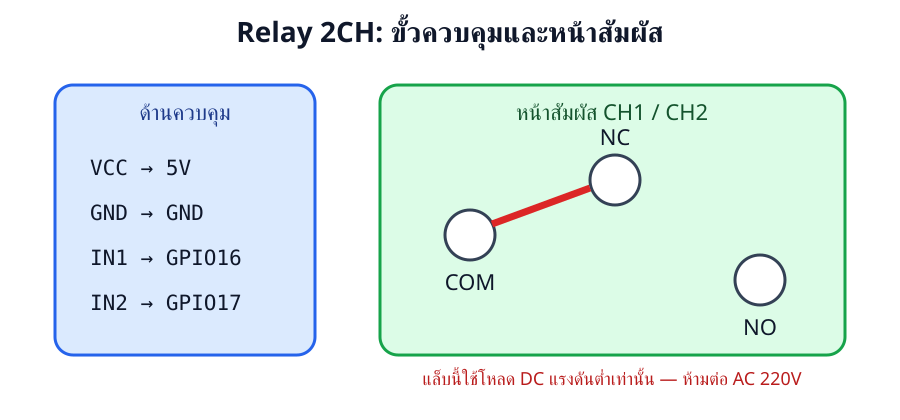
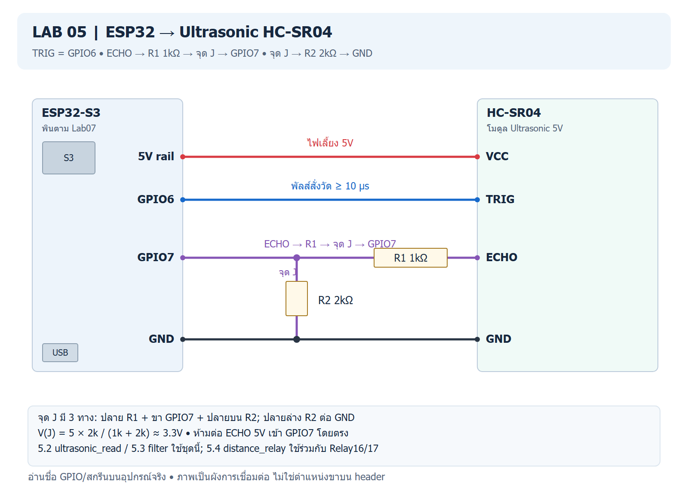
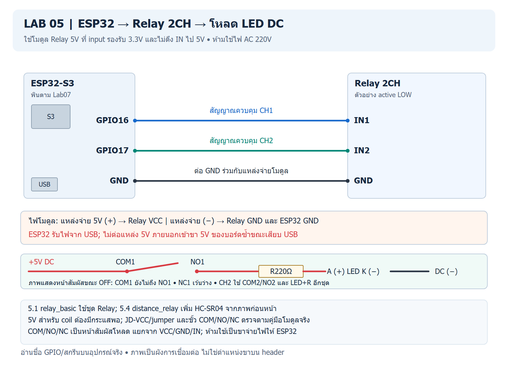
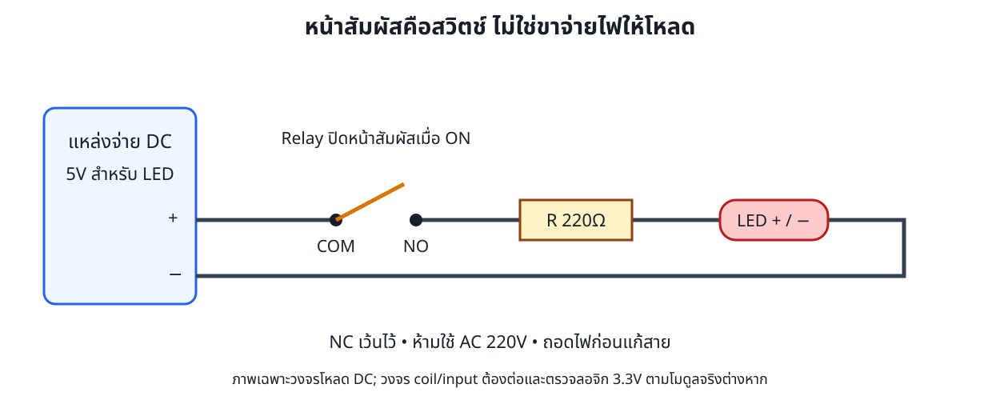
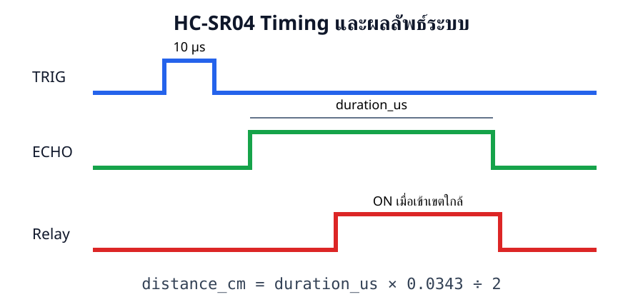

# Lab 05: Relay 2CH และ Ultrasonic

> ระดับ: ⭐⭐ | เวลา: 2–3 ชม. | ต้องผ่าน: [Lab 04](../lab04-lcd-i2c/)

เราจะสร้างตัวตรวจระยะที่สั่งไฟผ่าน Relay โดยเริ่มจากแยกทดสอบ output และ sensor แล้วค่อยรวมกติกา อย่าเริ่มด้วยโค้ดเต็มพร้อมโหลดทั้งหมด เพราะเมื่อไม่ทำงานจะไม่รู้ว่าผิดที่วงจรขับ เวลา echo หรือเงื่อนไขโปรแกรม

## 🎯 วัตถุประสงค์

เมื่อจบบทนี้ ผู้เรียนจะอธิบายขั้ว COM/NO/NC และ active LOW ได้, อ่านระยะจาก HC-SR04 โดยป้องกัน GPIO7 จากสัญญาณ 5V, กรองค่าด้วย moving average และควบคุม Relay แบบมี hysteresis เพื่อไม่ให้หน้าสัมผัสสั่นเปิด–ปิดถี่

## 🧰 อุปกรณ์ที่ใช้

| อุปกรณ์ | จำนวน | หมายเหตุ |
|---|---:|---|
| ESP32-S3 | 1 | ใช้ Relay16/17 ตาม Lab07 |
| Relay module 2CH 5V | 1 | มีวงจรขับ/ไดโอดและระบุว่า IN รองรับลอจิก 3.3V; ตัวอย่างใช้ active LOW |
| HC-SR04 | 1 | ECHO ปกติเป็น 5V |
| ตัวต้านทาน 1kΩ / 2kΩ | อย่างละ 1 | ทำ voltage divider ที่ ECHO |
| LED + R 220Ω หรือพัดลม DC 5V | 1 | โหลด DC แรงดันต่ำ |
| แหล่งจ่าย DC 5V ที่เหมาะกับกระแสโมดูล/โหลด | 1 ชุด | ขดลวด Relay ใช้ไฟจากแหล่งจ่าย ไม่ใช้ GPIO จ่ายกระแส |
| Breadboard และสาย jumper | 1 ชุด | ต่อ GND ร่วมกัน |



## ❓ คำถามก่อนเริ่มต้น

<details>
<summary><b>คลิกเพื่อดูคำถามก่อนเรียน</b></summary>

1. ขั้ว COM, NO และ NC ของ Relay ต่างกันอย่างไร?
2. คำว่า active LOW หมายถึงอะไร?
3. เพราะเหตุใดจึงไม่ควรต่อ ECHO 5V เข้าขา ESP32 โดยตรง?
4. HC-SR04 ใช้หลักการใดวัดระยะ?
5. `pulseIn()` ที่ไม่มี timeout อาจกระทบโปรแกรมอย่างไร?
6. hysteresis ช่วยลดการสั่นของ Relay ได้อย่างไร?

</details>

## 📖 ทฤษฎี

### Relay และหน้าสัมผัส

Relay ใช้ขดลวดสร้างสนามแม่เหล็กเพื่อขยับหน้าสัมผัส จึงแยกวงจรควบคุมออกจากวงจรโหลด ขั้ว **COM** เป็นขั้วร่วม, **NC** ต่อกับ COM ขณะไม่สั่งงาน และ **NO** ต่อกับ COM ขณะสั่งงาน โมดูล 2CH มักมี transistor ขับขดลวด, optocoupler ช่วยแยกสัญญาณ และ flyback diode รับแรงดันย้อนจากขดลวด บางรุ่นมี jumper `JD-VCC` สำหรับแยกไฟขดลวดออกจากไฟลอจิก ต้องตรวจสกรีนและคู่มือของโมดูลจริงเสมอ

โมดูลที่ใช้ในบทนี้สมมติว่าเป็น **active LOW**: เขียน `LOW` ที่ IN จะเปิด Relay และ `HIGH` จะปิด ดังนั้นโค้ดกำหนด `RELAY_ON`/`RELAY_OFF` ไว้ชัดเจน และสั่ง OFF ทันทีใน `setup()`

> [!CAUTION]
> **ห้ามทดลองกับไฟบ้าน AC 220V โดยเด็ดขาด** ใช้เฉพาะโหลด DC แรงดันต่ำ เช่น LED หรือพัดลม 5V การต่อไฟบ้านมีความเสี่ยงไฟดูด ไฟไหม้ และเสียชีวิต แม้ Relay จะพิมพ์ค่าทนแรงดันสูงไว้ก็ตาม

### HC-SR04 และ Time of Flight

ส่งพัลส์ HIGH อย่างน้อย 10 µs ที่ TRIG แล้วเซนเซอร์ปล่อยคลื่นเสียงความถี่สูง ขา ECHO จะ HIGH ตามเวลาเดินทางไป–กลับของเสียง เมื่อใช้อัตราเร็วเสียงประมาณ 0.0343 cm/µs:

`distance_cm = duration_us × 0.0343 ÷ 2`

หาร 2 เพราะเสียงเดินทางไปยังวัตถุแล้วสะท้อนกลับ `pulseIn(ECHO_PIN, HIGH, 30000)` จำกัดเวลารอ 30 ms; ถ้าคืน 0 หมายถึง timeout และไม่ควรนำไปคำนวณ

### การลดแรงดัน ECHO

ESP32 ใช้ลอจิก 3.3V และขา GPIO ไม่รองรับ 5V จึงใช้ R1=1kΩ จาก ECHO มายังจุดวัด และ R2=2kΩ จากจุดวัดลง GND ได้แรงดันประมาณ `5 × 2/(1+2) = 3.33V` หรือใช้ HC-SR04P รุ่นที่ระบุชัดว่ารองรับ 3.3V

### Moving average และ hysteresis

Moving average เฉลี่ยตัวอย่างล่าสุดหลายค่าเพื่อลดการกระโดดของระยะ แลกกับการตอบสนองที่ช้าลง ส่วน hysteresis ใช้เกณฑ์เปิดและปิดคนละค่า เช่น เปิด CH1 เมื่อต่ำกว่า 20 cm แต่ปิดเมื่อสูงกว่า 23 cm ค่าระหว่าง 20–23 cm จะคงสถานะเดิม จึงไม่สั่ง Relay ถี่เมื่อวัตถุสั่นอยู่ใกล้เส้นแบ่ง

## 🔌 การต่อวงจร

ใช้ **ESP32-S3** ตามชุดพินของ Lab07: [ตารางพินคงที่ทั้งคอร์ส](../../assets/PINOUT.md) เลือก **ESP32S3 Dev Module**; บอร์ด CH343 ของผู้สอนตั้ง **USB CDC On Boot = Disabled** และ Serial 115200; Flash/PSRAM เลือกตามบอร์ดจริง ไม่ต้องแก้เลขพินในโค้ดเมื่อเปลี่ยนบท

ภาพต่อไปนี้ใช้ชื่อพินเป็นหลัก ตำแหน่ง header ของบอร์ด ESP32-S3 แต่ละรุ่นและลำดับขาโมดูลอาจต่างกัน ให้หาสกรีน `GPIO6`/`IO6` หรือหมายเลข GPIO ที่ตรงกันบนบอร์ดจริงก่อนต่อสาย ตัวเลข GPIO ไม่ใช่ลำดับขาจากปลายบอร์ด

| การทดลอง | อุปกรณ์และภาพที่ใช้ | สายสัญญาณ ESP32 |
|---|---|---|
| 5.1 Relay basic | Relay 2CH; เริ่มโดยถอดโหลด แล้วเพิ่มโหลด LED | GPIO16 → IN1, GPIO17 → IN2 |
| 5.2 อ่านระยะ, 5.3 กรองระยะ | HC-SR04 + R1/R2; ไม่ต้องต่อ Relay | GPIO6 → TRIG, จุดแบ่งแรงดัน → GPIO7 |
| 5.4 ระยะสั่ง Relay | รวมสองวงจรบน **ESP32 ตัวเดียว** ใช้ GND ควบคุมร่วม | GPIO6/7 และ GPIO16/17 |

### A. ต่อ HC-SR04 และวงจรแบ่งแรงดัน ECHO



| สาย/จุดต่อ | ต่อจาก | ต่อไปยัง | หมายเหตุ |
|---|---|---|---|
| U1 | แหล่งจ่าย `5V` | HC-SR04 `VCC` | ไฟเลี้ยง 5V; ไม่ต่อกับ 3V3 |
| U2 | HC-SR04 `GND` | ESP32 `GND` และขั้วลบแหล่งจ่าย 5V | กราวด์ร่วม |
| U3 | ESP32 `GPIO6` | HC-SR04 `TRIG` | พัลส์ trigger จาก ESP32 |
| U4 | HC-SR04 `ECHO` | ปลายแรกของ `R1 = 1kΩ` | สัญญาณก่อนแบ่งแรงดันอาจถึง 5V |
| จุด J | ปลายอีกด้านของ R1 | ESP32 `GPIO7` และปลายแรกของ `R2 = 2kΩ` | ทั้งสามขาต้องต่อถึงกันที่จุดเดียว |
| U5 | ปลายอีกด้านของ R2 | `GND` ร่วม | R2 เป็นตัวล่างของ divider |

1. ถอด USB/แหล่งจ่ายก่อนต่อ เดิน U1–U3 ตามตารางและชื่อขาที่สกรีนบน HC-SR04
2. ต่อ ECHO → R1 1kΩ → **จุด J** → GPIO7 แล้วต่อ R2 2kΩ จาก **จุด J เดียวกัน** ลง GND อย่าต่อ R1/R2 อนุกรมไป GPIO โดยไม่มีแขนลง GND
3. ตรวจว่าจุด J ไม่ได้ต่อถึง ECHO โดยลัดข้าม R1 และไม่ได้ต่อ GND โดยลัดข้าม R2; ตัวต้านทานไม่มีขั้ว แต่ตำแหน่ง R1/R2 ในวงจรต้องถูกต้อง
4. ตรวจไฟ/ค่าตัวต้านทานและ GND ร่วมก่อนเสียบ USB แล้วทดลอง 5.2 ให้ได้ก่อนทำ 5.3/5.4 ดู [ภาพขยาย divider](images/lab05-echo-divider.svg) ประกอบ

### B. ต่อ Relay 2CH และโหลด LED DC



| สาย | ต่อจาก | ต่อไปยัง | หมายเหตุ |
|---|---|---|---|
| C1 | ESP32 `GPIO16` | Relay `IN1` | สั่ง CH1; ตัวอย่าง active LOW |
| C2 | ESP32 `GPIO17` | Relay `IN2` | สั่ง CH2; ตัวอย่าง active LOW |
| C3 | แหล่งจ่ายโมดูล `5V` | Relay `VCC` | ใช้โมดูลที่ IN รองรับลอจิก 3.3V |
| C4 | Relay `GND` | ESP32 `GND` และขั้วลบแหล่งจ่ายโมดูล | กราวด์ร่วมของฝั่งควบคุม |
| L1 | ขั้วบวกแหล่งจ่ายโหลด `+5V` | Relay `COM1` | วงจรโหลดแยกจากขั้วควบคุม |
| L2 | Relay `NO1` | R `220Ω` แล้วต่อขา anode ของ LED | anode คือขาบวก; โดยทั่วไปเป็นขายาว |
| L3 | ขา cathode ของ LED | ขั้วลบแหล่งจ่ายโหลด | โดยทั่วไปเป็นขาสั้น/ด้านแบนของ LED |
| เว้นไว้ | Relay `NC1` | ไม่ต่อสาย | โหลดตัวอย่างดับเมื่อไม่สั่ง CH1 |

หากต้องการโหลดให้ CH2 เพิ่มชุด LED+R แล้วต่อ `+5V → COM2`, `NO2 → R220Ω → anode LED`, `cathode → ขั้วลบแหล่งจ่ายโหลด` และเว้น `NC2` แต่ชุดพื้นฐานใช้ LED โหลดเพียงหนึ่งตัวเพื่อตรวจ CH1 ได้ ส่วน CH2 ตรวจไฟสถานะโมดูลก่อน



1. ถอด USB/แหล่งจ่ายก่อนเดินสาย อ่านสกรีนขาโมดูลจริงและตรวจว่ารับลอจิก 3.3V ได้ ไม่ใช้ตัวต้านทานดึง IN ไป 5V เข้าขา ESP32 ตรง
2. แยกฝั่งควบคุม VCC/GND/IN1/IN2 ออกจากฝั่งหน้าสัมผัส COM/NO/NC กระแสขดลวดต้องมาจากแหล่งจ่ายโมดูล ไม่ใช่ GPIO
3. ใช้โหลด LED เป็นหลัก: +5V ของแหล่งจ่ายโหลด → COM → NO → R220Ω → anode LED, cathode → ลบของแหล่งจ่ายโหลด NC เว้นไว้
4. ฝั่งควบคุม ESP32/Relay มี GND ร่วมตามวงจรโมดูลที่ใช้ ส่วนหน้าสัมผัสเป็นสวิตช์แยกจาก coil ไม่ใช่ขาที่จ่าย 5V ออกมาเอง
5. HC-SR04 ต่อ ECHO→R1 1kΩ→จุดรับ GPIO7 และจุดนั้น→R2 2kΩ→GND อย่าสลับ R บน/ล่าง และตรวจราง GND ถึงกัน
6. ถ้าใช้พัดลม/โหลด inductive ต้องมีการป้องกันตามโหลดด้วย ไดโอดบนโมดูล Relay อาจป้องกันเฉพาะ coil ไม่ได้ป้องกันโหลดทุกชนิด ห้ามนำวงจรนี้ไปทดลองกับ AC 220V

ค่า divider เป็นค่าประมาณตามแรงดันจริงและ tolerance ของ R ตรวจไฟ/ผังโมดูลก่อนต่อ GPIO การมี optocoupler หรือ jumper JD-VCC ไม่ได้รับประกัน isolation หากต่อกราวด์/จัมเปอร์ผิดกติกาของโมดูลนั้น

ใช้แหล่งจ่าย 5V ที่จ่ายกระแสพอสำหรับ Relay และ HC-SR04 พร้อมต่อขั้วลบร่วมกับ ESP32 GND หากอ้างอิง 5V จากขา `5V`/`VIN` ต้องตรวจผังและขีดจำกัดของบอร์ดจริงก่อน ห้ามป้อนไฟภายนอกกลับเข้าบอร์ดที่เสียบ USB โดยไม่ตรวจวงจรจ่ายไฟ และห้ามต่อ 5V เข้า `3V3` หรือ GPIO โมดูลที่มี `JD-VCC` ต้องเดินสายตามคู่มือรุ่นนั้น ไม่เดาว่าการใส่/ถอด jumper เหมือนกันทุกตัว

ภาพวงจรเป็นแผนภาพชื่อพินที่สร้างโดยโครงการ ให้ต่อจากชื่อต้นทางไปชื่อปลายทางตามตาราง ไม่ใช่หลักฐานการทดสอบ hardware จริง; แหล่งที่มาอยู่ใน [`IMAGE_SOURCES.md`](../../assets/IMAGE_SOURCES.md)

<details>
<summary><b>เฉพาะผู้ใช้ ESP32-WROOM-32 รุ่นเดิม</b></summary>

โค้ดเลือกพินตาม target ตอน compile อัตโนมัติ ตารางและภาพหลักของบทนี้สำหรับ ESP32-S3 ตามบอร์ดผู้สอน หากใช้ ESP32-WROOM-32 ให้ใช้พินของรุ่นเดิมดังนี้ และไม่สลับตารางระหว่างบท

| อุปกรณ์ | ESP32-WROOM-32 |
|---|---|
| LED ภายนอก | GPIO16 |
| ปุ่ม OUT | GPIO18 |
| OLED SDA/SCL | GPIO21/22 |
| ไฟ RD/YL/GY | GPIO17/23/32 |
| Relay IN1/IN2 | GPIO26/27 |
| HC-SR04 TRIG/ECHO | GPIO25/33; ECHO ผ่าน divider |
| DHT11 DATA | GPIO4 |

</details>

## 🧪 การทดลอง

### เตรียมก่อนเริ่ม

1. ใช้ ESP32S3 Dev Module, core 3.x และ Monitor 115200 ตาม Lab 01 ไม่ต้องติดตั้ง library ภายนอกในบทนี้
2. เริ่ม New Sketch → Save As ชื่อการทดลอง หรือเปิดไฟล์ `.ino` ที่ลิงก์ไว้ เพิ่มโค้ดทีละส่วนและกด Verify ก่อน Upload
3. ทดสอบ Relay โดยไม่มีโหลดก่อน จากนั้นทดสอบ HC-SR04 แยก แล้วจึงรวมระบบ ไม่ใช้เสียงคลิกเป็นหลักฐานว่าโหลดทำงานถูกต้อง
4. จดผลคาดการณ์ก่อนทดลองและผลที่เห็นจริง ตัวอย่าง Serial/ภาพใน README เป็นผลคาดหวัง ไม่ใช่ผลจาก hardware ที่ทดสอบในรอบเขียนเอกสาร

### การทดลองที่ 5.1: แยก “สถานะ ON” จาก “ระดับ LOW”

**วงจรที่ใช้:** ภาพ B สาย C1–C4: GPIO16→IN1, GPIO17→IN2, VCC=5V, GND ร่วม เริ่มโดยถอดโหลด แล้วจึงเพิ่ม L1–L3 เพื่อทดสอบ LED ผ่าน COM1/NO1; ยังไม่ต้องต่อ HC-SR04

1. ถอดโหลดออกจาก COM/NO/NC ก่อน ตรวจว่าโมดูล Relay รองรับ input 3.3V จริงและไม่ดึง IN ไป 5V หากไม่รองรับต้องมีวงจรขับที่เหมาะสม ห้ามสมมติว่า Relay 5V ทุกโมดูลต่อ GPIO ได้ตรง
2. ต่อ IN1=16, IN2=17, ไฟควบคุมและ GND ตามโมดูล ประกาศ RELAY_ON/RELAY_OFF ก่อน setup เพื่อรวมกติกา active LOW ไว้ที่เดียว
3. อ่าน `setRelay(pin,on)`: พารามิเตอร์ on เป็นความหมาย true/false ส่วน digitalWrite รับระดับไฟฟ้าที่แปลงแล้ว ทำให้ส่วนอื่นไม่ต้องจำว่า LOW แปลว่าเปิด
4. เริ่มจาก setup สั่งทั้งสอง OFF และ loop ว่าง Upload แล้วตรวจสถานะขณะเริ่มโปรแกรม จากนั้นใส่ loop ฉบับเต็มเพื่อสลับทุก 2 วินาที
5. เมื่อควบคุมได้แล้วถอดไฟ ต่อโหลด LED DC ตามภาพ แล้วทดสอบอีกครั้ง ตรวจทั้งไฟโมดูล เสียงคลิก และ LED ของโหลด

[ดาวน์โหลด `lab05_relay_basic.ino`](code/lab05_relay_basic/lab05_relay_basic.ino)

```cpp
/*
 * Lab 05.1 : ทดลอง Relay 2CH แบบ active LOW
 * คำอธิบาย : สลับ Relay 1 และ Relay 2 ทุก 2 วินาทีโดยไม่ block โปรแกรม
 * วงจร     : IN1 -> GPIO16, IN2 -> GPIO17 บน S3 (ESP32 เดิม 26/27), VCC -> 5V, GND ร่วมกัน; โหลด DC แรงดันต่ำเท่านั้น
 * ไลบรารี  : ไม่ใช้ไลบรารีภายนอก
 * Board    : ESP32S3 Dev Module หรือ ESP32 Dev Module (Arduino-ESP32 core 3.x)
 */
#include <Arduino.h>

#if defined(CONFIG_IDF_TARGET_ESP32S3)
constexpr uint8_t RELAY_1_PIN = 16;
constexpr uint8_t RELAY_2_PIN = 17;
#elif defined(CONFIG_IDF_TARGET_ESP32)
constexpr uint8_t RELAY_1_PIN = 26;
constexpr uint8_t RELAY_2_PIN = 27;
#else
#error "Use ESP32-S3 or ESP32 with the verified course pin map"
#endif
constexpr uint8_t RELAY_ON = LOW;
constexpr uint8_t RELAY_OFF = HIGH;
constexpr unsigned long INTERVAL_MS = 2000;

unsigned long lastChange = 0;
bool relay1On = false;

// เขียนสถานะโดยแปลงค่า bool เป็นลอจิก active LOW
void setRelay(uint8_t pin, bool on) {
  digitalWrite(pin, on ? RELAY_ON : RELAY_OFF);
}

void setup() {
  Serial.begin(115200);
  pinMode(RELAY_1_PIN, OUTPUT);
  pinMode(RELAY_2_PIN, OUTPUT);
  setRelay(RELAY_1_PIN, false);
  setRelay(RELAY_2_PIN, false);
  Serial.println("[RELAY] เริ่มต้น: Relay ทั้งสอง OFF");
}

void loop() {
  const unsigned long now = millis();
  if (now - lastChange < INTERVAL_MS) return;
  lastChange = now;

  relay1On = !relay1On;
  setRelay(RELAY_1_PIN, relay1On);
  setRelay(RELAY_2_PIN, !relay1On);
  Serial.printf("[RELAY] CH1=%s CH2=%s\n", relay1On ? "ON" : "OFF",
                relay1On ? "OFF" : "ON");
}
```

| ส่วนของโค้ด | หน้าที่ |
|---|---|
| `RELAY_ON=LOW`, `RELAY_OFF=HIGH` | แปลงกติกาเฉพาะโมดูล ถ้าเป็น active HIGH ต้องตรวจและปรับ |
| `setRelay(pin,on)` | รวมการแปลง bool เป็นระดับขาจริง ลดความสับสน |
| setup สั่ง OFF | สั่งสถานะหลัง firmware เริ่มทำงาน ไม่รับรองขาจะไม่ลอยช่วง reset ก่อน setup |
| timer 2000 ms | เว้นการสับโดยไม่ delay ใน loop |
| `relay1On = !relay1On` | สลับช่องแรก แล้วให้ช่องสองตรงข้าม |

ผลที่คาดหวัง:

```text
[RELAY] เริ่มต้น: Relay ทั้งสอง OFF
[RELAY] CH1=ON CH2=OFF
[RELAY] CH1=OFF CH2=ON
```

**จุดตรวจ:** ปิดไฟแล้วตรวจ continuity ว่า COM–NC ต่อกันขณะไม่จ่ายขดลวด เมื่อสั่ง ON ภายใต้การทดสอบ DC เท่านั้น COM–NO จึงต่อกัน อย่าใช้โหมด continuity กับวงจรที่จ่ายไฟอยู่

**ลองเปลี่ยน:** สั่งสองช่อง OFF ใน loop ชั่วคราวแล้วตรวจว่าโหลดหยุดตามหรือไม่ ถ้าต้องไม่มีกระตุกช่วง boot ต้องออกแบบวงจร default OFF ภายนอกให้เหมาะกับโมดูล ไม่ใช่พึ่ง setup อย่างเดียว

**ภารกิจท้าทาย:** รับคำสั่ง Serial `1`, `2`, `0` เพื่อเปิดช่องที่เลือกหรือปิดทั้งหมด โดยไม่เปลี่ยนกติกา active LOW กระจายหลายจุด

### การทดลองที่ 5.2: เริ่มจากเวลา แล้วค่อยเป็นระยะ

**วงจรที่ใช้:** ภาพ A: HC-SR04 VCC=5V, GND ร่วม, GPIO6→TRIG, ECHO→R1 1kΩ→จุด J→GPIO7 และจุด J→R2 2kΩ→GND; ไม่ต้องต่อ Relay

1. ต่อ HC-SR04 แยกจาก Relay: VCC=5V, GND ร่วม, TRIG=6 และ ECHO ผ่าน divider ไป GPIO7 ตรวจ R1/R2 ก่อนเสียบ USB
2. อ่าน `readDistanceCm()` ตามลำดับ: LOW สั้น ๆ → HIGH 10 µs → LOW → รอ ECHO → แปลงหน่วย พัลส์ 10 µs ใช้ delayMicroseconds เพื่อสร้างสัญญาณ ไม่ใช่การหน่วงวินาทีใน loop
3. `pulseIn()` คืนความกว้าง HIGH หน่วย µs เมื่อไม่พบพัลส์ตามกำหนดคืน 0 โค้ดแปลงเป็น NAN เพื่อไม่ให้ผู้ใช้เข้าใจว่าอยู่ 0 cm
4. Upload วางแผ่นเรียบตั้งฉากที่ 10,20,50 cm ใช้ไม้บรรทัดเทียบ บันทึกหลายค่าแต่ละระยะ ไม่วัดกับวัตถุเล็ก/ผ้านิ่มแล้วสรุปความแม่นจากครั้งเดียว
5. ลองเอาวัตถุออกหรือหันเฉียง สังเกตข้อความ timeout ซึ่งเป็นสถานะ invalid ไม่ใช่ “ไกลแน่นอน”

[ดาวน์โหลด `lab05_ultrasonic_read.ino`](code/lab05_ultrasonic_read/lab05_ultrasonic_read.ino)

```cpp
/*
 * Lab 05.2 : อ่านระยะจาก HC-SR04
 * คำอธิบาย : ส่ง trigger แล้วคำนวณระยะจากเวลาเดินทางของเสียง
 * วงจร     : S3 TRIG -> GPIO6, ECHO -> divider 1kΩ/2kΩ -> GPIO7; ESP32 เดิม 25/33; VCC -> 5V, GND ร่วมกัน
 * ไลบรารี  : ไม่ใช้ไลบรารีภายนอก
 * Board    : ESP32S3 Dev Module หรือ ESP32 Dev Module (Arduino-ESP32 core 3.x)
 */
#include <Arduino.h>

#if defined(CONFIG_IDF_TARGET_ESP32S3)
constexpr uint8_t TRIG_PIN = 6;
constexpr uint8_t ECHO_PIN = 7;
#elif defined(CONFIG_IDF_TARGET_ESP32)
constexpr uint8_t TRIG_PIN = 25;
constexpr uint8_t ECHO_PIN = 33;
#else
#error "Use ESP32-S3 or ESP32 with the verified course pin map"
#endif
constexpr unsigned long ECHO_TIMEOUT_US = 30000;
constexpr unsigned long SAMPLE_MS = 500;
unsigned long lastSample = 0;

// คืนค่าระยะเป็น cm; คืน NAN เมื่อไม่พบ echo ภายในเวลาที่กำหนด
float readDistanceCm() {
  digitalWrite(TRIG_PIN, LOW);
  delayMicroseconds(2);
  digitalWrite(TRIG_PIN, HIGH);
  delayMicroseconds(10);
  digitalWrite(TRIG_PIN, LOW);

  const unsigned long duration = pulseIn(ECHO_PIN, HIGH, ECHO_TIMEOUT_US);
  if (duration == 0) return NAN;
  return duration * 0.0343f / 2.0f;
}

void setup() {
  Serial.begin(115200);
  pinMode(TRIG_PIN, OUTPUT);
  pinMode(ECHO_PIN, INPUT);
  digitalWrite(TRIG_PIN, LOW);
}

void loop() {
  const unsigned long now = millis();
  if (now - lastSample < SAMPLE_MS) return;
  lastSample = now;

  const float distance = readDistanceCm();
  if (isnan(distance)) Serial.println("[SENSOR] timeout: ไม่พบ echo");
  else Serial.printf("[SENSOR] distance=%.1f cm\n", distance);
}
```

| ส่วนของโค้ด | หน้าที่ |
|---|---|
| OUTPUT / INPUT | TRIG ส่งออก ส่วน ECHO รับเข้า |
| `delayMicroseconds(10)` | ความกว้าง trigger ไม่ใช่ช่วงระหว่างสองการวัด |
| `pulseIn(...,30000)` | รอวัดแบบ synchronous มี timeout; loop ยังถูกหน่วงช่วงนี้ได้ |
| `duration*0.0343/2` | cm/µs × µs แล้วหารระยะไป–กลับ |
| `NAN`, `isnan()` | แยกข้อมูลใช้ไม่ได้ออกจากระยะจริง |
| `SAMPLE_MS=500` | เว้นรอบการวัดนานกว่าช่วง echo ไม่ trigger รัวทุก loop |

ผลตัวอย่าง:

```text
[SENSOR] distance=34.7 cm
[SENSOR] timeout: ไม่พบ echo
```

**จุดตรวจ:** คำนวณด้วยมือเมื่อ duration=1000 µs ได้ประมาณ 17.15 cm แล้วอธิบายว่าต้องหารสองเพราะอะไร ขนาดผลจากการวัดจริงขึ้นกับอุณหภูมิ พื้นผิว และตำแหน่งวัตถุด้วย

**ภารกิจท้าทาย:** เพิ่มรายงาน duration ดิบและหน่วย inch แล้วเทียบผลกับ cm ในแถวเดียว

### การทดลองที่ 5.3: กรองด้วยหน้าต่างข้อมูลจริง

**วงจรที่ใช้:** ใช้ภาพ A เหมือน 5.2 ทุกสาย เพิ่ม moving average ในโค้ดโดยไม่เพิ่มอุปกรณ์

1. ใช้วงจรเดิม ประกาศ array 5 ช่อง พร้อม sampleIndex และ sampleCount ก่อน setup ทั้งคู่มีหน้าที่ต่างกัน: index บอกช่องเขียน ส่วน count บอกจำนวนข้อมูล valid ที่มี
2. อ่านค่า raw ถ้า NAN ให้ข้ามก่อนเรียก `addAndAverage()` ห้ามเอา timeout มาเป็นศูนย์ผสมกับระยะจริง
3. เมื่อเพิ่มค่า ให้เลื่อน index ด้วย modulo 5 เพื่อวนแทนข้อมูลเก่าสุด แล้วรวมเฉพาะช่องที่มีข้อมูลจริง
4. Upload วางวัตถุนิ่งแล้วขยับกะทันหัน เทียบ raw กับ average จะเห็นการลดความผันผวนแลกกับการตามค่าที่ช้าลง
5. เปลี่ยน WINDOW_SIZE เป็น 3 และ 10 ทีละรอบแล้ว Upload เพื่อเทียบ ห้ามคาดว่า window ใหญ่สุดจะเหมาะทุกงาน

[ดาวน์โหลด `lab05_ultrasonic_filter.ino`](code/lab05_ultrasonic_filter/lab05_ultrasonic_filter.ino)

```cpp
/*
 * Lab 05.3 : กรองระยะด้วย moving average
 * คำอธิบาย : เก็บตัวอย่างล่าสุด 5 ค่าเพื่อลดสัญญาณรบกวนของ HC-SR04
 * วงจร     : S3 TRIG -> GPIO6, ECHO -> divider 1kΩ/2kΩ -> GPIO7; ESP32 เดิม 25/33; VCC -> 5V, GND ร่วมกัน
 * ไลบรารี  : ไม่ใช้ไลบรารีภายนอก
 * Board    : ESP32S3 Dev Module หรือ ESP32 Dev Module (Arduino-ESP32 core 3.x)
 */
#include <Arduino.h>

#if defined(CONFIG_IDF_TARGET_ESP32S3)
constexpr uint8_t TRIG_PIN = 6;
constexpr uint8_t ECHO_PIN = 7;
#elif defined(CONFIG_IDF_TARGET_ESP32)
constexpr uint8_t TRIG_PIN = 25;
constexpr uint8_t ECHO_PIN = 33;
#else
#error "Use ESP32-S3 or ESP32 with the verified course pin map"
#endif
constexpr size_t WINDOW_SIZE = 5;
constexpr unsigned long SAMPLE_MS = 200;
float samples[WINDOW_SIZE] = {};
size_t sampleIndex = 0;
size_t sampleCount = 0;
unsigned long lastSample = 0;

float readDistanceCm() {
  digitalWrite(TRIG_PIN, LOW);
  delayMicroseconds(2);
  digitalWrite(TRIG_PIN, HIGH);
  delayMicroseconds(10);
  digitalWrite(TRIG_PIN, LOW);
  const unsigned long duration = pulseIn(ECHO_PIN, HIGH, 30000);
  return duration == 0 ? NAN : duration * 0.0343f / 2.0f;
}

// เพิ่มค่าล่าสุดลง circular buffer แล้วคืนค่าเฉลี่ย
float addAndAverage(float value) {
  samples[sampleIndex] = value;
  sampleIndex = (sampleIndex + 1) % WINDOW_SIZE;
  if (sampleCount < WINDOW_SIZE) sampleCount++;

  float sum = 0.0f;
  for (size_t i = 0; i < sampleCount; i++) sum += samples[i];
  return sum / sampleCount;
}

void setup() {
  Serial.begin(115200);
  pinMode(TRIG_PIN, OUTPUT);
  pinMode(ECHO_PIN, INPUT);
  digitalWrite(TRIG_PIN, LOW);
}

void loop() {
  const unsigned long now = millis();
  if (now - lastSample < SAMPLE_MS) return;
  lastSample = now;

  const float raw = readDistanceCm();
  if (isnan(raw)) {
    Serial.println("[SENSOR] timeout; ไม่นำค่านี้ไปเฉลี่ย");
    return;
  }
  const float filtered = addAndAverage(raw);
  Serial.printf("[SENSOR] raw=%.1f cm average=%.1f cm samples=%u\n",
                raw, filtered, static_cast<unsigned>(sampleCount));
}
```

| ส่วนของโค้ด | หน้าที่ |
|---|---|
| `samples[WINDOW_SIZE]` | circular buffer ของระยะ valid ล่าสุด |
| `% WINDOW_SIZE` | วนช่องเขียนโดยไม่ออกนอก array |
| `sampleCount` | หารเฉพาะจำนวนที่รับมาแล้ว ตอนเริ่มยังไม่ครบ5 |
| `sum / sampleCount` | ค่าเฉลี่ยเลขคณิต ไม่ใช่การคัด outlier โดยตรง |
| guard `isnan(raw)` | ไม่ให้ค่า invalid ทำให้ผลเฉลี่ยเสีย |
| SAMPLE_MS=200 | ตัวอย่างล่าสุด 5 ค่าห่างกัน 200 ms จึงมีประวัติราว 0.8 วินาที |

ถ้าค่าเข้ามาเป็น 30,32,31 ค่าเฉลี่ยขณะ count=3 คือ 31 ไม่ใช่ 18.6 จากการหารด้วย 5 รวมศูนย์ที่ยังไม่เคยวัด

```text
[SENSOR] raw=31.8 cm average=32.1 cm samples=5
```

**จุดตรวจ:** บอกความต่างของ sampleIndex กับ sampleCount ได้ และอธิบายว่า “นิ่ง” ไม่ได้แปลว่า “ถูกต้อง” ค่าอ่านผิดที่คงที่ยังเฉลี่ยออกมาผิดได้ หากขาดข้อมูลนาน ตัวอย่างนี้ยังเก็บ buffer เก่าไว้ ผู้เรียนควรพิจารณา reset/อายุข้อมูลก่อนนำไปใช้จริง

**ภารกิจท้าทาย:** เปรียบเทียบ moving average กับ median เมื่อแทรก outlier หนึ่งค่า และบันทึกเวลาที่ใช้ตามการเปลี่ยนจริง

### การทดลองที่ 5.4: เปลี่ยนระยะเป็นคำสั่งโดยจำสถานะเดิม

**วงจรที่ใช้:** รวมภาพ A และ B บน ESP32 ตัวเดียว: HC-SR04 ใช้ GPIO6/7 และ Relay ใช้ GPIO16/17 ต่อ GND ควบคุมทั้งหมดร่วมกัน คง divider ที่ ECHO และใช้โหลด LED DC ผ่าน COM/NO เท่านั้น

1. ทดสอบ 5.1/5.2 ให้ผ่านก่อนรวม ใช้เฉพาะโหลด LED/DC แรงดันต่ำตามบท กำหนดความหมายของการเปิดแต่ละช่องก่อนเขียนเงื่อนไข
2. CH1 เปิดเมื่อ `<20` และปิดเมื่อ `>23` cm; CH2 เปิด `<10` และปิด `>13` ค่าภายในช่วงต้องดูสถานะเดิม จึงส่ง current เข้า `applyHysteresis()`
3. ไม่รวม moving average อัตโนมัติในไฟล์นี้ เพื่อแยกผลของ hysteresis ให้สังเกตชัด หากจะเพิ่ม filter ต้องวิเคราะห์ความหน่วงร่วมกัน
4. ตรวจ branch invalid: สองรอบแรกคงสถานะเดิม รอบผิดพลาดติดกันที่สามปิดทั้งสองช่องตามนโยบายโหลด LED สาธิต ค่า valid ใหม่จะล้าง invalidSamples
5. Upload ขยับวัตถุ 25→19→21→24 cm แล้วสังเกต CH1 จากนั้นลอง 15→9→11→14 cm สำหรับ CH2
6. จำลอง no echo ติดต่อกันแล้วตรวจ log invalid=1,2,3 กับ output อย่าแปลง NAN เป็น 0 แล้วปล่อยให้ trigger ใกล้โดยบังเอิญ

[ดาวน์โหลด `lab05_distance_relay.ino`](code/lab05_distance_relay/lab05_distance_relay.ino)

```cpp
/*
 * Lab 05.4 : ควบคุม Relay ตามระยะพร้อม hysteresis
 * คำอธิบาย : CH1 ON ต่ำกว่า 20 cm, CH2 ON ต่ำกว่า 10 cm และมีช่วงปล่อย 3 cm
 * วงจร     : S3: Relay IN1/IN2 -> GPIO16/17; HC-SR04 TRIG -> 6, ECHO -> divider -> 7; ESP32 เดิม Relay26/27 TRIG25/ECHO33
 * ไลบรารี  : ไม่ใช้ไลบรารีภายนอก
 * Board    : ESP32S3 Dev Module หรือ ESP32 Dev Module (Arduino-ESP32 core 3.x)
 */
#include <Arduino.h>

#if defined(CONFIG_IDF_TARGET_ESP32S3)
constexpr uint8_t TRIG_PIN = 6;
constexpr uint8_t ECHO_PIN = 7;
#elif defined(CONFIG_IDF_TARGET_ESP32)
constexpr uint8_t TRIG_PIN = 25;
constexpr uint8_t ECHO_PIN = 33;
#else
#error "Use ESP32-S3 or ESP32 with the verified course pin map"
#endif
#if defined(CONFIG_IDF_TARGET_ESP32S3)
constexpr uint8_t RELAY_1_PIN = 16;
constexpr uint8_t RELAY_2_PIN = 17;
#elif defined(CONFIG_IDF_TARGET_ESP32)
constexpr uint8_t RELAY_1_PIN = 26;
constexpr uint8_t RELAY_2_PIN = 27;
#else
#error "Use ESP32-S3 or ESP32 with the verified course pin map"
#endif
constexpr uint8_t RELAY_ON = LOW, RELAY_OFF = HIGH;
constexpr float CH1_ON_CM = 20.0f, CH1_OFF_CM = 23.0f;
constexpr float CH2_ON_CM = 10.0f, CH2_OFF_CM = 13.0f;
constexpr unsigned long SAMPLE_MS = 200;
bool relay1On = false, relay2On = false;
unsigned long lastSample = 0;
constexpr uint8_t MAX_INVALID_SAMPLES = 3;
uint8_t invalidSamples = 0;

float readDistanceCm() {
  digitalWrite(TRIG_PIN, LOW);
  delayMicroseconds(2);
  digitalWrite(TRIG_PIN, HIGH);
  delayMicroseconds(10);
  digitalWrite(TRIG_PIN, LOW);
  const unsigned long duration = pulseIn(ECHO_PIN, HIGH, 30000);
  return duration == 0 ? NAN : duration * 0.0343f / 2.0f;
}

// เปิดเมื่อระยะต่ำกว่า onThreshold และปิดเมื่อสูงกว่า offThreshold
bool applyHysteresis(bool current, float distance, float onThreshold,
                     float offThreshold) {
  if (!current && distance < onThreshold) return true;
  if (current && distance > offThreshold) return false;
  return current;
}

void writeRelays() {
  digitalWrite(RELAY_1_PIN, relay1On ? RELAY_ON : RELAY_OFF);
  digitalWrite(RELAY_2_PIN, relay2On ? RELAY_ON : RELAY_OFF);
}

void setup() {
  Serial.begin(115200);
  pinMode(TRIG_PIN, OUTPUT); pinMode(ECHO_PIN, INPUT);
  pinMode(RELAY_1_PIN, OUTPUT); pinMode(RELAY_2_PIN, OUTPUT);
  digitalWrite(TRIG_PIN, LOW);
  writeRelays();
}

void loop() {
  const unsigned long now = millis();
  if (now - lastSample < SAMPLE_MS) return;
  lastSample = now;

  const float distance = readDistanceCm();
  if (isnan(distance)) {
    // ตัวอย่างโหลด LED: ผิดพลาดติดกัน 3 รอบให้ปิดทั้งสองช่อง
    if (invalidSamples < MAX_INVALID_SAMPLES) invalidSamples++;
    if (invalidSamples >= MAX_INVALID_SAMPLES) {
      relay1On = false;
      relay2On = false;
      writeRelays();
    }
    Serial.printf("[SENSOR] invalid=%u CH1=%s CH2=%s\n",
                  static_cast<unsigned int>(invalidSamples),
                  relay1On ? "ON" : "OFF", relay2On ? "ON" : "OFF");
    return;
  }
  invalidSamples = 0;
  relay1On = applyHysteresis(relay1On, distance, CH1_ON_CM, CH1_OFF_CM);
  relay2On = applyHysteresis(relay2On, distance, CH2_ON_CM, CH2_OFF_CM);
  writeRelays();
  Serial.printf("[SYSTEM] distance=%.1f cm CH1=%s CH2=%s\n", distance,
                relay1On ? "ON" : "OFF", relay2On ? "ON" : "OFF");
}
```

| ส่วนของโค้ด | หน้าที่ |
|---|---|
| ON/OFF thresholds | กำหนดคนละเส้นเพื่อสร้าง deadband |
| `current` | จำสถานะเดิมเมื่อระยะอยู่ใน deadband |
| `<` และ `>` | ที่เท่ากับเส้นพอดีจะคงสถานะเดิมตามโค้ดนี้ |
| `invalidSamples` | นับความผิดพลาดติดกัน แยกจาก distance |
| `MAX_INVALID_SAMPLES` | กติกา error ของตัวอย่าง LED ไม่ใช่ fail-safe สากล |
| `writeRelays()` | แปลงสถานะของระบบเป็น active LOW ที่สองขา |

| ระยะ CH1 | สถานะก่อน | สถานะหลัง |
|---:|---|---|
| 25 cm | OFF | OFF |
| 19 cm | OFF | ON |
| 21 cm | ON | ON |
| 24 cm | ON | OFF |
| 21 cm | OFF | OFF |

```text
[SYSTEM] distance=25.1 cm CH1=OFF CH2=OFF
[SYSTEM] distance=18.9 cm CH1=ON CH2=OFF
[SYSTEM] distance=8.7 cm CH1=ON CH2=ON
[SENSOR] invalid=3 CH1=OFF CH2=OFF
```



**จุดตรวจ:** ระยะเดียวกัน 21 cm ทำให้ ON หรือ OFF ได้ทั้งคู่เพราะมีประวัติ ไม่ใช่ bug ของ if นโยบายปิดเมื่อไม่มีข้อมูลเหมาะกับโหลด LED ตัวอย่างนี้เท่านั้น งานปั๊ม/ประตู/เตือนระยะต้องเลือก fail-safe จากความเสี่ยงของงานจริง

**ภารกิจท้าทาย:** ทำระบบช่วยจอดรถด้วย LED/buzzer และแสดงระยะบน OLED เพิ่มการแสดงสถานะ invalid แยกจากสถานะไกล/ใกล้

### ใบงานบันทึกผล

| สิ่งที่ตรวจ | ผลจากชุดทดลองของผู้เรียน |
|---|---|
| โมดูล Relay/ความเข้ากันได้ input 3.3V | __________ |
| COM/NO/NC ที่ตรวจขณะถอดไฟ | __________ |
| R1/R2 และเส้นทาง ECHO | __________ |
| วัดจริง 10/20/50 cm เทียบค่าที่อ่าน | __________ |
| Window 3/5/10 ต่างด้านความนิ่ง/ความหน่วงอย่างไร | __________ |
| CH1 ผ่าน 25→19→21→24 cm | __________ |
| no echo 3 รอบติด ระบบทำอะไร | __________ |

## 🛠️ Troubleshooting

| อาการ | สาเหตุที่เป็นไปได้ | วิธีแก้ |
|---|---|---|
| Relay เปิดช่วง reset | active LOW หรือขาลอยก่อน setup | สั่ง OFF ต้น setup และออกแบบวงจร default OFF ภายนอกที่เข้ากับโมดูล; โค้ดไม่รับรองช่วงก่อนเริ่ม firmware |
| Relay ไม่ทำงาน/เสียงคลิกเบา | ไฟ 5V หรือกระแสไม่พอ, GND ไม่ร่วม | ตรวจ VCC/GND และใช้แหล่งจ่าย 5V ที่เพียงพอ |
| สั่ง ON แล้วโหลดไม่ติด | ต่อ COM/NC แทน COM/NO | ตรวจสกรีนและวัด continuity ขณะถอดไฟ |
| ค่า HC-SR04 เป็น timeout | TRIG/ECHO สลับ, วัตถุเอียงหรือไกลเกิน | ตรวจสาย หันพื้นผิวเรียบเข้าหาเซนเซอร์ และตรวจ timeout |
| ระยะมากกว่าจริงหรือกระโดด | เสียงสะท้อนหลายทาง/สัญญาณรบกวน | เว้นช่วงวัด ใช้ moving average และจัดตำแหน่งใหม่ |
| ESP32 reset เมื่อ Relay ทำงาน | ไฟตกหรือ noise จากขดลวด/โหลด | แยกแหล่งจ่ายโหลด, ต่อ GND อย่างเหมาะสม, ใช้โมดูลมีไดโอดและ capacitor bypass |
| GPIO7 ร้อนหรือบอร์ดเสีย | ต่อ ECHO 5V ตรง | ตัดไฟทันทีและติดตั้ง divider 1kΩ/2kΩ ก่อนทดสอบ |
| Relay สั่นใกล้เกณฑ์ | ใช้เกณฑ์เปิด/ปิดค่าเดียว | เพิ่ม hysteresis และ/หรือกรองระยะก่อนตัดสินใจ |

## 🔍 คำถามค้นคว้าหลังเรียน

1. อุณหภูมิอากาศมีผลต่อความเร็วเสียงและระยะที่คำนวณอย่างไร? **คำค้นแนะนำ:** `speed of sound temperature`, `ultrasonic compensation`
2. Optocoupler และ jumper JD-VCC แยกวงจรได้จริงภายใต้เงื่อนไขใด? **คำค้นแนะนำ:** `relay module JD-VCC`, `opto isolation ground`
3. Moving median เหมาะกับข้อมูล HC-SR04 ต่างจาก moving average อย่างไร? **คำค้นแนะนำ:** `median filter ultrasonic`, `outlier rejection`
4. อายุหน้าสัมผัส Relay ขึ้นกับโหลดแบบ resistive และ inductive อย่างไร? **คำค้นแนะนำ:** `relay contact rating`, `inductive load snubber`

## 📝 แบบทดสอบหลังเรียน

**ข้อ 1 (ง่าย)** ขั้วใดต่อกับ COM เมื่อ Relay ยังไม่ถูกสั่งทำงาน?

- ก. NO
- ข. NC
- ค. IN
- ง. VCC

**ข้อ 2 (ง่าย)** โมดูล active LOW เปิด Relay ด้วยระดับใด?

- ก. LOW
- ข. HIGH
- ค. Hi-Z เท่านั้น
- ง. PWM 50% เท่านั้น

**ข้อ 3 (ง่าย)** เหตุใดสูตรระยะจึงหารด้วย 2?

- ก. HC-SR04 มีหัวส่งสองหัว
- ข. ลดสัญญาณ 5V เป็น 2.5V
- ค. เสียงเดินทางไปยังวัตถุและกลับมา
- ง. วัดสองครั้งแล้วเฉลี่ย

**ข้อ 4 (ปานกลาง)** R1=1kΩ ต่อจาก ECHO และ R2=2kΩ ลง GND ให้แรงดันที่จุดกลางประมาณเท่าใดเมื่อ ECHO=5V?

- ก. 1.0V
- ข. 1.7V
- ค. 2.5V
- ง. 3.3V

**ข้อ 5 (ปานกลาง)** `pulseIn(..., 30000)` คืนค่า 0 ควรตีความอย่างไร?

- ก. วัตถุอยู่ที่ 0 cm แน่นอน
- ข. ไม่พบพัลส์ภายใน timeout
- ค. เซนเซอร์วัดได้ 30,000 cm
- ง. Relay ต้องเปิดทันที

**ข้อ 6 (ปานกลาง)** ประโยชน์หลักของ moving average คืออะไร?

- ก. เพิ่มแรงดัน ECHO
- ข. ทำให้เสียงเดินทางเร็วขึ้น
- ค. ลดความผันผวนของตัวอย่างระยะ
- ง. แยกไฟขดลวด Relay

**ข้อ 7 (ปานกลาง)** ถ้า CH1 เปิดต่ำกว่า 20 cm และปิดสูงกว่า 23 cm เมื่อเปิดอยู่แล้วและวัดได้ 21 cm จะเกิดอะไรขึ้น?

- ก. คงสถานะ ON
- ข. ปิดทันที
- ค. สลับ ON/OFF ทุก loop
- ง. ESP32 reset

**ข้อ 8 (ยาก)** วิธีใดปลอดภัยที่สุดเมื่อ HC-SR04 timeout ในระบบเตือนระยะ?

- ก. ใช้ค่า 0 cm เสมอ
- ข. ใช้ค่า 9999 cm โดยไม่แจ้งสถานะ
- ค. เปิด Relay ทุกตัวโดยไม่มีเงื่อนไข
- ง. ระบุว่าค่าไม่ valid และใช้ fail-safe ตามการวิเคราะห์ความเสี่ยง

**ข้อ 9 (ยาก)** Relay สั่นเมื่อวัตถุอยู่แถว 20 cm แม้เพิ่ม hysteresis แล้ว สิ่งใดควรทำต่อ?

- ก. เปลี่ยนเกณฑ์เปิดและปิดให้เป็น 20 cm เท่ากัน
- ข. กรองข้อมูล ตรวจตำแหน่งเซนเซอร์ และเพิ่มช่วง hysteresis อย่างเหมาะสม
- ค. ลดหน้าต่างเฉลี่ยเป็นหนึ่งค่าเสมอเพื่อไม่ต้องจำข้อมูลเก่า
- ง. พิมพ์ Serial ถี่ขึ้นแทนการตรวจค่าระยะที่กระโดด

**ข้อ 10 (ยาก)** หากต้องการแยกไฟขดลวด Relay ออกจาก ESP32 จริง ควรตรวจสิ่งใดมากที่สุด?

- ก. ใช้หมายเลข GPIO เดิมก็ถือว่าแยกไฟแล้ว
- ข. จำนวน channel บนโมดูลเพียงอย่างเดียว
- ค. ผังวงจร การตั้ง jumper JD-VCC และการต่อกราวด์ของโมดูลนั้น
- ง. ถอด jumper ทุกกรณีโดยไม่ตรวจเส้นทางไฟและกราวด์

## 📚 อ้างอิง

- [Arduino Language Reference: pulseIn()](https://docs.arduino.cc/language-reference/en/functions/advanced-io/pulseIn/)
- [ESP32-S3 GPIO — Espressif](https://docs.espressif.com/projects/esp-idf/en/stable/esp32s3/api-reference/peripherals/gpio.html)
- [HC-SR04 datasheet (ELECFREAKS ผ่าน SparkFun)](https://cdn.sparkfun.com/datasheets/Sensors/Proximity/HCSR04.pdf)
- Datasheet และผังวงจรของ Relay module รุ่นที่ใช้งานจริง

## ➡️ แล็บถัดไป

[Lab 06 — WiFi และ MQTT](../lab06-wifi-mqtt/) | [กลับสารบัญหลัก](../../README.md)
