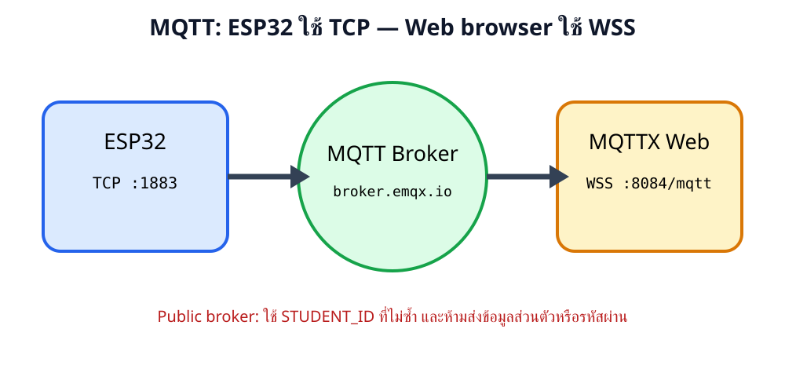
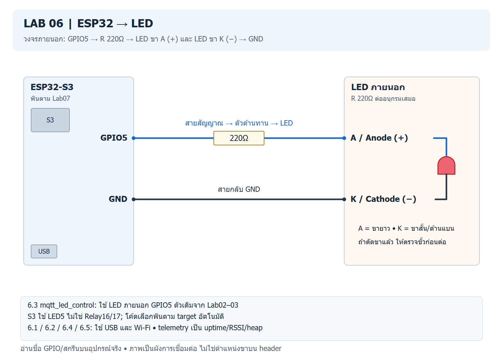
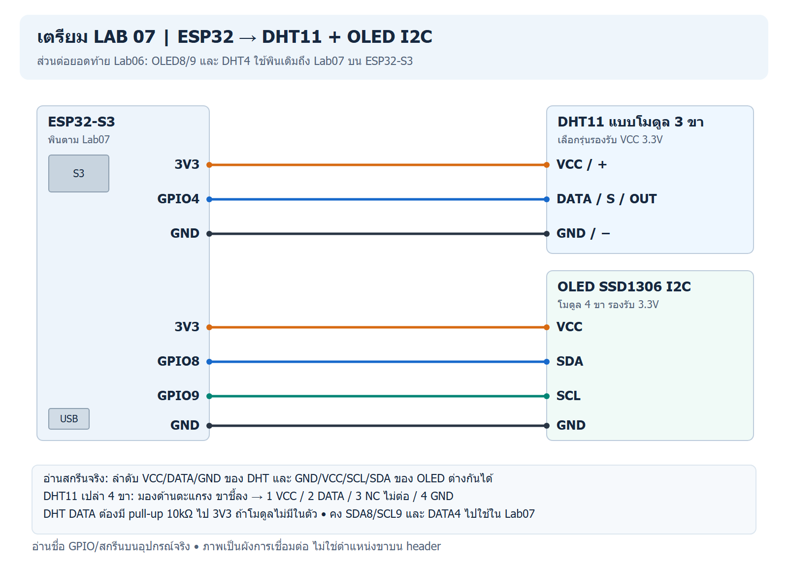
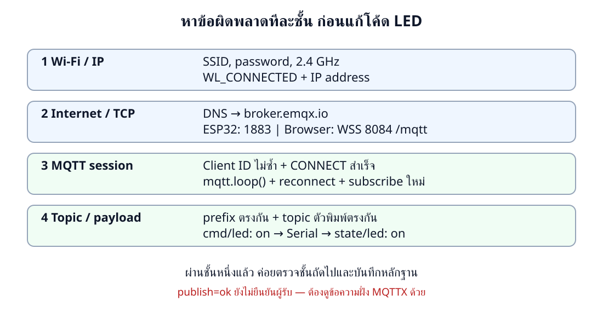
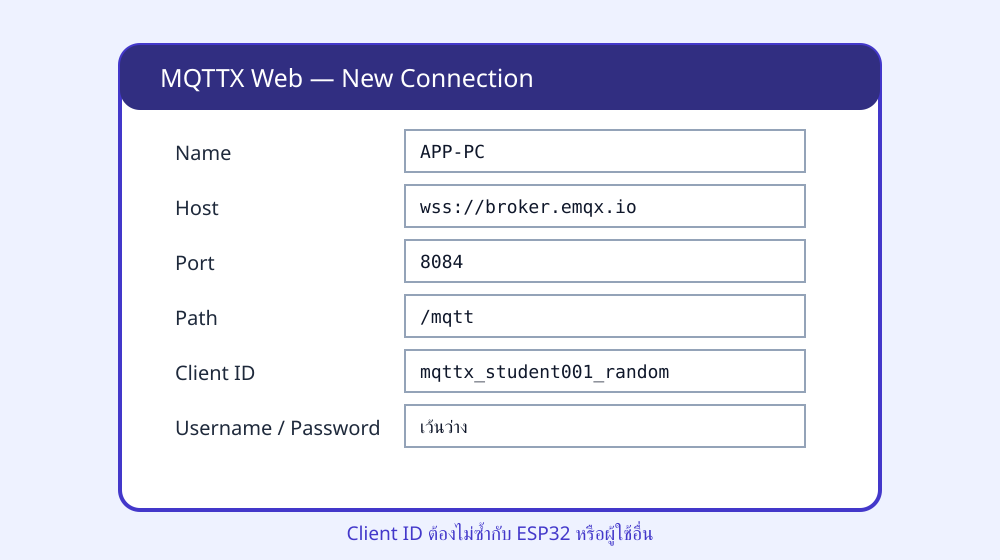
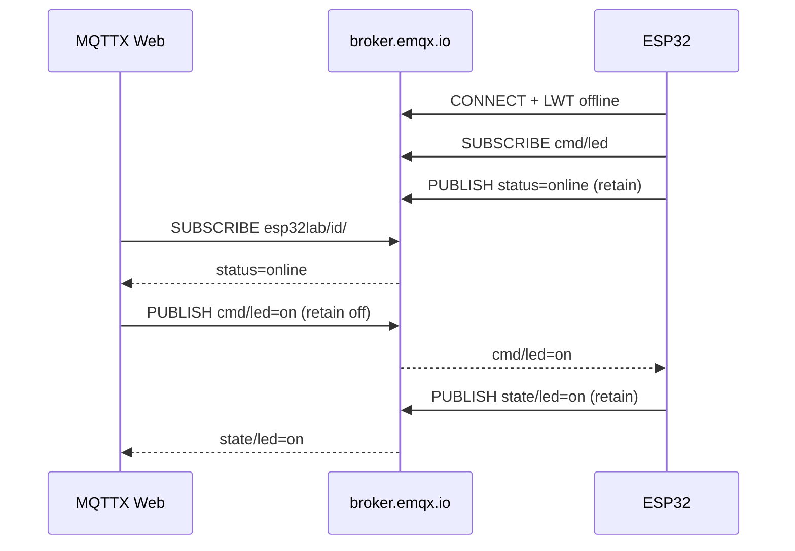
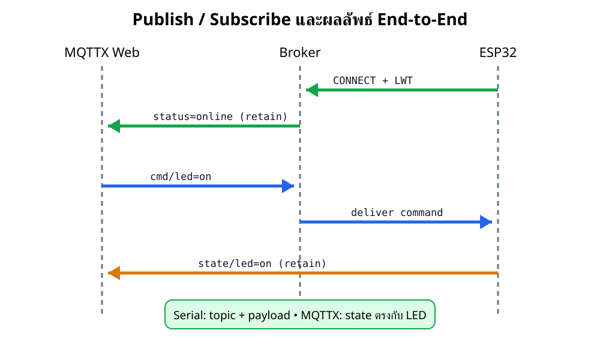

# Lab 06: WiFi และ MQTT

> ระดับ: ⭐⭐ | เวลา: 2–3 ชม. | ต้องผ่าน: [Lab 05](../lab05-relay-ultrasonic/)

## 🎯 วัตถุประสงค์

ผู้เรียนจะเชื่อม ESP32 กับ Wi-Fi แบบ STA, อธิบาย broker/publish/subscribe/topic/QoS/retain/LWT, ใช้ MQTTX Web สื่อสารสองทิศทาง, ควบคุม LED และส่ง JSON telemetry โดยกำหนดรอบ reconnect ด้วย millis() และ topic prefix ที่ไม่ซ้ำ

## 🧰 อุปกรณ์ที่ใช้

| อุปกรณ์ | จำนวน | หมายเหตุ |
|---|---:|---|
| ESP32-S3 | 1 | Arduino-ESP32 core 3.x; เลือก ESP32S3 Dev Module |
| สาย USB data | 1 | จ่ายไฟและ Serial Monitor |
| LED ภายนอก + R220Ω และสาย jumper | 1 ชุด | GPIO5 → R220Ω → LED anode, cathode → GND; ชุดเดิมจาก Lab02 |
| Wi-Fi 2.4 GHz | 1 เครือข่าย | ESP32 รุ่นนี้ไม่รองรับ 5 GHz |
| คอมพิวเตอร์และ browser | 1 | เปิด [MQTTX Web](https://mqttx.app/web-client) |



> [!WARNING]
> `broker.emqx.io` เป็น public broker ทุกคนอาจมองเห็น topic/payload ได้ ห้ามส่งชื่อจริง เบอร์โทร ที่อยู่ รหัสผ่าน token หรือข้อมูลส่วนตัว ใช้ `STUDENT_ID` สมมติที่ไม่ซ้ำเท่านั้น

## ❓ คำถามก่อนเริ่มต้น

<details>
<summary><b>คลิกเพื่อดูคำถามก่อนเรียน</b></summary>

1. Wi-Fi STA mode ต่างจาก Access Point mode อย่างไร?
2. MQTT broker ทำหน้าที่อะไรระหว่าง publisher และ subscriber?
3. Topic และ payload ต่างกันอย่างไร?
4. MQTT wildcard `+` และ `#` ใช้ต่างกันอย่างไร?
5. retain message และ Last Will and Testament มีประโยชน์อย่างไร?
6. เหตุใด MQTTX Web ใช้ WSS แต่ ESP32 ใช้ TCP?

</details>

## 📖 ทฤษฎี

### Wi-Fi STA และการ reconnect

STA (station) คืออุปกรณ์ที่เข้าเครือข่ายผ่าน access point เรียก `WiFi.mode(WIFI_STA)` และ `WiFi.begin(ssid,password)` แล้วตรวจ `WiFi.status()` ห้ามวนรอแบบไม่มีที่สิ้นสุด เพราะงานอื่นจะหยุด ตัวอย่างจึงใช้ `millis()` กำหนดช่วงลองใหม่ เมื่อเชื่อมสำเร็จอ่าน IP ด้วย `WiFi.localIP()` และความแรงสัญญาณ RSSI หน่วย dBm ด้วย `WiFi.RSSI()`; ค่าที่ใกล้ 0 กว่าโดยทั่วไปแรงกว่า

### MQTT

MQTT เป็น publish/subscribe protocol อุปกรณ์ไม่ส่งหากันโดยตรง แต่เชื่อมกับ **broker** ผู้ส่ง publish payload ไปยัง **topic** และผู้รับ subscribe topic นั้น

| แนวคิด | ความหมาย |
|---|---|
| Topic | ชื่อเส้นทางแบบลำดับชั้น เช่น `esp32lab/student001/status` |
| `+` | wildcard หนึ่งระดับ เช่น `esp32lab/+/status` |
| `#` | wildcard หลายระดับและต้องอยู่ท้าย filter เช่น `esp32lab/student001/#` |
| QoS 0 | ส่งอย่างมากหนึ่งครั้ง ไม่มีการยืนยัน; PubSubClient publish ใช้ระดับนี้ |
| QoS 1 | ส่งอย่างน้อยหนึ่งครั้ง จึงอาจซ้ำ |
| QoS 2 | ส่งครั้งเดียวด้วยขั้นตอนยืนยันมากที่สุด |
| retain | broker เก็บข้อความล่าสุดของ topic ให้ subscriber ใหม่ |
| LWT | broker publish ข้อความแทนอุปกรณ์เมื่อการเชื่อมต่อขาดผิดปกติ |
| Client ID | ตัวระบุ session ต้องไม่ซ้ำบน broker เดียวกัน |

Browser เปิด raw TCP socket ไม่ได้ตามโมเดลความปลอดภัยของเว็บ MQTTX Web จึงใช้ MQTT over secure WebSocket (`wss://broker.emqx.io:8084/mqtt`) ส่วน ESP32 ใช้ MQTT TCP port 1883 ในแล็บนี้

### Topic ของบทนี้

แทน `{id}` ด้วยค่า `STUDENT_ID` ของตนเอง เช่น `student001`

| Topic | ทิศทาง | Payload |
|---|---|---|
| `esp32lab/{id}/status` | ESP32 → broker | `online` retained / `offline` LWT |
| `esp32lab/{id}/heartbeat` | ESP32 → | uptime วินาที |
| `esp32lab/{id}/cmd/led` | MQTTX → ESP32 | `on`, `off`, `toggle` |
| `esp32lab/{id}/state/led` | ESP32 → MQTTX | `on`/`off` retained |
| `esp32lab/{id}/telemetry` | ESP32 → | JSON uptime, RSSI, heap |
| `esp32lab/{id}/chat` | สองทิศทาง | ข้อความทดลองที่ไม่ใช่ข้อมูลส่วนตัว |

## 🔌 การต่อวงจร

### วงจรที่ใช้ในการทดลอง 6.1–6.6



ภาพระบุชื่อพินตามหน้าที่ ให้หาสกรีน `GPIO5`/`5`/`IO5` บน ESP32-S3 จริง เลข GPIO ไม่ใช่ลำดับขาบน header ตำแหน่งขาของบอร์ดแต่ละรุ่นอาจต่างกัน

| การทดลอง | อุปกรณ์และการเชื่อมต่อ |
|---|---|
| 6.1 Wi-Fi, 6.2 MQTT, 6.4 JSON, 6.5 Chat, 6.6 LWT | ESP32 → สาย USB data → คอมพิวเตอร์ และเชื่อม Wi-Fi 2.4 GHz; ไม่ต้องต่อเซ็นเซอร์หรือจอ |
| 6.3 ควบคุม LED | LED ภายนอก active HIGH ที่ GPIO5 ตามตารางด้านล่าง ใช้ชุดเดิมจาก Lab02 และไม่ต้องย้ายสาย |

| สาย | ต่อจาก | ต่อไปยัง |
|---|---|---|
| 1 | ESP32-S3 `GPIO5` | ปลายด้านหนึ่งของ R `220Ω` |
| 2 | ปลายอีกด้านของ R `220Ω` | LED ขา anode `A (+)` โดยทั่วไปเป็นขายาว |
| 3 | LED ขา cathode `K (−)` โดยทั่วไปเป็นขาสั้น/ด้านแบน | ESP32 `GND` |

ถอด USB ก่อนต่อหรือย้ายสาย ตรวจขั้ว LED และ R อนุกรมให้ครบ แล้วเสียบ USB กลับ โค้ดเลือก `LED_PIN=5` เมื่อ compile สำหรับ S3 ให้อัตโนมัติ ไม่ต้องแก้หมายเลขขาระหว่างบท ส่วน JSON ใน 6.4 เป็นค่า uptime/RSSI/heap จากบอร์ด ไม่ใช่อุณหภูมิหรือความชื้นจาก DHT11

<details>
<summary>สำหรับบอร์ดเดิม ESP32-WROOM-32</summary>

เลือก **ESP32 Dev Module** แล้วต่อ LED ภายนอก `GPIO16 → R220Ω → anode`, `cathode → GND` เหมือน Lab02 โค้ดเลือก GPIO16 จาก `CONFIG_IDF_TARGET_ESP32` อัตโนมัติ ไม่ใช้ตำแหน่งขา S3 กับ WROOM สลับกัน

</details>

ก่อนเปิดแต่ละ sketch ให้คัดลอก `secrets.example.h` **ในโฟลเดอร์ sketch นั้น** เป็น `secrets.h` และแก้ค่า:

```cpp
#pragma once
constexpr char WIFI_SSID[] = "ชื่อ Wi-Fi 2.4 GHz";
constexpr char WIFI_PASS[] = "รหัสผ่าน Wi-Fi";
constexpr char STUDENT_ID[] = "student001"; // ตั้งให้ไม่ซ้ำและไม่ใช่ข้อมูลส่วนตัว
```

`secrets.h` ถูก `.gitignore` และห้าม commit; ถ้าไม่มีไฟล์จริง sketch จะใช้ค่าตัวอย่างเพื่อให้ compile/ศึกษาโครงสร้างได้ แต่จะเชื่อมเครือข่ายไม่ได้

### เตรียมต่อ DHT11 และจอ OLED สำหรับ Lab07

ส่วนนี้เพิ่มให้เห็นพินต่อสายของเซ็นเซอร์และจอที่ใช้ต่อยอด **โค้ด Lab06 ยังไม่อ่าน DHT11 หรือแสดงผล OLED** การทดลองจริงอยู่ที่ [Lab07: ทดสอบ OLED และ DHT11](../lab07-smart-home-project/) ไม่ต้องต่ออุปกรณ์ชุดนี้เพื่อผ่าน 6.1–6.6



เตรียมโมดูล **DHT11 3 ขาที่รองรับไฟ 3.3V**, จอ **OLED SSD1306 I2C 128×64 แบบ 4 ขาที่รองรับ 3.3V**, สาย Jumper และ R `10kΩ` หากโมดูล DHT11 ไม่มี pull-up ในตัว บอร์ดและสาย USB ใช้ชุดเดิม การต่อสองอุปกรณ์พร้อมกันใช้ ESP32-S3 ตัวเดียว ขา `3V3` และ `GND` แบ่งไปทั้งสองอุปกรณ์ได้ผ่านราง Breadboard ที่ต่อถึงกัน

| สาย | ต่อจาก ESP32-S3 | ต่อไปยังอุปกรณ์ | หน้าที่ |
|---|---|---|---|
| D1 | `3V3` | DHT11 `VCC` หรือ `+` | ไฟเลี้ยง 3.3V |
| D2 | `GPIO4` | DHT11 `DATA` / `S` / `OUT` | รับข้อมูลอุณหภูมิและความชื้น |
| D3 | `GND` | DHT11 `GND` หรือ `−` | กราวด์ร่วม |
| O1 | `3V3` | OLED `VCC` | ไฟเลี้ยง 3.3V |
| O2 | `GND` | OLED `GND` | กราวด์ร่วม |
| O3 | `GPIO8` | OLED `SDA` | ข้อมูล I2C; ขาเดียวกับ Lab04/07 บน S3 |
| O4 | `GPIO9` | OLED `SCL` | clock I2C; ขาเดียวกับ Lab04/07 บน S3 |
| เพิ่มเมื่อไม่มี pull-up | `3V3` → R `10kΩ` | ปลายอีกด้าน R ต่อจุด `DATA` ที่เชื่อม `GPIO4` | ดึง DATA ขึ้น 3.3V; ไม่ต่อ R อนุกรมในสาย DATA |

1. ถอด USB และแหล่งจ่ายก่อนต่อ อ่านสกรีนบนโมดูลจริง ลำดับ `VCC/GND/DATA` หรือ `VCC/GND/SDA/SCL` ต่างกันได้ อย่าเดาจากตำแหน่งซ้ายขวาในภาพ
2. ต่อ D1–D3 ให้ครบ ตรวจว่ารุ่นที่ใช้รองรับ 3.3V และมี pull-up DATA หรือไม่ หากไม่มีให้เพิ่ม R10kΩ ตามตาราง ไม่ย้าย VCC ไป 5V โดยยังต่อ DATA ตรงเข้าขา ESP32
3. ต่อ O1–O4 แล้วตรวจว่าไม่มี 5V ต่อเข้าขา GPIO หรือราง 3V3 OLED I2C ชุดนี้ใช้สัญญาณระดับ 3.3V จึงต่อ SDA/SCL เข้าบอร์ดได้ตามตาราง ใช้หลักเดียวกับ OLED 3.3V ใน Lab04
4. ถ้าเป็น **DHT11 เปล่า 4 ขา** ให้หันหน้าตะแกรงเข้าหาผู้มอง ขาชี้ลง: ซ้ายไปขวา `1=VCC`, `2=DATA`, `3=NC ไม่ต่อ`, `4=GND`; ใช้ R10kΩ ระหว่าง DATA กับ 3V3 และตรวจช่วงแรงดันรุ่นจริง หากไม่รองรับ 3.3V ให้เลือกโมดูลที่ตรงกับวงจรนี้
5. ทดสอบแยกด้วย [`lab07_dht11_test.ino`](../lab07-smart-home-project/code/lab07_dht11_test/lab07_dht11_test.ino) และ [`lab07_oled_test.ino`](../lab07-smart-home-project/code/lab07_oled_test/lab07_oled_test.ino) ตามขั้นตอนติดตั้ง library ของ Lab07 ก่อนรวมระบบ การ Upload โค้ดชุดใหม่จะแทนที่ Lab06

ตารางและภาพนี้ใช้ **ESP32-S3** โดยยึด DHT11 `DATA=GPIO4` และ OLED `SDA=GPIO8`/`SCL=GPIO9` ตรงกับ `config.h` และ sketches ใน Lab07 จึงใช้จอเดิมจาก Lab04 ต่อจนจบคอร์สได้โดยไม่ย้ายขา I2C

<details>
<summary>พินเตรียม Lab07 สำหรับ ESP32-WROOM-32 เดิม</summary>

ไฟเลี้ยง/กราวด์และ DHT11 DATA=GPIO4 เหมือนเดิม ส่วน OLED ใช้ `SDA=GPIO21`, `SCL=GPIO22` ตามสาขา `CONFIG_IDF_TARGET_ESP32` ในโค้ด Lab07 เมื่อเลือก **ESP32 Dev Module** ไม่ต้องแก้ค่าพินใน sketch เอง

</details>

อ้างอิงการต่อ [DHTxx และ pull-up จาก Adafruit](https://learn.adafruit.com/dht/connecting-to-a-dhtxx-sensor) และ [โมดูล OLED จาก Adafruit](https://learn.adafruit.com/monochrome-oled-breakouts?view=all) ภาพชุดนี้สร้างจาก SVG ของโครงการเพื่อระบุเส้นทางสาย ไม่ใช่ภาพถ่ายหรือหลักฐานการทดสอบฮาร์ดแวร์ ดู [ทะเบียนภาพ](../../assets/IMAGE_SOURCES.md)

## 🧪 การทดลอง

### เตรียมงาน: เรียนทีละชั้นและเปลี่ยนครั้งละเรื่อง

บทนี้ต่อยอด `setup()`/`loop()` และ `millis()` จาก Lab 02–03 เราจะไม่เริ่มจากโค้ดควบคุม LED ผ่านอินเทอร์เน็ตทันที เพราะถ้าไฟไม่ติดจะยังไม่รู้ว่าผิดที่ Wi-Fi, broker, topic หรือ GPIO เริ่มจากแสดง IP ให้สำเร็จก่อน แล้วเพิ่ม MQTT, callback, JSON และ Chat ตามลำดับ

1. เปิด Arduino IDE เลือก **Tools → Board → ESP32S3 Dev Module**, **Tools → Port → COM ของบอร์ด**, Upload Speed **115200** และ Serial Monitor **115200 baud** ใช้ core `esp32 by Espressif Systems` รุ่น 3.x ตาม [Lab 01](../lab01-esp32-introduction/) และตั้งค่า S3 ตาม [Lab07](../lab07-smart-home-project/): บอร์ดที่ใช้ USB-to-UART CH343 ให้ปิด **USB CDC On Boot**; Flash/PSRAM ต้องตรงรุ่นจริง
2. ไป **Sketch → Include Library → Manage Libraries** ค้น `PubSubClient` ผู้เขียน Nick O'Leary เลือกรุ่น **2.8.0** และ `ArduinoJson` ผู้เขียน Benoit Blanchon รุ่น **7.x**; WiFi มากับ core ไม่ต้องติดตั้ง library ชื่อ WiFi เพิ่ม
3. เปิด `.ino` ของการทดลองเพียงชุดเดียว แล้วใช้ **Sketch → Show Sketch Folder** เพื่อหาโฟลเดอร์ที่มี `.ino` และ `secrets.example.h` ของชุดนั้น
4. ใน File Explorer เปิด **View → File name extensions** คัดลอก `secrets.example.h` เป็น `secrets.h` ให้เห็นชื่อเต็มว่าไม่ได้กลายเป็น `secrets.h.txt` เปิดไฟล์ใหม่ใน IDE แล้วแก้ SSID/password และ `STUDENT_ID`
5. ใช้ ID สมมติสุ่ม เช่น `desk-a7f2` ความยาวไม่เกิน 24 ตัวอักษร ASCII ใช้ตัวอักษร ตัวเลข และขีดกลาง ห้าม `/`, `+`, `#` หรือชื่อจริง ID นี้ใช้สร้าง topic ส่วน Client ID จะเติม MAC ของบอร์ดอีกชั้น
6. **Verify → Upload → Serial Monitor** ทีละชุด การอัปโหลด sketch ถัดไปจะแทนที่ sketch ก่อนหน้า ไม่ได้รัน 5 ชุดพร้อมกัน ต้องคัดลอก `secrets.h` ลงในโฟลเดอร์ของแต่ละชุดด้วย

ค่าที่อยู่ใน `secrets.h` ใช้เฉพาะเครื่องผู้เรียน ส่วน host/port เป็นค่าคงที่ของ public broker ใน `.ino` ไม่ใช้ username/password ของ MQTT ห้ามถ่ายภาพหรือ commit รหัสผ่านจริง `.gitignore` ช่วยกันการเพิ่มไฟล์ใหม่ แต่ไม่ลบไฟล์ลับที่เคยถูก track หรือเผยแพร่ไปแล้ว

> รุ่น 2.8.0 ใช้เพื่อให้ทำตามบทนี้และตรวจ build ได้ตรงกัน [repository ของ PubSubClient](https://github.com/knolleary/pubsubclient) แจ้งว่าไม่มีการบำรุงรักษาแล้ว หากต่อยอดเป็นระบบใช้งานจริงให้ประเมิน library และการดูแลระยะยาวใหม่



*แผนภาพสร้างเอง พื้นขาว: ตรวจจาก Wi-Fi ไปหา topic ตามลำดับ ดูเครดิตใน [ทะเบียนภาพ](../../assets/IMAGE_SOURCES.md)*

### การทดลองที่ 6.1 ต่อ Wi-Fi และอ่าน IP

**วงจรที่ใช้:** USB data และ Wi-Fi 2.4 GHz เท่านั้น ไม่ต้องต่อ LED ภายนอก/เซ็นเซอร์/จอ

**ก่อนใส่โค้ดเต็ม ให้เข้าใจ 3 คำสั่งแรก:** `#include <WiFi.h>` เรียกส่วนติดต่อของ Wi-Fi; `WiFi.mode(WIFI_STA)` เลือกบทบาทลูกข่าย; `WiFi.begin(WIFI_SSID, WIFI_PASS)` เริ่มขอเชื่อมต่อ ชื่อ Wi-Fi ถูกต้องยังไม่แปลว่าได้รับ IP แล้ว จึงต้องตรวจ `WiFi.status() == WL_CONNECTED` ใน `loop()`

1. เปิด [`lab06_wifi_connect.ino`](code/lab06_wifi_connect/lab06_wifi_connect.ino) และ [`secrets.example.h`](code/lab06_wifi_connect/secrets.example.h) สร้าง `secrets.h` ตามขั้นเตรียมงาน
2. อ่าน `beginWiFi()` ก่อน: ฟังก์ชันเริ่มเชื่อมหนึ่งครั้งและจำเวลา `lastRetry` จากนั้นคืนให้ `loop()` ไม่ใช้ `while` รอจนสำเร็จ
3. อ่านส่วน `previousStatus`: ถ้าสถานะยังเหมือนรอบก่อนจะไม่พิมพ์ซ้ำ จึงเห็นเหตุการณ์เปลี่ยนสถานะแทนข้อความไหลเต็มจอ
4. Upload และรอข้อความ connected จด IP กับ RSSI ลงใบงาน ตัวเลข IP เป็นตัวอย่าง DHCP อาจแจกต่างกันทุกเครือข่าย
5. ปิด hotspot/Access Point ที่ตนควบคุมได้ชั่วคราว สังเกตสถานะเปลี่ยน แล้วเปิดกลับ จับเวลาจนได้ IP อีกครั้ง ไม่ต้องแก้โค้ดหรือกด Reset

**โค้ดเต็ม** — คัดลอกพร้อมไฟล์ header ในโฟลเดอร์เดียวกัน:

```cpp
/*
 * Lab 06.1 : เชื่อมต่อ Wi-Fi แบบ STA
 * คำอธิบาย : เชื่อมต่อ แสดง IP/RSSI และลองเชื่อมใหม่เมื่อหลุดแบบ non-blocking
 * วงจร     : ใช้ ESP32 และสาย USB เท่านั้น
 * ไลบรารี  : WiFi (มากับ Arduino-ESP32 core 3.x)
 * Board    : ESP32S3 Dev Module / ESP32 Dev Module (WROOM-32), core 3.x
 */
#include <Arduino.h>
#include <WiFi.h>
#if __has_include("secrets.h")
#include "secrets.h"
#else
#include "secrets.example.h"
#endif

constexpr unsigned long RETRY_MS = 10000;
unsigned long lastRetry = 0;
wl_status_t previousStatus = WL_NO_SHIELD;

// เริ่มการเชื่อมต่อหนึ่งครั้ง แล้วให้ loop เป็นผู้กำหนดเวลาลองใหม่
void beginWiFi() {
  Serial.printf("[WIFI] connecting to %s\n", WIFI_SSID);
  WiFi.begin(WIFI_SSID, WIFI_PASS);
  lastRetry = millis();
}

void setup() {
  Serial.begin(115200);
  WiFi.mode(WIFI_STA);
  WiFi.setAutoReconnect(true);
  beginWiFi();
}

void loop() {
  // รายงานเฉพาะตอนสถานะเปลี่ยน เพื่อลดข้อความซ้ำใน Serial Monitor
  const wl_status_t status = WiFi.status();
  if (status != previousStatus) {
    previousStatus = status;
    if (status == WL_CONNECTED) {
      Serial.printf("[WIFI] connected IP=%s RSSI=%d dBm\n",
                    WiFi.localIP().toString().c_str(), WiFi.RSSI());
    } else {
      Serial.printf("[WIFI] status=%d\n", static_cast<int>(status));
    }
  }
  if (status != WL_CONNECTED && millis() - lastRetry >= RETRY_MS) beginWiFi();
}
```

| บรรทัด/ส่วน | ความหมาย |
|---|---|
| `#if __has_include(...)` | เลือกไฟล์จริงถ้ามี มิฉะนั้นใช้ค่าตัวอย่างสำหรับ compile |
| `constexpr RETRY_MS` | ระยะเว้นการเริ่มเชื่อมใหม่ 10 วินาที |
| `wl_status_t` | ชนิดสถานะ Wi-Fi ของ library ไม่ใช่ชนิด IP |
| `WiFi.mode(WIFI_STA)` | เชื่อมเข้า router/hotspot ที่มีอยู่ |
| `setAutoReconnect(true)` | เปิดกลไกพยายามคืนการเชื่อมต่อของ stack |
| `status != previousStatus` | แสดง log เมื่อสถานะเปลี่ยน |
| `localIP()` / `RSSI()` | IP ที่ได้รับและความแรงสัญญาณหน่วย dBm |
| `millis() - lastRetry` | เปรียบเทียบเวลาที่ผ่านไปโดยไม่หยุดรอในลูป |

**ผลลัพธ์ Serial ที่คาดหวัง** (IP, RSSI และรหัสสถานะขึ้นกับเครือข่าย):

```text
[WIFI] connecting to YOUR_LAB_WIFI
[WIFI] status=...
[WIFI] connected IP=192.168.1.42 RSSI=-57 dBm
```

**จุดตรวจ:** อธิบายได้ว่า IP กับ RSSI บอกอะไรคนละเรื่อง และมี log กลับมา connected หลังเปิดเครือข่ายคืน การต่อ Wi-Fi ได้เพียงอย่างเดียวยังไม่ยืนยันว่าเข้าถึงอินเทอร์เน็ตหรือ broker ได้

**ภารกิจท้าทาย:** เพิ่ม timer อีกตัวแสดง RSSI ทุก 10 วินาที โดยไม่เพิ่ม `delay()` และไม่พิมพ์ IP ทุกครั้งที่วน `loop()`

### ตั้งค่า MQTTX Web ก่อนทดลอง MQTT



*ภาพจำลองฟอร์มเพื่ออธิบายค่าที่ต้องกรอก ไม่ใช่ภาพยืนยันการเชื่อมต่อจากเครื่องผู้เรียน*

1. เปิด [MQTTX Web](https://mqttx.app/web-client) เลือก **New Connection** หรือปุ่ม `+` สร้าง connection
2. ตั้ง Name=`APP-PC` เลือก protocol **wss://** และ Host=`broker.emqx.io` (ถ้ารุ่นนั้นรวม protocol ในช่อง host ให้ใส่ `wss://broker.emqx.io`) ไม่เติม protocol ซ้ำสองครั้ง
3. ตั้ง Port=`8084`, Path=`/mqtt`, Client ID=`mqttx_desk-a7f2_pc9` โดยปรับส่วนสุ่มให้ไม่ซ้ำกับบอร์ด/เพื่อน เว้น Username/Password
4. กด **Connect** ต้องเห็นสถานะ Connected ก่อน ถ้ายังไม่ผ่าน ให้ตรวจ protocol/port/path และเครือข่าย ยังไม่ต้องแก้ LED
5. เพิ่ม **New Subscription** ด้วย filter `esp32lab/desk-a7f2/#` แล้ว Subscribe แทน `desk-a7f2` ด้วย ID ตรงกับ `secrets.h` ทุกตัว รวมตัวพิมพ์เล็ก/ใหญ่ ห้ามพิมพ์วงเล็บ `{id}` หรือ `<id>` ลงไปจริง
6. แยกช่อง **Subscription** สำหรับรับออกจากช่อง **Publish** สำหรับส่ง การ subscribe ไม่ได้สั่งให้ ESP32 ทำงาน การ publish ต้องกรอก topic และ payload อีกส่วนหนึ่ง

| ช่อง | ค่าบทนี้ | เหตุผล |
|---|---|---|
| Browser protocol | WSS | เว็บใช้ WebSocket ไม่ใช่ raw TCP |
| Host / Port / Path | `broker.emqx.io` / `8084` / `/mqtt` | เป็น endpoint สำหรับ WebSocket ของ broker |
| ESP32 host / port | `broker.emqx.io` / `1883` | ใช้ `WiFiClient` และ MQTT TCP คนละช่องทางเข้าบริการ |
| Client ID | สุ่มต่างกันทุก client | ID ซ้ำอาจทำให้ session เดิมถูกตัด |
| Subscription | `esp32lab/desk-a7f2/#` | wildcard ใช้กับ filter เพื่อรับทุก topic ใต้ prefix นี้ |
| Publish topic | เช่น `esp32lab/desk-a7f2/cmd/led` | ส่งไปชื่อจริง ห้ามใส่ wildcard |

WSS เข้ารหัสเส้นทาง browser → broker ส่วนตัวอย่าง ESP32 ใช้ TCP 1883 ที่ไม่เข้ารหัส การเลือก prefix สุ่มช่วยหลีกเลี่ยงการชน แต่ไม่ได้ทำให้ข้อมูลลับหรือป้องกันคนอื่นสั่งงานได้ บทนี้ใช้ LED สาธิตเท่านั้น

### การทดลองที่ 6.2 MQTT heartbeat และ LWT

**วงจรที่ใช้:** USB data และ Wi-Fi; heartbeat ใช้เวลา uptime จากโปรแกรม ไม่ต้องต่อเซ็นเซอร์

**เริ่มจาก model ของข้อมูล:** `WiFiClient network` เป็นช่องเครือข่าย TCP ส่วน `PubSubClient mqtt(network)` สร้าง MQTT บนช่องนั้น `setServer()` แค่กำหนดปลายทาง ยังไม่เชื่อมจริง จน `connect()` สำเร็จจึงเริ่ม publish ได้

1. เปิด [`lab06_mqtt_basic.ino`](code/lab06_mqtt_basic/lab06_mqtt_basic.ino) เตรียม [`secrets.example.h`](code/lab06_mqtt_basic/secrets.example.h) เป็นไฟล์จริง ตรวจ ID ตรง MQTTX แล้ว Upload
2. ใน `setup()` สังเกตการประกอบ topic จาก prefix เดียวกัน จากนั้น `beginNetwork()` เริ่ม Wi-Fi และกำหนด host/port ของ MQTT
3. ใน `loop()` อ่านตามลำดับ `serviceWiFi()` → `connectMqtt()` → `mqtt.loop()` → timer heartbeat ห้ามเอา `mqtt.loop()` ไปใส่เฉพาะตอนกดปุ่มหรือส่งข้อมูล
4. MQTTX subscribe prefix ของตน ควรได้รับ `status=online` และ `heartbeat` เปลี่ยนทุกประมาณ 5 วินาที
5. Disconnect แล้ว Connect MQTTX และ subscribe ใหม่ สังเกตว่า online มาได้ทันทีเพราะ retain แต่ heartbeat ที่ไม่ได้ retain ต้องรอรอบส่งใหม่

```cpp
/*
 * Lab 06.2 : MQTT heartbeat และ LWT
 * คำอธิบาย : ส่ง uptime ทุก 5 วินาที พร้อม retained online/offline
 * วงจร     : ใช้ ESP32 และสาย USB เท่านั้น
 * ไลบรารี  : WiFi, PubSubClient 2.8.0
 * Board    : ESP32S3 Dev Module / ESP32 Dev Module (WROOM-32), core 3.x
 */
#include <Arduino.h>
#include <WiFi.h>
#include <PubSubClient.h>
#if __has_include("secrets.h")
#include "secrets.h"
#else
#include "secrets.example.h"
#endif

constexpr char MQTT_HOST[] = "broker.emqx.io";
constexpr uint16_t MQTT_PORT = 1883;
constexpr unsigned long WIFI_RETRY_MS = 10000;
constexpr unsigned long MQTT_RETRY_MS = 5000;
WiFiClient network;
PubSubClient mqtt(network);
String statusTopic;
unsigned long lastWiFiRetry = 0, lastMqttRetry = 0;
bool wifiReported = false;

// MAC 48 บิตช่วยแยก Client ID ของแต่ละบอร์ด แต่ไม่ใช่รหัสลับ
String makeClientId() {
  const uint64_t chip = ESP.getEfuseMac();
  char suffix[13];
  snprintf(suffix, sizeof(suffix), "%04X%08X",
           static_cast<unsigned int>(static_cast<uint16_t>(chip >> 32)),
           static_cast<unsigned int>(static_cast<uint32_t>(chip)));
  return String("esp32-") + STUDENT_ID + "-" + suffix;
}

// ไม่วนรอ Wi-Fi ให้ loop กลับไปทำงานอื่นระหว่างรอลองใหม่
void serviceWiFi() {
  if (WiFi.status() == WL_CONNECTED) {
    if (!wifiReported) {
      Serial.printf("[WIFI] IP=%s RSSI=%d dBm\n",
                    WiFi.localIP().toString().c_str(), WiFi.RSSI());
      wifiReported = true;
    }
    return;
  }
  wifiReported = false;
  if (millis() - lastWiFiRetry >= WIFI_RETRY_MS) {
    lastWiFiRetry = millis();
    WiFi.reconnect();
    Serial.println("[WIFI] retry");
  }
}

void beginNetwork() {
  WiFi.mode(WIFI_STA);
  WiFi.setAutoReconnect(true);
  WiFi.begin(WIFI_SSID, WIFI_PASS);
  lastWiFiRetry = millis();
  mqtt.setServer(MQTT_HOST, MQTT_PORT);
  mqtt.setSocketTimeout(2);  // จำกัดการรอ packet; DNS/TCP อาจยัง block ชั่วครู่
  mqtt.setKeepAlive(15);
  if (!mqtt.setBufferSize(256)) Serial.println("[MQTT] buffer allocation failed");
}

String heartbeatTopic;
constexpr unsigned long HEARTBEAT_MS = 5000;
unsigned long lastHeartbeat = 0;

// เรียกครั้งเดียวต่อรอบเวลา ไม่ใช้ while รอ broker กลับมา
void connectMqtt() {
  if (WiFi.status() != WL_CONNECTED || mqtt.connected()) return;
  if (millis() - lastMqttRetry < MQTT_RETRY_MS) return;
  lastMqttRetry = millis();
  const String id = makeClientId();
  Serial.printf("[MQTT] connecting as %s\n", id.c_str());
  if (mqtt.connect(id.c_str(), statusTopic.c_str(), 0, true, "offline")) {
    Serial.println("[MQTT] connected");
    if (!mqtt.publish(statusTopic.c_str(), "online", true)) {
      Serial.println("[MQTT] status publish failed");
    }
  } else {
    Serial.printf("[MQTT] failed state=%d\n", mqtt.state());
  }
}

void setup() {
  Serial.begin(115200);
  statusTopic = String("esp32lab/") + STUDENT_ID + "/status";
  heartbeatTopic = String("esp32lab/") + STUDENT_ID + "/heartbeat";
  beginNetwork();
}

void loop() {
  serviceWiFi();
  connectMqtt();
  mqtt.loop();  // รับ packet และดูแล keep-alive ทุกรอบ
  if (mqtt.connected() && millis() - lastHeartbeat >= HEARTBEAT_MS) {
    lastHeartbeat = millis();
    char payload[24];
    snprintf(payload, sizeof(payload), "%lu", millis() / 1000UL);
    const bool ok = mqtt.publish(heartbeatTopic.c_str(), payload);
    Serial.printf("[MQTT] heartbeat=%s s publish=%s\n", payload, ok ? "ok" : "failed");
  }
}
```

| บรรทัด/ส่วน | ความหมาย |
|---|---|
| `WiFiClient` → `PubSubClient` | ประกอบชั้น TCP และ MQTT ไม่ใช่ client สองตัวต่อ broker คนละอัน |
| `makeClientId()` | ใช้ ID สมมติและเลข MAC 48 บิตของชิปแยกบอร์ด; MAC ไม่ใช่ความลับยืนยันตัวตน |
| `serviceWiFi()` | รายงาน IP และขอ reconnect เว้น 10 วินาทีเมื่อหลุด |
| `MQTT_RETRY_MS` | จำกัดความถี่การลองต่อ MQTT เป็น 5 วินาที |
| `connect(...,0,true,"offline")` | ฝาก LWT QoS 0 แบบ retain ที่ status topic ก่อนเชื่อมสำเร็จ |
| `publish(...,"online",true)` | ประกาศ online แทน retained offline เก่า |
| `setKeepAlive(15)` / `mqtt.loop()` | ตั้งช่วง keep-alive และให้ client ประมวลผลเครือข่ายต่อเนื่อง |
| `publish()` คืน `bool` | ตรวจว่าการส่งจาก library สำเร็จขั้นต้น ไม่ใช่หลักฐานว่า subscriber ได้รับแล้ว |

ตัวจับเวลาไม่วนรอการ reconnect และเปิดโอกาสให้งานอื่นทำต่อ แต่ `mqtt.connect()` ยังเป็น synchronous call: การค้น DNS/ต่อ TCP/รอ CONNACK อาจ block ชั่วครู่ `setSocketTimeout(2)` จำกัดการรอ packet บางช่วง ไม่ได้ทำให้ทุกขั้นจบภายใน 2 วินาทีเสมอ ระบบที่ต้องตอบสนองเวลาตายตัวต้องออกแบบงานเครือข่ายเพิ่มเติม

**ผลลัพธ์ที่คาดหวัง:**

```text
[WIFI] IP=192.168.1.42 RSSI=-57 dBm
[MQTT] connecting as esp32-desk-a7f2-XXXXXXXXXXXX
[MQTT] connected
[MQTT] heartbeat=10 s publish=ok
[MQTT] heartbeat=15 s publish=ok
```

ใน MQTTX ต้องเห็น topic `.../status` payload `online` และ `.../heartbeat` payload ตัวเลข `10`, `15` โดย log `publish=ok` อย่างเดียวไม่พอ ให้ใช้ข้อความที่ MQTTX รับเป็นหลักฐานอีกด้าน

**จุดตรวจ:** ปิด MQTTX แล้ว ESP32 ยังส่ง heartbeat ได้ เพราะ MQTTX ไม่ใช่ broker และเมื่อเปิด MQTTX ใหม่จะรับ retained status ได้

**ภารกิจท้าทาย:** เปลี่ยน heartbeat เป็น JSON ที่มี uptime และ firmware version โดยไม่ส่งข้อมูลส่วนตัว

### การทดลองที่ 6.3 MQTTX สั่ง LED และรับ state กลับ

**วงจรที่ใช้:** ESP32-S3 GPIO5 → R220Ω → LED anode และ cathode → GND ใช้ LED ภายนอก active HIGH ชุดเดียวกับ Lab02 โค้ดเลือกพินตามชิปอัตโนมัติ

**เพิ่มทีละส่วนจาก heartbeat:** callback เป็นฟังก์ชันที่ library เรียกเมื่อได้รับ PUBLISH ที่ตรง subscription เราไม่ได้เรียก `onMessage()` ใน `loop()` เอง `mqtt.loop()` เป็นตัวนำข้อมูลเข้ามา ความยาว payload แยกมากับ `length` จึงห้ามใช้เหมือน C string ที่รับประกันว่าจะมี `\0`

1. เปิด [`lab06_mqtt_led_control.ino`](code/lab06_mqtt_led_control/lab06_mqtt_led_control.ino) และเตรียม [`secrets.example.h`](code/lab06_mqtt_led_control/secrets.example.h) เช่นเดิม Upload แล้วตรวจ log subscribe
2. MQTTX รับ `esp32lab/<id>/#` อยู่แล้ว ในช่อง Publish ใส่ topic `esp32lab/<id>/cmd/led`, payload **`on`** เป็นข้อความธรรมดา ไม่มีเครื่องหมายคำพูด
3. เลือก QoS 0 และ **ปิด Retain ของคำสั่ง** แล้วส่ง ตรวจ Serial, LED และ topic `state/led` ทีละอย่าง
4. ส่ง `off` แล้วส่ง `toggle` หนึ่งครั้ง ถ้าไฟไม่ตรงคำสั่งให้ทดสอบ LED ภายนอกที่ GPIO5 ด้วย Lab02 ก่อน ตรวจ R อนุกรม ขั้ว LED, GND และ target S3 ให้ตรงกัน
5. ส่ง `blink` ซึ่งไม่อยู่ในรายการ สังเกต `ignored command` และ LED ต้องไม่เปลี่ยน
6. ปิดเปิด Wi-Fi ที่ตนควบคุม ตรวจ reconnect และ subscribe ใหม่ state ล่าสุดต้องถูกส่งกลับอีกครั้งเมื่อเชื่อม MQTT สำเร็จ

```cpp
/*
 * Lab 06.3 : ควบคุม LED ผ่าน MQTT
 * คำอธิบาย : รับ on/off/toggle แล้วรายงาน GPIO state กลับ
 * วงจร     : ESP32-S3 GPIO5 / WROOM-32 GPIO16 -> R 220Ω -> LED anode; cathode -> GND
 * ไลบรารี  : WiFi, PubSubClient 2.8.0
 * Board    : ESP32S3 Dev Module / ESP32 Dev Module (WROOM-32), core 3.x
 */
#include <Arduino.h>
#include <WiFi.h>
#include <PubSubClient.h>
#if __has_include("secrets.h")
#include "secrets.h"
#else
#include "secrets.example.h"
#endif

constexpr char MQTT_HOST[] = "broker.emqx.io";
constexpr uint16_t MQTT_PORT = 1883;
constexpr unsigned long WIFI_RETRY_MS = 10000;
constexpr unsigned long MQTT_RETRY_MS = 5000;
WiFiClient network;
PubSubClient mqtt(network);
String statusTopic;
unsigned long lastWiFiRetry = 0, lastMqttRetry = 0;
bool wifiReported = false;

// MAC 48 บิตช่วยแยก Client ID ของแต่ละบอร์ด แต่ไม่ใช่รหัสลับ
String makeClientId() {
  const uint64_t chip = ESP.getEfuseMac();
  char suffix[13];
  snprintf(suffix, sizeof(suffix), "%04X%08X",
           static_cast<unsigned int>(static_cast<uint16_t>(chip >> 32)),
           static_cast<unsigned int>(static_cast<uint32_t>(chip)));
  return String("esp32-") + STUDENT_ID + "-" + suffix;
}

// ไม่วนรอ Wi-Fi ให้ loop กลับไปทำงานอื่นระหว่างรอลองใหม่
void serviceWiFi() {
  if (WiFi.status() == WL_CONNECTED) {
    if (!wifiReported) {
      Serial.printf("[WIFI] IP=%s RSSI=%d dBm\n",
                    WiFi.localIP().toString().c_str(), WiFi.RSSI());
      wifiReported = true;
    }
    return;
  }
  wifiReported = false;
  if (millis() - lastWiFiRetry >= WIFI_RETRY_MS) {
    lastWiFiRetry = millis();
    WiFi.reconnect();
    Serial.println("[WIFI] retry");
  }
}

void beginNetwork() {
  WiFi.mode(WIFI_STA);
  WiFi.setAutoReconnect(true);
  WiFi.begin(WIFI_SSID, WIFI_PASS);
  lastWiFiRetry = millis();
  mqtt.setServer(MQTT_HOST, MQTT_PORT);
  mqtt.setSocketTimeout(2);  // จำกัดการรอ packet; DNS/TCP อาจยัง block ชั่วครู่
  mqtt.setKeepAlive(15);
  if (!mqtt.setBufferSize(256)) Serial.println("[MQTT] buffer allocation failed");
}

// LED ภายนอก active HIGH; เลือกขาตามชิปโดยใช้สายเดิมตลอดแล็บ
#if defined(CONFIG_IDF_TARGET_ESP32S3)
constexpr uint8_t LED_PIN = 5;
#elif defined(CONFIG_IDF_TARGET_ESP32)
constexpr uint8_t LED_PIN = 16;
#else
#error "Lab06 supports ESP32-S3 and ESP32; define a verified pin mapping first."
#endif
String commandTopic, stateTopic;
bool ledOn = false;

// สถานะนี้เป็นค่าที่สั่ง GPIO ไม่ใช่ผลวัดแสงหรือกระแส LED จริง
void applyLed() {
  digitalWrite(LED_PIN, ledOn ? HIGH : LOW);
  const bool ok = mqtt.publish(stateTopic.c_str(), ledOn ? "on" : "off", true);
  Serial.printf("[MQTT] LED=%s state-publish=%s\n",
                ledOn ? "on" : "off", ok ? "ok" : "failed");
}

// payload ไม่จำเป็นต้องมี null terminator จึงอ่านตาม length เสมอ
void onMessage(char* topic, byte* payload, unsigned int length) {
  if (String(topic) != commandTopic || length > 16) {
    Serial.println("[MQTT] ignored topic/length");
    return;
  }
  String message;
  for (unsigned int i = 0; i < length; ++i) message += static_cast<char>(payload[i]);
  message.trim();
  message.toLowerCase();
  Serial.printf("[MQTT] topic=%s payload=%s\n", topic, message.c_str());
  if (message == "on") ledOn = true;
  else if (message == "off") ledOn = false;
  else if (message == "toggle") ledOn = !ledOn;
  else {
    Serial.println("[MQTT] ignored command");
    return;
  }
  applyLed();
}

// เรียกครั้งเดียวต่อรอบเวลา ไม่ใช้ while รอ broker กลับมา
void connectMqtt() {
  if (WiFi.status() != WL_CONNECTED || mqtt.connected()) return;
  if (millis() - lastMqttRetry < MQTT_RETRY_MS) return;
  lastMqttRetry = millis();
  const String id = makeClientId();
  Serial.printf("[MQTT] connecting as %s\n", id.c_str());
  if (mqtt.connect(id.c_str(), statusTopic.c_str(), 0, true, "offline")) {
    Serial.println("[MQTT] connected");
    if (!mqtt.publish(statusTopic.c_str(), "online", true)) {
      Serial.println("[MQTT] status publish failed");
    }
    // clean session ต้อง subscribe ใหม่หลัง reconnect ทุกครั้ง
    const bool ok = mqtt.subscribe(commandTopic.c_str());
    Serial.printf("[MQTT] subscribe=%s topic=%s\n", ok ? "ok" : "failed",
                  commandTopic.c_str());
    applyLed();
  } else {
    Serial.printf("[MQTT] failed state=%d\n", mqtt.state());
  }
}

void setup() {
  Serial.begin(115200);
  pinMode(LED_PIN, OUTPUT);
  digitalWrite(LED_PIN, LOW);
  const String prefix = String("esp32lab/") + STUDENT_ID;
  statusTopic = prefix + "/status";
  commandTopic = prefix + "/cmd/led";
  stateTopic = prefix + "/state/led";
  beginNetwork();
  mqtt.setCallback(onMessage);
}

void loop() {
  serviceWiFi();
  connectMqtt();
  mqtt.loop();
}
```

| บรรทัด/ส่วน | ความหมาย |
|---|---|
| `bool ledOn` | จำสถานะทางโปรแกรม เริ่ม false; Reset กลับปิด |
| `setCallback(onMessage)` | ลงทะเบียนผู้รับก่อนเชื่อมต่อ MQTT |
| `subscribe(commandTopic)` | รับเฉพาะคำสั่งของตน; เรียกซ้ำเมื่อ reconnect เพราะใช้ clean session |
| ตรวจ topic และ `length > 16` | ปฏิเสธข้อมูลที่ไม่ตรงขอบเขตคำสั่ง |
| สะสม payload ตาม `length` | ไม่อ่านเลยท้ายข้อมูล MQTT |
| `trim()` / `toLowerCase()` | ตัดช่องว่างหัวท้ายและทำรูปแบบตัวพิมพ์ให้สม่ำเสมอ |
| `if/else` | ยอมรับเฉพาะ on/off/toggle คำอื่นไม่แก้ state |
| `applyLed()` | เขียน GPIO แล้ว publish state แบบ retain |
| `state-publish=ok` | สำเร็จขั้นต้นที่ client ต้องตรวจข้อความฝั่ง MQTTX ต่อ |

**ผลลัพธ์ที่คาดหวังเมื่อส่ง on:**

```text
[MQTT] subscribe=ok topic=esp32lab/desk-a7f2/cmd/led
[MQTT] LED=off state-publish=ok
[MQTT] topic=esp32lab/desk-a7f2/cmd/led payload=on
[MQTT] LED=on state-publish=ok
```

MQTTX ได้ `esp32lab/desk-a7f2/state/led = on` เป็นสถานะที่ firmware สั่ง GPIO ไม่มี sensor ตรวจว่า LED ติดจริง ห้ามตีความเป็น feedback ทางกายภาพ

**retain และคำสั่งซ้ำ:** state ควร retain เพื่อให้คนเปิดใหม่เห็นสถานะล่าสุด ส่วนคำสั่งตัวอย่างไม่ retain โดยเฉพาะ `toggle` ถ้า retained toggle ค้างอยู่ broker อาจส่งซ้ำหลัง subscribe ทำให้ไฟกลับด้านโดยไม่ได้กดใหม่ คำสั่งกำหนดค่า `on/off` ทนการส่งซ้ำได้ดีกว่าเพราะสั่งค่าซ้ำแล้วยังได้ผลเดิม ถ้าเคยส่ง retained command ให้ล้างเฉพาะ topic ของตนด้วย publish payload ว่างแบบ retain แล้วกลับมาปิด retain

**จุดตรวจ:** มีหลักฐานครบสามอย่าง: ส่งคำสั่ง → Serial รับคำสั่ง → MQTTX รับ state กลับ พร้อมสังเกต LED

**ภารกิจท้าทาย:** เพิ่มคำสั่ง `status` ที่รายงาน state ปัจจุบันโดยไม่เปลี่ยน LED พร้อมอธิบายว่าควร retain หรือไม่

### การทดลองที่ 6.4 JSON telemetry

**วงจรที่ใช้:** USB data และ Wi-Fi; JSON เป็น uptime/RSSI/heap ไม่ต้องต่อ DHT11 หรือ OLED

JSON เก็บคู่ key/value เพื่อให้โปรแกรมปลายทางรู้ว่าตัวเลขแต่ละค่าคืออะไร `doc["rssi"] = WiFi.RSSI()` เพิ่มค่าตัวเลขลงเอกสาร แล้ว `serializeJson()` แปลงเป็น byte ที่ส่ง MQTT ได้ อย่าใช้การต่อข้อความเองจนหลงเครื่องหมายคำพูดหรือส่งเลขเป็น string โดยไม่ตั้งใจ

1. ตรวจว่าติดตั้ง ArduinoJson **7.x** เปิด [`lab06_mqtt_telemetry_json.ino`](code/lab06_mqtt_telemetry_json/lab06_mqtt_telemetry_json.ino) พร้อม [`secrets.example.h`](code/lab06_mqtt_telemetry_json/secrets.example.h)
2. ดู `publishTelemetry()` ก่อนส่วนเครือข่าย แยกค่าของ uptime วินาที, RSSI dBm และ free heap byte ลงตารางใบงาน
3. ตรวจ `char payload[128]` คือ buffer สำหรับ JSON ส่วน MQTT packet buffer 256 byte ต้องเผื่อชื่อ topic และ header เพิ่มด้วย ไม่ใช่ส่ง payload ได้ 256 byte เต็ม
4. Upload และ subscribe `esp32lab/<id>/telemetry` ใน MQTTX อ่าน JSON ทุกประมาณ 5 วินาที ตรวจชื่อ key และชนิดค่าตัวเลข
5. Reset บอร์ดแล้วสังเกต uptime กลับไปเริ่มใหม่ heap/RSSI อาจเปลี่ยน ไม่ควรคัดลอกตัวเลขคาดหวังไปอ้างเป็นผลวัดจริง

```cpp
/*
 * Lab 06.4 : JSON telemetry
 * คำอธิบาย : ส่ง uptime, RSSI และ free heap ด้วย ArduinoJson 7
 * วงจร     : ใช้ ESP32 และสาย USB เท่านั้น
 * ไลบรารี  : WiFi, PubSubClient 2.8.0, ArduinoJson 7.x
 * Board    : ESP32S3 Dev Module / ESP32 Dev Module (WROOM-32), core 3.x
 */
#include <Arduino.h>
#include <WiFi.h>
#include <PubSubClient.h>
#include <ArduinoJson.h>
#if __has_include("secrets.h")
#include "secrets.h"
#else
#include "secrets.example.h"
#endif

constexpr char MQTT_HOST[] = "broker.emqx.io";
constexpr uint16_t MQTT_PORT = 1883;
constexpr unsigned long WIFI_RETRY_MS = 10000;
constexpr unsigned long MQTT_RETRY_MS = 5000;
WiFiClient network;
PubSubClient mqtt(network);
String statusTopic;
unsigned long lastWiFiRetry = 0, lastMqttRetry = 0;
bool wifiReported = false;

// MAC 48 บิตช่วยแยก Client ID ของแต่ละบอร์ด แต่ไม่ใช่รหัสลับ
String makeClientId() {
  const uint64_t chip = ESP.getEfuseMac();
  char suffix[13];
  snprintf(suffix, sizeof(suffix), "%04X%08X",
           static_cast<unsigned int>(static_cast<uint16_t>(chip >> 32)),
           static_cast<unsigned int>(static_cast<uint32_t>(chip)));
  return String("esp32-") + STUDENT_ID + "-" + suffix;
}

// ไม่วนรอ Wi-Fi ให้ loop กลับไปทำงานอื่นระหว่างรอลองใหม่
void serviceWiFi() {
  if (WiFi.status() == WL_CONNECTED) {
    if (!wifiReported) {
      Serial.printf("[WIFI] IP=%s RSSI=%d dBm\n",
                    WiFi.localIP().toString().c_str(), WiFi.RSSI());
      wifiReported = true;
    }
    return;
  }
  wifiReported = false;
  if (millis() - lastWiFiRetry >= WIFI_RETRY_MS) {
    lastWiFiRetry = millis();
    WiFi.reconnect();
    Serial.println("[WIFI] retry");
  }
}

void beginNetwork() {
  WiFi.mode(WIFI_STA);
  WiFi.setAutoReconnect(true);
  WiFi.begin(WIFI_SSID, WIFI_PASS);
  lastWiFiRetry = millis();
  mqtt.setServer(MQTT_HOST, MQTT_PORT);
  mqtt.setSocketTimeout(2);  // จำกัดการรอ packet; DNS/TCP อาจยัง block ชั่วครู่
  mqtt.setKeepAlive(15);
  if (!mqtt.setBufferSize(256)) Serial.println("[MQTT] buffer allocation failed");
}

String telemetryTopic;
constexpr unsigned long PUBLISH_MS = 5000;
unsigned long lastPublish = 0;

// เรียกครั้งเดียวต่อรอบเวลา ไม่ใช้ while รอ broker กลับมา
void connectMqtt() {
  if (WiFi.status() != WL_CONNECTED || mqtt.connected()) return;
  if (millis() - lastMqttRetry < MQTT_RETRY_MS) return;
  lastMqttRetry = millis();
  const String id = makeClientId();
  Serial.printf("[MQTT] connecting as %s\n", id.c_str());
  if (mqtt.connect(id.c_str(), statusTopic.c_str(), 0, true, "offline")) {
    Serial.println("[MQTT] connected");
    if (!mqtt.publish(statusTopic.c_str(), "online", true)) {
      Serial.println("[MQTT] status publish failed");
    }
  } else {
    Serial.printf("[MQTT] failed state=%d\n", mqtt.state());
  }
}

// ตรวจขนาดก่อน serialize เผื่อที่ว่างสำหรับ null terminator ด้วย
void publishTelemetry() {
  JsonDocument doc;
  doc["uptime"] = millis() / 1000UL;
  doc["rssi"] = WiFi.RSSI();
  doc["heap"] = ESP.getFreeHeap();
  char payload[128];
  if (measureJson(doc) >= sizeof(payload)) {
    Serial.println("[MQTT] JSON too large");
    return;
  }
  const size_t length = serializeJson(doc, payload, sizeof(payload));
  const bool ok = mqtt.publish(telemetryTopic.c_str(),
                              reinterpret_cast<const uint8_t*>(payload), length, false);
  Serial.printf("[MQTT] telemetry=%s publish=%s\n", payload, ok ? "ok" : "failed");
}

void setup() {
  Serial.begin(115200);
  statusTopic = String("esp32lab/") + STUDENT_ID + "/status";
  telemetryTopic = String("esp32lab/") + STUDENT_ID + "/telemetry";
  beginNetwork();
}

void loop() {
  serviceWiFi();
  connectMqtt();
  mqtt.loop();
  if (mqtt.connected() && millis() - lastPublish >= PUBLISH_MS) {
    lastPublish = millis();
    publishTelemetry();
  }
}
```

| บรรทัด/ส่วน | ความหมาย |
|---|---|
| `JsonDocument doc` | API ArduinoJson 7 จัดการหน่วยความจำของเอกสาร |
| `doc["uptime"]` | จำนวนวินาทีตั้งแต่เริ่มโปรแกรม ค่าจาก millis มีรอบการ wrap |
| `doc["rssi"]` | ความแรง Wi-Fi ปัจจุบัน ไม่ใช่ความเร็วอินเทอร์เน็ต |
| `doc["heap"]` | หน่วยความจำ heap ว่างในหน่วย byte |
| `measureJson()` | วัด byte ที่ต้องใช้ก่อนเขียน และเผื่อ `\0` ใน buffer |
| `serializeJson()` | คืนจำนวน byte จริงที่ serialize แล้ว |
| `reinterpret_cast<const uint8_t*>` | ส่ง buffer เป็นลำดับ byte พร้อมความยาวจริง |
| `false` ใน publish | telemetry ไม่ retain ผู้เปิดใหม่รอข้อมูลสดรอบถัดไป |

**ผลลัพธ์ที่คาดหวัง:**

```text
[MQTT] telemetry={"uptime":35,"rssi":-58,"heap":247120} publish=ok
```

**จุดตรวจ:** MQTTX อ่าน JSON เป็น object ได้ uptime เป็นตัวเลข ไม่ใช่ข้อความ `"35"` และรอบส่งไม่ทำให้ reconnect หรือการรับ packet หยุดนาน

**ภารกิจท้าทาย:** เพิ่ม key `fw` เป็น string และคำนวณขนาด JSON ด้วย `measureJson()` เทียบกับขนาด packet ก่อนเพิ่มข้อมูลชุดใหญ่

### การทดลองที่ 6.5 Chat สองทิศทาง

**วงจรที่ใช้:** USB data สำหรับพิมพ์ข้อความ และ Wi-Fi สำหรับ MQTT ไม่ต้องต่ออุปกรณ์ GPIO เพิ่ม

งานนี้ทำ REQ-08 โดยตรง: MQTTX → broker → Serial และ Serial → broker → MQTTX ใช้ topic เดียวกันทั้งส่งและรับ ESP32 จึงอาจได้รับข้อความที่ตนส่งด้วย เป็นผลของ subscription ไม่ใช่อาการส่งซ้ำจาก Serial

1. เปิด [`lab06_mqtt_chat.ino`](code/lab06_mqtt_chat/lab06_mqtt_chat.ino) เตรียม [`secrets.example.h`](code/lab06_mqtt_chat/secrets.example.h) Upload แล้วรอ subscribe log
2. MQTTX publish topic `esp32lab/<id>/chat` payload `hello-from-web` แบบ Retain ปิด จดข้อความที่ ESP32 รับ
3. ตั้ง line ending ของ Serial Monitor เป็น **Newline** หรือ **Both NL & CR** พิมพ์ `hello-from-esp32` แล้ว Send ต้องเห็น payload ตรงกันใน MQTTX
4. ทดลอง No line ending แล้วอธิบายว่าทำไมยังไม่ส่ง จากนั้นคืน Newline เพื่อจบบรรทัด อย่าส่งข้อมูลส่วนตัว
5. ทดลองบรรทัดเกิน 120 byte ต้องแจ้งทิ้งทั้งบรรทัด ไม่ส่งข้อมูลที่ถูกตัดกลางอักขระภาษาไทย UTF-8 หนึ่งตัวอักษรอาจมีหลาย byte
6. ทดสอบส่งขณะ Wi-Fi ปิด ต้องแจ้ง offline; โค้ดสาธิตไม่เก็บคิวส่งย้อนหลัง ถ้าทดลองคู่ ESP32 ให้ทั้งคู่ตกลงใช้ topic ID กลุ่มเดียวกัน แต่ Client ID ยังต่างกันจาก MAC

```cpp
/*
 * Lab 06.5 : MQTT chat สองทิศทาง
 * คำอธิบาย : ส่งข้อความจาก Serial และรับข้อความจาก MQTTX บน topic เดียวกัน
 * วงจร     : ใช้ ESP32 และสาย USB เท่านั้น
 * ไลบรารี  : WiFi, PubSubClient 2.8.0
 * Board    : ESP32S3 Dev Module / ESP32 Dev Module (WROOM-32), core 3.x
 */
#include <Arduino.h>
#include <WiFi.h>
#include <PubSubClient.h>
#if __has_include("secrets.h")
#include "secrets.h"
#else
#include "secrets.example.h"
#endif

constexpr char MQTT_HOST[] = "broker.emqx.io";
constexpr uint16_t MQTT_PORT = 1883;
constexpr unsigned long WIFI_RETRY_MS = 10000;
constexpr unsigned long MQTT_RETRY_MS = 5000;
WiFiClient network;
PubSubClient mqtt(network);
String statusTopic;
unsigned long lastWiFiRetry = 0, lastMqttRetry = 0;
bool wifiReported = false;

// MAC 48 บิตช่วยแยก Client ID ของแต่ละบอร์ด แต่ไม่ใช่รหัสลับ
String makeClientId() {
  const uint64_t chip = ESP.getEfuseMac();
  char suffix[13];
  snprintf(suffix, sizeof(suffix), "%04X%08X",
           static_cast<unsigned int>(static_cast<uint16_t>(chip >> 32)),
           static_cast<unsigned int>(static_cast<uint32_t>(chip)));
  return String("esp32-") + STUDENT_ID + "-" + suffix;
}

// ไม่วนรอ Wi-Fi ให้ loop กลับไปทำงานอื่นระหว่างรอลองใหม่
void serviceWiFi() {
  if (WiFi.status() == WL_CONNECTED) {
    if (!wifiReported) {
      Serial.printf("[WIFI] IP=%s RSSI=%d dBm\n",
                    WiFi.localIP().toString().c_str(), WiFi.RSSI());
      wifiReported = true;
    }
    return;
  }
  wifiReported = false;
  if (millis() - lastWiFiRetry >= WIFI_RETRY_MS) {
    lastWiFiRetry = millis();
    WiFi.reconnect();
    Serial.println("[WIFI] retry");
  }
}

void beginNetwork() {
  WiFi.mode(WIFI_STA);
  WiFi.setAutoReconnect(true);
  WiFi.begin(WIFI_SSID, WIFI_PASS);
  lastWiFiRetry = millis();
  mqtt.setServer(MQTT_HOST, MQTT_PORT);
  mqtt.setSocketTimeout(2);  // จำกัดการรอ packet; DNS/TCP อาจยัง block ชั่วครู่
  mqtt.setKeepAlive(15);
  if (!mqtt.setBufferSize(256)) Serial.println("[MQTT] buffer allocation failed");
}

String chatTopic, serialLine;
constexpr size_t MAX_LINE_BYTES = 120;
bool discardLine = false;

// รับแล้วแสดงเท่านั้น ไม่ publish ซ้ำจาก callback เพื่อป้องกันวงจร echo
void onMessage(char* topic, byte* payload, unsigned int length) {
  if (String(topic) != chatTopic) return;
  Serial.printf("[CHAT] %s: ", topic);
  for (unsigned int i = 0; i < length; ++i) Serial.write(payload[i]);
  Serial.println();
}

// เรียกครั้งเดียวต่อรอบเวลา ไม่ใช้ while รอ broker กลับมา
void connectMqtt() {
  if (WiFi.status() != WL_CONNECTED || mqtt.connected()) return;
  if (millis() - lastMqttRetry < MQTT_RETRY_MS) return;
  lastMqttRetry = millis();
  const String id = makeClientId();
  Serial.printf("[MQTT] connecting as %s\n", id.c_str());
  if (mqtt.connect(id.c_str(), statusTopic.c_str(), 0, true, "offline")) {
    Serial.println("[MQTT] connected");
    if (!mqtt.publish(statusTopic.c_str(), "online", true)) {
      Serial.println("[MQTT] status publish failed");
    }
    const bool ok = mqtt.subscribe(chatTopic.c_str());
    Serial.printf("[MQTT] subscribe=%s topic=%s\n", ok ? "ok" : "failed",
                  chatTopic.c_str());
  } else {
    Serial.printf("[MQTT] failed state=%d\n", mqtt.state());
  }
}

// จำกัดจำนวน byte และแจ้งการทิ้งข้อความเมื่อ offline หรือยาวเกิน
void readSerial() {
  while (Serial.available()) {
    const char c = static_cast<char>(Serial.read());
    if (c == '\n') {
      if (discardLine) Serial.println("[CHAT] line too long; dropped");
      else if (serialLine.length() > 0) {
        if (!mqtt.connected()) Serial.println("[CHAT] offline; not sent");
        else {
          const bool ok = mqtt.publish(chatTopic.c_str(), serialLine.c_str());
          Serial.printf("[CHAT] publish=%s: %s\n", ok ? "ok" : "failed", serialLine.c_str());
        }
      }
      serialLine = "";
      discardLine = false;
    } else if (c != '\r' && !discardLine) {
      if (serialLine.length() < MAX_LINE_BYTES) serialLine += c;
      else discardLine = true;  // ทิ้งทั้งบรรทัดจน newline ไม่ส่งข้อความที่ถูกตัด
    }
  }
}

void setup() {
  Serial.begin(115200);
  statusTopic = String("esp32lab/") + STUDENT_ID + "/status";
  chatTopic = String("esp32lab/") + STUDENT_ID + "/chat";
  serialLine.reserve(MAX_LINE_BYTES);
  beginNetwork();
  mqtt.setCallback(onMessage);
}

void loop() {
  serviceWiFi();
  connectMqtt();
  mqtt.loop();
  readSerial();
}
```

| บรรทัด/ส่วน | ความหมาย |
|---|---|
| `MAX_LINE_BYTES` | ขอบเขตข้อมูลเป็น byte ไม่ใช่จำนวนตัวอักษรภาษาไทย |
| `reserve()` | จองพื้นที่ String ล่วงหน้าเพื่อลดการขยายทีละตัว |
| `while (Serial.available())` | อ่านเฉพาะข้อมูลที่มี ไม่รอ newline ค้างในลูป |
| `'\r'` / `'\n'` | ข้าม carriage return และใช้ newline เป็นจุดจบบรรทัด |
| `discardLine` | เมื่อเกินขนาดให้ทิ้งจนจบบรรทัดทั้งชุด |
| `mqtt.connected()` | ตรวจช่องส่งก่อน publish ถ้า offline แจ้งว่าไม่ได้ส่ง |
| `onMessage()` | พิมพ์ตาม length แล้วจบ ห้าม publish กลับจาก callback เป็น echo วน |
| subscribe topic ของตน | อาจเห็นข้อความที่ตนส่งกลับมาด้วยตามปกติของ MQTT |

**ผลลัพธ์ที่คาดหวัง:**

```text
[CHAT] esp32lab/desk-a7f2/chat: hello-from-web
[CHAT] publish=ok: hello-from-esp32
[CHAT] esp32lab/desk-a7f2/chat: hello-from-esp32
```

ถ้าขาดการเชื่อมต่อหรือบรรทัดยาวเกินจะเห็นข้อความต่อไปนี้ตามกรณี ไม่ใช่ข้อความสำเร็จ:

```text
[CHAT] offline; not sent
[CHAT] line too long; dropped
```

**จุดตรวจ:** มีหลักฐานคนละทิศทางจาก Serial และ MQTTX และอธิบายได้ว่าทำไม publish=ok ไม่รับประกันว่าเพื่อนอ่านแล้ว

**ภารกิจท้าทาย:** เปลี่ยน Chat เป็น JSON มี `sender` สมมติและ `seq` เพิ่มเลขข้อความ แล้วออกแบบวิธีสังเกตข้อความซ้ำโดยไม่ publish วนจาก callback

### การทดลองที่ 6.6 ทดสอบ LWT และการคืนการเชื่อมต่อ

**วงจรที่ใช้:** ใช้ชุดการทดลอง 6.2/6.3 เดิม; หากตรวจ LED ใช้ LED ภายนอก GPIO5 ผ่าน R220Ω ลง GND บน S3 ไม่ต้องย้ายสายหรือเพิ่มเซ็นเซอร์

ใช้โค้ดเต็มของการทดลอง **6.2** อีกครั้ง ไม่ต้องเพิ่ม sketch ใหม่ LWT ถูกฝากไว้ที่ broker ตอน CONNECT ไม่ใช่บรรทัดโค้ดที่จะรันหลัง ESP32 ถูกถอดไฟแล้ว

1. Upload 6.2 และให้ MQTTX subscribe status topic ของตน ต้องเห็น online ก่อน
2. ถอด USB ของ ESP32 โดยไม่ส่ง MQTT DISCONNECT MQTTX ต้องยังต่อ broker อยู่ จับเวลาจนเห็น offline
3. ห้ามกำหนดว่าต้องเห็นทันที broker ต้องตรวจพบ socket ขาดหรือ keep-alive timeout ก่อน เวลาอาจต่างกันตามเครือข่ายและบริการ
4. ต่อ USB กลับ รอ Wi-Fi/MQTT เชื่อมใหม่ ต้องมี online แทน retained offline และ heartbeat เริ่มนับตาม uptime ใหม่
5. ปิดเปิดเฉพาะ Access Point โดยไม่ Reset ESP32 ทดสอบว่าหลังเครือข่ายกลับมามี heartbeat ต่อ และบันทึกเวลาที่ใช้
6. ถ้าเปลี่ยนไปใช้ `mqtt.disconnect()` อย่างปกติ broker จะไม่ส่ง Will จากการ disconnect นั้น ถ้าต้องการสถานะ offline สำหรับการปิดปกติให้ publish offline ก่อน disconnect เอง

| บรรทัด/ส่วนที่นำกลับมาทดลอง | สิ่งที่ต้องพิสูจน์ |
|---|---|
| `connect(...statusTopic..., "offline")` | ฝาก Will ไว้ก่อนเครือข่ายขาด |
| `setKeepAlive(15)` และ `mqtt.loop()` | client มีการสื่อสารดูแลการเชื่อมต่อ |
| retained online/offline | subscriber ที่เข้าทีหลังเห็น status ล่าสุดที่ broker เก็บ |
| `serviceWiFi()` และ `connectMqtt()` | คืนการเชื่อมต่อโดยไม่ต้องกด Reset |

**ผลลัพธ์ที่คาดหวัง:** Serial หลังต่อไฟกลับแสดง `[MQTT] connected` อีกครั้ง ส่วน MQTTX เห็น `online → offline → online` อย่าอ่าน retained online เพียงครั้งเดียวแล้วสรุปว่าบอร์ดยังออนไลน์จริง ต้องดู heartbeat/เวลาอัปเดตร่วมด้วย

**ภารกิจท้าทาย:** เพิ่ม `boot` identifier สมมติและ uptime ใน status JSON เพื่อแยกข้อความเก่ากับการเริ่มโปรแกรมรอบใหม่

### เส้นทางคำสั่งและใบงานทดสอบ End-to-End





*ภาพลำดับสร้างเองเพื่ออธิบายการส่งกลับ ดู [ทะเบียนภาพ](../../assets/IMAGE_SOURCES.md)*

กรอกผลที่วัดจริง ช่องด้านล่างยังไม่ใช่ผลรับรองจาก hardware ใช้เฉพาะ prefix ของกลุ่มตน และปิดข้อมูลส่วนตัวในภาพส่งงาน

| การทดสอบ | ผลที่ต้องเห็น | ผลจริง/เวลา/หลักฐาน |
|---|---|---|
| 6.1 Wi-Fi | IP/RSSI และกลับมาเชื่อมหลังเปิด AP คืน | ____ |
| 6.2 Heartbeat | MQTTX ได้ status และ uptime เพิ่มทุกประมาณ 5 s | ____ |
| 6.3 on/off | Serial รับคำสั่ง, LED เปลี่ยน, MQTTX ได้ state | ____ |
| 6.3 คำสั่งผิด | `blink` ไม่เปลี่ยน LED | ____ |
| 6.4 JSON | มี uptime/rssi/heap เป็นเลข และ parse ได้ | ____ |
| 6.5 Web → ESP32 | payload แสดงใน Serial ตรงกับที่ส่ง | ____ |
| 6.5 ESP32 → Web | payload จาก Serial แสดงใน MQTTX | ____ |
| 6.5 Offline/ยาวเกิน | มี log ว่าไม่ส่ง/ทิ้ง ไม่อ้างว่าสำเร็จ | ____ |
| 6.6 LWT | ถอดไฟแล้วเห็น offline, ต่อไฟกลับเห็น online | ____ |
| Reconnect | คืน AP แล้วเชื่อมและ subscribe ได้โดยไม่ Reset | ____ |

ส่งตารางนี้ พร้อมภาพ Serial และ MQTTX ที่จับคู่ topic/payload ได้อย่างน้อยสองทิศทาง และคำอธิบายปัญหาหนึ่งอย่างที่แก้ด้วยการตรวจทีละชั้น

## 🛠️ Troubleshooting

| อาการ | สาเหตุที่เป็นไปได้ | วิธีแก้ |
|---|---|---|
| Wi-Fi ไม่เชื่อม | ใช้เครือข่าย 5 GHz หรือ SSID/password ผิด | ใช้ 2.4 GHz และตรวจ `secrets.h`/Serial status |
| Compile ได้แต่ต่อ SSID ชื่อ `YOUR_WIFI_SSID` | ยังไม่มี `secrets.h` ในโฟลเดอร์ sketch | คัดลอก `secrets.example.h` เป็น `secrets.h` แล้วแก้ค่า |
| MQTT state=-2 | DNS/network/broker ไปไม่ถึง | ตรวจว่า Wi-Fi มี IP, internet และ host/port 1883 |
| ต่อ MQTT แล้วหลุดวน | Client ID ซ้ำ | เปลี่ยน STUDENT_ID; อย่าใช้ Client ID เดียวกับ MQTTX |
| MQTTX Web ต่อไม่ได้ | Host/port/path หรือ protocol ผิด | ใช้ WSS, port 8084 และ path `/mqtt` |
| ESP32 ไม่รับคำสั่ง | Topic หรืออักษร payload ไม่ตรง | ตรวจ STUDENT_ID, subscribe log และใช้ `on/off/toggle` |
| เห็นข้อความของคนอื่น | STUDENT_ID ซ้ำบน public broker | ตั้ง prefix ใหม่ที่สุ่มและไม่ใช่ข้อมูลส่วนตัว |
| JSON ถูกตัด/ส่งไม่ผ่าน | PubSubClient buffer เล็ก | ลด payload หรือเพิ่ม `mqtt.setBufferSize()` |
| MQTT ค้างเมื่อทำงานอื่น | ไม่ได้เรียก `mqtt.loop()` ถี่พอ | เลี่ยง `delay()` ยาวและเขียนงานแบบ `millis()` |

## 🔍 คำถามค้นคว้าหลังเรียน

1. MQTT QoS 1 และ 2 จัดการข้อความซ้ำต่างกันอย่างไร? **คำค้นแนะนำ:** `MQTT QoS packet flow`, `PUBACK PUBREC`
2. TLS บน port 8883 ต้องจัดการ certificate และเวลาระบบบน ESP32 อย่างไร? **คำค้นแนะนำ:** `ESP32 WiFiClientSecure CA`, `NTP certificate validation`
3. retained message ต่างจาก persistent session อย่างไร? **คำค้นแนะนำ:** `MQTT retained message`, `clean session persistence`
4. Exponential backoff ลดผลกระทบต่อ broker หลังเครือข่ายล่มได้อย่างไร? **คำค้นแนะนำ:** `exponential backoff reconnect`, `thundering herd MQTT`

## 📝 แบบทดสอบหลังเรียน

**ข้อ 1 (ง่าย)** องค์ประกอบใดรับ publish แล้วกระจายข้อความให้ subscriber ที่ตรง topic?

- ก. MQTTX Web ทุกเครื่อง
- ข. Wi-Fi access point โดยไม่ต้องมี MQTT service
- ค. MQTT broker
- ง. ตัวแปร WiFiClient ในผู้ส่งเท่านั้น

**ข้อ 2 (ง่าย)** MQTTX Web ในบทนี้เชื่อมด้วยค่าใด?

- ก. TCP port 1883 โดยตรงจาก browser
- ข. WSS port 8084 path `/mqtt`
- ค. WSS port 1883 โดยไม่ระบุ path
- ง. TCP port 8084 path `/mqtt`

**ข้อ 3 (ง่าย)** wildcard ใดแทน topic ได้หนึ่งระดับ?

- ก. `+`
- ข. `#`
- ค. `*`
- ง. `?`

**ข้อ 4 (ปานกลาง)** ESP32 ฝาก Will=`offline` ตอน CONNECT แล้วถูกถอด USB โดยไม่ได้ส่ง DISCONNECT ใครส่ง offline และส่งเมื่อใด?

- ก. ESP32 ส่งหลังไฟดับทันที
- ข. MQTTX สร้าง offline เองทุกครั้งที่กด Subscribe
- ค. broker ส่งทันทีที่ heartbeat ครบ 5 วินาทีเสมอ
- ง. broker ส่งหลังตรวจพบการขาดการเชื่อมต่อตามเงื่อนไขของ Will

**ข้อ 5 (ปานกลาง)** MQTTX ใช้ Client ID เดียวกับ ESP32 แต่ topic ถูกต้องทุกตัว แล้วบอร์ดหลุดเมื่อ MQTTX Connect เหตุใดจึงเกิดขึ้นได้?

- ก. Subscribe wildcard เปลี่ยน Client ID ของบอร์ด
- ข. broker ใช้ Client ID ระบุ session จึงตัด session เดิมเมื่อ ID ซ้ำ
- ค. broker ไม่ยอมให้สอง client ใช้ topic เดียวกัน
- ง. TCP และ WSS ใช้ broker เดียวกันไม่ได้

**ข้อ 6 (ปานกลาง)** โค้ด subscribe ถูกต้อง แต่เรียก `mqtt.loop()` เฉพาะทุก 60 วินาทีเพราะเข้าใจว่าใช้สำหรับ publish เท่านั้น ควรแก้อย่างไร?

- ก. ย้าย subscribe ไปเรียกทุกครั้งที่วนลูปแทน
- ข. เปลี่ยน payload เป็น retained ทุกข้อความโดยไม่แก้ลูป
- ค. เรียก mqtt.loop() ถี่ใน loop เพื่อรับ packet/เรียก callback และดูแล keep-alive
- ง. เปลี่ยน topic คำสั่งให้เป็น wildcard ในช่อง publish

**ข้อ 7 (ปานกลาง)** ESP32 ส่ง `state/led=on` แบบ retain ก่อน MQTTX เปิด ภายหลัง MQTTX subscribe topic นี้จะได้ประโยชน์อย่างไร?

- ก. ได้สถานะล่าสุดที่ broker เก็บโดยไม่ต้องรอ LED เปลี่ยนครั้งใหม่
- ข. ได้ประวัติการเปลี่ยน LED ทุกครั้งตั้งแต่เปิดบอร์ด
- ค. ได้คำสั่ง toggle แทน state โดยอัตโนมัติ
- ง. ได้รับประกันว่า LED ติดจริงจากการวัดแสง

**ข้อ 8 (ยาก)** ถ้า Wi-Fi หลุดและโค้ดวน `while` รอจนต่อได้ ปัญหาหลักคืออะไร?

- ก. การรอทำให้ mqtt.loop() ถูกเรียกอัตโนมัติแทน
- ข. ระบบจะส่งข้อมูลที่ค้างทั้งหมดได้แม้ไม่ได้เขียน queue
- ค. timer งานอื่นยังถูกเรียกตามกำหนดเพราะ millis() ยังเดิน
- ง. งานอื่นและ mqtt.loop() ถูกกีดกันจนระบบไม่ตอบสนอง

**ข้อ 9 (ยาก)** MQTTX เห็น `online` ทันทีหลัง subscribe ทั้งที่เพิ่งถอดไฟ ESP32 แล้ว สาเหตุใดอธิบายได้เหมาะสมที่สุด?

- ก. ข้อความ online ยืนยันว่าบอร์ดยังมีไฟเสมอ
- ข. retained online เก่ายังอยู่ และ broker ยังไม่ตรวจพบการขาดหรือ Will ไม่ถูกตั้ง
- ค. status กับ heartbeat มีความหมายเหมือนกัน จึงไม่ต้องดูเวลา
- ง. การ subscribe ล้าง retained offline แล้วสร้าง online ใหม่เสมอ

**ข้อ 10 (ยาก)** จะทดลองควบคุม LED บน public broker ร่วมกับเพื่อนหลายกลุ่ม แนวทางใดเหมาะสมที่สุด?

- ก. ใช้ prefix สุ่มไม่ซ้ำ ไม่ส่งข้อมูลลับ ตรวจ topic และปิด retain ของคำสั่ง toggle
- ข. ใช้ Client ID ต่างกันก็เพียงพอ ทุกกลุ่มจึงใช้ command topic เดียวกันได้โดยไม่ชน
- ค. เปิด retain ให้ทุกคำสั่งเพื่อป้องกันคนอื่นเปลี่ยน LED
- ง. ใช้ WSS ที่ browser แล้วถือว่าข้อมูลจาก ESP32 TCP และ topic เป็นส่วนตัวทั้งหมด

## 📚 อ้างอิง

- [Arduino-ESP32 Wi-Fi API](https://docs.espressif.com/projects/arduino-esp32/en/latest/api/wifi.html)
- [PubSubClient — Arduino MQTT library](https://github.com/knolleary/pubsubclient)
- [ArduinoJson 7 documentation](https://arduinojson.org/v7/tutorial/serialization/)
- [MQTTX Web](https://mqttx.app/web-client)
- [MQTTX Web — Get Started](https://mqttx.app/docs/web/get-started)

## ➡️ แล็บถัดไป

[Lab 07 — Smart Home Project](../lab07-smart-home-project/) | [กลับสารบัญหลัก](../../README.md)
