# Lab 07: มินิโปรเจกต์ Smart Home

> ระดับ: ⭐⭐⭐ | เวลา: 3 ชม. + ช่วงพัฒนาแอปกับผู้สอน | ต้องผ่าน: [Lab 06](../lab06-wifi-mqtt/)

## 🎯 วัตถุประสงค์

ผู้เรียนจะสร้างระบบตาม **แอปอ้างอิง1.0.1 + firmware ESP32/ESP32-S3 + MQTTX Desktop1.13.3** ที่ผู้สอนทดสอบแล้ว เรียนการต่อวงจร/เขียนfirmwareด้วยmillis จัดการinvalid/reconnect/reported state และใช้Markdownสั่งOpenCodeสร้างแอปAndroid4หน้า เก็บข้อมูลหลักในSQLiteบนโทรศัพท์ ดีไซน์พื้นขาวขอบคม ไม่มีเงาฟุ้งรอบการ์ด/ปุ่ม

เมื่อจบบทต้องอธิบายและทำซ้ำได้ว่า **กดในแอป → /set → ESP32เขียนGPIO → /state → แอป/SQLite** และMQTTXเฝ้าดูแต่ละทิศทางอย่างไร เอกสารหลักอยู่ในหน้านี้ ส่วน9Markdownในapp-blueprintเป็นชุดคัดลอกไปให้AIอ่าน ไม่ต้องมีโปรเจกต์ส่วนตัวของผู้สอนในเครื่อง

### เส้นทางเรียนและขอบเขตผลงาน

| ช่วง | สิ่งที่ต้องได้ |
|---|---|
| เตรียมบอร์ด/7.1–7.3 | เลือกESP32หรือS3/ขาถูกต้อง, secretsเฉพาะเครื่อง, compile/upload, sensor/stateผ่านbroker |
| 7.4 เตรียมสเปก | เลือกIDสมมติ/package/target,คัดลอก9MD+assetsภาพจริง,อ่านbaseline/ข้อจำกัด |
| 7.5 สร้างแอป | OpenCodeทำUI→SQLite→MQTT→commands→MQTTX→standaloneAPKทีละPhase |
| 7.6 ตรวจรับ | ภาพ4หน้า/versions/TEST_RESULTS/ผลจริง แยกprotocolกับsensor/จอ/โหลด |

เริ่มแบบ **บอร์ดเปล่า** ได้: noOLED, sensor=null/valid=false แต่ทดสอบMQTT/คำสั่งและreportedGPIOได้ ภายหลังต่อOLED/DHT11/Relay/LED DCแล้วต้องทดสอบวงจรเพิ่ม ผลบอร์ดเปล่าไม่ยืนยันหน้าสัมผัสหรืออุณหภูมิจริง

### ภาพผลลัพธ์สุดท้ายจากเครื่องจริง — 27 พฤศจิกายน 2026

ภาพใหม่จาก **Samsung S25 Ultra / APK1.0.1** และ **MQTTX Desktop1.13.3** ที่เชื่อม ESP32-S3 จริง ไม่มี DHT11/OLED/Relay ต่ออยู่ Dashboard จึงแสดง Broker และ ESP32 ออนไลน์พร้อมข้อความอ่าน sensor ไม่ได้ สีและเส้นขอบในภาพเป็น UI ที่รันจริง

| Dashboard ออนไลน์ | เพิ่มอุปกรณ์ |
|---|---|
| 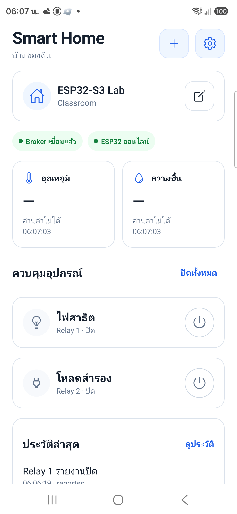 | 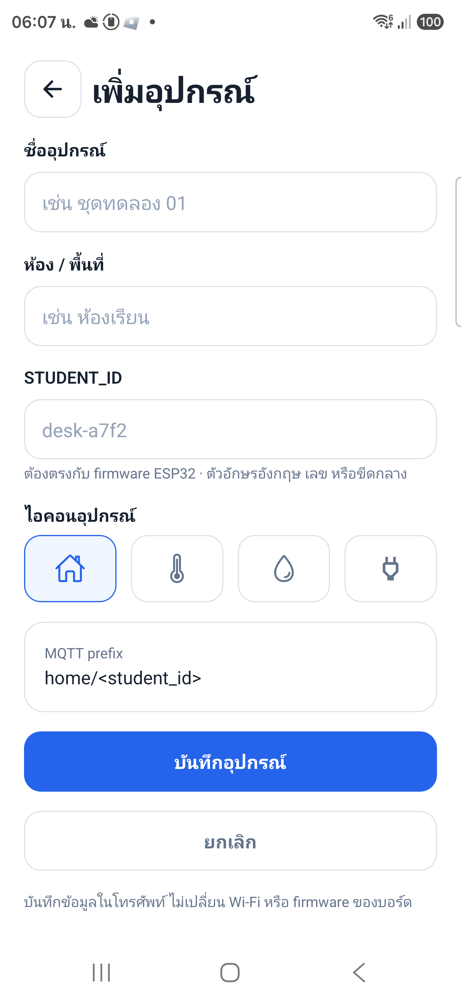 |
| แก้ไขอุปกรณ์ | ตั้งค่า WSS/ข้อมูลในโทรศัพท์ |
| 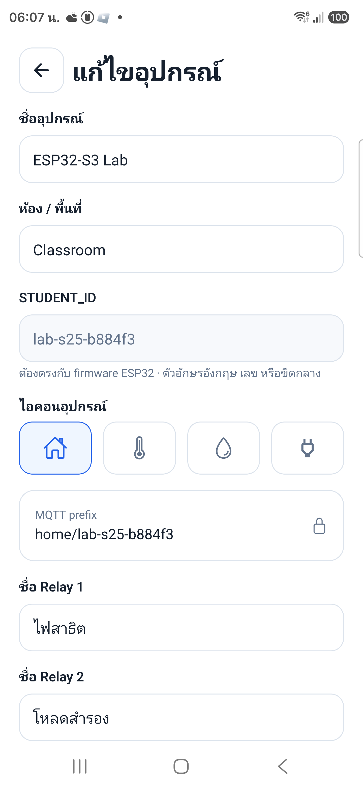 | 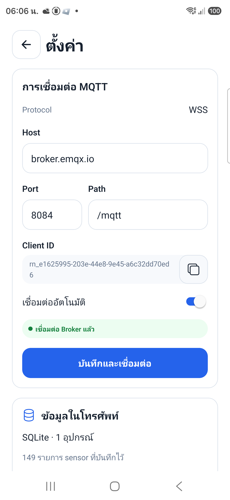 |

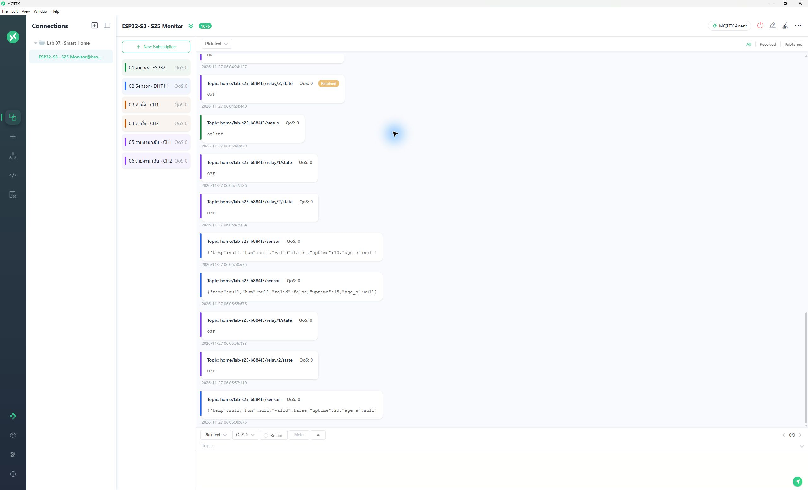

[ดูแกลเลอรีเต็ม ภาพส่วนท้ายฟอร์ม วิธีจับภาพและ SHA256](app-blueprint/evidence/final-2026-11-27/README.md) · [เปิดภาพ MQTTX ขนาดเต็ม](app-blueprint/evidence/final-2026-11-27/lab07-final-mqttx-overview.jpg)

ก่อนจับภาพพบ retained offline จึงเชื่อม MQTTX และ Reset บอร์ดหนึ่งครั้งจนได้รับ online/sensor/state สด ทั้งสองช่องเป็น OFF หลัง Reset ภาพรอบนี้เป็นหลักฐาน UI/การรับข้อมูล ไม่ใช่ผลทดสอบ DHT หรือหน้าสัมผัส Relay จริง และไม่ได้ทดสอบคำสั่งจากโทรศัพท์เพิ่มในรอบจับภาพ

## 🧰 อุปกรณ์ที่ใช้

| อุปกรณ์ | จำนวน | หมายเหตุ |
|---|---:|---|
| ESP32 DevKit V1 หรือ ESP32-S3 | 1 | เลือกtarget/pinตามตาราง; รอบจริงใช้S3Flash16MB/PSRAM8MB |
| OLED SSD1306 I2C 128×64 | 1 | address ตัวอย่าง 0x3C, ใช้ไฟ 3.3V |
| DHT11 module | 1 | module มักมี pull-up; sensor เปล่าเพิ่ม 10kΩ |
| Relay module 2CH 5V | 1 | IN1=GPIO26, IN2=GPIO27, active LOW ตามตัวอย่าง |
| LED+R หรือพัดลม DC 5V | 2 โหลด | ใช้โหลด DC แรงดันต่ำเท่านั้น |
| Breadboard, jumper, USB data | 1 ชุด | ต่อ GND ร่วมกัน |
| Android phone หรือ emulator | 1 | nativeAPK; baseline minSdk24, รอบจริงSamsungAndroid17/emulatorAndroid16 |
| คอมพิวเตอร์ + Node/npm/JDK/Android SDK/OpenCode | 1 | baselineและวิธีbuildด้านล่าง ไม่พึ่งwebpreviewอย่างเดียว |
| MQTTX Desktop | 1 | รอบอ้างอิง1.13.3, monitor6หัวข้อ/4สี |

### BOM สำหรับโครงงาน

| รายการ | จำนวน | จุดตรวจรับ |
|---|---:|---|
| ESP32 + USB | 1 | upload และ Serial 115200 ได้ |
| DHT11 | 1 | อ่านอุณหภูมิ/ความชื้นได้ทุก ≥2 วินาที |
| OLED SSD1306 | 1 | พบ address และแสดง 4 สถานะ |
| Relay 2CH | 1 | สั่ง ON/OFF และ feedback state ตรงกัน |
| โหลด DC ต่ำ + แหล่งจ่ายเหมาะสม | 1–2 | ไม่ดึงกระแสเกินจากบอร์ด |
| React Native Android app | 1 โครงงาน | ผู้เรียนสร้างด้วย OpenCode, SQLite local และ MQTT |

> [!CAUTION]
> ห้ามใช้ไฟบ้าน AC 220V ในมินิโปรเจกต์นี้ ให้ใช้เฉพาะโหลด DC แรงดันต่ำ และถอดแหล่งจ่ายก่อนแก้วงจร

> [!WARNING]
> `broker.emqx.io` เป็น public broker ห้ามส่งข้อมูลส่วนตัว รหัสผ่าน หรือ token ตั้ง `STUDENT_ID` สมมติที่ไม่ซ้ำกับผู้อื่น

## ❓ คำถามก่อนเริ่มต้น

<details>
<summary><b>คลิกเพื่อดูคำถามก่อนเรียน</b></summary>

1. โปรแกรมใน ESP32 ต่างจากแอป React Native บนโทรศัพท์อย่างไร?
2. การเก็บประวัติในโทรศัพท์ต่างจาก retained message ของ MQTT อย่างไร?
3. เมื่อ sensor อ่านค่าไม่ได้ แอปควรสื่อสารกับผู้ใช้ด้วยวิธีใด?
4. คำสั่งที่ผู้ใช้กดต่างจาก state ที่อุปกรณ์รายงานกลับอย่างไร?
5. หาก Wi-Fi หรือ MQTT หลุด ระบบควรจัดการปุ่มสั่งงานและข้อมูลที่เคยบันทึกอย่างไร?
6. ไฟล์ Markdown ประเภทใดช่วยให้ AI coding agent สร้างแอปและทดสอบตามโจทย์ได้?

</details>

## 📖 ทฤษฎี

### สถาปัตยกรรมระบบ

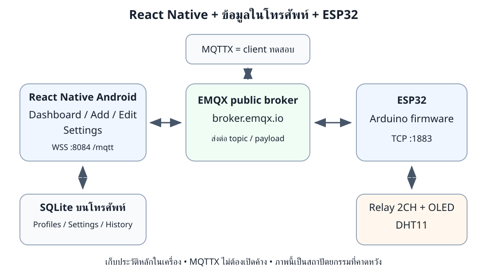

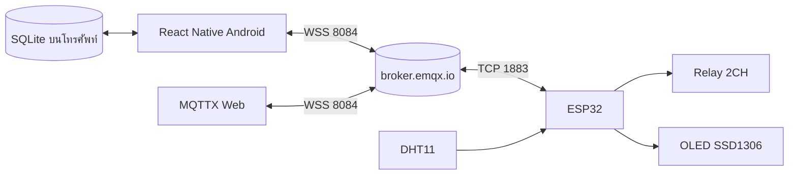

แอปส่ง **desired command** ไป topic `/set`; ESP32 ตรวจคำสั่งและเขียน GPIO และ publish **reported state** ไป `/state` แบบ retained Dashboard จึงต้องแสดง `/state` ที่ได้รับกลับ ไม่เดาจากปุ่มที่เพิ่งกด state นี้เป็นค่าที่ firmware สั่ง GPIO ไม่ใช่ sensor ตรวจหน้าสัมผัส/โหลดจริง

### แอป React Native กับข้อมูลในโทรศัพท์

แอปเป็น MQTT client อีกตัวที่ผู้เรียนสร้างด้วย OpenCode จากชุด Markdown มี Dashboard เป็นหน้าเปิด, Add Device, Edit Device และ Settings ข้อมูล profile/settings/history อยู่ใน SQLite บนโทรศัพท์ ส่วน broker ส่งต่อข้อความระหว่างแอปกับ ESP32 MQTTX ใช้ดู/ส่งข้อความเพื่อ debug ไม่ใช่ตัว broker

เมื่อโทรศัพท์ไม่มีเน็ตยังเปิดดูประวัติ local ได้ แต่ข้อมูลเก่าต้องมีป้ายเวลาและปุ่มสั่งงานถูกปิด การกดปุ่มแล้ว publish สำเร็จขั้นต้นยังไม่ยืนยัน Relay ต้องรอ reported state กลับและมี timeout สัญญา topic ของแอปตรงกับ firmware ด้านล่าง

### OLED SSD1306

จอ 128×64 เก็บภาพใน RAM buffer ก่อนเรียก `display.display()` เพื่อส่งผ่าน I2C ค่า address ที่พบบ่อยคือ 0x3C แต่ต้องใช้ I2C scanner หากจอไม่ตอบสนอง SDA/SCL ใช้ GPIO21/22 ร่วมกับอุปกรณ์ I2C อื่นได้เมื่อ address ไม่ชนกัน

### DHT11 และข้อมูล invalid

DHT11 มีความละเอียด/ความแม่นยำจำกัดและรอบอ่านช้า จึงเว้นอย่างน้อย 2 วินาที ไลบรารีอาจคืน `NaN` เมื่อ checksum/สัญญาณผิด ต้องตรวจ `isnan()` และไม่ publish NaN เป็นค่าปกติ ระบบตัวอย่างส่ง `temp/hum=null, valid=false` เพื่อแจ้ง invalid และเก็บค่าดีล่าสุดบน OLED พร้อมคำว่า STALE กับอายุข้อมูล

### Firmware แบบ cooperative

`loop()` ต้องกลับมาทำงานถี่เพื่อเรียก `mqtt.loop()` งาน sensor, OLED และ reconnect ใช้ `millis()` แยกช่วงเวลา ไม่มี `delay()` ยาว สถานะ Relay ใช้ active LOW แต่เก็บในโปรแกรมเป็น `bool` ที่อ่านง่าย เมื่อ MQTT reconnect จะ subscribe ใหม่และ publish state ทั้งสองช่องเพื่อ sync dashboard

### Topic ของโครงงาน

| Topic | ทิศทาง | Payload/คุณสมบัติ |
|---|---|---|
| `home/{id}/relay/1/set` | App → ESP32 | `ON`/`OFF` |
| `home/{id}/relay/2/set` | App → ESP32 | `ON`/`OFF` |
| `home/{id}/relay/1/state` | ESP32 → App | `ON`/`OFF`, retain |
| `home/{id}/relay/2/state` | ESP32 → App | `ON`/`OFF`, retain |
| `home/{id}/sensor` | ESP32 → App | `{"temp":28,"hum":61,"valid":true,"uptime":5,"age_s":0}` |
| `home/{id}/status` | ESP32/LWT → App | `online`/`offline`, retain |

## 🔌 การต่อวงจร

**ภาพและตารางแรกเป็น ESP32-WROOM-32** หากใช้ ESP32-S3 ให้เลือกขาจากตาราง S3 ด้านล่างก่อนต่อสาย โดยเฉพาะ Relay และ I2C ซึ่งใช้ขาต่างกัน รอบตัวอย่างบน Samsung ใช้ S3 เปล่า ไม่มีโมดูลต่ออยู่

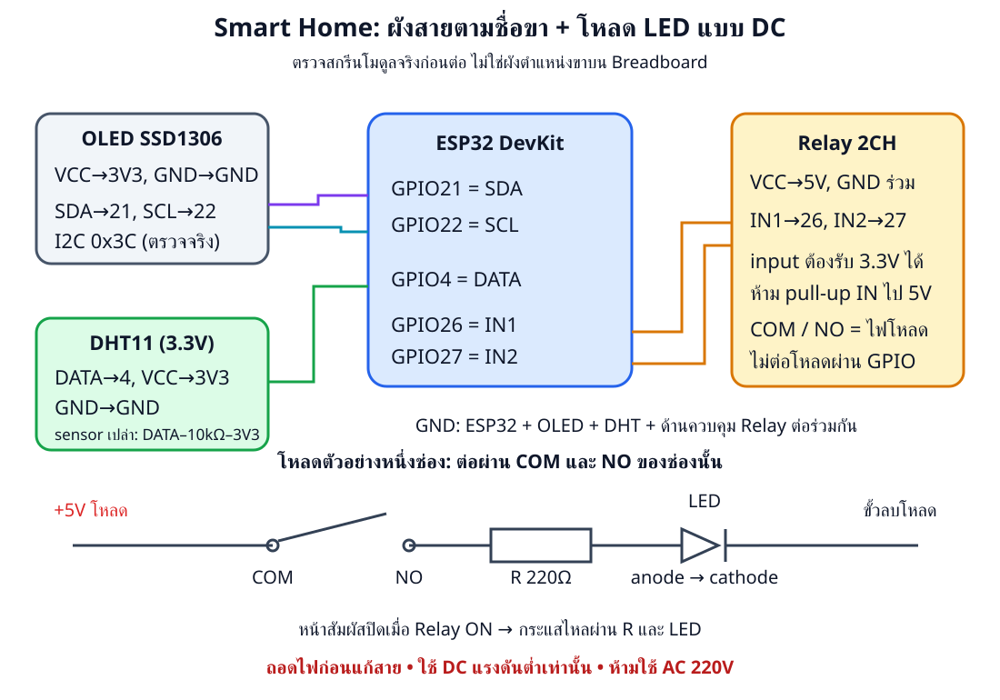

| อุปกรณ์ | ขา | ต่อกับ | หมายเหตุ |
|---|---|---|---|
| OLED | VCC/GND | 3V3/GND | ตรวจสกรีนโมดูลจริง |
| OLED | SDA/SCL | GPIO21/GPIO22 | address 0x3C |
| DHT11 | VCC/GND | 3V3/GND | sensor เปล่าใส่ pull-up 10kΩ DATA→3V3 |
| DHT11 | DATA | GPIO4 | อย่าใช้ช่วงอ่านต่ำกว่า 2 วินาที |
| Relay | VCC/GND | 5V/GND | พิจารณาแหล่งจ่ายแยกเมื่อโหลดกินกระแสสูง |
| Relay | IN1/IN2 | GPIO26/GPIO27 | ใช้โมดูล input รองรับ 3.3V, active LOW ที่ตรวจแล้ว |
| โหลด DC | COM/NO | แหล่งจ่าย DC ภายนอก | ห้ามใช้ AC 220V |

ต่อวงจรขณะถอดไฟ ตรวจขั้ว VCC/GND ของ OLED เพราะลำดับขาแต่ละรุ่นอาจต่างกัน ให้ GND ของ ESP32, OLED, DHT และด้านควบคุม Relay ร่วมกัน จ่าย 3.3V ให้ OLED/DHT รุ่นที่รองรับ แหล่งจ่าย 5V ของขดลวด Relay ไม่ได้แปลว่า IN1/IN2 รับ GPIO 3.3V ได้ทุกโมดูล ต้องตรวจ datasheet/วงจร input ว่าไม่มี pull-up 5V เข้าขา ESP32 หากไม่เข้ากันต้องใช้วงจร driver/level interface ที่เหมาะสมก่อนต่อ

สำหรับโหลดเริ่มต้นแต่ละช่อง ต่อ **+5V ของโหลด → COM → NO → R 220Ω → anode LED → cathode → ขั้วลบของแหล่งจ่ายโหลด** ใช้หน้าสัมผัสตัดต่อไฟโหลด ไม่จ่ายไฟ LED จาก IN1/IN2 ดู [ภาพวงจรโหลด DC](../lab05-relay-ultrasonic/images/lab05-dc-load.svg) และตรวจ COM/NO จากสกรีนจริง ขั้วไฟโหลดเป็นคนละวงจรกับขาควบคุม อย่าดึงกระแสโหลดผ่าน GPIO

ก่อน setup ทำงาน GPIO อาจยังเป็น input การเขียน OFF ในโปรแกรมอย่างเดียวจึงไม่รับประกันว่า Relay จะไม่กระตุกตอนจ่ายไฟ ต้องใช้ input bias/driver ที่เข้ากับโมดูลและทดสอบช่วงเปิดเครื่องจริง ขั้นนี้เริ่มด้วย LED โหลด DC เท่านั้น

### ถ้าใช้ ESP32-S3 แทน ESP32-WROOM-32

วงจรหลักและภาพด้านบนใช้ **ESP32 รุ่นเดิม** ส่วน sketch 7.1 และ 7.3 เลือกขาตาม target ตอน compile อัตโนมัติ สำหรับ S3 ต้องย้ายสายตามตารางนี้ก่อนจ่ายไฟ ตรวจว่าบอร์ดของตนมีขาเหล่านี้และไม่มีวงจรอื่นใช้อยู่ อย่าใช้เลขตำแหน่ง header แทนหมายเลข GPIO

| สัญญาณ | ESP32-WROOM-32 | ESP32-S3 |
|---|---|---|
| DHT11 DATA | GPIO4 | GPIO4 |
| Relay IN1 / IN2 | GPIO26 / GPIO27 | GPIO16 / GPIO17 |
| OLED SDA / SCL | GPIO21 / GPIO22 | GPIO8 / GPIO9 |

S3 ไม่มี GPIO22; GPIO26–32 ใช้กับ Flash/PSRAM และ S3 ที่ใช้ Octal memory ยังสงวน GPIO33–37 จึงห้ามนำวงจร Relay26/27 เดิมมาต่อกับ S3 ดู [GPIO ของ ESP32-S3](https://docs.espressif.com/projects/esp-idf/en/stable/esp32s3/api-reference/peripherals/gpio.html) และ [คู่มือ DevKitC-1](https://docs.espressif.com/projects/esp-dev-kits/en/latest/esp32s3/esp32-s3-devkitc-1/user_guide_v1.1.html)

เลือก **ESP32S3 Dev Module** ใน Arduino IDE; ถ้าใช้ USB-to-UART CH343 ให้ปิด **USB CDC On Boot** เพื่ออ่าน `Serial` ผ่านพอร์ต UART เดิม เลือก Flash/PSRAM ตามรุ่นจริง ไม่ใช้ขนาดจากตัวอย่างกับทุกบอร์ด รอบตรวจบอร์ด S3 Flash16MB/Octal PSRAM8MB ใช้:

```powershell
arduino-cli compile --fqbn "esp32:esp32:esp32s3:FlashSize=16M,PSRAM=opi,CDCOnBoot=default,UploadSpeed=115200" --warnings all labs/lab07-smart-home-project/code/lab07_smart_home
```

ถ้ามีเฉพาะบอร์ด ยังทดสอบ Wi-Fi/MQTT/คำสั่งและ reported GPIO state ได้: OLED จะรายงาน no ACK, DHT ส่ง `temp:null,hum:null,valid:false,age_s:null` แอปแสดง “อ่านค่าไม่ได้” ผลนี้ไม่ยืนยันอุณหภูมิ จอ หรือหน้าสัมผัส Relay จริง

### ภาพต่อสาย DHT11 + OLED และขาที่โค้ดใช้

ภาพชุดนี้ขยายส่วน sensor/จอจากวงจรรวม ให้ไล่สายทีละเส้นได้ ภาพต่อสายวาดบอร์ดซ้ำสองมุมมองเพื่อแยกชุดสาย DHT11 กับ OLED ให้อ่านง่าย **ให้ต่อทั้งสองชุดบนบอร์ดเดียวกัน** และใช้ 3V3/GND ร่วมกัน ไม่ต้องใช้สองบอร์ด ใช้ **ชื่อ GPIO บนบอร์ด** เป็นหลัก กล่องขาที่ขยายในภาพเป็น functional pin map ไม่ใช่ขาเรียงติดกันบน header และไม่ใช้แทน pinout ทางกายภาพของบอร์ดทุกยี่ห้อ

หาตำแหน่ง header จริงของ **DevKit V1 แบบ30pin** ได้จาก [ภาพ pinout ใน Lab01](../lab01-esp32-introduction/images/lab01-pinout-circuitstate.png) ส่วน **ESP32-S3-DevKitC-1** ดู [Header Block ของ Espressif](https://docs.espressif.com/projects/esp-dev-kits/en/latest/esp32s3/esp32-s3-devkitc-1/user_guide_v1.1.html#header-block) ถ้าเป็นบอร์ดคนละรุ่นให้ใช้ pinout ผู้ผลิตของบอร์ดนั้น ไม่เทียบตำแหน่งข้ามรุ่น

#### ดูขาอุปกรณ์ก่อนต่อ

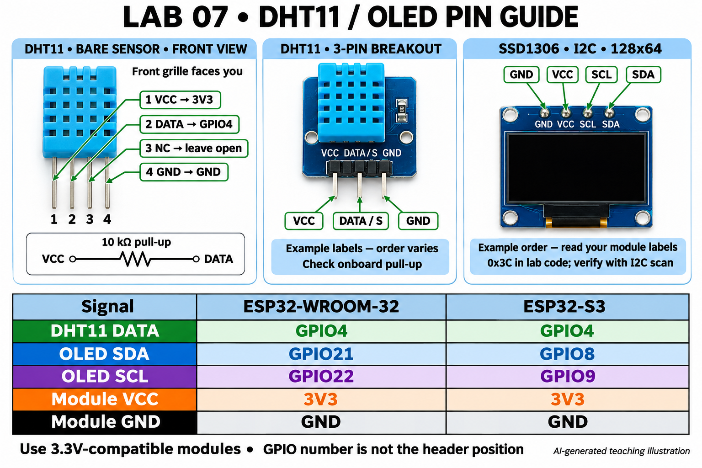

*ภาพประกอบสร้างด้วย AI — DHT11 แบบเปล่ามองด้านหน้าที่มีช่องตะแกรง ขาชี้ลง เรียง 1=VCC, 2=DATA, 3=NC, 4=GND; โมดูล 3 ขาและ OLED ให้ตามสกรีนจริง เพราะลำดับขาแต่ละผู้ผลิตอาจต่างกัน*

ภาพ OLED เลือกตัวอย่างที่เรียง **GND, VCC, SCL, SDA** หากของตนเรียง VCC/GND กลับกันให้ย้ายสายตามชื่อ ไม่ทำตามตำแหน่งในภาพโดยไม่อ่านสกรีน เลือกจอ **SSD1306 I2C 128×64 แบบ4ขา** ที่รองรับ3.3V และตรวจ address0x3C ด้วย I2C scanner ตามแล็บ4; จอ SPI7ขาใช้ภาพนี้ต่อแทนไม่ได้

#### ESP32-WROOM-32 — SDA21 / SCL22

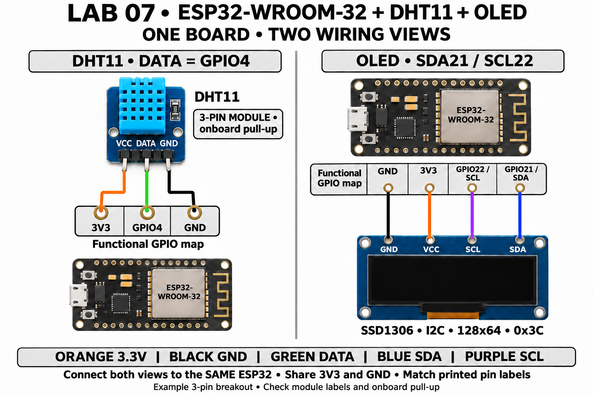

*ภาพประกอบสร้างด้วย AI — สีส้ม=3.3V, ดำ=GND, เขียว=DATA, น้ำเงิน=SDA, ม่วง=SCL ตรง [config.h](code/lab07_smart_home/config.h) ของ target ESP32; ภาพต่อสายเลือกโมดูล DHT11 แบบ3ขาที่มี pull-up บน PCB ส่วน sensor เปล่า4ขาให้ดูภาพขยายและต่อ R10kΩ ตามตาราง*

#### ESP32-S3 — SDA8 / SCL9

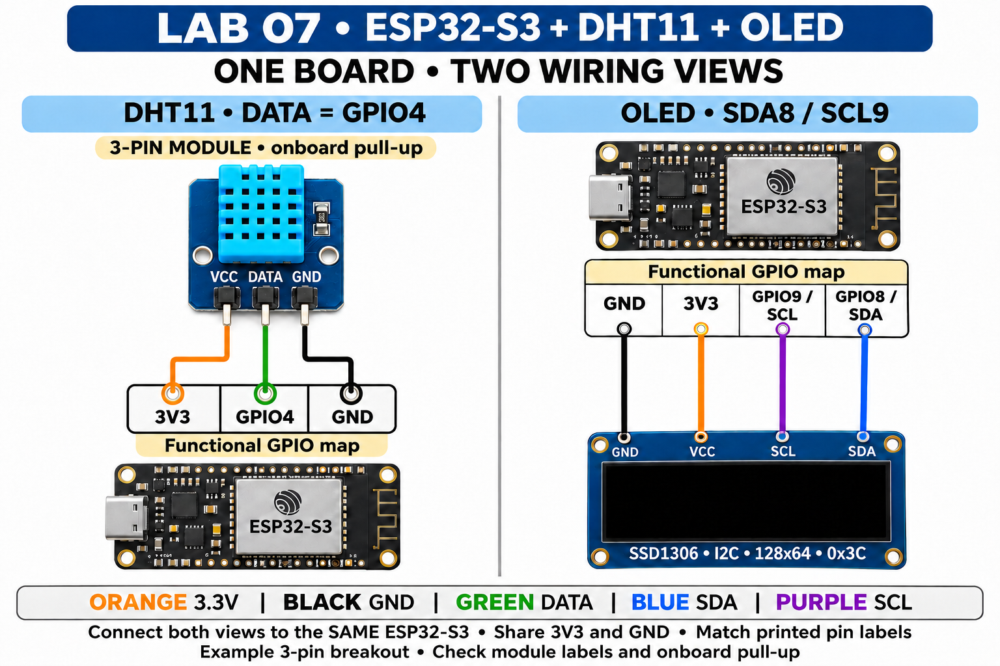

*ภาพประกอบสร้างด้วย AI — ใช้สีสายชุดเดียวกัน แต่ย้าย SDA/SCL เป็น GPIO8/9 ตาม target S3 ใน [config.h](code/lab07_smart_home/config.h) ไม่ย้ายสายตามตำแหน่ง header ของ ESP32 รุ่นเดิม*

#### ตารางตรวจปลายสายทุกเส้น

| ปลายสายที่อุปกรณ์ | ESP32-WROOM-32 | ESP32-S3 | สีในภาพ |
|---|---|---|---|
| DHT11 VCC (ขา1 ของ sensor เปล่า) | 3V3 | 3V3 | ส้ม |
| DHT11 DATA (ขา2 ของ sensor เปล่า) | GPIO4 | GPIO4 | เขียว |
| DHT11 NC (ขา3 ของ sensor เปล่า) | ไม่ต่อ | ไม่ต่อ | ไม่มีสาย |
| DHT11 GND (ขา4 ของ sensor เปล่า) | GND | GND | ดำ |
| OLED VCC | 3V3 | 3V3 | ส้ม |
| OLED GND | GND | GND | ดำ |
| OLED SDA | GPIO21 | GPIO8 | น้ำเงิน |
| OLED SCL | GPIO22 | GPIO9 | ม่วง |
| R10kΩ สำหรับ DHT11 เปล่า | ระหว่าง 3V3 กับ DATA | ระหว่าง 3V3 กับ DATA | ต่อคร่อม net ส้ม–เขียว |

1. ถอด USB/แหล่งจ่ายก่อน ตรวจรุ่นบอร์ดและสกรีน VCC/GND ของโมดูลจริง แยกขา3=NC ของ DHT11 เปล่าออกจาก GPIO3 ของ ESP32 ซึ่งเป็นคนละความหมาย
2. ต่อ GND ร่วมก่อน แล้วต่อ 3V3 ไป VCC ของ DHT11/OLED ที่ระบุรองรับ3.3V จุดแตกสายทำจริงด้วยรางไฟ/กราวด์บน breadboard หรือขั้วแยกสายที่ยึดแน่น ตรวจรางที่ขาดกลางก่อนใช้
3. ต่อ DATA ไป GPIO4 ถ้าใช้ sensor เปล่าใส่ R10kΩ **ระหว่าง DATA กับ3V3** เป็น pull-up ไม่ต่ออนุกรมในสาย DATA และไม่ต่อ R ลง GND ถ้าเป็น breakout3ขาที่มี pull-up อยู่แล้วให้ตรวจวงจรโมดูลก่อนเพิ่ม R
4. ต่อ SDA/SCL ตาม target ในตาราง ระวังสลับสองเส้น ดู `Wire.begin(I2C_SDA_PIN, I2C_SCL_PIN)` ใน sketch OLED และ config.h ของ smart_home; DHT ใช้ `DHT_PIN=4` เหมือนกันทั้งสองบอร์ด
5. ตรวจว่า 3V3 ไม่ลัดกับ GND แล้วจึงเสียบ USB ทดสอบ OLED ใน7.1 ตามด้วย DHT11 ใน7.2 และรวมใน7.3 ตามลำดับ ผลอ่าน sensor ไม่ได้ให้ตรวจรุ่น/ขา/ไฟ/pull-up ไม่เปลี่ยน VCC เป็น5Vโดยไม่ตรวจระดับสัญญาณที่เข้า ESP32

อ้างอิงหลักการ sensor/pull-up: [Adafruit — Connecting to a DHTxx Sensor](https://learn.adafruit.com/dht/connecting-to-a-dhtxx-sensor); ขา S3 ตรวจเพิ่มจาก [Espressif — Header Block](https://docs.espressif.com/projects/esp-dev-kits/en/latest/esp32s3/esp32-s3-devkitc-1/user_guide_v1.1.html#header-block) ภาพเป็นสื่ออธิบายการต่อ ไม่ใช่หลักฐานทดสอบโมดูลจริง ดู [prompt ชุดภาพ](../../assets/prompts/lab07-dht11-oled-pinout.md) สำหรับข้อกำหนดที่ใช้สร้าง

## 🧪 การทดลอง

### เตรียมโครงงาน: ผ่านทีละส่วนก่อนต่อรวม

ลองนึกถึงการเปิด Dashboard แล้วเห็นปุ่ม Relay ON แต่หลอดไฟไม่ติด เราจะตอบไม่ได้ทันทีว่าแอปส่งผิด, เครือข่ายขาด, โมดูลกลับลอจิก หรือโหลดไม่มีไฟ บทนี้จึงมีจุดตรวจ 4 ช่วง: **จอแสดงได้ → sensor อ่านได้ → MQTT สั่ง/รับ state ได้ → แอปใช้ topic เดียวกัน**

1. ตรวจวงจรตามตารางด้านบนขณะถอดไฟ ใช้ LED กับ R เป็นโหลดเริ่มต้น ทดสอบ Relay ตาม [Lab 05](../lab05-relay-ultrasonic/) และ MQTT สองทิศทางตาม [Lab 06](../lab06-wifi-mqtt/) ก่อน
2. เปิด Arduino IDE เลือก **ESP32 Dev Module** (หรือ **ESP32S3 Dev Module** ตามหัวข้อ S3 ด้านบน), COM ของบอร์ด, core **3.x** และ Serial Monitor **115200 baud**
3. ไป **Sketch → Include Library → Manage Libraries** ติดตั้งรายการด้านล่าง ผู้เขียน library สำคัญเพราะชื่อคล้ายกันหลายชุด หากมีหน้าต่างถาม dependency ให้ติดตั้งด้วย
4. ทดสอบ 7.1 โดยต่อเฉพาะ OLED ก่อน ตามด้วย 7.2 ที่ต่อ DHT11 แล้วจึง 7.3 ที่รวมวงจร การ Upload แต่ละ sketch แทนที่โปรแกรมเดิม
5. เตรียมใบงานจดอาการและ log จริง ทุกภาพหน้าจอในบทเป็นตัวอย่างหรือแผนภาพ ไม่ใช่หลักฐานว่าบอร์ดของผู้เรียนผ่านแล้ว

| Library | ผู้เขียน | รุ่นที่ใช้ตรวจ build |
|---|---|---|
| Adafruit SSD1306 | Adafruit | 2.5.17 |
| Adafruit GFX Library | Adafruit | 2.0.0 |
| Adafruit BusIO (dependency) | Adafruit | 1.17.4 |
| DHT sensor library | Adafruit | 1.4.7 |
| Adafruit Unified Sensor | Adafruit | 1.1.15 |
| PubSubClient | Nick O'Leary | 2.8.0 |
| ArduinoJson | Benoit Blanchon | 7.4.3 |

WiFi/Wire มากับ core ไม่ต้องติดตั้ง library แยก เลือกรุ่นใกล้เคียงอาจใช้งานได้ แต่ให้จดรุ่นที่ใช้จริงเพื่ออธิบายผลที่ต่างกัน PubSubClient publish ได้ QoS 0 เท่านั้น จึงต้องตรวจข้อมูลฝั่งรับด้วย และ repository ของ library แจ้งว่าไม่มีการบำรุงรักษาแล้ว การใช้งานจริงต้องประเมิน dependency เพิ่ม

### การทดลองที่ 7.1 ทดสอบ OLED จาก buffer สู่จอ

OLED ต่างจากการ `Serial.print()` ตรงที่คำสั่งวาดของ GFX แก้ภาพใน RAM ก่อน `display.display()` จึงส่งภาพไปจอ ตำแหน่ง `(0,0)` อยู่มุมซ้ายบน x เพิ่มไปขวา y เพิ่มลงล่าง จอ 128×64 มี x=0–127, y=0–63 ภาพขาวดำทั้งจอใช้ buffer 128×64÷8 = 1,024 byte

1. ตรวจขา **VCC/GND/SDA/SCL จากสกรีนของโมดูลจริง** อย่าเดาลำดับขาจากภาพ ต่อไฟ 3.3V และ GND, ESP32 ใช้ SDA21/SCL22; S3 ใช้ SDA8/SCL9 ตามตาราง
2. เปิด [`lab07_oled_test.ino`](code/lab07_oled_test/lab07_oled_test.ino) เริ่มอ่านจาก `#include <Wire.h>` สำหรับบัส, `Adafruit_GFX.h` สำหรับข้อความ/รูปทรง และ `Adafruit_SSD1306.h` สำหรับ controller จอ
3. อ่านการประกาศ `display(...)`: ตัวแปรนี้จำขนาดจอ บัส Wire และ reset=-1 ซึ่งหมายถึงไม่มีขา reset แยกที่กำหนดให้ library
4. ใน `setup()` เริ่ม Wire แล้วส่ง address ตรวจ ACK ถ้าไม่พบ ให้ถอดไฟตรวจสายและใช้ I2C scanner จาก Lab 04 หา address; ถ้าเป็น 0x3D ให้แก้ `OLED_ADDRESS` ตามค่าที่พบ อย่าเปลี่ยนตัวเลขสุ่ม
5. อ่านทีละคำสั่ง: `clearDisplay()` ล้าง buffer → `drawRect()` วาดกรอบ → `setTextColor()` เลือก pixel สีขาว → `setTextSize()` เลือกขนาด → `setCursor()` วางตำแหน่ง → `println()` วาดข้อความ → `display()` ส่งออก
6. Upload สังเกตจอจริงและ Serial จากนั้นทดลองเปลี่ยน cursor ของคำว่า ESP32 เช่น x=6, y=12 แล้ว Upload ใหม่ เปลี่ยนเพียงตัวเดียวเพื่อเห็นผลของพิกัด

**โค้ดเต็ม:**

```cpp
/*
 * Lab 07.1 : ทดสอบ OLED SSD1306
 * คำอธิบาย : ตรวจจอ I2C 128x64 address 0x3C และแสดงข้อความ/กรอบ
 * วงจร     : OLED VCC->3V3, GND->GND; ESP32 SDA/SCL=21/22, S3=8/9
 * ไลบรารี  : Adafruit GFX Library, Adafruit SSD1306
 * Board    : ESP32 Dev Module หรือ ESP32S3 Dev Module (Arduino-ESP32 core 3.x)
 */
#include <Arduino.h>
#include <Wire.h>
#include <Adafruit_GFX.h>
#include <Adafruit_SSD1306.h>

constexpr int SCREEN_WIDTH = 128;
constexpr int SCREEN_HEIGHT = 64;
constexpr int OLED_RESET = -1;
constexpr uint8_t OLED_ADDRESS = 0x3C;
#if defined(CONFIG_IDF_TARGET_ESP32S3)
constexpr uint8_t I2C_SDA_PIN = 8;
constexpr uint8_t I2C_SCL_PIN = 9;
#elif defined(CONFIG_IDF_TARGET_ESP32)
constexpr uint8_t I2C_SDA_PIN = 21;
constexpr uint8_t I2C_SCL_PIN = 22;
#else
#error "Lab07 supports ESP32 and ESP32-S3; define a verified pin mapping first."
#endif
Adafruit_SSD1306 display(SCREEN_WIDTH, SCREEN_HEIGHT, &Wire, OLED_RESET);

void setup() {
  Serial.begin(115200);
  Wire.begin(I2C_SDA_PIN, I2C_SCL_PIN);
  // ACK ตรวจว่ามีอุปกรณ์ตอบที่ address; ยังไม่ยืนยันว่าเป็นรุ่น SSD1306
  Wire.beginTransmission(OLED_ADDRESS);
  if (Wire.endTransmission() != 0) {
    Serial.println("[OLED] no I2C ACK at 0x3C; check wiring/address");
    return;
  }
  if (!display.begin(SSD1306_SWITCHCAPVCC, OLED_ADDRESS)) {
    Serial.println("[OLED] buffer/init failed");
    return;
  }

  // วาดข้อมูลลง buffer แล้วส่งขึ้นจอด้วย display()
  display.clearDisplay();
  display.drawRect(0, 0, SCREEN_WIDTH, SCREEN_HEIGHT, SSD1306_WHITE);
  display.setTextColor(SSD1306_WHITE);
  display.setTextSize(2); display.setCursor(18, 12); display.println("ESP32");
  display.setTextSize(1); display.setCursor(18, 40); display.println("Smart Home Lab");
  display.display();
  Serial.println("[OLED] display ready");
}

void loop() {}
```

| บรรทัด/ส่วน | ความหมาย |
|---|---|
| `I2C_SDA_PIN/I2C_SCL_PIN`, `Wire.begin(...)` | เลือกขาตาม target ESP32/S3 แล้วตั้ง SDA/SCL ก่อนสื่อสาร |
| `beginTransmission()` + `endTransmission()` | ตรวจว่ามีอุปกรณ์ตอบ ACK ที่ address |
| `display.begin()` | จอง buffer/เริ่ม controller ค่า true อย่างเดียวไม่รับรองว่าเป็นจอถูกชนิดหรือภาพขึ้นจริง |
| `SSD1306_SWITCHCAPVCC` | การตั้ง charge pump ของ controller ไม่ใช่คำสั่งจ่ายไฟให้ขา VCC โมดูล |
| `clearDisplay()` | ล้างภาพใน RAM ยังไม่ทำให้จอจริงเปลี่ยนทันที |
| `drawRect(0,0,128,64,...)` | วาดกรอบรอบพื้นที่ |
| `setTextSize(2)` → `1` | ขยายข้อความแรกแล้วคืนขนาดสำหรับบรรทัดถัดไป |
| `display.display()` | ส่ง buffer ทาง I2C ต้องเรียกหลังวาดครบ |
| `loop()` ว่าง | ภาพนิ่งไม่ต้องวาดซ้ำตลอดเวลา |

**ผลลัพธ์ Serial ที่คาดหวัง:**

```text
[OLED] display ready
```

จอแสดงกรอบและข้อความ `ESP32` / `Smart Home Lab` ถ้าพบ ACK แต่จอว่าง ให้ตรวจรุ่น controller ว่าเป็น SSD1306 จริง (SH1106 ต้องใช้ driver ต่างกัน) และขนาด/ไฟ/สาย ไม่ถือว่า ACK ยืนยันทุกอย่าง

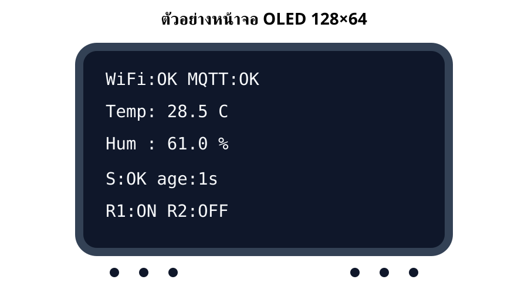

*ภาพจำลองผลลัพธ์ของ 7.3; ใน 7.1 ยังแสดงเฉพาะกรอบกับข้อความทดสอบ ภาพทุกใบสร้างเองและมี [ทะเบียนภาพ](../../assets/IMAGE_SOURCES.md)*

**จุดตรวจ:** อธิบายได้ว่าทำไม `clearDisplay()`/`print()` โดยไม่เรียก `display()` จึงไม่เปลี่ยนภาพจริง และบันทึก address ที่อุปกรณ์ตอบ

**ภารกิจท้าทาย:** เพิ่มกรอบสี่เหลี่ยมขนาด 8×8 ที่มุมขวาบนก่อนส่ง buffer แล้วอธิบายพิกัดและขนาดที่เลือก

### การทดลองที่ 7.2 ทดสอบ DHT11 และความหมายของ NaN

DHT11 ใช้ DATA เส้นเดียวส่งข้อมูลแบบกำหนดเวลา ไม่ใช่ I2C จึงไม่ค้นพบใน I2C scanner ความชื้นคือสัดส่วนความชื้นสัมพัทธ์หน่วย %RH และอุณหภูมิจากตัวอย่างเป็น °C การพิมพ์ทศนิยมหนึ่งตำแหน่งไม่ได้ยืนยันว่า sensor แม่นยำระดับ 0.1 หน่วย

1. ถอดไฟ ต่อ DHT11 ที่รองรับการจ่าย 3.3V: VCC→3V3, GND→GND, DATA→GPIO4 sensor เปล่าต้องมี R pull-up 10kΩ จาก DATA ไป 3V3 ตรวจขาจริงจากโมดูล ห้ามใช้ pull-up ไป 5V เข้าขา ESP32
2. เปิด [`lab07_dht11_test.ino`](code/lab07_dht11_test/lab07_dht11_test.ino) ดู `DHT dht(DHT_PIN,DHT11)` ว่ากำหนดชนิดตรงอุปกรณ์ ถ้าเลือก DHT22 แทนโดยไม่ได้เปลี่ยน sensor การแปลข้อมูลจะไม่ตรง
3. อ่าน timer ก่อน: `now - lastRead < 2000` ให้กลับออกก่อนเมื่อยังไม่ถึงรอบ `return` ใน `loop()` ครั้งนี้แค่จบรอบ แล้วระบบจะเรียกใหม่ ไม่ได้ปิดโปรแกรม
4. ถึงเวลาแล้วจึงอ่าน humidity และ temperature เป็น `float` library นี้เก็บผลการอ่านล่าสุดภายในช่วง 2 วินาที จึงอ่านสองค่าต่อกันได้โดยไม่บังคับวัดใหม่สองรอบ
5. Upload รออย่างน้อย 3 รอบ จดค่าพร้อมหน่วย ไม่จับ sensor ด้วยมือร้อนแล้วใช้เป็นการสอบเทียบ
6. ทดสอบข้อผิดพลาดโดย **ถอดไฟก่อน** ถอด DATA แล้วจ่ายไฟใหม่ ต้องมี NaN log; ถอดไฟต่อกลับแล้วทดสอบค่าปกติ การถอดไฟทำให้ค่าเดิมใน RAM หาย ดังนั้นการทดสอบนี้ต่างจาก sensor เสียระหว่างรัน

```cpp
/*
 * Lab 07.2 : ทดสอบ DHT11
 * คำอธิบาย : อ่านอุณหภูมิและความชื้นทุก 2 วินาที พร้อมตรวจค่า NaN
 * วงจร     : DHT11 DATA->GPIO4, VCC->3V3, GND->GND; sensor เปล่าใช้ pull-up 10kΩ
 * ไลบรารี  : DHT sensor library, Adafruit Unified Sensor
 * Board    : ESP32 Dev Module (Arduino-ESP32 core 3.x)
 */
#include <Arduino.h>
#include <DHT.h>

constexpr uint8_t DHT_PIN = 4;
constexpr unsigned long READ_INTERVAL_MS = 2000;
DHT dht(DHT_PIN, DHT11);
unsigned long lastRead = 0;

void setup() {
  Serial.begin(115200);
  dht.begin();
  Serial.println("[SENSOR] DHT11 ready");
}

void loop() {
  const unsigned long now = millis();
  if (now - lastRead < READ_INTERVAL_MS) return;
  lastRead = now;

  // อ่านไม่ถี่กว่า 2 วินาที และทิ้งรอบที่เซนเซอร์คืนค่าไม่ถูกต้อง
  const float humidity = dht.readHumidity();
  const float temperature = dht.readTemperature();
  if (isnan(humidity) || isnan(temperature)) {
    Serial.println("[SENSOR] อ่าน DHT11 ไม่สำเร็จ (NaN)");
    return;
  }
  Serial.printf("[SENSOR] temperature=%.1f C humidity=%.1f %%\n",
                temperature, humidity);
}
```

| บรรทัด/ส่วน | ความหมาย |
|---|---|
| `#include <DHT.h>` | โหลด API จาก DHT sensor library ของ Adafruit |
| `constexpr DHT_PIN` | ผูก DATA เข้ากับ GPIO4 จุดเดียว |
| `dht.begin()` | เริ่มต้น pin/timing ของ library |
| `READ_INTERVAL_MS=2000` | ไม่เรียกงานอ่านถี่เกินช่วงที่บทนี้ใช้ |
| `readTemperature()` | ค่า Celsius ตามค่าเริ่มต้น ไม่ใช่ Fahrenheit |
| `isnan()` | ทดสอบ Not a Number ไม่ควรใช้ `value == NAN` |
| `||` ในเงื่อนไขผิดพลาด | ถ้าค่าใดค่าหนึ่ง invalid ให้ทิ้งข้อมูลคู่ของรอบนั้น |
| `%.1f` / `%%` | แสดงเลขทศนิยม 1 ตำแหน่ง/เครื่องหมาย % ใน printf |

**ผลลัพธ์ที่คาดหวัง:**

```text
[SENSOR] DHT11 ready
[SENSOR] temperature=28.0 C humidity=61.0 %
[SENSOR] temperature=28.0 C humidity=61.0 %
```

กรณีอ่านไม่ได้:

```text
[SENSOR] อ่าน DHT11 ไม่สำเร็จ (NaN)
```

**จุดตรวจ:** ไม่เอา NaN ไปแทนด้วย 0 เพราะ 0 °C หรือ 0 %RH มีความหมายเป็นค่าตัวเลขจริง ต้องแยกข้อมูลไม่สำเร็จออกจากค่าที่วัดได้

**ภารกิจท้าทาย:** เพิ่มตัวนับ error ติดต่อกัน และ log เมื่อติดกันครบ 3 รอบ โดยไม่เร่งอ่านซ้ำและไม่หยุดโปรแกรม

### การทดลองที่ 7.3 รวม firmware โดยแยก state กับงานตามเวลา

#### เงื่อนไขสำหรับให้AIสร้าง firmware ได้ตรงระบบนี้

| เรื่อง | ต้องสร้าง/คงพฤติกรรมนี้ |
|---|---|
| ไฟล์/target | .ino+config.h+secrets.example.h, secrets.hในเครื่อง; core3.x/Serial115200; เลือกESP32หรือS3ก่อนกำหนดขา |
| เครือข่าย | Wi-Fi2.4GHz/TCP1883,STUDENT_IDสมมติตรงแอป/MQTTX,clientIdต่อท้ายMAC48บิต |
| คาบเวลา | DHT5s/OLED1s/state10s,Wi-Fi retry10s/MQTT retry5s, mqtt.loopกลับมาทำงานถี่ |
| OLED/DHTหาย | ตรวจACK0x3Cก่อนinitแล้วcontinueถ้าไม่มีจอ; NaNส่งnull/valid=false/age_sตามข้อมูลดีล่าสุด ไม่สร้างเลข0หรือค่าmock |
| คำสั่ง | รับexactsetสองช่อง,ขนาดไม่เกิน8byte,trim/uppercase ON/OFF; ห้ามเปลี่ยนpayloadเป็นJSONที่แอปเดิมไม่ส่ง |
| รายงาน | หลังcommand/connectและทุก10sส่งstateสองช่องretained; sensorJSONไม่retain; online/LWT offlineเป็นretained |
| สถานะโหลด | ActiveLOW; Resetเริ่มOFF, networkหลุดคงstate, sensorinvalidไม่เปลี่ยนRelay; ก่อนsetupต้องตรวจbias/driverจริง |
| ข้อจำกัด | PubSubClientpublishQoS0, MQTTbuffer256/JSON160,connectอาจรอแม้sockettimeout2s ไม่รับประกันhard real-time |

OLEDใช้128×64/reset=-1/I2Cตามtarget ส่วนDHTเป็นDHT11 ไม่เปลี่ยนชนิดsensorโดยไม่แก้contract แก้firmwareให้compileและรายงานตามนี้ก่อนรวมUI รายการFW-01–10ในชุดสเปกใช้ส่งต่อให้OpenCode แต่โค้ดเต็มทุกไฟล์สำหรับเรียนอยู่ด้านล่าง

ก่อนอ่านโค้ดรวม ให้แยก 3 กลุ่มข้อมูล: **config** คือขา/เวลา/host คงที่, **secret** คือค่าเชื่อม Wi-Fi ในเครื่องผู้เรียน, **state** คือค่าที่เปลี่ยนระหว่างรัน เช่น Relay ON หรืออุณหภูมิล่าสุด การแยกนี้ช่วยให้เปลี่ยนวงจรโดยไม่แก้ตรรกะทั่วไฟล์

1. ถอดไฟแล้วต่อวงจรรวม ตรวจโหลด LED แรงดันต่ำและ input Relay ที่รับ 3.3V ได้จริงก่อน เปิด [`lab07_smart_home.ino`](code/lab07_smart_home/lab07_smart_home.ino) ภายในโฟลเดอร์ [`lab07_smart_home`](code/lab07_smart_home/)
2. โฟลเดอร์เดียวกันต้องมี [`config.h`](code/lab07_smart_home/config.h) และ [`secrets.example.h`](code/lab07_smart_home/secrets.example.h) ใช้ **Sketch → Show Sketch Folder** คัดลอกตัวอย่างเป็น `secrets.h` เปิดการแสดงนามสกุลไฟล์บน Windows เพื่อกัน `.h.txt`
3. ใส่ Wi-Fi 2.4GHz และ ID สมมติ เช่น `desk-a7f2` ไม่เกิน 24 ASCII ใช้ตัวอักษร/ตัวเลข/ขีดกลาง ไม่ใช้ `/ + #` หรือข้อมูลส่วนตัว ไฟล์จริงถูก ignore ไม่ใส่ลง GitHub
4. อ่าน `config.h` ด้านล่าง `#pragma once` ป้องกันประกาศซ้ำเมื่อ include ซ้อน, `Arduino.h` ให้ชนิด/ค่า HIGH/LOW และ `#if` เลือก pin mapping จาก target ESP32/S3 ที่ compile `RELAY_ON=LOW` แปลงความหมาย ON เป็นระดับไฟฟ้าที่โมดูลนี้ต้องการ
5. ก่อน Upload เปิด MQTTX ตาม Lab 06 แล้ว subscribe **`home/desk-a7f2/#`** บทนี้ใช้ `home/` ต่างจาก `esp32lab/` ใน Lab 06 ตรวจ ID ให้ตรงกัน
6. Upload รอ OLED/Wi-Fi/MQTT log ทดสอบจาก MQTTX ก่อนสร้างแอป: publish `home/desk-a7f2/relay/1/set` payload `ON` แบบ Retain ปิด แล้ว `OFF` ทำซ้ำช่อง 2
7. จับคู่ state ที่ได้รับกลับกับ OLED และโหลดจริง ถ้าไม่ตรง แยกตรวจ GPIO/active LOW/COM-NO ก่อนแก้ Dashboard
8. ดู sensor JSON ทุก 5 วินาที มี `valid`, `uptime`, `age_s` เพิ่มจาก temp/hum เพื่อบอกคุณภาพข้อมูล จากนั้นอ่าน flow ของ `loop()` ตามภาพ

**config.h เต็ม:**

```cpp
#pragma once
#include <Arduino.h>

// เลือกขาตามชิป; ตรวจสกรีน/วงจรบอร์ดจริงก่อนต่อโมดูล
constexpr uint8_t DHT_PIN = 4;
#if defined(CONFIG_IDF_TARGET_ESP32S3)
// S3 ไม่ใช้ GPIO26–37 ที่เกี่ยวกับ Flash/PSRAM และไม่มี GPIO22
constexpr uint8_t RELAY_1_PIN = 16;
constexpr uint8_t RELAY_2_PIN = 17;
constexpr uint8_t I2C_SDA_PIN = 8;
constexpr uint8_t I2C_SCL_PIN = 9;
#elif defined(CONFIG_IDF_TARGET_ESP32)
// ESP32-WROOM-32 ตามวงจรหลักของคอร์ส
constexpr uint8_t RELAY_1_PIN = 26;
constexpr uint8_t RELAY_2_PIN = 27;
constexpr uint8_t I2C_SDA_PIN = 21;
constexpr uint8_t I2C_SCL_PIN = 22;
#else
#error "Lab07 supports ESP32 and ESP32-S3; define a verified pin mapping first."
#endif
constexpr uint8_t RELAY_ON = LOW;
constexpr uint8_t RELAY_OFF = HIGH;
constexpr uint8_t OLED_ADDRESS = 0x3C;
constexpr int OLED_WIDTH = 128;
constexpr int OLED_HEIGHT = 64;
constexpr int OLED_RESET = -1;

// ปลายทาง public broker และช่วงเวลาสำหรับ cooperative loop
constexpr char MQTT_HOST[] = "broker.emqx.io";
constexpr uint16_t MQTT_PORT = 1883;
constexpr unsigned long WIFI_RETRY_MS = 10000;
constexpr unsigned long MQTT_RETRY_MS = 5000;
constexpr unsigned long STATE_INTERVAL_MS = 10000;
constexpr unsigned long SENSOR_INTERVAL_MS = 5000;
constexpr unsigned long DISPLAY_INTERVAL_MS = 1000;
```

**secrets.example.h เต็ม** — แก้ค่าที่ไฟล์ `secrets.h` ในเครื่องเท่านั้น:

```cpp
#pragma once
constexpr char WIFI_SSID[] = "YOUR_WIFI_SSID";
constexpr char WIFI_PASS[] = "YOUR_WIFI_PASSWORD";
constexpr char STUDENT_ID[] = "student001";
```

#### อ่านโค้ดรวมเป็นช่วงก่อนใช้ฉบับเต็ม

| ช่วง | สิ่งที่เพิ่มจากการทดลองก่อนหน้า | เหตุผล |
|---|---|---|
| includes และ objects | Wire/WiFi/MQTT/JSON/DHT/display | แต่ละ object ดูแลงานของอุปกรณ์หรือ protocol หนึ่งอย่าง |
| ตัวแปร global | Relay bool, sensorValid, lastValidRead | เก็บสถานะข้ามรอบ loop ไม่เริ่มใหม่ทุกครั้ง |
| `publishRelayStates()` | ส่ง `/state` หลังสั่งและเป็นระยะ | UI รับสิ่งที่ firmware รายงาน ลดโอกาสค้างเมื่อ packet QoS 0 หาย |
| `onMessage()` | ตรวจความยาว/topic/payload | คำสั่งที่ไม่ตรงต้องไม่เปลี่ยน Relay |
| `serviceWiFi()` / `connectMqtt()` | เว้นช่วง retry, subscribe ใหม่ | ไม่วน while รอเครือข่ายจนงานอื่นหยุด |
| `readAndPublishSensor()` | ตรวจ NaN ก่อนเปลี่ยนค่าล่าสุด | ค่าผิดพลาดไม่ถูกแสดงเป็นค่าปกติ |
| `updateDisplay()` | อ่าน state ที่เก็บไว้และวาด buffer | ไม่อ่าน DHT ทุกครั้งที่อัปเดตจอ |
| `setup()` / `loop()` | เริ่มครั้งเดียว/เรียกงานตามเวลา | โครงเดิมจาก Lab 01–03 รองรับอุปกรณ์หลายชุด |

ตัวอย่างการแปลงความหมายกับแรงดัน: `relay1On=true` หมายถึงต้องการ ON แต่ `digitalWrite(...,RELAY_ON)` ใช้ LOW ถ้าเอา bool ไปเขียน GPIO โดยตรงลอจิกจะกลับด้าน

**นโยบายของโหลด LED สาธิตนี้:** เมื่อ Reset จะเริ่ม Relay ทั้งคู่ OFF; ถ้า Wi-Fi/MQTT หลุดโดยโปรแกรมยังรัน ให้คง state ล่าสุดและแสดง MQTT `--`; เมื่อ reconnect ให้ subscribe ใหม่แล้วรายงาน state เดิม แอปส่ง `/set` โดย `retain=false` และไม่ replay คำสั่งเก่า แต่ PubSubClient callback ไม่แจ้ง retain flag ถ้าเคยส่ง retained `/set` ต้องล้างเฉพาะ topic ของตนก่อนเริ่ม มิฉะนั้นบอร์ดอาจรับคำสั่งนั้นหลัง subscribe ใหม่ DHT invalid ไม่เปลี่ยน Relay เพราะตัวอย่างยังไม่มี auto mode นโยบายนี้ต้องออกแบบใหม่ตามชนิดโหลดก่อนใช้จริง

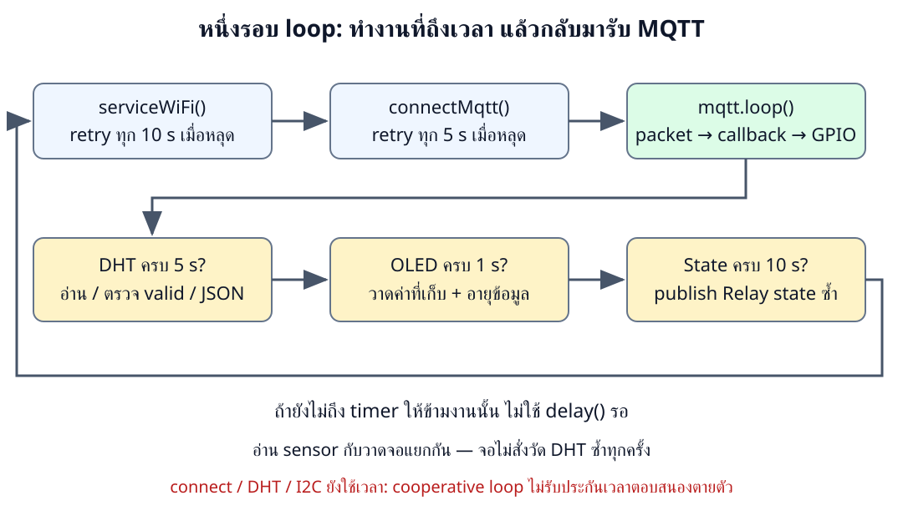

*แผนภาพสร้างเอง งานผลัดกันใน loop เดียว ไม่ใช่งานที่เริ่มพร้อมกันทุกคาบอย่างตายตัว*

| เวลาคร่าวๆ หลังเริ่ม loop | งานที่ครบ timer |
|---|---|
| ประมาณ 1 s | วาด OLED, sensor ยัง NO DATA จนถึงรอบแรก |
| ประมาณ 5 s | อ่าน DHT/publish JSON และวาดค่าที่เก็บไว้ |
| ประมาณ 10 s | อ่านรอบถัดไป, วาดจอ, ส่ง Relay state เป็นระยะ |
| ทุกรอบระหว่างนั้น | service Wi-Fi/MQTT และรับ callback ถ้ามี packet |

ตัวจับเวลาทำให้งานไม่ใช้ `delay()` ยาว แต่ไม่ได้ทำให้ทุกฟังก์ชันเป็น asynchronous: DHT/I2C ใช้เวลาติดต่ออุปกรณ์ และ `mqtt.connect()` อาจรอ DNS/TCP/CONNACK ชั่วครู่ แม้ตั้ง socket timeout แล้ว ตัวอย่างนี้เป็น cooperative scheduling ไม่ใช่ระบบรับประกันเวลาตอบสนองตายตัว

**โค้ดหลักเต็ม:**

```cpp
/*
 * Lab 07.3 : Smart Home firmware
 * คำอธิบาย : รวม DHT11, OLED, Relay 2CH และ MQTT พร้อมตรวจ valid/stale
 * วงจร     : ESP32: Relay=26/27, I2C=21/22; S3: Relay=16/17, I2C=8/9; DHT=4
 * ไลบรารี  : WiFi, PubSubClient 2.8.0, ArduinoJson 7.x, DHT, Adafruit GFX/SSD1306
 * Board    : ESP32 Dev Module หรือ ESP32S3 Dev Module (Arduino-ESP32 core 3.x)
 */
#include <Arduino.h>
#include <Wire.h>
#include <WiFi.h>
#include <PubSubClient.h>
#include <ArduinoJson.h>
#include <DHT.h>
#include <Adafruit_GFX.h>
#include <Adafruit_SSD1306.h>
#include "config.h"
#if __has_include("secrets.h")
#include "secrets.h"
#else
#include "secrets.example.h"
#endif

WiFiClient network;
PubSubClient mqtt(network);
DHT dht(DHT_PIN, DHT11);
Adafruit_SSD1306 display(OLED_WIDTH, OLED_HEIGHT, &Wire, OLED_RESET);

String relay1SetTopic, relay2SetTopic, relay1StateTopic, relay2StateTopic;
String sensorTopic, statusTopic;
bool relay1On = false, relay2On = false, displayReady = false;
bool sensorValid = false, hasValidReading = false, wifiReported = false;
float lastTemperature = NAN, lastHumidity = NAN;
unsigned long lastMqttRetry = 0, lastWiFiRetry = 0;
unsigned long lastSensorRead = 0, lastValidRead = 0, lastDisplay = 0, lastState = 0;

// Client ID แยกแต่ละบอร์ดด้วย MAC 48 บิต ไม่ใช้เป็นรหัสลับ
String makeClientId() {
  const uint64_t chip = ESP.getEfuseMac();
  char suffix[13];
  snprintf(suffix, sizeof(suffix), "%04X%08X",
           static_cast<unsigned int>(static_cast<uint16_t>(chip >> 32)),
           static_cast<unsigned int>(static_cast<uint32_t>(chip)));
  return String("home-") + STUDENT_ID + "-" + suffix;
}

// รายงานค่าที่สั่ง GPIO ไม่ใช่ sensor ตรวจหน้าสัมผัส Relay
void publishRelayStates() {
  if (!mqtt.connected()) return;
  const bool ok1 = mqtt.publish(relay1StateTopic.c_str(), relay1On ? "ON" : "OFF", true);
  const bool ok2 = mqtt.publish(relay2StateTopic.c_str(), relay2On ? "ON" : "OFF", true);
  Serial.printf("[STATE] CH1=%s CH2=%s publish=%s/%s\n",
                relay1On ? "ON" : "OFF", relay2On ? "ON" : "OFF",
                ok1 ? "ok" : "failed", ok2 ? "ok" : "failed");
}

void applyRelays(bool report) {
  digitalWrite(RELAY_1_PIN, relay1On ? RELAY_ON : RELAY_OFF);
  digitalWrite(RELAY_2_PIN, relay2On ? RELAY_ON : RELAY_OFF);
  if (report) publishRelayStates();
}

// callback ยอมรับเฉพาะ topic ของตนและคำสั่ง ON/OFF
void onMessage(char* topic, byte* payload, unsigned int length) {
  if (length > 8) {
    Serial.println("[MQTT] ignored payload length");
    return;
  }
  String message;
  for (unsigned int i = 0; i < length; ++i) message += static_cast<char>(payload[i]);
  message.trim();
  message.toUpperCase();
  if (message != "ON" && message != "OFF") {
    Serial.println("[MQTT] ignored command");
    return;
  }
  const String incoming(topic);
  if (incoming == relay1SetTopic) relay1On = message == "ON";
  else if (incoming == relay2SetTopic) relay2On = message == "ON";
  else return;
  applyRelays(true);
}

void serviceWiFi() {
  if (WiFi.status() == WL_CONNECTED) {
    if (!wifiReported) {
      Serial.printf("[WIFI] IP=%s RSSI=%d dBm\n",
                    WiFi.localIP().toString().c_str(), WiFi.RSSI());
      wifiReported = true;
    }
    return;
  }
  wifiReported = false;
  if (millis() - lastWiFiRetry >= WIFI_RETRY_MS) {
    lastWiFiRetry = millis();
    WiFi.reconnect();
    Serial.println("[WIFI] retry");
  }
}

// เว้นรอบลองใหม่; connect ยังเป็น synchronous call อาจรอเครือข่ายชั่วครู่
void connectMqtt() {
  if (WiFi.status() != WL_CONNECTED || mqtt.connected()) return;
  if (millis() - lastMqttRetry < MQTT_RETRY_MS) return;
  lastMqttRetry = millis();
  const String id = makeClientId();
  if (mqtt.connect(id.c_str(), statusTopic.c_str(), 0, true, "offline")) {
    const bool online = mqtt.publish(statusTopic.c_str(), "online", true);
    const bool sub1 = mqtt.subscribe(relay1SetTopic.c_str());
    const bool sub2 = mqtt.subscribe(relay2SetTopic.c_str());
    Serial.printf("[MQTT] connected online=%s subscribe=%s/%s\n",
                  online ? "ok" : "failed", sub1 ? "ok" : "failed", sub2 ? "ok" : "failed");
    publishRelayStates();
    lastState = millis();
  } else {
    Serial.printf("[MQTT] failed state=%d\n", mqtt.state());
  }
}

// รอบผิดพลาดส่ง null + valid=false; OLED เก็บค่าดีเก่าแต่ระบุ STALE
void readAndPublishSensor() {
  const float humidity = dht.readHumidity();
  const float temperature = dht.readTemperature();
  sensorValid = !isnan(humidity) && !isnan(temperature);
  if (sensorValid) {
    lastHumidity = humidity;
    lastTemperature = temperature;
    lastValidRead = millis();
    hasValidReading = true;
  } else {
    Serial.println("[SENSOR] NaN; previous reading is stale");
  }

  JsonDocument doc;
  if (sensorValid) {
    doc["temp"] = temperature;
    doc["hum"] = humidity;
  } else {
    doc["temp"] = nullptr;
    doc["hum"] = nullptr;
  }
  doc["valid"] = sensorValid;
  doc["uptime"] = millis() / 1000UL;
  if (hasValidReading) doc["age_s"] = (millis() - lastValidRead) / 1000UL;
  else doc["age_s"] = nullptr;
  char payload[160];
  if (measureJson(doc) >= sizeof(payload)) {
    Serial.println("[SENSOR] JSON too large");
    return;
  }
  const size_t length = serializeJson(doc, payload, sizeof(payload));
  if (mqtt.connected()) {
    const bool ok = mqtt.publish(sensorTopic.c_str(),
                                reinterpret_cast<const uint8_t*>(payload), length, false);
    Serial.printf("[SENSOR] %s publish=%s\n", payload, ok ? "ok" : "failed");
  } else {
    Serial.printf("[SENSOR] %s publish=offline\n", payload);
  }
}

// งานจอใช้ค่าที่เก็บไว้ ไม่อ่าน DHT ซ้ำทุกครั้งที่วาด
void updateDisplay() {
  if (!displayReady) return;
  display.clearDisplay();
  display.setTextColor(SSD1306_WHITE);
  display.setTextSize(1);
  display.setCursor(0, 0);
  display.printf("WiFi:%s MQTT:%s", WiFi.status() == WL_CONNECTED ? "OK" : "--",
                 mqtt.connected() ? "OK" : "--");
  display.setCursor(0, 14);
  if (!hasValidReading) display.print("Temp: --.- C");
  else display.printf("Temp: %.1f C", lastTemperature);
  display.setCursor(0, 26);
  if (!hasValidReading) display.print("Hum : --.- %");
  else display.printf("Hum : %.1f %%", lastHumidity);
  display.setCursor(0, 38);
  if (!hasValidReading) display.print("S:NO DATA");
  else {
    const unsigned long age = millis() - lastValidRead;
    const bool fresh = sensorValid && age < SENSOR_INTERVAL_MS * 2;
    display.printf("S:%s age:%lus", fresh ? "OK" : "STALE", age / 1000UL);
  }
  display.setCursor(0, 52);
  display.printf("R1:%s R2:%s", relay1On ? "ON" : "OFF", relay2On ? "ON" : "OFF");
  display.display();
}

void setup() {
  Serial.begin(115200);
  Serial.printf("[BOOT] %s DHT=%u Relay=%u/%u I2C=%u/%u\n", ESP.getChipModel(),
                DHT_PIN, RELAY_1_PIN, RELAY_2_PIN, I2C_SDA_PIN, I2C_SCL_PIN);
  // ปิด output ตั้งแต่ setup; วงจรต้องจัดการช่วงก่อน setup ด้วย
  pinMode(RELAY_1_PIN, OUTPUT);
  digitalWrite(RELAY_1_PIN, RELAY_OFF);
  pinMode(RELAY_2_PIN, OUTPUT);
  digitalWrite(RELAY_2_PIN, RELAY_OFF);
  applyRelays(false);

  Wire.begin(I2C_SDA_PIN, I2C_SCL_PIN);
  dht.begin();
  Wire.beginTransmission(OLED_ADDRESS);
  if (Wire.endTransmission() == 0) {
    displayReady = display.begin(SSD1306_SWITCHCAPVCC, OLED_ADDRESS);
    Serial.println(displayReady ? "[OLED] ready" : "[OLED] buffer/init failed; continue");
  } else {
    Serial.println("[OLED] no I2C ACK; continue without display");
  }

  const String prefix = String("home/") + STUDENT_ID;
  relay1SetTopic = prefix + "/relay/1/set";
  relay2SetTopic = prefix + "/relay/2/set";
  relay1StateTopic = prefix + "/relay/1/state";
  relay2StateTopic = prefix + "/relay/2/state";
  sensorTopic = prefix + "/sensor";
  statusTopic = prefix + "/status";
  WiFi.mode(WIFI_STA);
  WiFi.setAutoReconnect(true);
  WiFi.begin(WIFI_SSID, WIFI_PASS);
  lastWiFiRetry = millis();
  mqtt.setServer(MQTT_HOST, MQTT_PORT);
  mqtt.setCallback(onMessage);
  mqtt.setSocketTimeout(2);
  mqtt.setKeepAlive(15);
  if (!mqtt.setBufferSize(256)) Serial.println("[MQTT] buffer allocation failed");
}

void loop() {
  serviceWiFi();
  connectMqtt();
  mqtt.loop();
  const unsigned long now = millis();
  if (now - lastSensorRead >= SENSOR_INTERVAL_MS) {
    lastSensorRead = now;
    readAndPublishSensor();
  }
  if (now - lastDisplay >= DISPLAY_INTERVAL_MS) {
    lastDisplay = now;
    updateDisplay();
  }
  // ส่ง state เป็นระยะเพิ่มจากตอนรับคำสั่ง/เชื่อมใหม่ เพราะ publish ใช้ QoS 0
  if (mqtt.connected() && now - lastState >= STATE_INTERVAL_MS) {
    lastState = now;
    publishRelayStates();
  }
}
```

| บรรทัด/ส่วน | ความหมาย |
|---|---|
| `hasValidReading` | เคยได้ข้อมูลดีหรือยัง ก่อนครั้งแรก OLED เป็นขีดและ NO DATA |
| `sensorValid` | รอบ sensor ล่าสุดอ่านสำเร็จหรือไม่ |
| `lastValidRead` | เวลา millis ของข้อมูลดีล่าสุด ใช้บอกอายุ ไม่ใช่เวลาปฏิทิน |
| `null` + `valid=false` ใน JSON | แจ้งรอบผิดพลาด ไม่ส่ง NaN และไม่ปลอมเป็น 0 |
| `S:STALE` บน OLED | ค่าดีเดิมเก็บไว้ให้ดู แต่รอบล่าสุดผิดพลาดหรืออายุเกินเกณฑ์ |
| `measureJson()` + buffer 160 | ป้องกัน serialize เกิน buffer ก่อน publish |
| MQTT buffer 256 | ต้องเผื่อ topic/header เพิ่มจาก JSON; ID จึงกำหนดความยาวไว้ |
| `displayReady` | ถ้าไม่มี ACK/จอง buffer ไม่ได้ ให้ส่วนอื่นทำงานต่อโดยข้ามการวาด |
| `STATE_INTERVAL_MS` | ส่ง state ซ้ำทุก 10 s เพิ่มจากตอนรับคำสั่งและ reconnect |
| `publish=ok` / `failed` / `offline` | แยกผลส่งขั้นต้น ไม่รับรองว่าทุก subscriber ได้รับแล้ว |

**ผลลัพธ์ Serial ที่คาดหวัง** (ตัวเลขและลำดับอาจต่างกัน):

```text
[OLED] ready
[WIFI] IP=192.168.1.42 RSSI=-57 dBm
[MQTT] connected online=ok subscribe=ok/ok
[STATE] CH1=OFF CH2=OFF publish=ok/ok
[SENSOR] {"temp":28.0,"hum":61.0,"valid":true,"uptime":5,"age_s":0} publish=ok
[STATE] CH1=ON CH2=OFF publish=ok/ok
```

เมื่อ sensor อ่านผิดพลาด จะมี log และ MQTT payload ลักษณะนี้:

```text
[SENSOR] NaN; previous reading is stale
[SENSOR] {"temp":null,"hum":null,"valid":false,"uptime":15,"age_s":10} publish=ok
```

JSON อาจพิมพ์ `28` แทน `28.0` ได้ทั้งคู่เป็นเลข OLED แสดงค่าดีเก่าพร้อม STALE และอายุข้อมูล ถ้าไม่เคยมีค่าดี age_s จะเป็น null ส่วนข้อมูล sensor ไม่ retain ผู้เปิดใหม่รอรอบสด การไม่ได้รับข้อความใหม่เลยต้องตรวจ status และเวลาอัปเดตของ client ร่วมด้วย

**จุดตรวจ:** สั่ง Relay ทั้งคู่ได้จาก MQTTX, เห็น state กลับ, OLED แสดง Wi-Fi/MQTT กับ sensor และอธิบายสถานะ NO DATA/OK/STALE ได้ reported state เป็นเพียงค่าที่ firmware สั่ง GPIO ไม่ได้วัดว่าหน้าสัมผัสปิดหรือโหลดทำงานจริง

**ภารกิจท้าทาย:** เพิ่ม auto mode ใช้ hysteresis อุณหภูมิจาก Lab 05 ระบุว่าเมื่อ sensor invalid/network หลุดจะทำอะไร และแยก topic mode/set กับ mode/state ก่อนเขียนโค้ด

#### ใช้ MQTTX Desktop เป็นมอนิเตอร์แยกหมวด

ตัวโปรแกรม **MQTTX** ใช้ดูข้อความ ส่วน **EMQX** คือ broker ที่ทุกฝั่งเชื่อมร่วมกัน สำหรับสร้างตามในเครื่องใหม่ใช้ [MQTTX templateของผู้เรียน](app-blueprint/assets/mqttx-monitor.template.json) ทำสำเนาเป็นmqttx-monitor.json แล้วแทน **REPLACE-STUDENT-IDทั้ง6แห่ง** ด้วยIDสมมติเดียวกับfirmwareและแอปก่อนimport

1. เปิดMQTTXDesktop1.13.3 → **Import Data → JSON → เลือกไฟล์ → Confirm**
2. เลือก **Lab 07 · Student Monitor → ESP32 · Student Monitor → Connect** หลังimportconnectionsจะไม่ต่อเอง
3. ตรวจhost broker.emqx.io,protocol mqtt://,port1883,MQTT3.1.1,CleanSession=true,KeepAlive30s,reconnect4s,ClientIDแยกจากบอร์ด/แอปพร้อมtimestamp ไม่มีusername/passwordของWi-Fi
4. ตรวจรายการalias6หัวข้อ/4สี/QoS0ตามตารางด้านล่าง ถ้าสร้างด้วยมือใช้ **New Connection** ตั้งค่าข้อ3แล้ว **New Subscription** ทีละtopic พร้อมalias/color/QoS0ให้ครบ
5. ตัวอย่างIDในตารางใช้ของชุดผู้สอนเพื่อเทียบภาพจริงเท่านั้น [presetของผู้สอน](mqttx/lab07-s25-monitor.json) ใช้เฝ้าดูบอร์ดผู้สอน อย่านำIDนี้ไปสั่งอุปกรณ์ในงานกลุ่มอื่น

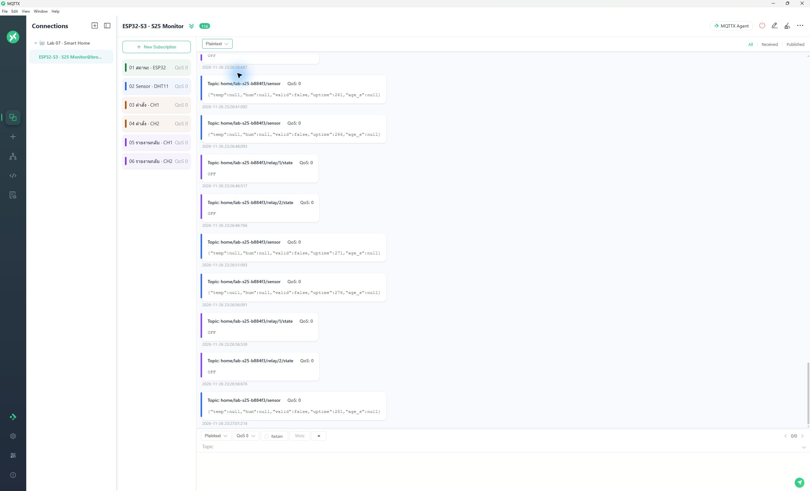

แอปยังใช้WSS8084 ส่วนMQTTXDesktopและESP32ใช้TCP1883 บนbrokerเดียวกันจึงเห็นtopicเดียวกัน เว้นช่องpublishว่างและไม่ตั้งtimed messageเพื่อใช้เป็นมอนิเตอร์ หากเคยมีretainedsetให้ล้างเฉพาะtopicของตนก่อนเริ่มตามผู้สอน

| ชื่อในรายการ subscription | Topic | หมวดสี |
|---|---|---|
| 01 สถานะ · ESP32 | home/lab-s25-b884f3/status | เขียว #15803D |
| 02 Sensor · DHT11 | home/lab-s25-b884f3/sensor | น้ำเงิน #2563EB |
| 03 คำสั่ง · CH1 | home/lab-s25-b884f3/relay/1/set | ส้ม #B45309 |
| 04 คำสั่ง · CH2 | home/lab-s25-b884f3/relay/2/set | ส้ม #B45309 |
| 05 รายงานกลับ · CH1 | home/lab-s25-b884f3/relay/1/state | ม่วง #7C3AED |
| 06 รายงานกลับ · CH2 | home/lab-s25-b884f3/relay/2/state | ม่วง #7C3AED |

1. คลิกพื้นที่แถบหมวดบริเวณ **QoS0** เพื่อกรองข้อความ กดซ้ำเพื่อล้างตัวกรอง (คลิกชื่อจะคัดลอกtopic) แล้วใช้ **All** ดูทุกทิศทางในหน้ารวม ไม่สมัคร `#` ทั้ง public broker
2. ใช้ **Plaintext** สำหรับหน้ารวม ON/OFF/online/offlineเป็นข้อความธรรมดา หากจะอ่าน sensorแบบJSON ให้กรองหัวข้อ02ก่อน แล้วเปลี่ยนคืนPlaintextเมื่อดูทุกหัวข้อ
3. ดู `status=online` ล่าสุดร่วมกับ `sensor.uptime` ที่เพิ่มทุกประมาณ5s ข้อความที่ติด Retainedอาจเป็นข้อมูลเก่า สีเขียวของconnectionเพียงยืนยันว่าMQTTXต่อbrokerได้
4. กดปุ่มในโทรศัพท์แล้วเทียบสีส้ม `/set` กับสีม่วง `/state` คำขอยังไม่ใช่ผลรายงาน และผลรายงานยังไม่ยืนยันหน้าสัมผัสจริง ให้ส่งคำสั่งโดยปิดRetainเสมอ
5. บอร์ดที่ไม่มี DHT11 จะส่ง null/valid=falseตามที่สอน ไม่ใช่0°C protocolนี้ไม่มีหัวข้อphone/status จึงเห็นคำสั่งจากแอปเมื่อมีการส่ง แต่ไม่ได้ยืนยันว่าโทรศัพท์ออนไลน์ตลอดเวลา

ดู [คู่มือสี ความหมาย payload และการนำเข้าซ้ำ](mqttx/README.md) สำหรับรายละเอียดของหน้ามอนิเตอร์

### การทดลองที่ 7.4 เตรียมสเปกสำหรับสร้างแอป React Native ด้วย OpenCode

ผลงานส่งท้ายบทนี้คือ **แอป Android ที่ผู้เรียนสร้างด้วยOpenCodeให้ตรงระบบอ้างอิง1.0.1** มีsourceที่รันแล้วและAPKให้เทียบ แต่ผลสร้างจากMarkdownของผู้เรียนต้องตรวจใหม่ เป้าหมายคือพฤติกรรม/ดีไซน์ตามสเปก ไม่ใช่แค่ติดตั้งAPKของผู้สอนแล้วนับว่าสร้างแอปสำเร็จ

| Dashboardจริง1.0.1 | Add Deviceจริง1.0.1 |
|---|---|
| 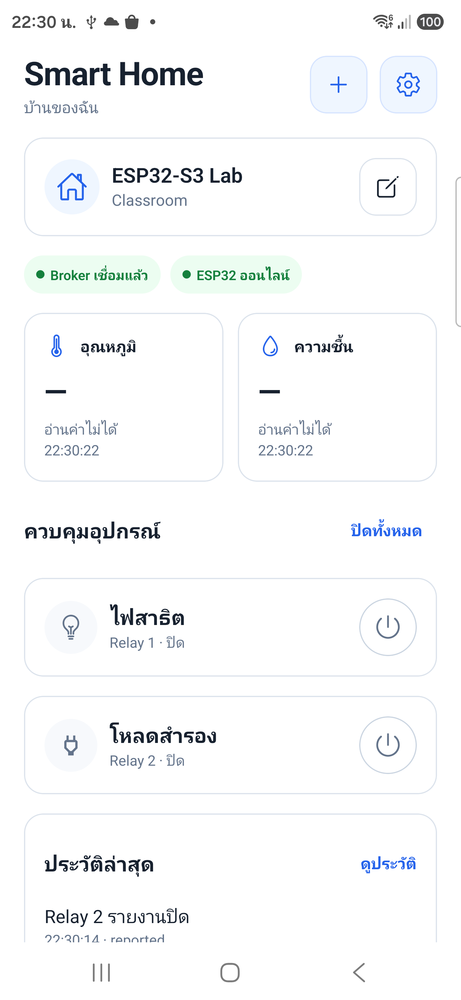 | 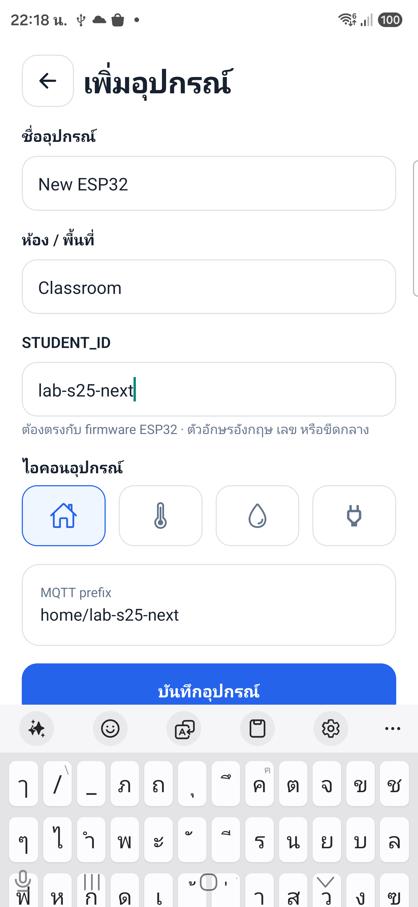 |
| Edit Deviceจริง1.0.1 | Settingsจริง1.0.1 |
| 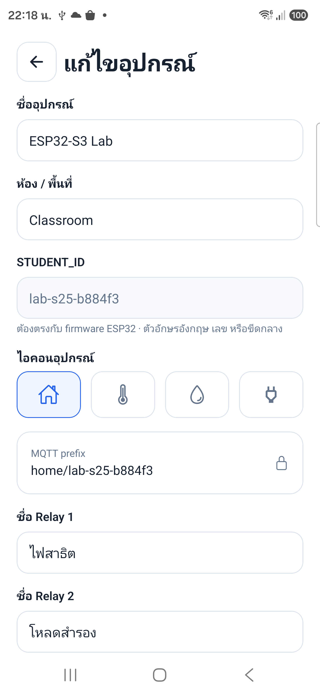 | 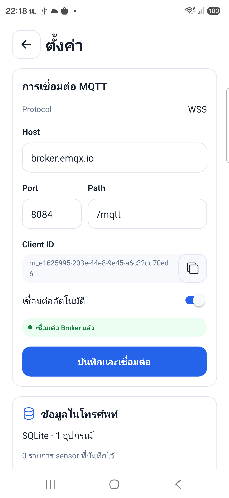 |

*ภาพจากSamsung S25 Ultraที่ติดตั้งAPK1.0.1 ข้อมูลชื่อ/IDเป็นของชุดทดลอง บอร์ดไม่มีDHT11จึงอ่านค่าไม่ได้ ฟอร์มเลื่อนได้ ภาพAIเดิมเก็บเป็น [แนวคิดก่อนปรับขอบ](app-blueprint/assets/lab07-app-four-screens-ai.png) ให้ยึดภาพจริงและสเปกปัจจุบัน ดู [ทะเบียนภาพ](../../assets/IMAGE_SOURCES.md)*

#### เริ่มจากไฟล์โจทย์ ไม่ใช่แอปสำเร็จรูป

1. เปิด [ชุดไฟล์ app-blueprint](app-blueprint/README.md) หรือดาวน์โหลด repository ผ่าน **Code → Download ZIP** แล้วแตกไฟล์บนคอมพิวเตอร์
2. สร้างโฟลเดอร์โปรเจกต์ใหม่ เช่น `D:\Projects\SmartHomeApp`
3. คัดลอก **เฉพาะ** 9 `.md` พร้อมโฟลเดอร์ `assets/` จาก `app-blueprint/` (เว้น mobile/ และ evidence/ ของแอปอ้างอิงเมื่อเริ่มโปรเจกต์ใหม่) ไปไว้ใน SmartHomeApp ให้ AGENTS/requirements/design/implementation อยู่ระดับราก
4. เปิด SmartHomeApp ใน OpenCode Desktop หรือ terminal ที่โฟลเดอร์นั้นตามการติดตั้งของผู้สอน ไม่ต้องสั่ง init ทับ AGENTS ที่เตรียมไว้
5. กำหนดชื่อโปรเจกต์,packageของกลุ่ม เช่น com.example.lab07a7f2, STUDENT_IDสมมติ เช่น lab07-a7f2c9, BOARD_TARGET=esp32หรือesp32s3 และHARDWARE_SCOPE=bare-board/full-circuit ให้ตรงกันทุกฝั่ง IDตัวอย่างของผู้สอนไม่ใช่รหัสที่ทั้งห้องใช้ร่วมกัน
6. เริ่มด้วยP0ให้อ่านไฟล์และตรวจbaselineก่อนสร้าง ผู้สอนดูแลmodel/provider/Androidenvironment ห้ามคัดลอกภาพUIเป็นปุ่มรูปภาพทั้งหน้า และห้ามใส่Wi-Fi passwordลงprompt/MD/app

| ไฟล์พร้อมนำไปใช้ | เนื้อหาที่ AI และผู้เรียนต้องอ่าน |
|---|---|
| [README.md](app-blueprint/README.md) | วิธีคัดลอกชุดสเปกและเริ่มโปรเจกต์ใหม่ |
| [AGENTS.md](app-blueprint/AGENTS.md) | บทบาท กติกา โครงสร้าง source และการรายงานผลจริง |
| [requirements.md](app-blueprint/requirements.md) | APP-01–12 และเกณฑ์ตรวจรับ |
| [design.md](app-blueprint/design.md) | ภาพจริง4หน้า/token1.0.1/navigation/สี/spacing/ขอบคม/icon/สถานะUI |
| [implementation.md](app-blueprint/implementation.md) | Phase 0–5 สำหรับงานสร้างแอปของผู้เรียน ทุกช่องยังว่าง |
| [mqtt-contract.md](app-blueprint/mqtt-contract.md) | FW-01–10/MX-01–06, broker/topic/payload/retain/freshness/การสั่งงาน |
| [data-model.md](app-blueprint/data-model.md) | SQLite, tables/migration/retention/offline data |
| [test-plan.md](app-blueprint/test-plan.md) | สิ่งที่ต้องทดสอบบนเครื่อง/Android/ESP32 และฟอร์มผลจริง |
| [opencode-prompts.md](app-blueprint/opencode-prompts.md) | Prompt สำหรับวางแผน สร้างทีละส่วน ตรวจ และแก้ปัญหา |

`implementation.md` ใน repository คอร์สติดตามงานเตรียมบทเรียน ส่วนไฟล์ชื่อเดียวกันในชุดสเปกเป็นงาน **สร้างแอปของผู้เรียน** จึงต้องคง [ ] จนกว่าผู้เรียนลงมือและตรวจจริง

#### หน้าแอปที่คาดหวังและสิ่งที่แต่ละปุ่มทำ

| หน้า | สิ่งที่เห็น | สิ่งที่ทำ |
|---|---|---|
| Dashboard — หน้าแรก | Broker/ESP32 แยกสถานะ, temp/hum, Relay 2 ช่อง, ประวัติล่าสุด | เลือกบอร์ด, กด power ON/OFF, ปิดทั้งสองช่อง, เพิ่ม/แก้ไข/ตั้งค่า, ดูประวัติ |
| Add Device | ชื่อ ห้อง STUDENT_ID ไอคอน และ prefix ที่คำนวณได้ | บันทึก profile ลงโทรศัพท์ ไม่ flash firmware/สแกน Bluetooth |
| Edit Device | ข้อมูลเดิม ชื่อ Relay 1/2, ID อ่านอย่างเดียว | แก้ label/icon ในเครื่อง หรือลบ profile โดยไม่ส่งคำสั่งเปลี่ยน Relay |
| Settings | Host/port/path WSS, auto-connect, สถานะ, SQLite/local history | บันทึกแล้ว reconnect, ล้างประวัติพร้อมยืนยัน |

เปิดแอปแล้วต้องเจอ Dashboard โดยตรง ไม่มีloginหรือหน้าบังคับกรอกค่าก่อน DB/fontsพร้อมก่อนเริ่มใช้งาน ถ้ายังไม่มีอุปกรณ์ให้มีempty stateกับปุ่มเพิ่ม ไม่มีบอร์ด/ค่า28°Cตัวอย่างติดตั้งมาเอง ใช้React Native componentsที่กดได้จริงและicon fontผ่าน@expo/vector-icons ไม่ใช้ภาพUIปิดทับหน้าจอ

| Token ที่ต้องสร้าง | ค่า1.0.1 |
|---|---|
| พื้นหลัง/การ์ด | #FFFFFF; paddingหน้า20dp,การ์ด16dp |
| ขอบ/มุม | ขอบทึบ1dp #DCE3EC; การ์ดradius16, input/button14dp |
| เงา | ไม่มีdrop shadow/blurของการ์ดหรือปุ่ม; elevation0 |
| สีหลัก/ข้อความ | accent#2563EB, selected#EFF6FF; text#17212F/secondary#64748B |
| ตัวอักษร | title27/700,heading17/600,body15/line23,secondary13,caption12,input16 |
| ปุ่ม | touchอย่างน้อย48×48dp; primaryminHeight50; กดเปลี่ยนพื้น#1D4ED8แทนลดopacityจนขอบจาง |
| Icon font | Ionicons(home/thermometer/water/bulb/power), MaterialCommunityIcons(power-plug-outline) โหลดfontก่อนrender |

Add/Editใช้ฟอร์มเลื่อนพร้อมkeyboard resize; Back/Cancelถ้าข้อมูลdirtyต้องยืนยันก่อนทิ้ง STUDENT_IDหน้าEditอ่านอย่างเดียว ประวัติ/เลือกบอร์ดเป็นbottom sheet ไม่เพิ่มloginหรือbottom navigationที่โจทย์ไม่ได้ใช้

ใช้ React Native + Expo + TypeScript โค้ดที่จะสร้างอยู่ใน `mobile/` เพื่อไม่ทับไฟล์สเปก SQLite ผ่าน `expo-sqlite` เก็บ profile, connection settings, sensor history และ command/event history เป็นหลักในโทรศัพท์ ไม่ใช้ cloud database เป็นเงื่อนไขทำงานหลัก และไม่เก็บ Wi-Fi password ของ ESP32 ในแอป

#### ข้อมูลและข้อจำกัดที่AIต้องสร้างให้ครบ

| เรื่อง | เงื่อนไขตามแอปอ้างอิง |
|---|---|
| Profiles | สูงสุด5บอร์ด,ชื่อ1–40/ห้อง0–40/ชื่อRelay1–30หลังtrim, ID1–24ASCII[A-Za-z0-9-]+ไม่ซ้ำแบบแยกตัวพิมพ์ |
| SQLite | schema2/migration/parameterizedSQL/write queue+transaction; settings/devices/samples/snapshots/commands/events |
| Retention | sensor10,000แถวต่อบอร์ดและไม่เกิน7วัน, commands1,000/events500; ที่ทุก5sจะถึง10,000ในราว13ชม53นาที ไม่รับรองเก็บครบ7วัน |
| History UI | อ่านsensorล่าสุด60/commands50/events50มารวม; Dashboardแสดงcommand/event3รายการ ไม่renderทั้งDBทุกครั้ง |
| Cache/live | cacheและretainedใช้แสดงข้อมูลเก่า ไม่เปิดcontrols; sensorfreshnessมีtimerแยกจากstateของบอร์ด |
| Pending | 8sต่อช่อง, matchedเฉพาะstateไม่retainedที่รับหลังส่งจริงและตรงค่า; publish callbackไม่ใช่ACKหน้าสัมผัส |
| Local actions | เปลี่ยนชื่อ/ลบprofile/ล้างประวัติไม่publish; ล้างsamples/commands/eventsทุกprofile คงsettings/profiles/relay cache |
| Lifecycle | background/disconnectยกเลิกpending, foregroundเริ่มsessionใหม่ ไม่queue/replayคำสั่งและไม่เก็บข้อมูลbackgroundแบบรับประกัน |

การลบแอป/Clear app dataเสี่ยงเสียข้อมูลlocal ไม่มีcloud sync/backupข้ามเครื่องในตัว ไม่มีphone/status/BLE provisioning/OTA/auto-modeในรุ่นนี้ หากต้องเพิ่มให้เป็นงานต่อยอดพร้อมcontract/testใหม่

#### ค่าที่ต้องตรงกันระหว่างแอป MQTTX และ firmware

| รายการ | ค่าตัวอย่าง/พฤติกรรม |
|---|---|
| Broker ฟรี | EMQX `broker.emqx.io` |
| แอป React Native + MQTTX Web | `wss://broker.emqx.io:8084/mqtt` |
| ESP32 | `broker.emqx.io:1883` TCP ตาม firmware ด้านบน |
| MQTTX Desktop | TCP1883/MQTT3.1.1; 6exact topics/4สี ส่วนแอปsubscribe4topicsต่อบอร์ด |
| MQTTX | เป็น client สำหรับตรวจข้อความ ไม่ใช่ตัว broker และไม่จำเป็นต้องเปิดค้าง |
| STUDENT_ID | เช่น `desk-a7f2`, 1–24 ASCII ตัวอักษร/เลข/ขีดกลาง ตรง firmware ทุกตัว |
| Prefix ของบอร์ด | `home/desk-a7f2` คำนวณจาก ID |
| คำสั่ง | ON/OFF ไป `/relay/1/set` หรือ `/relay/2/set`, QoS0, retain=false |
| รายงาน | `/relay/1/state`, `/relay/2/state`, `/sensor`, `/status` |
| Client ID | แอปสุ่มแยกต่อการติดตั้ง ห้ามซ้ำ ESP32/MQTTX |
| Offline | อ่านข้อมูล local ได้ แต่ไม่ queue หรือ replay คำสั่ง Relay |

1. ครั้งแรกเพิ่มชื่อ/ห้อง/ID ลงเครื่องได้แม้ยังไม่มีเน็ต ID ต้องตรงกับ `secrets.h` ใน firmware และไม่ซ้ำกับบอร์ดที่บันทึกไว้
2. แอปต่อ broker ผ่าน WSS แล้ว subscribe topic ของบอร์ดนั้น การเห็น “Broker เชื่อมแล้ว” ยังไม่รับรองว่าบอร์ดออนไลน์
3. รอ packet live ของ sensor/state ที่ schema ถูกต้องเพื่อยืนยันความสด ข้อมูล retained/cache แสดงพร้อมป้าย “รอยืนยัน/ข้อมูลล่าสุดที่บันทึก” ไม่เปิดปุ่มจาก retained online อย่างเดียว
4. กด ON/OFF → ส่ง `/set` → ESP32 ตรวจคำสั่ง/เขียน GPIO → ส่ง `/state` → แอปอัปเดตรายงานและเก็บประวัติ ถ้าไม่เห็น state ตรงภายใน 8 s แจ้งว่ายังไม่พบรายงาน ห้ามเปลี่ยนเหมือนสำเร็จจากปุ่มเพียงอย่างเดียว
5. เมื่อไม่มี packet live เกิน 15 s หรือ offline ให้ปิด controls ข้อมูลเก่ายังอ่านได้พร้อมเวลา sensor valid=false ต้องเป็น “อ่านค่าไม่ได้” ไม่แปลง null เป็น 0
6. ปิด/เปิดแอปแล้วชื่อ/ประวัติอยู่ แต่ connection/pending ต้องเริ่มรอยืนยันใหม่ ไม่ส่งคำสั่งค้างออกไป SQLite เป็นประวัติหลัก; broker retain ไม่ใช่ฐานประวัติของแอป
7. จำกัด sensor ล่าสุด 10,000 แถวต่อบอร์ดและอายุไม่เกิน 7 วัน (ถึงข้อใดก่อนลบก่อน), commands 1,000, events 500 ต่อบอร์ด เพื่อไม่ให้ข้อมูลโตไม่จำกัด

**จุดตรวจของช่วงเตรียม:** มีไฟล์ `.md` 9 ไฟล์และภาพครบในโฟลเดอร์ใหม่ อธิบายได้ว่าข้อมูลใดอยู่ในโทรศัพท์ ข้อมูลใดเดินผ่าน broker และการเพิ่ม profile ไม่ได้เปลี่ยน firmware

**ภารกิจท้าทาย:** วาด flow ของ “กดปุ่มแต่ state ไม่กลับ” แล้วระบุว่าหน้าจอ ประวัติ และ Relay จริงอาจมีสถานะใดได้บ้าง

### การทดลองที่ 7.5 ให้ OpenCode สร้างแอปเป็นช่วงกับผู้สอน

ขั้นนี้ใช้ **ภาพจริง4หน้าและสเปก1.0.1** เป็นเป้าหมาย ผู้เรียนเปิดOpenCodeที่โฟลเดอร์สเปกเพื่อสร้างsourceของตน มี [ภาพ/แนวทางสร้างเอง](app-blueprint/mobile/README.md) และ [APK1.0.1](https://github.com/sunanedu/ESP32-LAB/raw/refs/heads/main/downloads/esp32-smart-home-preview-1.0.1.apk) ให้ติดตั้งเทียบได้ แอปอ้างอิงสร้างด้วยCodexตามสเปกเดียวกัน ไม่อ้างว่าได้รันOpenCodeแทนผู้เรียนแล้ว


*ภาพ APK1.0.1 standalone บน Samsung S25 Ultra เชื่อม ESP32-S3 จริง ขอบการ์ด/ปุ่มไม่มีเงาฟุ้ง รอบตรวจมีเฉพาะบอร์ดจึงแสดง DHT11 อ่านค่าไม่ได้ และรายงาน GPIO โดยไม่มี Relay/โหลดต่ออยู่ ดู [ภาพ4หน้าและวิธีรัน](app-blueprint/mobile/README.md) กับ [ผลตรวจและข้อจำกัดจริง](app-blueprint/mobile/PHYSICAL_TEST_RESULTS.md)*

#### เตรียมเครื่องตาม baseline ที่ผ่านจริง

| ส่วน | รุ่น/ค่าที่ใช้สร้างแอป1.0.1 |
|---|---|
| Node/npm/JDK | 24.19.0 / 11.17.0 / JDK17 |
| Expo/React/React Native | 58.0.26 / 19.3.0 / 0.88.1 |
| TypeScript/MQTT.js | 6.0.3 / 5.16.1 |
| SQLite/Crypto/Font | expo-sqlite58.0.18 / expo-crypto58.0.8 / expo-font58.0.12 |
| Clipboard/StatusBar | expo-clipboard58.0.4 / expo-status-bar58.0.5 |
| Icons/Safe area | @expo/vector-icons15.1.1 / react-native-safe-area-context5.11.1 |
| Native Android | compileSdk37/targetSdk36/minSdk24,Gradle9.4.1,NDK27.1.12297006 |
| Windows CMake/Ninja | 3.31.6 / 1.12.1, native buildในpathสั้น, CMAKE_OBJECT_PATH_MAX=240 |

ตัวเลขนี้เป็นenvironmentที่ตรวจจริง ไม่ใช่คำรับรองว่าlatestทุกตัวเข้ากัน ตั้งJAVA_HOME/ANDROID_HOMEของเครื่องตน ติดตั้งSDK/JDK/NDK/CMakeตามbuildต้องใช้และยอมรับlicenseตามขั้นตอนปกติ ไม่คัดลอกpathโปรไฟล์ผู้สอน ถ้าเครื่องไม่มีไดรฟ์Dให้ใช้pathสั้นเช่นC:\Bแทนตัวอย่างD:\BuildCache

**ถ้ายังไม่มีเครื่องมือ Android:** ติดตั้ง [Android Studio](https://developer.android.com/studio) แล้วเปิด **Tools → SDK Manager** จด **Android SDK Location** ไว้ ในแท็บ **SDK Platforms** เลือก API37 ตาม compileSdk ของแอปอ้างอิง ส่วน **SDK Tools** ให้มี Platform-Tools, Build-Tools, Command-line Tools, NDK27.1.12297006 และ CMake3.31.6; เพิ่ม Emulator เมื่อจะใช้เครื่องจำลอง กด Apply แล้วอ่าน/ยอมรับ license ตามที่เครื่องมือแสดง รุ่นที่เลือกอิง baseline ของบทนี้ ดู [วิธีจัดการ SDK ทางการ](https://developer.android.com/studio/intro/update#sdk-manager)

ติดตั้ง JDK17 แล้วเปิด Windows **Edit environment variables for your account** ตั้ง `JAVA_HOME` เป็นโฟลเดอร์ JDK และ `ANDROID_HOME` เป็น SDK Location เพิ่ม `%JAVA_HOME%\bin` และ `%ANDROID_HOME%\platform-tools` ใน user Path โดยเก็บรายการเดิมไว้ เปิด terminal ใหม่แล้วตรวจคำสั่งด้านล่าง ถ้าไม่พบ adb ให้แก้ Path ก่อนเริ่มสร้าง APK ดู [คู่มือตั้งค่า Windows ของ Expo](https://docs.expo.dev/workflow/android-studio-emulator/)

```powershell
node --version
npm --version
java -version
adb version
```

1. ตรวจ `node --version`, `npm --version`, `java -version`, `adb version` และOpenCode/model providerของตน บันทึกเลขรุ่น/lockfileก่อนเริ่ม ไม่ใส่provider API keyในโครงการสาธารณะ
2. เริ่มด้วย prompt นี้ในโฟลเดอร์ SmartHomeApp:

```text
อ่าน AGENTS.md, README.md, requirements.md, design.md, implementation.md,
mqtt-contract.md, data-model.md, test-plan.md และ opencode-prompts.md
สรุปโจทย์ React Native Android 4 หน้าและการเก็บข้อมูลบนโทรศัพท์
ตรวจ environment/dependencies และทำตาราง APP-xx → งาน → test ID
ยึดbaseline1.0.1 ภาพจริง4หน้า FW-01–10 และMX-01–06
ใช้PROJECT_NAME/ANDROID_PACKAGE/STUDENT_ID/BOARD_TARGET/HARDWARE_SCOPEของกลุ่ม
ให้แผนก่อน ยังไม่สร้างแอปหรือทำเครื่องหมายว่างานเสร็จ
```

3. ตรวจว่าแผนไม่เปลี่ยนไปใช้ dashboard สำเร็จรูป/cloud database หรือข้าม MQTT contract แล้วใช้ prompt P1–P5 จากไฟล์ที่เตรียมไว้ทีละช่วง
4. ทำ Phase ตามตาราง ตรวจ diff เปิดแอปและจดผลก่อนขยับ ไม่ให้คำว่า “เสร็จแล้ว” จาก AI มาแทนหลักฐานรันจริง

| Phase | งานของผู้เรียนกับ OpenCode | จุดที่ต้องตรวจ |
|---|---|---|
| 0 | อ่านสเปก ตรวจbaseline/ID/target/ขอบเขต | APP/FW/MXและแผนทดสอบ |
| 1 | Scaffold mobile/, theme, 4 หน้า/navigation | เปิด Dashboard และกดนำทางได้จริง ใช้ mock ที่ระบุชัด |
| 2 | SQLite/CRUD/history/retention | ปิดเปิดใหม่ข้อมูลยังอยู่, Cancel/ลบไม่ publish |
| 3 | MQTT service/parser/freshness/lifecycle | client เดียว, WSS ถูก, retained ไม่กลายเป็น live, ไม่ queue คำสั่ง |
| 4 | Monitor/Relay/reported state/pending/timeout | กดส่งไม่เปลี่ยน reported ล่วงหน้าและมีผลรายช่อง |
| 5a | Firmware/MQTTX6topics/4สี | IDตรงกัน/online+uptimeจริง/ไม่มีmockไปทับบอร์ด |
| 5b | StandaloneAPK/Android/end-to-end/หลักฐาน | ปิดMetroแล้วเปิดได้ TEST_RESULTSเป็นผลจริงหรือยังไม่ทดสอบ |

#### เริ่มสร้างsourceจากโจทย์

1. หลังP0 ให้OpenCodescaffoldในmobile/โดยยังไม่install เพื่อเลือกbaselineก่อน ตัวอย่างคำสั่งจากrootโปรเจกต์:

```powershell
npx create-expo-app@latest mobile --template blank-typescript --no-install --no-agents-md
```

2. ให้AIตั้งdependenciesตามตาราง/requirementsก่อนinstall เก็บpackage-lockจริง หากtemplateรุ่นใหม่ใช้SDKต่างกันให้แก้โดยตรวจcompatibility ไม่อัปเกรดทั้งชุดเงียบๆ `--no-agents-md` รักษาคำแนะนำAGENTSที่เตรียมไว้ ตรวจ `--help` หากCLIรุ่นที่ใช้ไม่มีflagนี้
3. ใช้P1ให้สร้างApp.tsx/context/theme/components/DeviceForm/Dashboard/Settingsก่อน ตามด้วยP2SQLite schema2, P3MQTTservice/parser, P4pending/timeout และP-FW/P-MX/P-APKในชุดprompts ไม่รวมSQL/MQTTไว้ทุกscreen
4. MQTT.jsต้องรันบนRNnativeWSS ตั้งprotocolVersion4,clean=true,queueQoSZero=false,resubscribe=false,forceNativeWebSocket=true,manualConnect=true,reconnect2000ms/connectTimeout12000ms/keepalive15s ลงlistenersก่อนconnect แล้วservice subscribe4topicsต่อบอร์ด
5. เปิดappครั้งแรกเพิ่มprofile IDตรงfirmware ตั้งSettingshost=broker.emqx.io/port8084/path/mqtt/autoConnect รอsubscribeackและpacketสด<15sกับstateของช่องในsessionนี้ก่อนเปิดcontrols; cached/retainedonlineอย่างเดียวใช้สั่งไม่ได้

#### Build APK และติดตั้งให้เหมือนรอบที่ทดสอบ

1. ให้AIสร้างscripts typecheck/lint/test/export:android/build:apk และไฟล์ `scripts/build-android.ps1` (องค์ประกอบที่ผู้เรียนพัฒนาเอง; source อ้างอิงเก็บสำหรับผู้สอน) กับ `plugins/with-short-cmake-path.cjs` (องค์ประกอบที่ผู้เรียนพัฒนาเอง; source อ้างอิงเก็บสำหรับผู้สอน) ตามพฤติกรรมอ้างอิง หรือดาวน์โหลดสองไฟล์นี้ไว้ตำแหน่งเดียวกันในmobileของตน
2. app.jsonตั้งlight/portrait/keyboard resize/packageของกลุ่ม และplugins expo-sqlite/expo-font/./plugins/with-short-cmake-path.cjs โหลดIoniconsและMaterialCommunityIconsด้วยuseFontsก่อนrender
3. helperสร้างสำเนาsource+node_modulesไปpathสั้นที่เลือก เว้นandroid/ios/.expo/dist/coverage/.git แล้วprebuildในสำเนา ใช้CMake3.31.6/Ninja1.12.1 และpluginตั้งOBJECT_PATH_MAX240 ไม่ย้าย/ลบsourceเดิมหรือแก้generatedGradleที่prebuildจะทับ
4. จากmobile/ตรวจโค้ดและbuildReleaseสำหรับarm64-v8a/x86_64ซึ่งรวมJS/Hermes/fonts:

```powershell
npm run typecheck
npm run lint
npm test
npm run export:android
./scripts/build-android.ps1 -Mode Release -BuildRoot D:\BuildCache
```

5. เปิดDeveloper options/USB debuggingบนAndroid เสียบสายdataและอนุญาตRSAบนโทรศัพท์เอง ตรวจ `adb devices -l` ต้องเป็นdevice ไม่ใช่unauthorized แล้วติดตั้งAPKที่helpercopyกลับมา:

```powershell
adb -d install -r dist/apk/esp32-smart-home-release.apk
```

6. ถ้าUSBหลายเครื่องใช้ `adb -s <serialของตน>` แทน-d อย่าใช้serialเครื่องผู้สอน ปิดMetroแล้วเปิดappจากlauncher จึงนับว่าstandaloneผ่าน ถ้าsignature/packageไม่ตรงให้ใช้keyเดิมหรือpackageใหม่ ไม่uninstallอัตโนมัติเพื่อแก้เพราะข้อมูลlocalอาจหาย
7. ทดสอบเพิ่ม/แก้ไข/Cancel/Settings/history/force-stopและcommandกับMQTTXตาม7.6 APKอ้างอิงเป็นReleaseที่ใช้test signing key ไม่ใช่store-signed production การbuild/เซ็นใหม่ไม่จำเป็นต้องได้SHA256เท่ากับไฟล์ที่ผู้สอนเผยแพร่

#### ทดลอง APK ก่อนสร้างของตน

ดาวน์โหลด [APK พื้นฐาน](../../downloads/README.md) เพื่อดูหน้าตาและเทียบพฤติกรรม โครงการสาธารณะไม่แจก source แอปสำเร็จ ผู้เรียนสร้างโปรเจกต์ใหม่จากชุด Markdown ตามขั้นตอนด้านบน ใช้ source/ผลทดสอบของตนเป็นหลักฐานส่งงาน

### การทดลองที่ 7.6 ตรวจรับมินิโปรเจกต์ React Native + ESP32

ใช้รายการเต็มใน [test-plan.md](app-blueprint/test-plan.md) ตารางนี้เป็นใบงานสรุปที่อ่านได้ในหน้าเดียว ยังไม่ใช่ผลรับรองแอปจริง ทุกการแก้วงจรให้ถอดไฟก่อน ใช้โหลด LED DC เท่านั้น

#### ใช้ผลอ้างอิงอย่างไร

อ่าน [รายงาน Samsung/ESP32-S3 จริง](app-blueprint/mobile/PHYSICAL_TEST_RESULTS.md) คู่กับ [ผล automated/emulator](app-blueprint/mobile/TEST_RESULTS.md) และ [ผลตั้ง MQTTX](mqttx/README.md) ก่อนเริ่ม ไม่เติมช่องผลของผู้เรียนจากรายงานผู้สอน

| หลักฐานของแอปอ้างอิง 1.0.1 | ใช้อ้างได้ถึงไหน |
|---|---|
| 19 unit tests, 5 Samsung UI checks, 11 MQTT/runtime cases กับบอร์ดจริง | ตรวจ parser/storage/state และพฤติกรรมที่ระบุในรายงาน แต่ไม่แทนการรันบนโปรเจกต์ใหม่ |
| Lab07 3 sketches × 2 targets compile ผ่าน | ยืนยัน ESP32/S3 build ได้ ไม่ยืนยันวงจรหรือ sensor จริง |
| Samsung S25 Ultra Android17 + ESP32-S3 เปล่า | เปิด APK โดยไม่ใช้ Metro, ข้อมูล local, invalid sensor, reported GPIO, reconnect/timeout/LWT ตามหลักฐาน |
| MQTTX Desktop1.13.3 | นำเข้าชุดผู้สอน, 6 topics/4สี, online/heartbeat/state จากบอร์ดจริง; รอบตั้งมอนิเตอร์ยังไม่ได้กด OFF จากโทรศัพท์เพราะหน้าจอล็อก |
| ยังต้องตรวจเพิ่ม | DHT ปกติแล้วขัดข้อง, OLED, หน้าสัมผัส Relay/โหลด, ตัดไฟจริงแทนค้าง EN, โทรศัพท์หลุด Wi-Fi ระหว่าง pending, ล้างประวัติ/ลบบน Samsung, TalkBack และ endurance |

เมื่อมีเพียงบอร์ด ให้กรอก `HARDWARE_SCOPE=bare-board` และระบุการทดสอบที่ต้องใช้โมดูลว่า “ยังไม่ทดสอบ” เมื่อมีวงจรครบจึงตรวจ `full-circuit` เพิ่ม การเห็น `valid=false` บนบอร์ดเปล่าเป็นผลที่ถูกต้อง ไม่แก้ firmware ให้สร้างเลขอุณหภูมิสมมติ

| กรณี | วิธีทดสอบ | ผลที่ต้องเห็น | ผลจริง/หลักฐาน |
|---|---|---|---|
| First launch | เริ่มแอป DB ว่าง | Dashboard/empty state ไม่มี login | ____ |
| Add/Edit | เพิ่ม ID แล้วแก้ label/ยกเลิก/IDซ้ำ | บันทึกเฉพาะค่าถูก, Cancel ไม่เขียน, duplicate ถูกปฏิเสธ | ____ |
| Persistence | force-stop แล้วเปิดแอป | profile/settings/history ยังอยู่ แต่ controls รอยืนยัน | ____ |
| MQTT สอง client | แอปต่อ WSS, MQTTX subscribe prefix ตน | Broker connected แยกจาก ESP32 presence | ____ |
| คำสั่งสองช่อง | ส่ง ON/OFF จากแอป | set ใน MQTTX, Serial รับ, state กลับ, UI/โหลดตรง | ____ |
| สั่งจาก MQTTX | ส่งคำสั่งโดยไม่กดในแอป | แอปรับ reported state แล้วเปลี่ยนตาม | ____ |
| Pending/timeout | ทดสอบ mock/เครือข่ายขาดทำ state ไม่กลับ | ไม่แสดงสำเร็จล่วงหน้า timeout8s และไม่ replay | ____ |
| Sensor invalid | ถอดไฟ ถอด DATA แล้วเปิดใหม่ | null/valid=false, แอปอ่านค่าไม่ได้ ไม่ปลอม0 | ____ |
| Retained เก่า | เปิดแอปขณะบอร์ดดับแต่มี cache | รอยืนยัน/ข้อมูลเก่า ปุ่ม disabled | ____ |
| Network/lifecycle | ปิดเน็ต/background แล้วกลับมา | อ่าน local ได้ reconnect แบบไม่สร้าง client/คำสั่งซ้ำ | ____ |
| Reset/LWT | MQTTX ยังต่อแล้วถอด/ต่อไฟบอร์ด | offline หลังตรวจพบ, Reset RelayOFF, แอปรอข้อมูลสด | ____ |
| Local actions | ล้างประวัติ/ลบ profile | ข้อมูล local เปลี่ยนตามที่แจ้ง ไม่มีคำสั่ง Relay ส่งเอง | ____ |
| Android UI | ทดสอบ 360dp/keyboard/font scaling | ปุ่มอ่าน/กดได้และฟอร์มเลื่อนได้ทุกหน้า | ____ |
| OLED ไม่มี | ถอดไฟ ถอดจอ เปิดใหม่ | firmware log no ACK; sensor/MQTT ส่วนอื่นยังทำงาน | ____ |

ผล unit test/mock, Android runtime และ hardware end-to-end ต้องแยกกัน หากยังไม่มีอุปกรณ์ให้ระบุกรณี hardware ว่า “ยังไม่ทดสอบ” ห้ามนำภาพ AI หรือ log คาดหวังมาใส่เป็นหลักฐานผ่าน

ใน firmware นี้ **Reset แล้ว Relay OFF**, **network หลุดแล้วคง state**, และ **sensor invalid ไม่เปลี่ยน Relay** เป็นนโยบายของโหลด LED สาธิต reported state เป็นค่าที่สั่ง GPIO ไม่ยืนยันหน้าสัมผัสหรือโหลดจริง หากต่อยอด auto mode ต้องออกแบบ fault policy ใหม่

#### ข้อจำกัดที่ต้องบอกในผลงาน

| ขอบเขต | ความหมายต่อการใช้งาน |
|---|---|
| Public broker / QoS0 | ไม่มีความเป็นส่วนตัวหรือสิทธิ์เฉพาะ topic ในชุดนี้ ข้อความอาจสูญหาย ห้ามใช้กับข้อมูลส่วนตัว/ระบบควบคุมสำคัญ |
| Pending8s / รายงาน GPIO | timeout ไม่รับรองว่า ESP32 ไม่ได้สั่ง GPIO; คำสั่งไม่มี request ID ใน payload จึงไม่ใช่ causal ACK ห้าม retry/rollback อัตโนมัติ |
| Presence15s / retained | online หรือ state ที่ retained อาจเก่า ต้องได้ packet live ใน session ปัจจุบัน; MQTTX ไม่มี topic presence ของโทรศัพท์จึงไม่ยืนยันว่ามือถือเปิดอยู่ |
| โทรศัพท์ background | รุ่นนี้ปิด MQTT เมื่อเข้า background แล้วเชื่อมใหม่เมื่อกลับมา ไม่มี foreground/background service และไม่มีคำสั่ง offline ค้างส่ง |
| ข้อมูล local | สูงสุด5 profiles; sample10,000แถวหรือ7วันต่อบอร์ด แล้วแต่ถึงก่อน ส่งทุก5sจะเต็มโควตาแถวในประมาณ13ชม.53นาที จึงไม่รับประกันเก็บครบ7วัน |
| APK Preview | ใช้ signing key สำหรับทดสอบ; ยังไม่ใช่ Play Store release เปลี่ยน package/key ต้องพิจารณาข้อมูลเดิมก่อนติดตั้ง ไม่สั่ง uninstall อัตโนมัติ |

ส่งงานพร้อม version/commit, IDสมมติ, board/pins, hardware scope, ผล T/H/R ตาม test-plan, ภาพจริง4หน้า, log MQTTX/Serial และรายการ “ยังไม่ทดสอบ” ของตน แยกจากภาพอ้างอิงและผลผู้สอนเสมอ

## 🛠️ Troubleshooting

| อาการ | สาเหตุที่เป็นไปได้ | วิธีแก้ |
|---|---|---|
| OLED ดำสนิท | address/ขั้ว/ไฟผิด | รัน I2C scanner ตรวจ 0x3C, ESP32 ใช้ SDA21/SCL22 แต่ S3 ใช้ SDA8/SCL9 ตาม config; ตรวจ VCC/GND |
| Compile ไม่พบ `Adafruit_SSD1306.h` | ยังไม่ติดตั้งไลบรารี/dependency | ติดตั้ง Adafruit SSD1306 และ GFX ผ่าน Library Manager |
| DHT คืน NaN ต่อเนื่อง | ขา DATA/VCC ผิด, ไม่มี pull-up, อ่านถี่ | ตรวจ GPIO4, เพิ่ม 10kΩ สำหรับ sensor เปล่า และเว้น ≥2 วินาที |
| Relay เปิดตอน boot | ขา input ลอยก่อน setup หรือระดับลอจิกไม่เข้ากัน | ตรวจ 3.3V compatibility, input bias/driver และวัดช่วง boot; firmware OFF อย่างเดียวไม่รับประกันช่วงก่อน setup |
| Relay ทำให้ ESP32 reset | แหล่งจ่ายตก/noise จากโหลด | แยกไฟโหลดอย่างเหมาะสม ใช้ common GND และ decoupling; โหลด DC ต่ำเท่านั้น |
| แอปต่อ broker ไม่ได้ | host/port/path หรือ Client ID ผิด | แอป React Native ชุดนี้ใช้ WSS8084 path /mqtt; ตรวจ runtime ของ MQTT.js และ Client ID |
| กดปุ่มแต่ Relay ไม่เปลี่ยน | offline/stale หรือ topic/payload ไม่ตรง | ตรวจเหตุผล disabled, /set ON/OFF และ log ผ่าน MQTTX; ไม่แก้ UI ให้ดูสำเร็จปลอม |
| App แสดง state ไม่ตรง | App แสดงค่าจากปุ่มแทน `/state` | subscribe reported state และให้ firmware publish retain หลังเขียน GPIO |
| Sensor ไม่แสดงเลข | schema ผิด หรือ valid=false/stale | ดู JSON ใน MQTTX และ parser; แยก null/ข้อมูลเก่าจาก 0 |
| หลุดแล้วไม่กลับมา | มี `delay()` ยาวหรือไม่เรียก `mqtt.loop()` | ใช้ `millis()`, reconnect เป็นช่วง และให้ loop หมุนต่อเนื่อง |
| S3 compile/ต่อวงจรไม่ตรง | เลือก target หรือใช้ขา WROOM กับ S3 | ตรวจชื่อชิปจริง เลือก esp32s3 และ mapping4/16/17/8/9; ห้ามใช้ขา Flash/PSRAM ของบอร์ด |
| MQTTX แสดง SyntaxError เมื่อรับ OFF/online | เลือก JSON กับทุกข้อความ | หน้ารวมใช้ Plaintext; กรอง sensor อย่างเดียวจึงใช้ JSON แล้วสลับกลับเมื่อดูรวม |
| MQTTX เห็นเพียง topic เดียว/คลิกชื่อแล้วไม่กรอง | มี subscription filter หรือคลิก alias ซึ่งเป็นปุ่ม copy | คลิกพื้นที่ว่างของแถว/QoS0 เพื่อเปิดหรือปิด topic filter; ปุ่ม All กรองทิศทางข้อความ ไม่ได้ล้าง topic filter |
| Broker connected แต่ปุ่มแอปยัง disabled | ID ไม่ตรง, ได้เพียง retained/cache หรือ state ยังไม่สด | ตรวจ ID ให้ตรงสามฝั่ง รอ live sensor/state และ state ของช่องนั้นใน session ใหม่ ไม่ใช้การกด ON เป็นวิธีตรวจ presence |
| Windows build fail ที่ Ninja/ชื่อ path ยาว | native/CMake path ยาวหรือเวอร์ชันไม่ตรง | ใช้ helper สร้างสำเนาที่ D:\AI\e32-build หรือ C:\B, plugin CMake3.31.6/OBJECT_PATH_MAX240 ตามขั้น 7.5; ไม่ย้ายหรือลบ source เดิม |
| APK เปิดแล้วหา Metro | ติดตั้ง development/debug APK | build assembleRelease ด้วย helper แล้วติดตั้งไฟล์ dist/apk/esp32-smart-home-release.apk ปิด Metro และลองเปิดใหม่ |
| INSTALL_FAILED_UPDATE_INCOMPATIBLE | package เดียวแต่ signing key ต่าง | ใช้ package ของผู้เรียนแยก หรือจัดการ key/สำรองข้อมูลก่อนเปลี่ยนแอป ไม่แก้ด้วยการถอนแอปเดิมอัตโนมัติ |

## 🔍 คำถามค้นคว้าหลังเรียน

1. SQLite migration และ retention ช่วยให้แอปเก็บข้อมูลระยะยาวอย่างไร? **🔎 คำค้นแนะนำ:** `Expo SQLite migration`, `SQLite data retention`
2. การแบ่ง prompt/Phase และให้ AI อ่าน AGENTS.md ส่งผลต่อการตรวจงานอย่างไร? **🔎 คำค้นแนะนำ:** `OpenCode project instructions`, `AI coding acceptance criteria`
3. Android lifecycle มีผลต่อ MQTT และคำสั่งที่ค้างเมื่อกลับเข้าแอปอย่างไร? **🔎 คำค้นแนะนำ:** `React Native AppState MQTT`, `MQTT.js queueQoSZero`
4. ถ้าเปลี่ยนจาก public broker เป็นระบบใช้งานจริง ต้องออกแบบ identity/ACL/ข้อมูล local อย่างไร? **🔎 คำค้นแนะนำ:** `MQTT TLS topic ACL`, `Expo SecureStore credentials`

## 📝 แบบทดสอบหลังเรียน

**ข้อ 1 (ง่าย)** แหล่งเก็บ profile/settings/history หลักของแอปในมินิโปรเจกต์นี้คืออะไร?

- ก. retained messages บน public broker ทุก topic
- ข. SQLite ภายในโทรศัพท์
- ค. ตัวแปร React state ใน RAM เท่านั้น
- ง. ไฟล์ภาพ mockup 4 หน้า

**ข้อ 2 (ง่าย)** MQTTX ทำหน้าที่ใดในระบบนี้?

- ก. เป็น MQTT client ช่วยส่ง/ตรวจข้อความที่ broker
- ข. เป็น database หลักที่โทรศัพท์ต้องเปิดค้างไว้
- ค. เป็น firmware ที่ติดตั้งใน ESP32
- ง. เป็น framework ที่สร้าง React Native app

**ข้อ 3 (ง่าย)** topic ใดใช้สั่ง Relay 1?

- ก. `home/{id}/status`
- ข. `home/{id}/sensor`
- ค. `home/{id}/relay/1/set`
- ง. `home/{id}/relay/1/state`

**ข้อ 4 (ปานกลาง)** หลัง ESP32 เขียน GPIO Relay แล้วควรทำอะไรเพื่อให้แอปแสดง reported state?

- ก. ให้แอปเปลี่ยนตามปุ่มที่กดเพียงอย่างเดียว
- ข. ส่ง state เฉพาะตอนเปิดบอร์ดครั้งแรก
- ค. publish คำสั่งเดิมกลับไป `/set` แทนรายงาน
- ง. publish reported state ไป `/state` แบบ retained

**ข้อ 5 (ปานกลาง)** แอปเพิ่งเปิดใหม่ อ่าน cache จาก DB และได้รับ retained online แต่ยังไม่เห็น packet live ควรแสดงอย่างไร?

- ก. ESP32 online และเปิดปุ่มสั่งงานทันทีจาก cache
- ข. แสดงข้อมูลเก่าพร้อมป้ายรอยืนยัน และรอข้อมูลสดก่อนเปิด controls
- ค. ส่ง ON ไปทั้งสองช่องเพื่อเช็กว่าบอร์ดออนไลน์หรือไม่
- ง. ล้าง profiles ทั้งหมดเพราะ cache ไม่ใช่ข้อมูลสด

**ข้อ 6 (ปานกลาง)** แอปได้รับ `temp=null, hum=null, valid=false` จาก sensor topic ที่ schema ถูกต้อง ควรทำอย่างไร?

- ก. แปลง null เป็น 0 แล้วแสดงว่าข้อมูลปกติ
- ข. เอาค่าดีเก่ามาแสดงเป็นค่าปัจจุบันโดยไม่บอกเวลา
- ค. แจ้งอ่านค่าไม่ได้ เก็บรอบ invalid และแยกจากสถานะ broker
- ง. disconnect แล้วส่งคำสั่ง Relay ซ้ำจนได้ข้อมูลตัวเลข

**ข้อ 7 (ปานกลาง)** MQTTX สั่ง Relay OFF ขณะที่แอปเปิดอยู่ แอปควรใช้ข้อมูลใดอัปเดต reported state?

- ก. topic `/state` ที่ ESP32 รายงานหลังเขียน GPIO
- ข. ค่าที่ผู้ใช้กดในแอปครั้งล่าสุดเท่านั้น
- ค. topic `/set` เพียงอย่างเดียว เพราะยืนยันโหลดทำงานแล้ว
- ง. retained `/status` เพราะ online หมายถึง Relay ON

**ข้อ 8 (ยาก)** AI สร้างแอปที่ยอมกด ON ตอน offline แล้ว Relay เปิดเองหลัง reconnect ควรแก้สาเหตุอย่างไร?

- ก. ตั้ง retain=true เพื่อให้คำสั่งค้างแน่นอนยิ่งขึ้น
- ข. เพิ่มเวลารอ timeout โดยยังเก็บคำสั่ง offline ไว้ส่งใหม่
- ค. เปลี่ยน reported state เป็น ON ทันทีเพื่อให้หน้าจอดูตรงปุ่ม
- ง. ปิดการ queue/replay รวม queueQoSZero ของ MQTT.js และ disable controls เมื่อ offline/stale

**ข้อ 9 (ยาก)** แอปแสดงประวัติได้ระหว่างเปิดอยู่ แต่ force-stop แล้วประวัติหาย โค้ดเก็บทุกอย่างใน React state เท่านั้น ควรแก้อย่างไร?

- ก. ขอให้ MQTTX สร้างประวัติย้อนหลังจากทุก set message ให้เอง
- ข. เพิ่ม SQLite repository/migration และบันทึก/อ่านข้อมูลถาวร พร้อมทดสอบเปิดใหม่
- ค. ตั้ง retained sensor แล้วถือว่าได้ประวัติครบทุก sample
- ง. เพิ่ม RAM ให้หน้าจอโดยไม่เปลี่ยนการ persist

**ข้อ 10 (ยาก)** หลักฐานใดเพียงพอที่สุดในการประเมินว่าโครงงานแอปที่ OpenCode สร้างทำงานตามโจทย์?

- ก. Source/versions พร้อมผล typecheck/tests และหลักฐาน Android, persistence, MQTT/end-to-end แยกจาก mock
- ข. ภาพ AI 4 หน้าตรงสเปกเพียงอย่างเดียว
- ค. AI ตอบว่าเสร็จแล้วโดยไม่มีคำสั่งหรือผลรัน
- ง. publish callback สำเร็จหนึ่งครั้งโดยไม่ตรวจ state กลับหรือข้อมูลหลังเปิดแอปใหม่

## 📚 อ้างอิง

- [Adafruit SSD1306 Library](https://github.com/adafruit/Adafruit_SSD1306)
- [DHT Sensor Library](https://github.com/adafruit/DHT-sensor-library)
- [Arduino-ESP32 Wi-Fi API](https://docs.espressif.com/projects/arduino-esp32/en/latest/api/wifi.html)
- [PubSubClient](https://github.com/knolleary/pubsubclient)
- [OpenCode — Project instructions](https://opencode.ai/docs/instructions/)
- [Expo — Create a project](https://docs.expo.dev/get-started/create-a-project/)
- [Expo SQLite](https://docs.expo.dev/versions/latest/sdk/sqlite/)
- [Expo icon fonts](https://docs.expo.dev/guides/icons/)
- [MQTT.js](https://github.com/mqttjs/MQTT.js)
- [EMQX public broker](https://www.emqx.com/en/mqtt/public-mqtt5-broker)

### Rubric ประเมิน (100 คะแนน)

| ด้าน | คะแนน | หลักฐานที่คาดหวัง |
|---|---:|---|
| วงจร/firmware/โหลด DC | 15 | pin mapping, sensor valid/invalid, Relay GPIO และผลจริง |
| React Native UI 4 หน้า | 20 | หน้าจอจริงพื้นขาว, navigation/forms/accessibility, ไม่ใช้ภาพAIแทนUI |
| ข้อมูลในโทรศัพท์ | 20 | SQLite/CRUD/migration/retention, force-stop/เปิดใหม่ยังอยู่ |
| MQTT และ reported state | 25 | WSS/topic, pending/timeout, ไม่มีoffline replay, สอง client |
| กระบวนการ OpenCode/ทดสอบ/อธิบาย | 20 | Phase/diff/versions/TEST_RESULTS และอธิบายข้อจำกัดจากผลจริง |

### แบบฟอร์มส่งงาน

- ชื่อกลุ่ม/รหัสสมมติ: `____________________`
- Git commit/tag: `____________________`
- STUDENT_ID ที่ใช้ (ห้ามเป็นข้อมูลส่วนตัว): `____________________`
- Source React Native ใน mobile/ และ lockfile: `____________________`
- ภาพวงจรและภาพแอปจริง 4 หน้า (แยกจากภาพAI): `____________________`
- รุ่น Android/Expo/React Native/dependencies: `____________________`
- TEST_RESULTS.md พร้อม test ID และผลที่ยังไม่ทดสอบ: `____________________`
- ผล force-stop/เปิดใหม่และ SQLite persistence: `____________________`
- วิดีโอทดสอบ React Native App → Relay → reported state: `ลิงก์ ____________________`
- ผลทดสอบ Wi-Fi/MQTT หลุดแล้วกลับมา: `ผ่าน / ไม่ผ่าน / หมายเหตุ __________`
- ปัญหาที่พบและวิธีแก้: `________________________________________`
- ยืนยันว่าใช้โหลด DC แรงดันต่ำและไม่มี secret ใน repo: `[ ] ยืนยัน`

## ➡️ แล็บถัดไป

เมื่อผู้เรียนสร้างและทดสอบแอป React Native ครบตามเกณฑ์แล้วถือว่าจบมินิโปรเจกต์ ให้ทบทวน [สารบัญและเส้นทางการเรียน](../../README.md) หรือพัฒนาภารกิจ auto mode ต่อเป็นโครงงานของตนเอง
