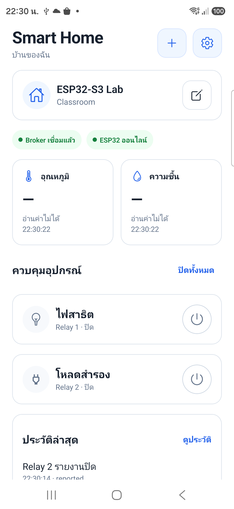
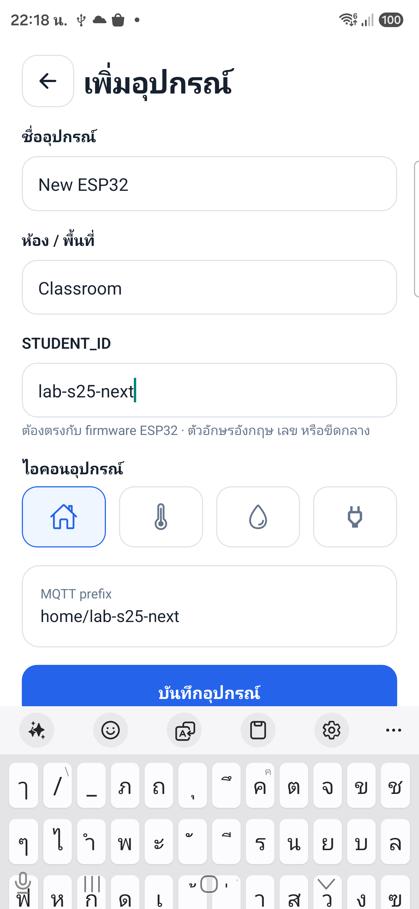
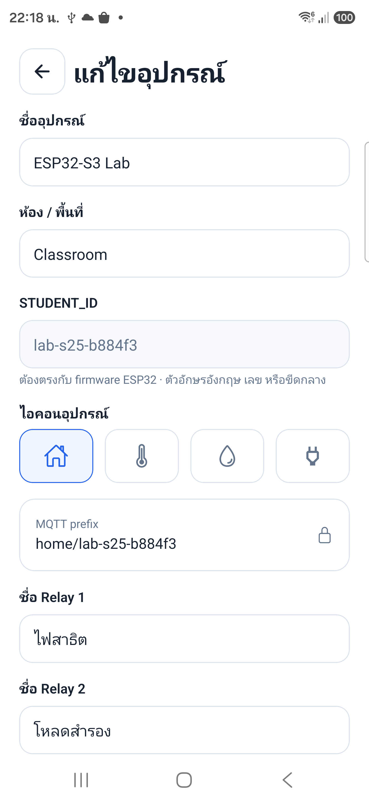
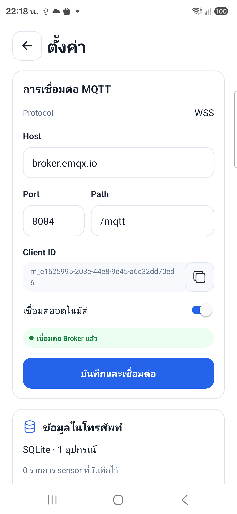

# ชุดไฟล์สร้างตามระบบจริง — Smart Home 1.0.1 ผ่าน OpenCode

ชุดนี้เป็น **9 Markdown files + assets** สำหรับให้ผู้เรียนสั่งOpenCodeสร้างแอปให้ตรงระบบที่ผู้สอนทำสำเร็จแล้ว มีภาพอ้างอิงและ [APK1.0.1](https://github.com/sunanedu/ESP32-LAB/raw/refs/heads/main/downloads/esp32-smart-home-preview-1.0.1.apk) สำหรับตรวจเทียบ แยกการสร้างจากโจทย์กับการรันsourceเดิมตามสองเส้นทางด้านล่าง

ดู [ผลตรวจ Samsung + ESP32-S3 จริง](https://github.com/sunanedu/ESP32-LAB/blob/main/labs/lab07-smart-home-project/app-blueprint/mobile/PHYSICAL_TEST_RESULTS.md) และ [MQTTXที่ตั้งค่าจริง](https://github.com/sunanedu/ESP32-LAB/tree/main/labs/lab07-smart-home-project/mqttx) รอบบอร์ดจริงไม่มีโมดูลต่ออยู่ ผลครอบคลุมการสื่อสาร/reported GPIO ส่วนsensor/จอ/หน้าสัมผัสRelayยังต้องต่อและตรวจเพิ่ม ผลเหล่านี้เป็นของผู้สอน ผู้เรียนต้องสร้างTEST_RESULTSของตน

## เป้าหมายปลายทาง

เปิดแอป Android แล้วพบ Dashboard สีขาวทันที ดู DHT11 และควบคุม Relay 2 ช่องของ ESP32 ผ่าน public MQTT broker ฟรีของ EMQX เก็บ profiles/settings/history เป็นหลักใน SQLite บนโทรศัพท์ ไม่มี cloud database หรือ login สำหรับการใช้งานหลัก

| Dashboard1.0.1 | เพิ่มอุปกรณ์1.0.1 |
|---|---|
|  |  |
| แก้ไขอุปกรณ์1.0.1 | ตั้งค่า1.0.1 |
|  |  |

*ภาพจริงจากSamsungของผู้สอน ให้ยึดเส้นขอบทึบ/radius16/elevation0ตามdesign.md ตัวเลข/ชื่อ/IDในภาพไม่ใช่ข้อมูลที่ติดตั้งมากับแอปใหม่ ภาพAIเดิมในassetsเป็นแบบร่างก่อนปรับขอบ ไม่ใช่หลักฐานของงานผู้เรียน*

## ไฟล์ในชุดนี้

| ไฟล์ | ใช้ทำอะไร |
|---|---|
| [AGENTS.md](AGENTS.md) | บทบาท/กติกาที่ OpenCode ต้องอ่าน |
| [requirements.md](requirements.md) | APP-01–12 และเกณฑ์ตรวจรับของแอป |
| [design.md](design.md) | 4 หน้า, visual tokens, navigation, component/state architecture |
| [implementation.md](implementation.md) | Phase 0–5 ที่ผู้เรียนจะลงมือ ทุกช่องยัง [ ] |
| [mqtt-contract.md](mqtt-contract.md) | host/ports, topics, payload, retain, freshness และ command lifecycle |
| [data-model.md](data-model.md) | SQLite schema, migration, retention และ offline data |
| [test-plan.md](test-plan.md) | unit/runtime/end-to-end พร้อมเกณฑ์ผ่านและฟอร์มผลจริง |
| [opencode-prompts.md](opencode-prompts.md) | Prompt P0–P6 ใช้สร้าง/ทดสอบ/แก้ปัญหาทีละช่วง |
| [README.md](README.md) | วิธีนำชุดสเปกนี้ไปเริ่มโปรเจกต์ |
| assets/lab07-reference-*.png | ภาพจริง4หน้าสำหรับสร้างUIตามรุ่น1.0.1 |
| [MQTTX template](assets/mqttx-monitor.template.json) | group/connection/6topics/4สี ต้องเปลี่ยนREPLACE-STUDENT-IDก่อนใช้ |
| [ภาพ MQTTX จริง](assets/lab07-mqttx-monitor.jpg) | เป้าหมายหน้ามอนิเตอร์; ไม่ใช่ผลของเครื่องผู้เรียน |
| [ภาพAIเดิม](assets/lab07-app-four-screens-ai.png) | แนวคิดเดิม ไม่ใช้ตัดสินขอบการ์ดปัจจุบัน |

## คัดลอกไปโปรเจกต์ใหม่

1. จาก GitHub ของคอร์สเลือก **Code → Download ZIP** แล้วแตกไฟล์ หรือใช้ clone ที่ผู้สอนเตรียมไว้
2. เข้า `labs/lab07-smart-home-project/app-blueprint/` แล้วคัดลอก **เฉพาะ 9 ไฟล์ `.md` และโฟลเดอร์ `assets/`** ไปโฟลเดอร์โปรเจกต์ใหม่ เช่น `D:\Projects\SmartHomeApp` โดยเว้น mobile/ และ evidence/ ของแอปอ้างอิงไว้
3. ตรวจว่า `AGENTS.md`, `requirements.md`, `design.md`, `implementation.md` อยู่ระดับรากของ SmartHomeApp ไม่อยู่ในโฟลเดอร์ย่อย app-blueprint อีกชั้น
4. เปิดโฟลเดอร์ใหม่นี้ใน OpenCode Desktop หรือเปิด terminal ที่โฟลเดอร์นี้แล้วเรียก `opencode` ตามรุ่นที่ติดตั้ง ผู้สอนดูแลการติดตั้ง/เลือก model/provider ตาม [เอกสาร OpenCode](https://opencode.ai/docs/)
5. ตั้งPROJECT_NAME, STUDENT_IDสมมติของกลุ่ม, BOARD_TARGET=esp32หรือesp32s3 และpackageชื่อใหม่ เช่น com.example.lab07a7f2 ให้AIใช้ค่าชุดเดียวทั้งfirmware/app/MQTTX ห้ามส่งWi-Fi passwordให้AIหรือใส่MDสาธารณะ
6. ใช้ P0 จาก opencode-prompts.md ให้ AI อ่านไฟล์/ตรวจเครื่อง/เสนอแผนก่อน จากนั้น P1–P5, P-MXและP-APKตามลำดับ ส่วนP-FWใช้เมื่อต้องสร้าง/แก้firmware
7. ให้ AI scaffold แอปใน `mobile/` เพื่อไม่ทับเอกสารในราก ตรวจ diff และรันทีละ Phase จดรุ่น/คำสั่ง/ผลจริงในTEST_RESULTS.md ถ้ายังไม่มีอุปกรณ์ให้ระบุยังไม่ทดสอบ

ไม่ต้องติดตั้ง library หรือสร้าง source React Native ตอนคัดลอกเอกสาร และไม่ต้องใช้ `/init` ทับ AGENTS.md ที่เตรียมไว้

### ตั้ง Git ignore ในโปรเจกต์ใหม่

ตอนลงมือ Phase0 ให้สร้าง `.gitignore` ที่รากโครงการตามรายการนี้ หรือรวมเข้ากับไฟล์เดิมโดยไม่ลบกติกาที่มีอยู่ ต้องทำก่อนสร้าง secrets/commit; ไฟล์ `secrets.example.h` ใช้ค่า placeholder เท่านั้น ส่วนเฉลยเก็บใน `answer-keys/` เฉพาะเครื่องผู้สอน

```gitignore
**/secrets.h
_reference/
answer-keys/
**/node_modules/
**/.expo/
**/android/
**/ios/
**/build/
**/dist/
**/coverage/
**/.gradle/
**/.env
**/.env.*
!**/.env.example
**/*.db
**/*.db-shm
**/*.db-wal
**/*.jks
**/*.keystore
**/local.properties
**/*.apk
**/*.aab
```

ก่อน push ตรวจ `git status --short` และ `git diff --cached --name-only` ว่าไม่มีไฟล์ต้องห้ามหรือข้อมูลจริงในไฟล์ตัวอย่าง การเพิ่มเข้า .gitignore ไม่ได้เลิกติดตามไฟล์ที่เคย commit ไปแล้ว

## เส้นทาง A — สร้างโครงการใหม่จาก Markdown

1. เตรียมNode/npm/JDK/Android SDKตามbaselineในrequirements.md ตรวจ `node --version`, `npm --version`, `java -version`, `adb version` และติดตั้งSDK/CMake/NDKผ่านเครื่องมือAndroidตามรุ่นที่buildขอ พร้อมยอมรับlicenseตามปกติ
2. ให้OpenCodeทำP0และยืนยันก่อนscaffoldว่าจะใช้Expo58/React19.3/RN0.88.1 ไม่เปลี่ยนเป็นSDKใหม่เพราะtemplateล่าสุดชี้ไปอีกรุ่น
3. Scaffoldเฉพาะโครงเปล่าได้ด้วยคำสั่งด้านล่าง จากนั้นให้AIตั้งdependencyตามbaselineก่อนinstallครั้งแรก เก็บpackage-lockที่เกิดจริงและตรวจcompatibility หากมีการเปลี่ยนรุ่นให้บันทึกและทดสอบใหม่

```powershell
npx create-expo-app@latest mobile --template blank-typescript --no-install --no-agents-md
```

`--no-install` แยกการเลือกtemplateออกจากการresolveรุ่น ส่วน `--no-agents-md` คงคำแนะนำในAGENTSของชุดโจทย์ หากcreate-expo-appรุ่นที่ติดตั้งไม่มีflagนี้ให้ตรวจ `--help` และรักษาAGENTSรากด้วยตนเอง ไม่เขียนทับทั้งโฟลเดอร์

4. ทำUIตามภาพจริงก่อน เชื่อมSQLite schema2/MQTTและreported-stateทีละPhase จากนั้นทำMQTTXpresetจากtemplateให้IDตรงกัน ไม่เพิ่มlogin/cloud database/provisioning/BLEเอง
5. สร้างscripts `typecheck`, `lint`, `test`, `export:android`, `build:apk` และbuild helper/config pluginตามหัวข้อWindowsด้านล่าง ปิดfixturesก่อนเก็บหลักฐานจริง
6. ตรวจunit/integration, สร้างAPKnative, ติดตั้งและทดสอบกับบอร์ดตามtest-plan ผลOpenCodeที่เขียนโค้ดเสร็จยังไม่เท่ากับผลรันAndroid

## ทดลอง APK โดยไม่รับ source สำเร็จ

ดาวน์โหลด [APK พื้นฐาน](../../../downloads/README.md) เพื่อดูหน้าตา/เทียบการทำงาน แล้วทำเส้นทางสร้างแอปจาก Markdown ของตน ไม่ clone tag หรือคัดลอก source แอปผู้สอน

## Build Android บน Windows และติดตั้ง

- ใช้local native buildกับSDK/JDKที่ตั้งถูกต้อง ไม่จำเป็นต้องมีEAS/cloud build สำหรับเป้าหมายนี้ ตั้ง `ANDROID_HOME`/`JAVA_HOME` ให้ตรงเครื่องตนและให้adbใช้งานได้ ไม่คัดลอกpathโปรไฟล์ผู้สอน
- ให้ AI สร้าง `scripts/build-android.ps1` และ `plugins/with-short-cmake-path.cjs` ในโปรเจกต์ของกลุ่มตามพฤติกรรมด้านล่าง ไม่มี helper สำเร็จให้ดาวน์โหลด ตรวจไฟล์ก่อนเรียกคำสั่ง
- สร้างสำเนาไปpathสั้นเช่น `D:\BuildCache\<รหัสสุ่ม>` รวมnode_modulesที่ติดตั้งแล้ว แต่เว้นandroid/ios/dist/.expo/coverage/.git ของต้นทาง; prebuildในสำเนา ไม่ย้ายหรือลบsourceเดิม
- ใช้CMake3.31.6/Ninja1.12.1และconfig pluginกำหนด `CMAKE_OBJECT_PATH_MAX=240` ในapp Gradleก่อนbuild ไม่แก้generated Gradleแล้วปล่อยให้prebuildลบทับ และไม่ลดเป็น160ซึ่งไม่พอกับbase pathในรอบตรวจ
- app.jsonลงทะเบียนexpo-sqlite/expo-font/config plugin, light/portrait, keyboard resize, Androidpackageของกลุ่ม; โหลดIoniconsและMaterialCommunityIconsด้วยuseFontsก่อนrender
- ReleaseรวมJS/Hermes/fonts, buildarm64-v8aสำหรับโทรศัพท์และx86_64สำหรับemulator ในสำเนารัน `gradlew.bat :app:assembleRelease -PreactNativeArchitectures=arm64-v8a,x86_64` แล้วcopyAPKกลับdist/apk ไม่ต้องเปิดMetroเมื่อใช้งานAPKนี้

ตัวอย่างเรียกhelperหลังAIสร้างไฟล์ครบ จากmobile/:

```powershell
./scripts/build-android.ps1 -Mode Release -BuildRoot D:\BuildCache
adb devices -l
adb -d install -r dist/apk/esp32-smart-home-release.apk
```

ผู้ใช้เปิดDeveloper options/USB debuggingและกดอนุญาตบนโทรศัพท์เอง ถ้ามีอุปกรณ์USBหลายเครื่องให้เลือกserialของตนด้วย `adb -s <serial>` แทน `-d` หากpackage/signing keyไม่ตรงกับแอปเดิมจะติดตั้งทับไม่ได้ อย่าแก้ด้วยuninstallอัตโนมัติซึ่งเสี่ยงลบข้อมูล เลือกpackageใหม่หรือจัดการkeyให้ถูกต้องตามผู้สอน

หลังติดตั้งปิดMetroแล้วเปิดแอปจากlauncher ตรวจempty Dashboard/เพิ่มprofile/Settings/กลับมาonlineและforce-stop/reopen ข้อมูลเดิมอยู่ การเปิดExpo Goหรือwebpreviewอย่างเดียวไม่ผ่านข้อstandaloneAPK SHA256ของAPKผู้สอนใช้ตรวจไฟล์ที่ดาวน์โหลด ไม่บังคับให้APKที่buildใหม่/เซ็นใหม่มีhashเหมือนกัน

## จับคู่กับ firmware และ MQTTX

1. อ่านFW-01–10ในmqtt-contract.md เลือกขา/targetตามบอร์ด สร้างsecrets.hเฉพาะเครื่อง ใส่Wi-Fi2.4GHzและSTUDENT_IDสมมติของตน compile/uploadทีละsketchตามบทเรียนคอร์ส
2. เริ่มแบบบอร์ดเปล่าได้: expectnoOLED/nullsensor แต่ต้องมีonline/uptime/stateจริงก่อนสั่งGPIO ไม่จำลองค่าsensorไปทับnamespaceบอร์ดจริง
3. ในแอปเพิ่มprofileIDตรงfirmware เปิดSettingsใช้host broker.emqx.io,port8084,path/mqtt,autoConnect จากนั้นรอข้อมูลสด controlsไม่เปิดจากretained/cacheอย่างเดียว
4. ทำสำเนาassets/mqttx-monitor.template.json แทนREPLACE-STUDENT-IDทั้ง6แห่ง แล้วimportMQTTXDesktop1.13.3ตามMX-01–06ในcontract กดConnectเอง หน้ารวมPlaintext
5. เทียบ/setสีส้มกับ/stateสีม่วง กรองแถบตรงQoS0เพื่อดูเฉพาะหมวด การเห็นคำสั่ง/stateไม่ได้ระบุidentityของโทรศัพท์บนpublic broker และไม่ใช่การวัดหน้าสัมผัส
6. เมื่อต่อโมดูลจริงเพิ่มภายหลัง ต้องทดสอบDHTvalid/invalid,OLEDและโหลดLEDDCใหม่ ไม่ใช้ผลบอร์ดเปล่าหรือภาพผู้สอนแทนผลวงจร

## ค่าที่ทุกฝ่ายต้องตรงกัน

| รายการ | ค่า |
|---|---|
| แอป React Native / MQTTX Web | `wss://broker.emqx.io:8084/mqtt` |
| ESP32 | `broker.emqx.io:1883` TCP |
| MQTTX Desktop monitor | `mqtt://broker.emqx.io:1883`, MQTT3.1.1; 6 exact topics/4หมวดสี |
| Profile ID ตัวอย่าง | `desk-a7f2` — เปลี่ยนเป็นรหัสสมมติที่ไม่ซ้ำและตรง firmware |
| Prefix | `home/desk-a7f2` |
| Relay commands | `ON`/`OFF`, QoS0, retain=false |
| Local storage | SQLite บนโทรศัพท์ |

MQTTX เป็น client ช่วยตรวจข้อความ ส่วน broker เป็น EMQX `broker.emqx.io` ไม่ใช่ MQTTX app ที่เปิดบนคอมพิวเตอร์ จึงปิด MQTTX ได้เมื่อทดสอบเสร็จ และแอปยังติดต่อบอร์ดผ่าน broker ได้

## ภาพรวมการทำงานที่คาดหวัง

เพิ่ม profile ในเครื่อง → รอข้อมูลสดจาก ESP32 → ดู sensor → กด Relay → ส่ง set → ESP32 เขียน GPIO → รับ state กลับ → เก็บประวัติในโทรศัพท์ การแก้ชื่อ/ล้างประวัติเป็นงานในเครื่อง ไม่สั่งเปลี่ยน Relay การขาดเน็ตทำให้ปุ่มสั่งถูกปิด แต่ยังดูข้อมูลที่บันทึกไว้พร้อมป้ายข้อมูลเก่าได้

Public broker เปิดให้คนอื่นเห็น/ส่งข้อความได้ ใช้ข้อมูลสมมติและโหลด LED DC เท่านั้น ห้ามข้อมูลส่วนตัวหรือ AC220V หากต่อยอดระบบจริงต้องออกแบบ authentication/TLS/ACL และนโยบาย actuator ใหม่

## ตรวจเสร็จเมื่อใด

เอกสารชุดนี้พร้อมส่งต่อให้ผู้เรียนเมื่อไฟล์/ลิงก์/ภาพ/contract สอดคล้องกัน ส่วน **แอปเสร็จ** เมื่อผู้เรียนทำ Phase และ test-plan จนครบ มี source/หลักฐานจริงและระบุข้อที่ยังไม่ผ่าน ห้ามนับภาพ AI เป็นผลรัน Android

ภาพreferenceเป็นscreenshotจริงของทีมESP32-LABจากAPK1.0.1บนSamsung ภาพMQTTXจากโปรแกรม1.13.3 (UIApache-2.0); ภาพAIเดิมสร้างด้วยimagegen ทั้งหมดมีทะเบียนในassets/IMAGE_SOURCES.mdของrepositoryคอร์ส

เอกสารทางการ: [create-expo-app options](https://docs.expo.dev/more/create-expo/), [local Android build](https://docs.expo.dev/guides/local-app-development/), [Prebuild/config plugins](https://docs.expo.dev/workflow/continuous-native-generation/), [OpenCode project instructions](https://opencode.ai/docs/instructions/)
