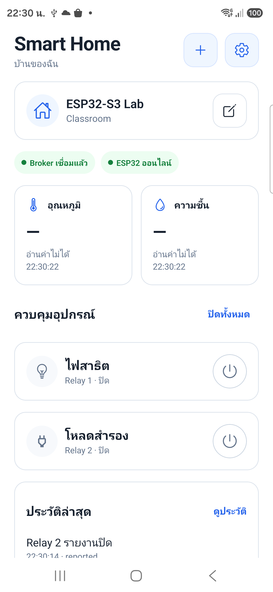
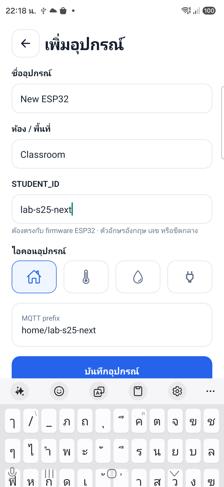
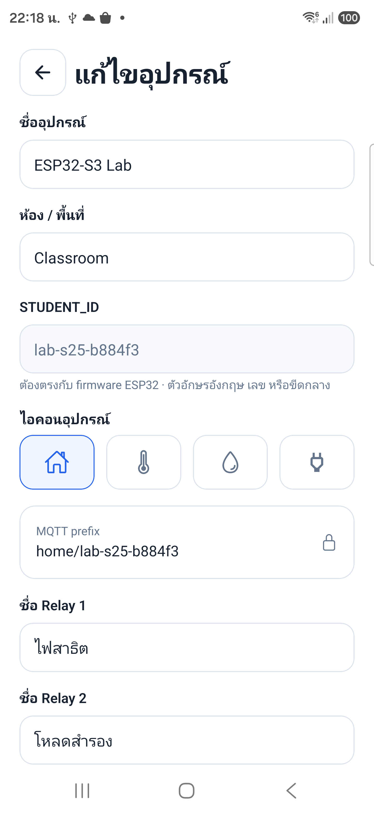
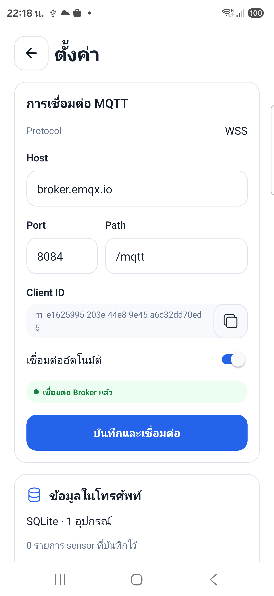

# Design — Smart Home Android

ใช้ร่วมกับ [requirements.md](requirements.md), [mqtt-contract.md](mqtt-contract.md) และ [data-model.md](data-model.md) เป้าหมายคือสร้างUI/พฤติกรรมตามแอปอ้างอิง1.0.1 ให้ใช้tokensและภาพจริงด้านล่างเป็นหลัก ไม่ถือว่าการคัดลอกภาพเป็นการสร้างหน้าจอnative

## ภาพจริง 4 หน้าจาก APK1.0.1

| Dashboard | Add Device |
|---|---|
|  |  |
| Edit Device | Settings |
|  |  |

ภาพจากSamsung S25 Ultra Android17 ข้อมูลชื่อ/IDเป็นตัวอย่างของผู้สอน หน้าDashboardถ่ายขณะมีเฉพาะESP32-S3จึงอ่านsensorไม่ได้ ต้องสร้างทั้งempty/valid/invalid/staleตามข้อมูลจริง ไม่hard-codeค่าหรือชื่อในภาพ ฟอร์มและhistoryเลื่อนได้ ภาพAddเห็นkeyboardของเครื่องในจังหวะจับภาพ ไม่ใช่ส่วนUIที่ต้องวาดเอง

ภาพร่างAIเดิม [lab07-app-four-screens-ai.png](assets/lab07-app-four-screens-ai.png) เก็บไว้เพื่อเทียบแนวคิดก่อนปรับขอบ ใช้ภาพจริงและtokensปัจจุบันเมื่อต่างกัน

## Visual tokens

| Token | ค่าเริ่มต้น |
|---|---|
| Page / card | #FFFFFF / #FFFFFF |
| Text / secondary | #17212F / #64748B |
| Border / subtle surface | #DCE3EC / #F7F9FC; เส้นขอบทึบ 1 dp |
| Accent / selected | #2563EB / #EFF6FF |
| Online / warning / error | #15803D / #B45309 / #B91C1C พร้อมข้อความกำกับ |
| Radius card / input / button | 16 / 14 / 14 dp |
| Spacing | 4, 8, 12, 16, 24, 32 dp; padding หน้า 20 dp |
| Shadow | การ์ด/ปุ่มไม่ใส่ drop shadow หรือ blur; Android elevation=0 ใช้เส้นขอบแยกพื้นผิว |
| Font | systemภาษาไทย; title27/700, letterSpacing=-0.5; heading17/600; body15/line23; secondary13/line20; caption12/line18; input16 |
| Touch / icon | touch ≥48×48 dp, icon 20–24 dp, ไม่ใช้ emoji แทน icon font |
| Pressed | เปลี่ยนพื้นprimaryเป็น#1D4ED8, secondaryเป็น#F7F9FC; ไม่ลดopacityทั้งปุ่มขณะกดจนขอบดูจาง |
| Disabled | opacityประมาณ0.45ของปุ่ม พร้อมdisabled/busy accessibility stateและข้อความเหตุผล |
| Icon buttons | ขอบ1dp/radius14/min48; ปุ่มฟ้าพื้น#EFF6FFขอบ#D6E4FF; elevation0 |
| Input / primary button | input minHeight50/paddingแนวนอน14/แนวตั้ง11; button minHeight50/radius14 |

ใช้พื้นขาวจริง ไม่เติม gradient, glass effect, เงาหนัก หรือภาพบ้านตกแต่ง พื้นที่ว่างช่วยแยกข้อมูล ต้องไม่บีบฟอร์มเพื่อให้ทุกอย่างอยู่จอเดียว หน้าที่เนื้อหายาวเลื่อนได้และรองรับ keyboard/safe area

การปรับตามผู้สอนอ้างแนวขอบคมของ FloatingNavDemoV.2/MinimalTodoNative ผู้เรียนไม่ต้องมีโปรเจกต์ส่วนตัวเหล่านั้นในเครื่อง tokensและภาพจริงในassetsเพียงพอสำหรับสร้างตาม ห้ามอ้างpath D:\AI ของผู้สอนเป็นdependencyของงานใหม่

## แผนที่หน้าจอ

Dashboard เป็นหน้าเริ่มต้นเสมอ
- ปุ่ม `+` → Add Device → บันทึก → Dashboard เลือกอุปกรณ์ใหม่
- เมนูดินสอของบอร์ด → Edit Device → บันทึก/ยกเลิก → Dashboard
- ปุ่ม gear → Settings → บันทึกและเชื่อมต่อ/ย้อนกลับ → Dashboard
- “ดูประวัติ” → bottom sheet ในหน้า Dashboard ไม่ต้องเพิ่มหน้าหลักที่ห้า

ไม่ต้องมี bottom tab bar ที่ซ้ำหน้าหรือหน้า login ครั้งแรก Dashboard ว่างมีคำอธิบายสั้นและปุ่ม Add Device

## หน้าที่ 1 — Dashboard / “บ้านของฉัน”

ลำดับจากบนลงล่าง:
1. Header: “Smart Home”, subtitle “บ้านของฉัน”, ปุ่มบวกและ gear ที่มี accessibility label
2. แถบเลือก profile เช่น “ชุดทดลอง 01 · ห้องเรียน” และปุ่มดินสอแก้ไข; ถ้ามีหลายบอร์ดเลือกจาก bottom sheet ได้
3. Status row สองส่วน: “Broker เชื่อมต่อแล้ว” กับ “ESP32 ออนไลน์/รอยืนยัน/ข้อมูลเก่า/ออฟไลน์” แสดงข้อความ ไม่ใช้จุดสีล้วน
4. Sensor cards 2 คอลัมน์: thermometer “อุณหภูมิ 28.0 °C”, water “ความชื้น 61 %RH” ใต้การ์ดบอก valid/อัปเดตเมื่อใด; ถ้า invalid แสดง `—` และ “อ่านค่าไม่ได้”
5. แถว “ควบคุมอุปกรณ์” กับปุ่มรอง “ปิดทั้งหมด” สำหรับบอร์ดที่เลือก
6. Relay cards สองใบ: icon bulb/plug, ชื่อที่ตั้งเอง, ข้อความ reported “เปิด/ปิด/ไม่ทราบ”, ปุ่ม power/toggle ที่แสดง pending แยกจาก reported state
7. การ์ด “ประวัติล่าสุด” แสดง3รายการล่าสุดที่เป็นcommand/event (ไม่ให้sensorทุก5sกลบคำสั่ง) ปุ่มดูประวัติเปิดbottom sheetที่รวมsensor/command/event; footerเก็บข้อมูลในโทรศัพท์

การ์ด Relay สีขาวเหมือนกัน ขอบ/วงกลมไอคอน accent จางเมื่อ ON ใช้ฟ้าเป็นปุ่ม active การเปิดใช้งานปุ่มดูจาก canSend ใน mqtt-contract.md ระหว่างรอยืนยันยังเห็นข้อมูลเก่าได้แต่ปุ่ม disabled และมีเหตุผล

## หน้าที่ 2 — Add Device / “เพิ่มอุปกรณ์”

Header ลูกศรกลับ + หัวหน้า ฟอร์มตามลำดับ:
- ชื่ออุปกรณ์ เช่น “ชุดทดลอง 01” (1–40 ตัวอักษรหลัง trim)
- ห้อง/พื้นที่ เช่น “ห้องเรียน” (ไม่เกิน 40, ว่างได้)
- STUDENT_ID เช่น `desk-a7f2` พร้อมคำอธิบายว่าต้องตรง firmware ไม่ใช่ชื่อ Wi-Fi
- Icon picker4ตัวเลือก: Ionicons home-outline/thermometer-outline/water-outline และMaterialCommunityIcons power-plug-outline (ไม่สมมติชื่อplug-outlineของIonicons)
- การ์ด preview “MQTT prefix · home/desk-a7f2” อ่านอย่างเดียว คำนวณจาก ID
- ปุ่มหลัก “บันทึกอุปกรณ์”; ปุ่มรอง “ยกเลิก”

Validate ชื่อ/ID/duplicate/จำนวนสูงสุด inline ไม่ให้กดบันทึกสองครั้ง ไม่มีการกดปุ่มค้นหาหรือสแกนหา ESP32 ปลอม Add ไม่ต้องเชื่อมเน็ตเพื่อบันทึก profile ได้ หากไม่มีเน็ตกลับ Dashboard แล้วเป็นข้อมูลรอยืนยัน

## หน้าที่ 3 — Edit Device / “แก้ไขอุปกรณ์”

ใช้ฟอร์มเดียวกับ Add ที่ prefill ข้อมูล เพิ่ม:
- STUDENT_ID และ prefix เป็น read-only พร้อม icon lock และข้อความ “ต้องตรงกับ firmware”
- ชื่อ Relay 1/2 เช่น “ไฟสาธิต” / “โหลดสำรอง” ไม่เกิน 30 ตัวอักษรและไม่ว่าง
- ปุ่ม “บันทึกการแก้ไข” และ “ยกเลิก”
- ข้อความสีแดง “ลบอุปกรณ์จากโทรศัพท์” ที่ท้ายหน้า ต้องกดยืนยันชื่อ profile ก่อนลบ

การแก้ชื่อ/ไอคอนไม่ publish MQTT และไม่เปลี่ยน Relay หากมี unsaved changes แล้วย้อนกลับให้เลือกว่าอยู่ต่อหรือทิ้งการแก้ไข ไม่ auto-save โดยไม่บอก

## หน้าที่ 4 — Settings / “ตั้งค่า”

ส่วน “การเชื่อมต่อ MQTT”
- Protocol แสดง WSS เป็นค่าอ่านอย่างเดียว
- Host=`broker.emqx.io`, Port=`8084`, Path=`/mqtt`
- Client ID สุ่มต่อการติดตั้งเป็น read-only พร้อมปุ่มคัดลอก (ถ้าทำปุ่มต้องมี feedback)
- Switch “เชื่อมต่ออัตโนมัติ”
- แสดง connection state และ error ล่าสุดที่อ่านเข้าใจ
- ปุ่มหลัก “บันทึกและเชื่อมต่อ”; ไม่ใช้ภาพเครื่องหมายถูกแทนผลเชื่อมจริง

ส่วน “ข้อมูลในโทรศัพท์”
- แสดงจำนวน profiles/samples และเพดานการเก็บ ไม่แสดงว่ามี cloud sync
- ปุ่มรอง “ล้างประวัติ” พร้อม dialog ยืนยันว่าจะเก็บ profiles/settings
- ข้อความ “Public broker · ห้ามส่งข้อมูลส่วนตัว”

การเปลี่ยน connection settings ยกเลิก pending/client เก่า ไม่ส่งคำสั่งเดิมหลังต่อใหม่ เมื่อกลับ Dashboard ต้องรอข้อมูลใหม่เพื่อเปิด controls

## สถานะที่ต้องออกแบบนอกภาพตัวอย่าง

| สถานะ | สิ่งที่ผู้ใช้เห็น |
|---|---|
| Empty | Dashboard ว่าง ปุ่มเพิ่มอุปกรณ์ ใช้ Settings ได้ |
| Loading DB | ActivityIndicator/ข้อความบน Dashboard, ไม่รีบเริ่ม MQTTก่อนhydrate ปุ่มเพิ่ม/ตั้งค่ารอพร้อม |
| Connecting broker | ข้อความกำลังเชื่อม controls disabled |
| Connected แต่บอร์ดยังไม่ส่ง | Broker เชื่อมแล้ว / ESP32 รอยืนยัน |
| Cached/stale | แสดงข้อมูลเดิมสีรองพร้อมเวลา ห้ามแสดงว่า live |
| Sensor invalid | ตัวเลข `—`, อ่านค่าไม่ได้; ค่าเก่าดูได้เฉพาะประวัติ |
| Command pending | spinner/ข้อความรอรายงานเฉพาะช่อง |
| Timeout | แจ้งยังไม่พบรายงาน ตำแหน่ง reported ยังตามข้อมูลที่รับ |
| Storage error | แสดง retry/คำอธิบาย ไม่แอบล้างข้อมูล |
| Offline | อ่าน local history ได้, ปุ่มสั่ง disabled, กดเชื่อมใหม่ได้ |

## สถาปัตยกรรมแอป

```text
React Native UI → app store/view-model → MQTT service → EMQX broker → ESP32
                           ↓                     ↑ state/sensor
                    SQLite repository ← validated message parser
```

- UI ไม่เรียก SQL/MQTT ตรงทุก component ให้ service/repository ดูแล
- MQTT client หนึ่ง instance, listener หนึ่งชุด, ผูกกับ AppState ในชั้น service
- SQLite คือแหล่งข้อมูลถาวร; memory store คือสถานะหน้าจอ/connection/pending ระหว่างรัน
- Parser แปลง external data เป็น typed model ก่อนเขียน store/DB
- Snapshot/cached values กับ live values มี source/เวลาแยกกัน
- ไม่ย้าย logic ไป cloud หรือบังคับสมัครบัญชีเพื่อใช้งานหลัก

## โครงสร้าง source ที่ให้ OpenCode สร้างภายหลัง

```text
mobile/
  App.tsx                     bootstrap DB/fonts, AppState และ route4หน้า
  src/components.tsx          Card/Field/Button/IconButton/Pill/Sheet/Screen
  src/theme.ts                tokens และ StyleSheet ตามตาราง
  src/context.tsx              provider/useSyncExternalStore
  src/screens/                Dashboard, DeviceForm(add/edit), SettingsScreen
  src/services/               home-controller, mqtt-transport, transport interface
  src/database/               repository, schema2/migrations, write queue/retention
  src/domain/                 models, validation, protocol, presence
  src/tests/                  parser/realSQLite/controller+fake transport/time
  plugins/                    with-short-cmake-path.cjs สำหรับWindows nativebuild
  scripts/                    build-android.ps1 / Android smoke / simulator
evidence/                      ภาพ/log ที่ลบข้อมูลส่วนตัวแล้ว
TEST_RESULTS.md                ผลทดสอบจริงที่ผู้เรียนสร้างภายหลัง
```

โครงสร้างนี้ตรงแอปอ้างอิง ไม่จำเป็นต้องเพิ่มrouter/bottom tabsหรือstate libraryใหม่ Routeเป็นstateในApp.tsxและhistory/เลือกprofileเป็นSheet ถ้าเปลี่ยนโครงสร้างต้องคงback/dirty form/lifecycleทั้งหมด ไม่ทำSQL/MQTTกระจายในแต่ละcomponent

## พฤติกรรมที่ภาพไม่แสดงครบ

| เหตุการณ์ | ผลที่ต้องสร้าง |
|---|---|
| เปิดแอปครั้งแรก | DBพร้อมก่อน, Dashboardว่าง ไม่มีบอร์ด/ค่าsensorตัวอย่างที่ติดตั้งมาเอง |
| เพิ่มprofile | เก็บlocalและคำนวณtopic ไม่สแกน/provision/flashESP32 |
| เลือกอีกบอร์ด | เปลี่ยนDashboard/historyของบอร์ดนั้น ไม่ส่งคำสั่ง; เปิดแอปใหม่เลือกprofileแรกตามลำดับสร้างได้ ไม่ต้องpersistlast-selection |
| เข้าEdit/Settingsแล้วBack | keyboardปิดได้, ถ้าค่าdirtyให้ยืนยันว่าจะอยู่ต่อหรือทิ้ง ไม่saveเอง |
| กดON | spinnerเฉพาะช่อง; reportedไม่เปลี่ยนจนรับstate, pending8s/timeoutแสดงในhistory |
| เปิดแอป/กลับforeground | อ่านcacheได้ แต่เริ่มpresenceรอยืนยันและรอsessionใหม่ก่อนเปิดcontrols |
| sensorinvalidแต่มีheartbeat | —/อ่านค่าไม่ได้ ไม่ใช่0°C และไม่เท่ากับbrokerหลุด; manualRelayใช้ได้ตามcanSend |
| ล้างประวัติ | ยืนยันแล้วลบsamples/commands/eventsทุกprofile คงชื่อ/settings/relay cache ไม่publish |

อย่าเขียนexpected screenshotให้บังคับต้องมี28°C/61% หากไม่มีsensorจริง ต้องออกแบบข้อความerror/อ่านค่าไม่ได้ให้สวยตามภาพจริงด้วย

## อ้างอิง UI/runtime

- [Expo icon fonts](https://docs.expo.dev/guides/icons/)
- [React Native AppState](https://reactnative.dev/docs/appstate)
- [Expo SQLite](https://docs.expo.dev/versions/latest/sdk/sqlite/)
