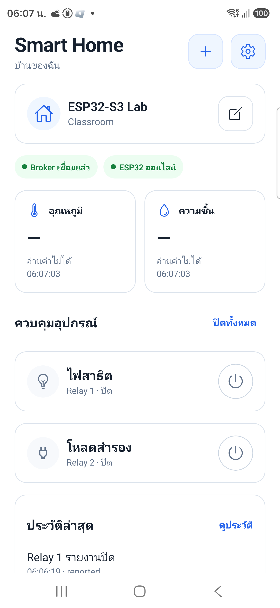
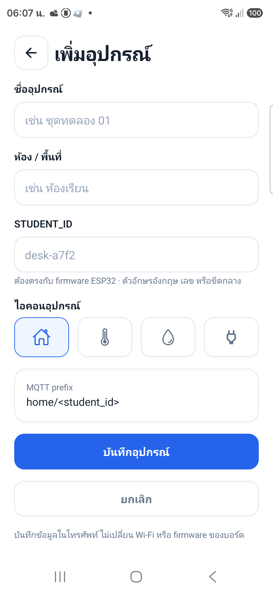
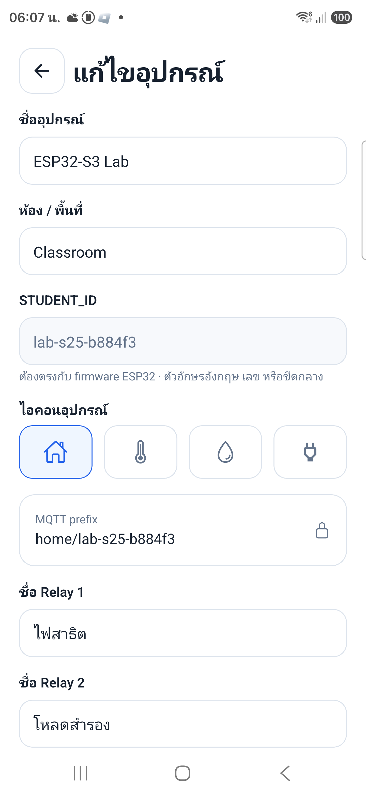
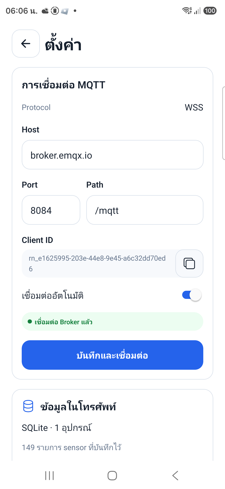
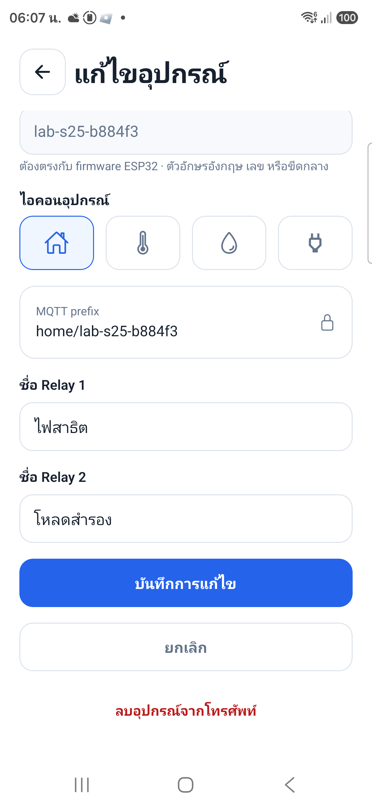
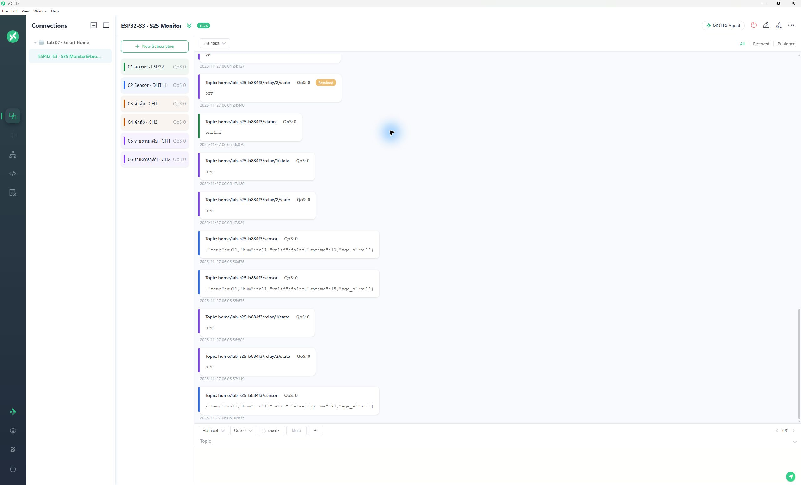

# ภาพผลลัพธ์สุดท้าย — Samsung และ MQTTX

จับภาพจากแอปที่รันจริงเช้าวันที่ **27 พฤศจิกายน 2026 (Asia/Bangkok)**: Samsung S25 Ultra ใช้ ESP32 Smart Home **1.0.1 / versionCode2** และ MQTTX Desktop **1.13.3** บน Windows ทั้งสองฝั่งเชื่อม `broker.emqx.io` กับ ESP32-S3 ของชุดผู้สอน namespace `home/lab-s25-b884f3`

## แอปบน Samsung S25 Ultra

| Dashboard — ออนไลน์ | เพิ่มอุปกรณ์ |
|---|---|
|  |  |
| แก้ไขอุปกรณ์ — ID อ่านอย่างเดียว | ตั้งค่า — WSS และข้อมูลในโทรศัพท์ |
|  |  |

หน้าแก้ไขยาวกว่าจอ จึงเลื่อนจับเพิ่มเพื่อเห็นชื่อ Relay ปุ่มบันทึก ยกเลิก และลบข้อมูล local:

[เปิดภาพส่วนท้ายฟอร์มขนาดเต็ม](lab07-final-edit-details.png)

หน้า Add เป็นฟอร์มว่าง หน้า Edit ใช้ profile เดิมของผู้สอน การจับภาพครั้งนี้ไม่ได้เพิ่ม/แก้ไข/ลบ profile หรือบันทึก Settings ชุดใหม่ การเห็นปุ่มลบในภาพเป็นการแสดง UI ไม่ใช่หลักฐานว่าได้ทดสอบลบข้อมูลแล้ว

## MQTTX Desktop — 6 หัวข้อ / 4 หมวดสี

[เปิดภาพ MQTTX ขนาดเต็ม](lab07-final-mqttx-overview.jpg) · [ค่าตั้งและ preset ของผู้สอน](../../../mqttx/README.md) · [template สำหรับ ID ของผู้เรียน](../../assets/mqttx-monitor.template.json)

ภาพเห็น subscription ทั้ง6: statusเขียว, sensorน้ำเงิน, commandสองช่องสีส้ม และ reported stateสองช่องสีม่วง ใช้ Plaintext ในหน้ารวม ข้อความ `online` และ sensor/state ในภาพมาจาก ESP32-S3 จริง โดย sensor ส่ง `temp=null, hum=null, valid=false` และ uptime เพิ่ม ส่วน state ทั้งสองช่องเป็น OFF หลัง Reset

## สภาพระบบขณะจับภาพ

- เริ่มต้นพบ MQTTX ยังไม่ได้เชื่อมและบอร์ดมี retained offline; เชื่อม MQTTX ใหม่แล้วรีเซ็ต ESP32-S3 ผ่าน COM7 หนึ่งครั้ง พบ log MQTT connected และข้อมูลสด ภาพสุดท้ายถ่ายหลังกลับมาออนไลน์ ไม่ได้ flash firmware ใหม่
- Dashboard แยก Broker เชื่อมแล้วกับ ESP32 ออนไลน์ หน้าตั้งค่าใช้ WSS8084 `/mqtt`; MQTTX/ESP32 ใช้ TCP1883 ไป broker เดียวกัน
- มีเฉพาะบอร์ด ESP32-S3 ไม่มี DHT11/OLED/Relay/โหลดต่ออยู่ ข้อความอ่านค่าไม่ได้เป็นผลจริง และ reported state ยืนยันค่าที่ firmware สั่ง GPIO เท่านั้น
- รอบนี้เก็บภาพ UI และการรับข้อมูลหลัง reconnect ไม่ได้กดสั่ง ON/OFF จากโทรศัพท์ใหม่ อ่านผลทดสอบคำสั่งรอบก่อนใน [รายงาน hardware](../../mobile/PHYSICAL_TEST_RESULTS.md)
- PNG มือถือได้จาก `adb shell screencap -p` แล้ว `adb pull`; JPEG MQTTX ได้จาก Windows.Graphics.Capture ผ่าน computer-use บันทึกเฉพาะหน้าต่าง MQTTX ไม่มีการวาดทับ เปลี่ยน payload หรือประกอบภาพให้ดูออนไลน์

ดู [capture-manifest.json](capture-manifest.json) สำหรับขนาดภาพ ขนาดไฟล์ SHA256 และวิธีจับภาพ ใช้ตรวจว่าไฟล์ต้นฉบับที่แสดงในแกลเลอรีตรงกับไฟล์ที่บันทึกไว้

[กลับไปบทเรียน Lab07](../../../README.md) · [source และวิธี build แอป](../../mobile/README.md)
