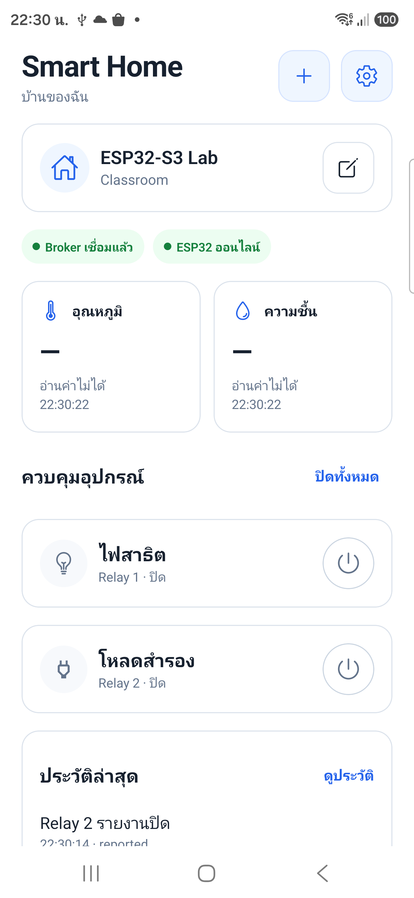
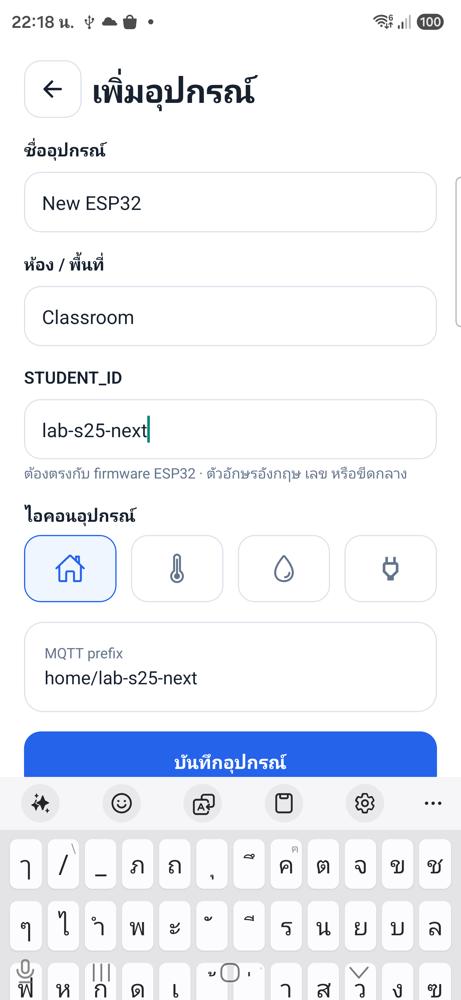
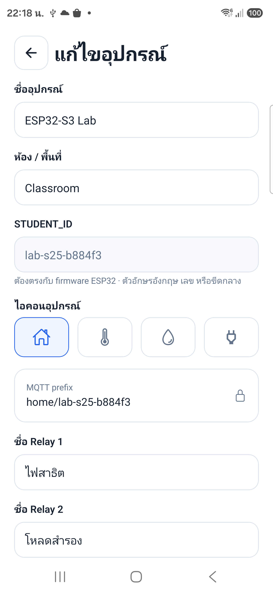
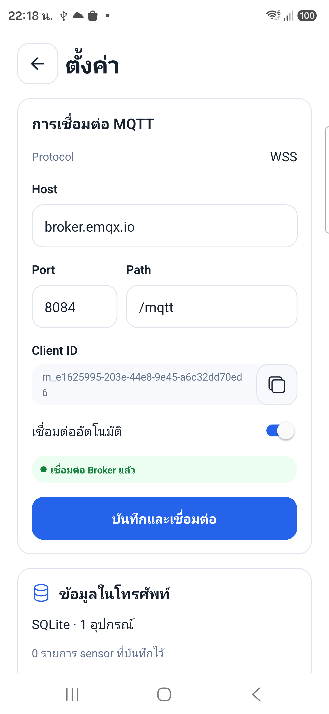

# ESP32 Smart Home — ภาพและวิธีใช้ APK พื้นฐาน

Repository สาธารณะไม่แจก source แอปสำเร็จ โฟลเดอร์นี้เก็บเอกสาร/ภาพอ้างอิงสำหรับประเมินผลงาน ผู้เรียนสร้างแอปเองจาก [บทเรียน Lab07](../../README.md) และ [ชุดสเปก Markdown](../README.md)

[ดาวน์โหลด APK พื้นฐาน 1.0.1](../../../../downloads/README.md) · [ผลตรวจ Samsung + ESP32-S3](PHYSICAL_TEST_RESULTS.md) · [ผลตรวจเดิม](TEST_RESULTS.md) · [นโยบายเผยแพร่](../../../../PUBLISHING.md)

## ภาพหน้าจอจริง

**ภาพผลลัพธ์ล่าสุด 27 พฤศจิกายน 2026:** ดู [แกลเลอรี Samsung 4 หน้าและ MQTTX](../evidence/final-2026-11-27/README.md) ที่จับจากระบบจริงหลังเชื่อมต่อใหม่ พร้อมภาพส่วนท้ายฟอร์มและ SHA256 ของแต่ละภาพ ชุดด้านล่างเป็นภาพอ้างอิงจากรอบปรับ UI ก่อนหน้า

ภาพจาก **Samsung S25 Ultra, Android17, APK1.0.1 standalone** ปรับเส้นขอบการ์ด/ปุ่มให้คม ไม่มีเงาฟุ้งตามคำสั่งผู้สอน Dashboard เชื่อม ESP32-S3 จริงผ่าน MQTT โดยมีเฉพาะบอร์ด ไม่มี DHT11/OLED/Relay ต่ออยู่ จึงแสดง sensor อ่านค่าไม่ได้ และ state หมายถึงค่าที่ firmware สั่ง GPIO ฟอร์มและหน้าประวัติเลื่อนดูต่อได้

| Dashboard | เพิ่มอุปกรณ์ |
|---|---|
|  |  |
| แก้ไขอุปกรณ์ | ตั้งค่า |
|  |  |

[เทียบภาพก่อนปรับขอบ](../evidence/lab07-s25-before-ui.png) · ภาพ emulator/ตัวจำลองของ1.0.0เก็บอยู่ใน [ผลตรวจรอบก่อน](TEST_RESULTS.md)

## เริ่มใช้งานกับบอร์ด

1. ใช้ firmware `lab07_smart_home` ตาม README แล็บ ตั้ง STUDENT_ID สมมติของตน เช่น `desk-a7f2` และ Wi-Fi **2.4GHz** ใน `secrets.h` ของบอร์ด ถ้าใช้ ESP32-S3 ต้องเลือก target/pin mapping S3 ตามตารางใน README ไม่ต่อ Relay26/27 หรือ I2C21/22 ตามวงจร ESP32 รุ่นเดิม
2. เปิดแอป → เพิ่มอุปกรณ์ → ใส่ชื่อ/ห้อง/ID ตรง firmware → บันทึก
3. ค่าเริ่มต้นแอปคือ `wss://broker.emqx.io:8084/mqtt`; ESP32 ใช้ TCP1883 ใน firmware ไม่ต้องเปิด MQTTX ค้าง
4. รอ Broker เชื่อมแล้ว และ packet live ของบอร์ด ปุ่มไม่เปิดใช้จาก retained online หรือ cache เพียงอย่างเดียว
5. กด power → ส่ง ON/OFF ไป `/set` → รอ `/state` กลับ ถ้าไม่ตรงใน8s จะแจ้งในประวัติ ไม่มีการส่งค้างใหม่หลัง reconnect
6. เมื่อไม่มี packet live15s/offline ปุ่มจะปิด ข้อมูลเก่าดูได้พร้อมป้าย/เวลา การล้างประวัติหรือแก้ชื่อเป็นงานในโทรศัพท์ ไม่สั่งเปลี่ยน Relay

ใช้เฉพาะโหลด LED DC แรงดันต่ำ ห้าม AC220V ข้อมูลผ่าน public broker เห็นได้โดยผู้อื่น ใช้ข้อมูลสมมติและไม่ส่งรหัสผ่าน

## สร้างแอปของตน

เริ่มจากโฟลเดอร์ใหม่ ใช้ P0–P5 และ P-APK ในชุดสเปกเพื่อสร้าง source, dependencies, build scripts และ tests ของกลุ่ม ไม่มี package.json หรือ source พร้อมให้รัน npm ci ในโฟลเดอร์เอกสารนี้ ผลตรวจเดิมเป็นหลักฐานของแอปผู้สอน ไม่ใช่ผลตรวจของโปรเจกต์ใหม่

APK Preview ลงนามด้วย test key และรวม JavaScript/Hermes/fonts จึงไม่ต้องเปิด Metro ใช้ดูหน้าตาและทดลองในห้องเรียนเท่านั้น รายการ dependencies/ข้อจำกัดและผลทดสอบเดิมยังอยู่ในเอกสารประกอบ
