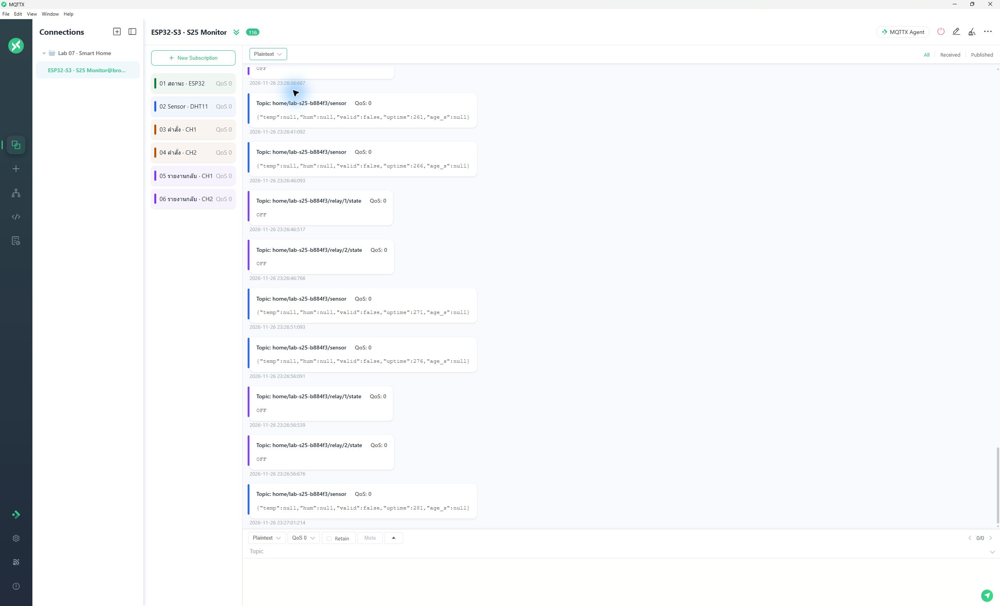

# MQTTX Monitor — Lab07

ใช้ **MQTTX Desktop** เป็น client เฝ้าดู ESP32-S3 และแอป Samsung บน **EMQX public broker** ทั้งสามฝั่งเชื่อม broker เดียวกัน แอปกับบอร์ดทำงานได้แม้ปิด MQTTX

**ภาพผลลัพธ์ล่าสุด 27 พฤศจิกายน 2026:** [MQTTX พร้อม online/sensor/state จริงและภาพแอป Samsung](../app-blueprint/evidence/final-2026-11-27/README.md) ภาพด้านล่างเก็บจากรอบตั้งค่ามอนิเตอร์ก่อนหน้า

ภาพจาก MQTTX Desktop1.13.3 ที่ตั้งค่าจริง ไม่ใช่ภาพจำลอง สีขอบ/พื้นของ subscriptionช่วยแยกหมวดโดยใช้ตัวอักษรสีเข้มให้อ่านง่าย

## ชุดตั้งค่าสำหรับเครื่องผู้สอน

**ผู้เรียนให้เริ่มจาก [mqttx-monitor.template.json](../app-blueprint/assets/mqttx-monitor.template.json)** แทน preset ผู้สอน: แทน `REPLACE-STUDENT-ID` ทั้ง6แห่งด้วย ID ของกลุ่มตนที่ตรง firmware/profile แล้ว import ด้วยขั้นตอนด้านล่าง เลือก **Lab 07 · Student Monitor → ESP32 · Student Monitor** เปลี่ยนชื่อ connection ให้ระบุกลุ่มได้แต่คง alias/สีตามมาตรฐาน ดู [คู่มือสร้างระบบครบขั้นตอน](../README.md) และ [ชุดเอกสารสำหรับ OpenCode](../app-blueprint/README.md)

ดาวน์โหลด [lab07-s25-monitor.json](lab07-s25-monitor.json) แล้วใน MQTTX เลือก **Import Data → JSON → เลือกไฟล์ → Confirm** หลัง import เลือก **Lab 07 · Smart Home → ESP32-S3 · S25 Monitor** แล้วกด **Connect** ตรวจจริงด้วย MQTTX Desktop **1.13.3**

| รายการ | ค่า |
|---|---|
| Broker ของ MQTTX | mqtt://broker.emqx.io:1883 |
| MQTT version | 3.1.1, Clean Session=true |
| Keep Alive / retry | 30s / 4s |
| Client ID | mqttx_lab07_watch_77454e7e พร้อม timestamp ขณะ connect แยกจากแอปและ ESP32 |
| Authentication | ไม่กำหนด username/password และไม่มี Wi-Fi credentials ในไฟล์ |
| Namespace | home/lab-s25-b884f3 ตรง profileและfirmwareของชุดที่ตรวจ |

ไฟล์นี้ใช้ **IDสมมติของเครื่องผู้สอน** หากนำไปใช้กับนักเรียนต้องเปลี่ยน `lab-s25-b884f3` ทั้ง6topicให้ตรง STUDENT_ID ของกลุ่มตน และใช้ Client ID ที่ไม่ซ้ำกัน ไม่สมัคร `#` ทั้ง public broker

แอปโทรศัพท์ยังใช้ **WSS8084 /mqtt** และ ESP32 ใช้ **TCP1883** ตามเดิม การใช้ transport ต่างกันไม่แยก topic เมื่อเชื่อม brokerเดียวกัน

## 6หัวข้อ / 4หมวดสี

ใช้สีเป็นเครื่องช่วยจำร่วมกับชื่อและหมายเลข ไม่ตีความจากสีเพียงอย่างเดียว ตัวอักษร payloadใช้สีเข้มของ Light theme ตามโปรแกรม สีประจำ subscriptionแสดงบนแถบ/พื้นหัวข้อและขอบข้อความ ไม่เปลี่ยนสีตามคำว่า ON/OFF อัตโนมัติ แม้statusเป็นofflineก็ยังอยู่ในหมวดขอบเขียว ต้องอ่านข้อความและดูเวลา/heartbeatประกอบ

| Alias ใน MQTTX | Topic ต่อท้าย home/lab-s25-b884f3/ | หมวด / สี | อ่านว่า |
|---|---|---|---|
| 01 สถานะ · ESP32 | status | เขียว #15803D | online / offline ของบอร์ด |
| 02 Sensor · DHT11 | sensor | น้ำเงิน #2563EB | temp/hum/valid/uptime/age_s |
| 03 คำสั่ง · CH1 | relay/1/set | ส้ม #B45309 | แอปหรือ client ส่ง ON/OFF ไปช่อง1 |
| 04 คำสั่ง · CH2 | relay/2/set | ส้ม #B45309 | แอปหรือ client ส่ง ON/OFF ไปช่อง2 |
| 05 รายงานกลับ · CH1 | relay/1/state | ม่วง #7C3AED | GPIO stateช่อง1ที่บอร์ดรายงาน |
| 06 รายงานกลับ · CH2 | relay/2/state | ม่วง #7C3AED | GPIO stateช่อง2ที่บอร์ดรายงาน |

ทุก subscriptionใช้ QoS0 ตรง firmware ซึ่ง publishได้สูงสุด QoS0 ไม่มี wildcardทับกัน จึงไม่รับข้อความเดิมซ้ำจากทั้ง exact topicและ `home/id/#`

## วิธีเฝ้าดู

1. คลิกพื้นที่แถบ subscriptionบริเวณ **QoS0** เพื่อกรองเฉพาะหมวดนั้น กดซ้ำเพื่อยกเลิกตัวกรอง การคลิกตรงข้อความชื่อใช้คัดลอกtopicแทน หากต้องการทั้งหมดให้เคลียร์ตัวกรองหัวข้อก่อนแล้วเลือก **All** ซึ่งเป็นตัวกรองทิศทางข้อความ
   หน้ารวมใช้ **Plaintext** เพราะ ON/OFF/online/offlineไม่ใช่JSON หากต้องการ sensorแบบเยื้องบรรทัด ให้กรองหัวข้อ02ก่อนแล้วเลือกJSON เมื่อกลับหน้ารวมให้เปลี่ยนคืนPlaintext เพื่อไม่ให้ข้อมูลสถานะปกติถูกแสดงเป็น SyntaxError
2. ดูหัวข้อ01เพื่ออ่าน `online` ล่าสุด และดูหัวข้อ02ว่า `uptime` เพิ่มทุกประมาณ5s ใช้ข้อมูลสดประกอบสถานะ ไม่ยืนยันบอร์ดonlineจาก retainedเก่าอย่างเดียว
3. ดูหัวข้อ03/04ระหว่างกดปุ่มในโทรศัพท์ แล้วเทียบหัวข้อ05/06 ข้อความ `/set` คือคำขอ ส่วน `/state` คือค่าที่ firmwareรายงานกลับ
4. `/set` ที่ถูกต้องส่งโดย `retain=false` ช่อง Publish ของมอนิเตอร์เว้นว่างเพื่อไม่เผลอสั่งอุปกรณ์ เลือก QoS0และไม่ติ๊ก Retain หากผู้สอนจะส่งทดสอบเอง
5. ก่อนต่อ DHT11 ค่า `temp:null,hum:null,valid:false,age_s:null` เป็นสิ่งที่คาดหวัง ไม่ใช่อุณหภูมิ0°C ส่วน `uptime` ยังเพิ่มได้เมื่อบอร์ดทำงาน
6. หยุดบอร์ดแล้ว brokerจะส่ง LWT `offline` หลังตรวจขาด keepalive ไม่จำเป็นต้องเกิดทันทีที่ถอดสาย การ์ดคำว่า Retained หมายถึงข้อมูลที่ brokerเก็บไว้และส่งให้ subscriberใหม่

สถานะสีเขียวของ connectionด้านซ้ายบอกว่า **MQTTX ต่อ brokerได้** ไม่ใช่สถานะ ESP32 ต้องอ่าน payloadในหัวข้อ01และ heartbeatประกอบ สำหรับโทรศัพท์ protocolปัจจุบันไม่มี `phone/status` จึงตรวจการส่งคำสั่งของแอปได้ แต่ยืนยันว่ามือถือออนไลน์ตลอดเวลาจากหน้าจอนี้เพียงอย่างเดียวไม่ได้

Public brokerไม่ยืนยันตัวผู้ส่ง `/set` หาก clientอื่นใช้topicเดียวกันก็ส่งได้ ชื่อหมวด “คำสั่ง” จึงหมายถึงทิศทางตาม contract ไม่ใช่หลักฐานระบุตัวตนโทรศัพท์ และ `/state` ยังไม่ใช่ feedbackหน้าสัมผัส Relay จริง

## การนำเข้าซ้ำ

MQTTXรองรับการนำเข้าJSONที่มี group/connection/subscriptions ไฟล์นี้มีIDคงที่เพื่ออัปเดตชุดเดิมเมื่อimportซ้ำ การ importจะตัด connectionที่เปิดอยู่ ต้องกดConnectอีกครั้ง และรายการsubscriptionsของconnectionIDนี้ถูกแทนด้วยชุดในไฟล์ ไม่ใส่ประวัติข้อความหรือรหัสผ่านลงpreset

## ผลตรวจจริง — 26 พฤศจิกายน 2026

- นำเข้าJSONผ่านหน้าต่างImport Dataของ MQTTX1.13.3 สำเร็จ กลุ่ม/connection/aliasesทั้ง6และสีทั้ง4แสดงตามตาราง
- Connect TCP1883/MQTT3.1.1สำเร็จ รับ retained status/stateเดิมก่อน แล้วเห็น status=onlineสดจาก ESP32-S3
- พบ COM7 แล้ว resetบอร์ดหนึ่งครั้งโดยไม่flash firmwareใหม่ Serialยืนยัน config S3,ไม่มีOLED/DHT11 และต่อWi-Fi/MQTTสำเร็จ ไม่เผยแพร่ local IP/รหัสผ่านในชุดตั้งค่า
- เห็น sensor uptime6,11,16ต่อเนื่องไปจนเกิน281วินาที และ stateOFFทั้งคู่หลังปิดSerial readerแล้ว MQTTXยังรับต่อได้
- หน้ารวมPlaintextแสดงstatus/state/sensorร่วมกันโดยไม่มีJSON SyntaxError ไม่ตั้งtimed publish และเว้นช่องส่งข้อความว่าง
- ทดลองคลิกพื้นที่QoS0ของหัวข้อ01แล้วกรองเหลือstatusสองข้อความ (retained offlineเก่าและonlineสด) จากนั้นคลิกซ้ำกลับหน้ารวมสำเร็จ ชื่อtopicเป็นจุดคัดลอกจึงไม่ใช้จุดนั้นเพื่อเปิดfilter
- การทดสอบกดOFFจากโทรศัพท์ในรอบตั้งค่ามอนิเตอร์ยังรอปลดล็อกหน้าจอ จึงไม่อ้างว่ามีข้อความคำสั่งจากมือถือเกิดขึ้นแล้วในภาพนี้ ผลคำสั่งจากมือถือของรอบก่อนอยู่ใน [ผลทดสอบแอปจริง](../app-blueprint/mobile/PHYSICAL_TEST_RESULTS.md)

## อ้างอิง

- [MQTTX: Connect / subscriptions / aliases / color](https://mqttx.app/docs/get-started)
- [MQTTX: Backup and restore / group / repeated imports](https://github.com/emqx/MQTTX/blob/main/docs/desktop/en/advanced/backup-and-restore.md)
- [MQTT contract ของแอปกับบอร์ด](../app-blueprint/mqtt-contract.md)
- [กลับไปบทเรียน Lab07](../README.md)
