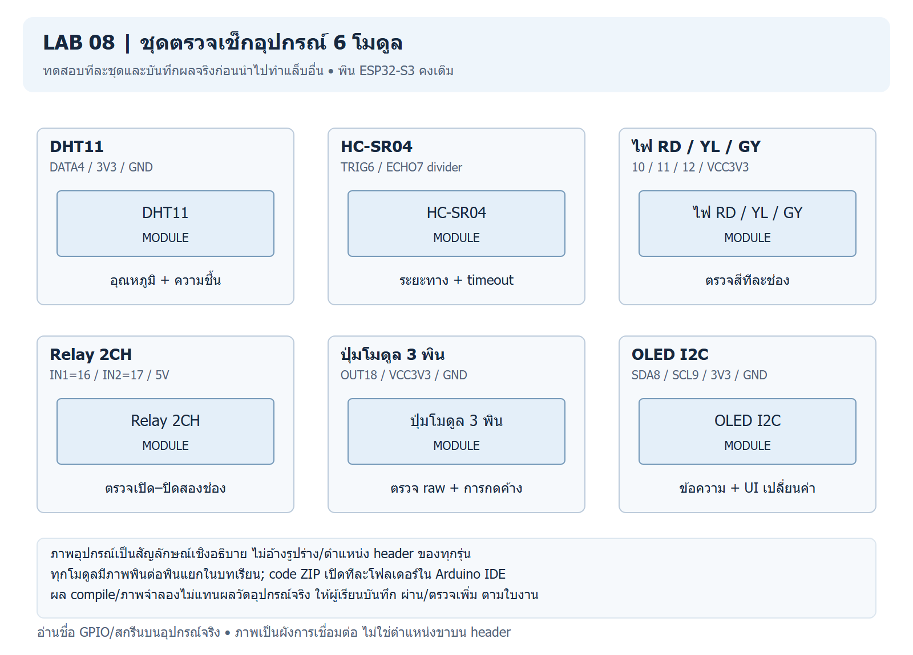
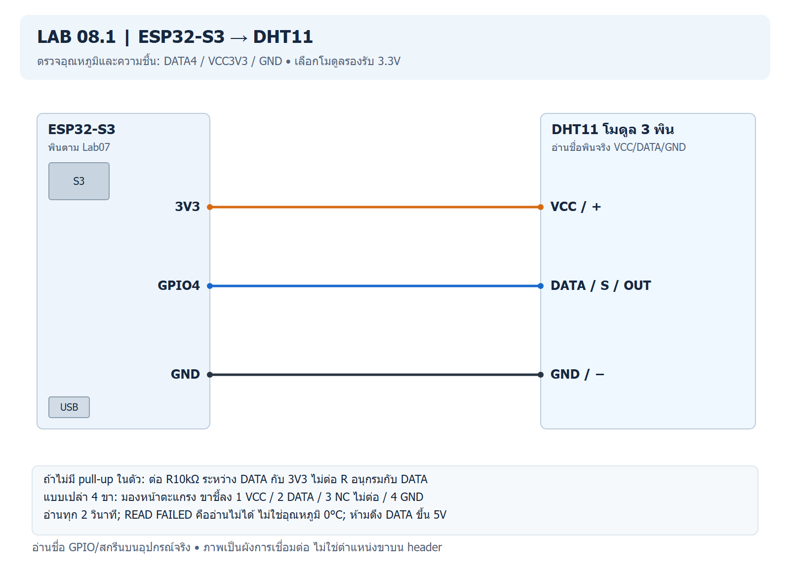
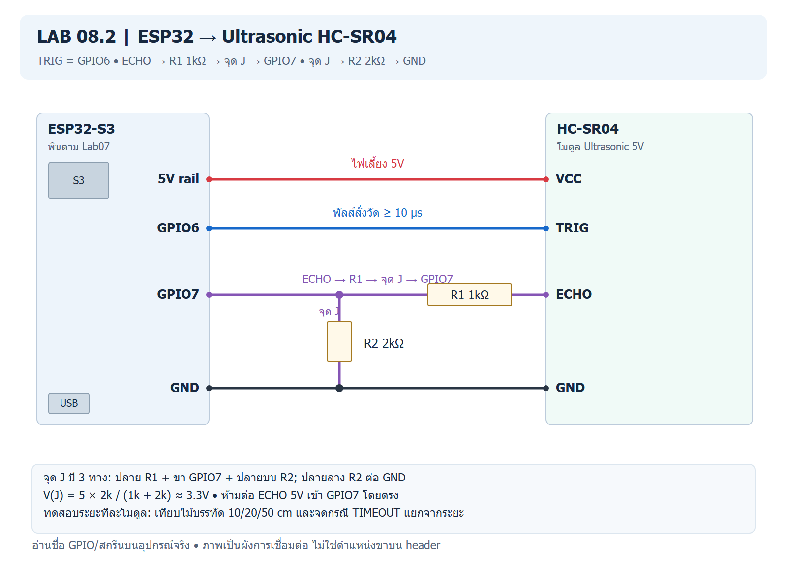
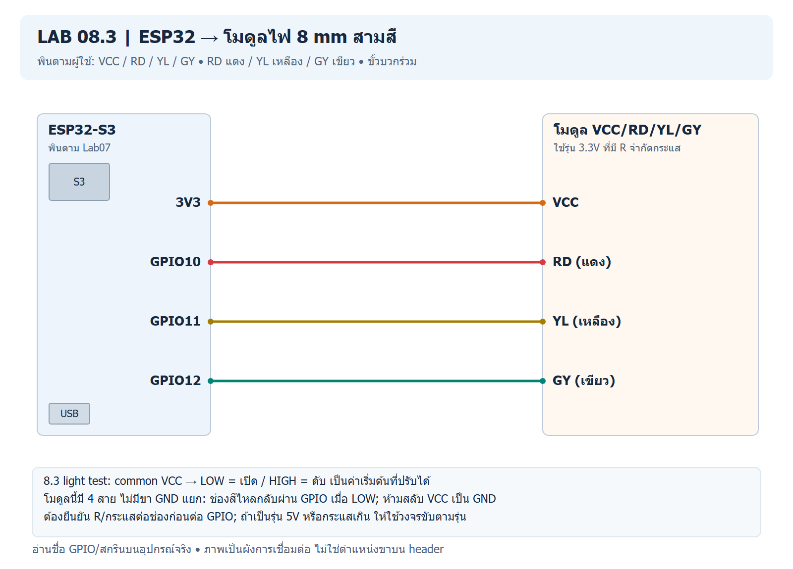
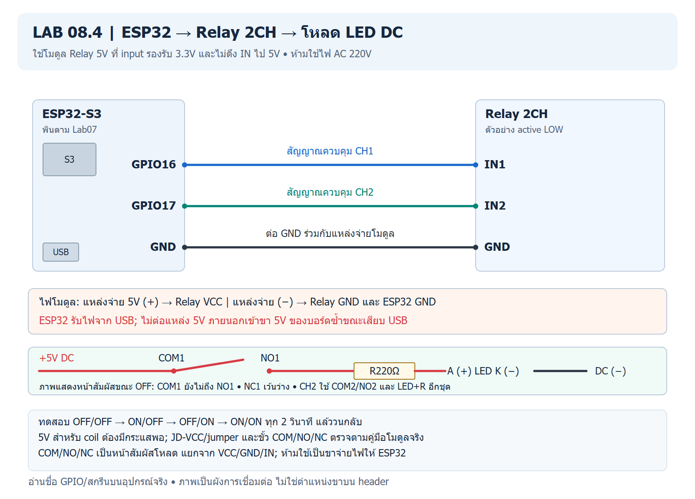
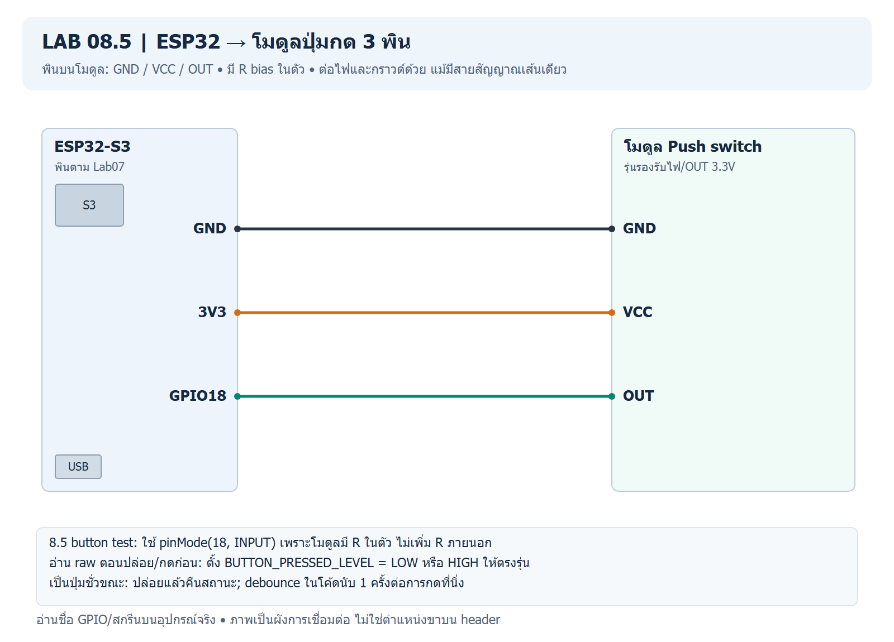
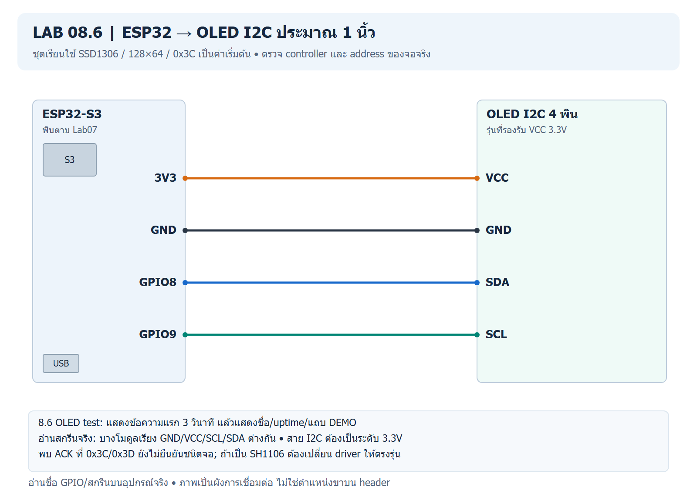
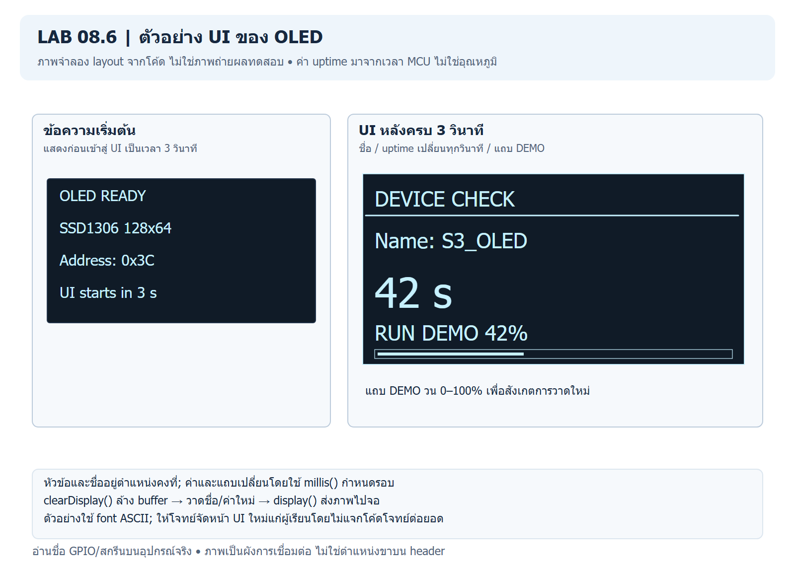

# Lab 08: ตรวจเช็กอุปกรณ์ก่อนใช้งาน — Hardware Health Check

> ระดับ: ⭐–⭐⭐ | เวลา: 2–3 ชม. | ต้องผ่าน: [Lab01](../lab01-esp32-introduction/) เฉพาะการติดตั้ง/Upload; เปิดบทนี้ก่อน Lab02–07 ได้

บทพิเศษนี้ให้ตรวจว่าอุปกรณ์แต่ละตัว **ต่อสายถูก อ่าน/สั่งได้ และแสดงผลตามที่คาด** ก่อนนำไปประกอบในแล็บอื่น ใช้ ESP32-S3 และพินชุดเดิมของคอร์ส ไม่ต้องเรียน Lab07 ให้จบก่อน และไม่ใช้ Wi-Fi/MQTT ในการตรวจพื้นฐาน

## 🎯 วัตถุประสงค์

- ต่อ DHT11, HC-SR04, ไฟสามสี, Relay2CH, ปุ่มโมดูล และ OLED ตามชื่อพินได้ทีละชุด
- ใช้โค้ดทดสอบแยกตรวจผล Serial และอุปกรณ์จริง แล้วบันทึก ผ่าน / ตรวจเพิ่ม / ยังไม่ทดสอบ
- อธิบายความต่างของค่าอ่านไม่ได้กับค่าศูนย์ การกดค้างกับขอบกด และค่าที่สั่งกับผลที่วัดจริง
- ต่อยอดจากการตรวจอุปกรณ์ไปสู่เงื่อนไข ข้อความแจ้งสถานะ toggle ลำดับไฟ และ UI เปลี่ยนค่า โดยออกแบบวิธีทำเอง

## 🧰 อุปกรณ์ที่ใช้

| อุปกรณ์ | จำนวน | หมายเหตุ |
|---|---:|---|
| ESP32-S3 + สาย USB data | 1 ชุด | ใช้พินหลัก S3; เลือก Flash/PSRAM ตามรุ่นจริง |
| DHT11 โมดูล | 1 | รองรับไฟ/ข้อมูล3.3V; ถ้าไม่มี pull-up ให้ใช้ R10kΩ |
| HC-SR04 | 1 | VCC5V และ divider ECHO: R1=1kΩ/R2=2kΩ |
| โมดูลไฟสามสี 8mm | 1 | VCC/RD/YL/GY ขั้วบวกร่วม3.3V มี R จำกัดกระแสเหมาะกับGPIO |
| Relay2CH | 1 | ไฟโมดูล5V, IN รองรับ3.3Vและไม่ดึงGPIOขึ้น5V |
| โมดูลปุ่ม Push switch | 1 | GND/VCC/OUT มีRในตัว รองรับ3.3V |
| OLED I2C ประมาณ1นิ้ว | 1 | baseline SSD1306 128×64 รองรับ3.3V; ไม่สรุปdriverจากขนาด |
| Breadboard/Jumper/แหล่ง5Vสำหรับโมดูล | ตามวงจร | GNDร่วมโดยไม่ป้อนไฟ5Vภายนอกกลับบอร์ดที่เสียบUSB |
| ไม้บรรทัด / มิเตอร์ / เครื่องวัดอ้างอิง | ถ้ามี | ใช้แยกผลสั่งงานออกจากผลจริง |



ภาพในบทนี้เป็นภาพเชิงอธิบายที่โครงการสร้างเอง ไม่ใช่รูปถ่ายผลการทดลองจริง รูปร่าง/ลำดับพินให้ยึดสกรีนของโมดูลที่มีอยู่ [ทะเบียนภาพ](../../assets/IMAGE_SOURCES.md)

## ❓ คำถามก่อนเริ่มต้น

<details>
<summary><b>คลิกเพื่อดูคำถามก่อนเรียน</b></summary>

1. ก่อนเชื่อมโมดูลที่ยังไม่เคยใช้ เราควรตรวจข้อมูลใดบ้าง?
2. ผลที่ compiler ยอมรับกับผลที่อุปกรณ์ทำงานจริงต่างกันอย่างไร?
3. การทดสอบทีละโมดูลช่วยค้นหาจุดผิดเมื่อเทียบกับการต่อทุกอย่างพร้อมกันอย่างไร?
4. ถ้าไม่มีค่าจากเซ็นเซอร์ เราควรบันทึกผลอย่างไร?
5. ถ้าต้องการพิสูจน์ว่าหน้าสัมผัส Relay เปลี่ยนจริง เราควรสังเกตหรือวัดอะไร?
6. หน้าจอที่ใช้แสดงชื่ออุปกรณ์และค่าที่เปลี่ยนไปควรจัดข้อมูลส่วนใดไว้ตรงไหน?

</details>

## 📖 ทฤษฎี

### แยกหลักฐานแต่ละระดับ

| ระดับ | หลักฐานที่ใช้ | สิ่งที่ยังสรุปไม่ได้ |
|---|---|---|
| Verify/Compile ผ่าน | ไม่มี build error | ยังไม่ยืนยันสาย ไฟ หรือสภาพโมดูล |
| Upload และมี Serial | โปรแกรมเริ่มและรายงานสถานะ | ข้อความที่สั่ง ON ยังไม่ยืนยันว่าไฟ/หน้าสัมผัสทำงาน |
| ตรวจอินพุต/เอาต์พุตจริง | เปลี่ยนระยะ กดปุ่ม ดูสี/จอ หรือวัดหน้าสัมผัส | ยังไม่ใช่การสอบเทียบความแม่นยำทุกสภาวะ |

ถ้าผลไม่ตรงคาด ให้เริ่มจากไฟและกราวด์ → ชื่อพินและทิศสัญญาณ → โมเดล/ระดับลอจิก → โค้ด/ตัวแปรที่เลือก อย่าเปลี่ยนหลายอย่างพร้อมกันแล้วสรุปว่าโมดูลเสีย

### พื้นฐานที่ใช้กับทุกชุด

- GPIO ของ S3 รับสัญญาณระดับ3.3V: ECHO5V ของ HC-SR04 ต้องลดระดับก่อนเข้าขา7 โมดูลอื่นต้องไม่ดึงขาESP32ขึ้น5V
- `millis()` ใช้กำหนดรอบโดยไม่รอวินาทีใน loop แต่ `pulseIn()` ยังรอพัลส์ตาม timeout และ library DHT/I2C ใช้เวลาระหว่างสื่อสารได้ บทนี้ไม่ได้อ้างว่าทุกคำสั่งไม่ block
- ปุ่มมีRในตัวช่วยกำหนดระดับ OUT แต่ยังมี bounce ได้ ใช้ `INPUT` และรอระดับนิ่ง40ms ก่อนรับขอบกด; ระดับกด LOW/HIGH ต้องตรวจจากของจริง
- ไฟVCC/RD/YL/GY ใช้ LOW=เปิด/HIGH=ดับตามวงจรขั้วบวกร่วมของชุดเรียน ชื่อสีตามผู้สอนคือแดง/เหลือง/เขียว ไม่มีช่องน้ำเงิน
- OLED ใช้ SDA8/SCL9 และมี buffer ภาพในRAM: ล้าง buffer → วาดข้อความ/ค่า/เส้น → ส่งด้วย `display()` จอ128×64ใช้ข้อมูลภาพหนึ่งบิตต่อpixelรวม1024bytes

## 🔌 การต่อวงจร

| โมดูล | สัญญาณ ESP32-S3 → พินโมดูล | ไฟ/กราวด์ |
|---|---|---|
| DHT11 | GPIO4 → DATA/S/OUT | 3V3→VCC, GND→GND |
| HC-SR04 | GPIO6→TRIG; ECHO→R1 1kΩ→J→GPIO7; J→R2 2kΩ→GND | 5V→VCC, GNDร่วม |
| ไฟสามสี | GPIO10→RD, GPIO11→YL, GPIO12→GY | 3V3→VCC; ไม่มีGNDแยก |
| Relay2CH | GPIO16→IN1, GPIO17→IN2 | ไฟโมดูล5VและGNDร่วมตามคู่มือ |
| ปุ่มโมดูล | GPIO18→OUT | 3V3→VCC, GND→GND |
| OLED | GPIO8→SDA, GPIO9→SCL | 3V3→VCC, GND→GND |

ถอด USB/แหล่งจ่ายก่อนต่อหรือย้ายสาย GPIOคือเลขสกรีน ไม่ใช่ลำดับขาบนheader ใช้พินเดิมจาก [ตารางคอร์ส](../../assets/PINOUT.md) ทุกโมดูลมีภาพขยายและตารางสายอยู่ในหัวข้อทดลองของตนด้านล่าง

เริ่มต่อเฉพาะโมดูลที่จะตรวจ เมื่อใช้ชุดสายที่ต่อค้างจากแล็บอื่น โค้ดนี้ตรวจเฉพาะโมดูลของตนและไม่รับรองสถานะขาที่ไม่ได้กำหนด โดยเฉพาะช่วงReset/ก่อนsetup ให้ถอดโหลดRelayระหว่างเตรียมชุดตรวจ การต่อสายค้างไม่ใช่หลักฐานว่าทุกเอาต์พุตถูกควบคุมพร้อมกัน

## 🧪 การทดลอง

### เตรียม IDE และดาวน์โหลด

1. เลือก **ESP32S3 Dev Module**, core3.x, COMของบอร์ด, Upload Speed115200 และ Serial Monitor115200 baud บอร์ดUSB-to-UART CH343ของผู้สอนตั้ง **USB CDC On Boot=Disabled** เลือกFlash/PSRAMตามบอร์ดจริง
2. ติดตั้ง **DHT sensor library**, **Adafruit Unified Sensor**, **Adafruit SSD1306**, **Adafruit GFX Library** และ **Adafruit BusIO** ผ่าน Library Manager ตามdependency อีกสี่โมดูลใช้Arduinoที่มากับcore
3. คลิกปุ่ม ZIP ของโมดูลที่ต้องการ แตกไฟล์ แล้วเปิด `.ino` ภายในโฟลเดอร์ชื่อเดียวกัน ห้ามรวมหลาย `.ino` ที่มีsetup/loopคนละชุดในsketchเดียว
4. ต่อวงจร → Verify → Upload → เปิดSerial → กดEN/Reset → เทียบผลจริงกับจุดตรวจ หากยังไม่ผ่านให้แก้ส่วนพื้นฐานก่อนทำโจทย์ต่อยอด

**ดาวน์โหลดรวมทั้ง 6 โมดูล**

[](downloads/lab08-all-modules.zip)

**ปุ่มด้านบนดาวน์โหลด ZIP รวม6สเก็ตช์** ส่วนปุ่มในแต่ละหัวข้อดาวน์โหลดเพียงชุดเดียว ทุกชุดมีโค้ดเต็มในหน้านี้ด้วย โค้ดดาวน์โหลดเป็น **การทดสอบพื้นฐาน** ไม่ได้มีโปรแกรมแก้โจทย์ต่อยอดที่ให้ผู้เรียนทำเอง

### การทดลองที่ 8.1: DHT11 — อ่านอุณหภูมิและความชื้น

**วงจรที่ใช้:** ตรวจโมดูลนี้กับ ESP32-S3 ทีละชุด ตามพินในภาพและตาราง



| ต่อจาก | ต่อไปยัง | หน้าที่/ข้อควรตรวจ |
|---|---|---|
| ESP32-S3 3V3 | DHT11 VCC/+ | ไฟ3.3V |
| ESP32-S3 GND | DHT11 GND/− | กราวด์ |
| ESP32-S3 GPIO4 | DHT11 DATA/S/OUT | รับข้อมูล |
| 3V3 → R10kΩ (ถ้าไม่มีในโมดูล) | DATAที่เชื่อมGPIO4 | pull-up ไม่ต่ออนุกรม |

[](downloads/lab08_dht11_test.zip)

[เปิดไฟล์ `lab08_dht11_test.ino`](code/lab08_dht11_test/lab08_dht11_test.ino) — แตกZIPแล้วเปิดโฟลเดอร์ชื่อเดียวกับsketch

**ขั้นตอนทดสอบพื้นฐาน**

1. ต่อสายตามรูป เลือกDHT11ที่รองรับ3.3V ตรวจว่ามีpull-up DATAหรือไม่ ถ้าเป็นsensorเปล่า4ขา: หันหน้าตะแกรง ขาชี้ลง 1=VCC/2=DATA/3=NCเว้น/4=GND
2. Uploadแล้วรออย่างน้อย2วินาที อ่านค่าอุณหภูมิและความชื้นหลายรอบ เปรียบเทียบแนวโน้มกับสภาพแวดล้อมหรือเครื่องวัดอ้างอิงถ้ามี
3. ปิดไฟก่อนถอดDATAแล้วเปิดตรวจใหม่ สังเกตREAD FAILED จากนั้นปิดไฟต่อกลับและตรวจซ้ำ ไม่อุ่นด้วยเปลวไฟหรือทำให้โมดูลเปียก

**โค้ดเต็มสำหรับตรวจอุปกรณ์**

```cpp
/*
 * Lab 8.1 : ตรวจเช็กอุปกรณ์ก่อนใช้งาน — ESP32-S3 + DHT11 (พินเดียวกับ Lab07)
 * วงจร: VCC/+ -> 3V3, GND/- -> GND, DATA/S/OUT -> GPIO4
 * ใช้รุ่นรองรับ 3.3V; ถ้าไม่มี pull-up ให้ต่อ R10k ระหว่าง DATA กับ 3V3
 * DHT11 เปล่า 4 ขา: มองหน้าตะแกรง ขาชี้ลง 1=VCC 2=DATA 3=NC 4=GND
 * ไลบรารี: DHT sensor library และ Adafruit Unified Sensor
 * Board: ESP32S3 Dev Module, Arduino-ESP32 core 3.x, Serial 115200
 */
#include <Arduino.h>
#include <DHT.h>

#if !defined(CONFIG_IDF_TARGET_ESP32S3)
#error "Select ESP32S3 Dev Module; this sketch uses the course ESP32-S3 pin map"
#endif

constexpr uint8_t DHT_PIN = 4;
constexpr uint32_t READ_INTERVAL_MS = 2000;
DHT dht(DHT_PIN, DHT11);
uint32_t previousReadMs = 0;

void setup() {
  Serial.begin(115200);
  dht.begin();
  previousReadMs = millis();
  Serial.println("[DHT11] DATA=GPIO4; รออ่านทุก 2 วินาที");
}

void loop() {
  const uint32_t now = millis();
  if (now - previousReadMs < READ_INTERVAL_MS) return;
  previousReadMs = now;

  // อ่านทั้งสองค่าและตรวจความสำเร็จ ไม่แทนค่าที่อ่านไม่ได้ด้วยศูนย์
  const float humidity = dht.readHumidity();
  const float temperature = dht.readTemperature();
  if (isnan(humidity) || isnan(temperature)) {
    Serial.println("[DHT11] READ FAILED: ตรวจ VCC/GND/DATA และ pull-up");
    return;
  }
  Serial.printf("[DHT11] temperature=%.1f C humidity=%.1f %%\n",
                temperature, humidity);
}
```

| ส่วนของโค้ด | หน้าที่ |
|---|---|
| READ_INTERVAL_MS / previousReadMs | กำหนดรอบอ่าน2วินาที |
| readHumidity/readTemperature | อ่านค่าความชื้นและอุณหภูมิ |
| isnan | แยกการอ่านล้มเหลวออกจากค่าที่อ่านได้ |

**ผลลัพธ์ Serial ที่คาดหวัง** — ค่าตัวเลข/เวลาเป็นตัวอย่าง ไม่ใช่ผลจากอุปกรณ์ที่ผู้เขียนวัดในรอบนี้

```text
[DHT11] temperature=28.0 C humidity=62.0 %
[DHT11] temperature=28.1 C humidity=62.0 %
[DHT11] READ FAILED: ตรวจ VCC/GND/DATA และ pull-up
```

**จุดตรวจ:** อ่านค่าเป็นตัวเลขต่อเนื่องได้โดยไม่มีREAD FAILEDซ้ำตลอด และมีบันทึกผลเทียบสภาพจริง ตัวเลขในตัวอย่างไม่ใช่ค่าอ้างอิงตายตัว

**โจทย์ต่อยอด — แจ้งเตือนอุณหภูมิที่กำหนด**

ให้ผู้เรียนกำหนดจุดเตือนเอง เช่น30°C แล้วแสดง `TEMP HIGH` เมื่ออุณหภูมิถึงจุดนั้น และ `TEMP NORMAL` เมื่อกลับลงต่ำกว่า เมื่ออ่านไม่ได้ให้แสดง `SENSOR ERROR` แยกจากสองสถานะแรก ให้รายงานข้อความเมื่อสถานะเปลี่ยนและยังอ่านค่าเป็นรอบเดิม

**แนวทาง:** แยกค่าจุดเตือนเป็นตัวแปรที่เปลี่ยนง่าย ตรวจความสำเร็จของข้อมูลก่อนใช้เงื่อนไข แล้วเก็บสถานะก่อนหน้าไว้เทียบกับรอบใหม่ ไม่ใช้ค่าอ่านไม่ได้เป็นเลขศูนย์

**หลักฐานที่ส่ง:** ค่าจุดเตือนที่เลือก ตารางกรณีต่ำกว่า/เท่ากับ/สูงกว่า และกรณีข้อมูลผิดพลาด ถ้าอุณหภูมิห้องไม่ผ่านจุดเตือน ให้ขอผู้สอนกำหนดจุดทดสอบใกล้ค่าที่อ่านจริงแทนการให้ความร้อนที่เสี่ยง

### การทดลองที่ 8.2: Ultrasonic HC-SR04 — วัดระยะและแยก timeout

**วงจรที่ใช้:** ตรวจโมดูลนี้กับ ESP32-S3 ทีละชุด ตามพินในภาพและตาราง



| ต่อจาก | ต่อไปยัง | หน้าที่/ข้อควรตรวจ |
|---|---|---|
| แหล่งจ่าย5V | HC-SR04 VCC | ไฟโมดูล |
| GNDร่วม | HC-SR04 GND | กราวด์ |
| GPIO6 | HC-SR04 TRIG | สั่งวัด |
| HC-SR04 ECHO | R1=1kΩ → จุดJ | ลดระดับ5V |
| จุดJ | GPIO7 และปลายบนR2=2kΩ | สามจุดต่อถึงกัน |
| ปลายล่างR2 | GND | ทางลงกราวด์ |

[](downloads/lab08_ultrasonic_test.zip)

[เปิดไฟล์ `lab08_ultrasonic_test.ino`](code/lab08_ultrasonic_test/lab08_ultrasonic_test.ino) — แตกZIPแล้วเปิดโฟลเดอร์ชื่อเดียวกับsketch

**ขั้นตอนทดสอบพื้นฐาน**

1. ตรวจdividerตามภาพ: ECHO→R1→จุดJ, จุดJแยกไปGPIO7และR2ลงGND ห้ามต่อECHOตรงเข้าGPIO7
2. Uploadแล้วใช้แผ่นเรียบตั้งฉากกับเซ็นเซอร์ที่10/20/50cm ใช้ไม้บรรทัดและจดอย่างน้อยระยะละ5ค่า
3. ขยับวัตถุออกหรือเอียงแผ่น สังเกตTIMEOUTแยกจากระยะที่อ่านได้ ไม่ใช้timeoutสรุปว่าไกลหรือระยะ0cm

**โค้ดเต็มสำหรับตรวจอุปกรณ์**

```cpp
/*
 * Lab 8.2 : ตรวจเช็กอุปกรณ์ก่อนใช้งาน — ESP32-S3 + Ultrasonic HC-SR04
 * วงจร: VCC -> แหล่งจ่าย 5V, GND -> GND ร่วม, TRIG -> GPIO6
 * ECHO -> R1 1k -> จุด J -> GPIO7; จุด J -> R2 2k -> GND
 * ห้ามต่อ ECHO 5V เข้าขา GPIO7 ตรง
 * ไลบรารี: Arduino มากับ core ไม่ต้องติดตั้งเพิ่ม
 * Board: ESP32S3 Dev Module, Arduino-ESP32 core 3.x, Serial 115200
 */
#include <Arduino.h>

#if !defined(CONFIG_IDF_TARGET_ESP32S3)
#error "Select ESP32S3 Dev Module; this sketch uses the course ESP32-S3 pin map"
#endif

constexpr uint8_t TRIG_PIN = 6;
constexpr uint8_t ECHO_PIN = 7;
constexpr uint32_t SAMPLE_INTERVAL_MS = 500;
constexpr uint32_t ECHO_TIMEOUT_US = 30000;
uint32_t previousSampleMs = 0;

void setup() {
  Serial.begin(115200);
  pinMode(TRIG_PIN, INPUT);
  digitalWrite(TRIG_PIN, LOW);
  pinMode(TRIG_PIN, OUTPUT);
  pinMode(ECHO_PIN, INPUT);
  previousSampleMs = millis();
  Serial.println("[ULTRASONIC] TRIG=GPIO6 ECHO=GPIO7 ผ่าน divider 1k/2k");
}

void loop() {
  const uint32_t now = millis();
  if (now - previousSampleMs < SAMPLE_INTERVAL_MS) return;
  previousSampleMs = now;

  // ส่งพัลส์เริ่มวัด 10 us แล้วรอ ECHO โดยจำกัดเวลารอ
  digitalWrite(TRIG_PIN, LOW);
  delayMicroseconds(2);
  digitalWrite(TRIG_PIN, HIGH);
  delayMicroseconds(10);
  digitalWrite(TRIG_PIN, LOW);
  const unsigned long durationUs = pulseIn(ECHO_PIN, HIGH, ECHO_TIMEOUT_US);
  if (durationUs == 0) {
    Serial.println("[ULTRASONIC] TIMEOUT: ไม่พบ ECHO ภายใน 30000 us");
    return;
  }
  // เวลาเสียงไป-กลับต้องหารสอง; ใช้ความเร็วเสียงประมาณ 0.0343 cm/us
  const float distanceCm = durationUs * 0.0343f / 2.0f;
  Serial.printf("[ULTRASONIC] echo=%lu us distance=%.1f cm\n", durationUs, distanceCm);
}
```

| ส่วนของโค้ด | หน้าที่ |
|---|---|
| TRIG_PIN/ECHO_PIN | คงพิน6/7และวงจรdivider |
| pulseIn + ECHO_TIMEOUT_US | รอพัลส์ไม่เกิน30000us |
| durationUs × 0.0343 / 2 | แปลงเวลาเดินทางไป-กลับเป็นcm |

**ผลลัพธ์ Serial ที่คาดหวัง** — ค่าตัวเลข/เวลาเป็นตัวอย่าง ไม่ใช่ผลจากอุปกรณ์ที่ผู้เขียนวัดในรอบนี้

```text
[ULTRASONIC] echo=1166 us distance=20.0 cm
[ULTRASONIC] TIMEOUT: ไม่พบ ECHO ภายใน 30000 us
```

**จุดตรวจ:** ค่าระยะเปลี่ยนตามการเลื่อนแผ่นและแยกTIMEOUTได้ มีบันทึกเทียบไม้บรรทัด การได้เลขครั้งเดียวไม่รับรองความแม่นยำทุกพื้นผิว

**โจทย์ต่อยอด — แบ่งช่วงระยะและพิมพ์ข้อความ**

ให้แสดง `NEAR` เมื่อระยะต่ำกว่า20cm, `WATCH` เมื่อตั้งแต่20cmแต่ไม่เกิน50cm และ `CLEAR` เมื่อเกิน50cm กรณีtimeoutให้แสดง `NO MEASUREMENT` และไม่ใช้การวัดครั้งนั้นจัดช่วง เพิ่มเงื่อนไขให้ข้อความสถานะไม่ไหลซ้ำทุกรอบเมื่อยังอยู่ช่วงเดิม

**แนวทาง:** ทำงานกับหน่วยcmหลังตรวจพัลส์สำเร็จ วางแผนขอบเขตที่20และ50ให้ไม่มีช่วงซ้ำ/ช่วงขาด แล้วเก็บชื่อหรือรหัสสถานะเดิมเพื่อเปรียบเทียบก่อนรายงาน ไม่เพิ่มdelayยาวเพื่อแก้ข้อความซ้ำ

**หลักฐานที่ส่ง:** ตารางทดสอบ19/20/21/50/51cmและtimeout พร้อมข้อความที่คาดก่อนทดลองและค่าที่เห็นจริง หากค่าบริเวณขอบแกว่ง ให้บันทึกอาการก่อนเสนอวิธีลดการสลับสถานะ

### การทดลองที่ 8.3: โมดูลไฟสามสี — ตรวจเขียว เหลือง แดงทีละช่อง

**วงจรที่ใช้:** ตรวจโมดูลนี้กับ ESP32-S3 ทีละชุด ตามพินในภาพและตาราง



| ต่อจาก | ต่อไปยัง | หน้าที่/ข้อควรตรวจ |
|---|---|---|
| 3V3 | VCC | ขั้วบวกร่วมของโมดูล3.3V |
| GPIO10 | RD | แดง |
| GPIO11 | YL | เหลือง |
| GPIO12 | GY | เขียว |

[](downloads/lab08_traffic_light_test.zip)

[เปิดไฟล์ `lab08_traffic_light_test.ino`](code/lab08_traffic_light_test/lab08_traffic_light_test.ino) — แตกZIPแล้วเปิดโฟลเดอร์ชื่อเดียวกับsketch

**ขั้นตอนทดสอบพื้นฐาน**

1. อ่านสกรีนVCC/RD/YL/GYและตรวจว่ามีRจำกัดกระแสในโมดูล กระแสแต่ละช่องเหมาะกับGPIO โมดูลนี้ไม่มีGNDแยก อย่าสลับVCCเป็นGND
2. UploadและสังเกตOFF→GREEN→YELLOW→RED→ALL ทุก2วินาที เทียบสีจริงกับSerial โดยใช้LOWเปิดเป็นbaseline
3. ถ้าสีหรือระดับกลับกันให้ถอดไฟแล้วตรวจคู่มือ/ชื่อสายก่อนปรับ ACTIVE_LOW อย่าถือว่าทุกโมดูล4พินใช้วงจรเดียวกัน

**โค้ดเต็มสำหรับตรวจอุปกรณ์**

```cpp
/*
 * Lab 8.3 : ตรวจเช็กอุปกรณ์ก่อนใช้งาน — ESP32-S3 + ไฟสามสี 8 mm แดง/เหลือง/เขียว
 * วงจร: VCC -> 3V3, RD -> GPIO10, YL -> GPIO11, GY -> GPIO12
 * ใช้โมดูลขั้วบวกร่วมที่มี R จำกัดกระแสในตัว รองรับ 3.3V และกระแส GPIO
 * มี 4 พิน VCC/RD/YL/GY ไม่มี GND แยก; ห้ามต่อ VCC เป็น GND
 * LOW=เปิด/HIGH=ดับตาม baseline; ตรวจวงจรจริงก่อนเปลี่ยน ACTIVE_LOW
 * ไลบรารี: Arduino มากับ core ไม่ต้องติดตั้งเพิ่ม
 * Board: ESP32S3 Dev Module, Arduino-ESP32 core 3.x, Serial 115200
 */
#include <Arduino.h>

#if !defined(CONFIG_IDF_TARGET_ESP32S3)
#error "Select ESP32S3 Dev Module; this sketch uses the course ESP32-S3 pin map"
#endif

constexpr uint8_t RED_PIN = 10;
constexpr uint8_t YELLOW_PIN = 11;
constexpr uint8_t GREEN_PIN = 12;
constexpr bool ACTIVE_LOW = true;
constexpr uint8_t ON_LEVEL = ACTIVE_LOW ? LOW : HIGH;
constexpr uint8_t OFF_LEVEL = ACTIVE_LOW ? HIGH : LOW;
constexpr uint8_t COLOR_PINS[] = {RED_PIN, YELLOW_PIN, GREEN_PIN};
constexpr uint32_t STEP_INTERVAL_MS = 2000;
const char* const STEP_NAMES[] = {"OFF", "GREEN", "YELLOW", "RED", "ALL"};
constexpr uint8_t STEP_COUNT = sizeof(STEP_NAMES) / sizeof(STEP_NAMES[0]);
uint8_t stepIndex = 0;
uint32_t previousStepMs = 0;

void showStep() {
  // ปิดทุกช่องก่อนเลือกสีใหม่ ลดการเปิดค้างระหว่างเปลี่ยนสถานะ
  for (uint8_t pin : COLOR_PINS) digitalWrite(pin, OFF_LEVEL);
  if (stepIndex == 1 || stepIndex == 4) digitalWrite(GREEN_PIN, ON_LEVEL);
  if (stepIndex == 2 || stepIndex == 4) digitalWrite(YELLOW_PIN, ON_LEVEL);
  if (stepIndex == 3 || stepIndex == 4) digitalWrite(RED_PIN, ON_LEVEL);
  Serial.printf("[LIGHT] %s | RD=GPIO10 YL=GPIO11 GY=GPIO12\n", STEP_NAMES[stepIndex]);
}

void setup() {
  Serial.begin(115200);
  // ผูกเป็น GPIO ก่อนตั้ง latch OFF แล้วจึงเปิด OUTPUT ตาม API core 3.x
  // การสั่ง OFF นี้ไม่รับรองระดับขาขณะ Reset หรือก่อน setup
  for (uint8_t pin : COLOR_PINS) {
    pinMode(pin, INPUT);
    digitalWrite(pin, OFF_LEVEL);
    pinMode(pin, OUTPUT);
  }
  showStep();
  previousStepMs = millis();
}

void loop() {
  const uint32_t now = millis();
  if (now - previousStepMs < STEP_INTERVAL_MS) return;
  previousStepMs = now;
  stepIndex = (stepIndex + 1) % STEP_COUNT;
  showStep();
}
```

| ส่วนของโค้ด | หน้าที่ |
|---|---|
| COLOR_PINS/ACTIVE_LOW | รวมขาช่องสีและระดับเปิดดับ |
| stepIndex/STEP_NAMES | เลือกสถานะOFF/สีเดี่ยว/ทุกสี |
| previousStepMs | เปลี่ยนขั้นทุก2วินาทีโดยไม่delay |

**ผลลัพธ์ Serial ที่คาดหวัง** — ค่าตัวเลข/เวลาเป็นตัวอย่าง ไม่ใช่ผลจากอุปกรณ์ที่ผู้เขียนวัดในรอบนี้

```text
[LIGHT] OFF | RD=GPIO10 YL=GPIO11 GY=GPIO12
[LIGHT] GREEN | RD=GPIO10 YL=GPIO11 GY=GPIO12
[LIGHT] YELLOW | RD=GPIO10 YL=GPIO11 GY=GPIO12
[LIGHT] RED | RD=GPIO10 YL=GPIO11 GY=GPIO12
[LIGHT] ALL | RD=GPIO10 YL=GPIO11 GY=GPIO12
```

**จุดตรวจ:** ชื่อสีในSerialตรงไฟจริงทั้งสามช่อง OFFดับครบและALLติดครบ หากเปิดครบแล้วไฟตก/รีเซ็ตต้องตรวจไฟเลี้ยงและกระแสก่อนใช้ต่อ

**โจทย์ต่อยอด — ออกแบบรูปแบบไฟสามโหมด**

ออกแบบให้มีโหมดดังนี้: A เปิดทั้งสามสีค้าง, B เปิดพร้อมกัน500msแล้วดับพร้อมกัน500ms และ C ไล่เขียว→เหลือง→แดง สีละ250msโดยมีช่วงดับทั้งหมด250msก่อนเริ่มรอบใหม่ ให้เลือกโหมดจากSerialด้วยอักษรA/B/C และมีคำสั่งSหยุดให้ทุกสีดับ

**แนวทาง:** แยกข้อมูลว่าอยู่โหมดใด ออกจากข้อมูลว่าอยู่ขั้นใดในโหมดนั้น สร้างตารางชื่อสี/ระยะเวลาบนกระดาษก่อนใช้arrayหรือตัวแปรstate กำหนดเวลาจากmillisเพื่อยังอ่านคำสั่งหยุดได้ ไม่เพิ่มsetup/loopชุดใหม่ทับของเดิม

**หลักฐานที่ส่ง:** ตารางสถานะ/เวลาของแต่ละโหมด วิดีโอสั้นหรือบันทึกผล และทดลองส่งSระหว่างที่ไฟกำลังไล่สี โดยอธิบายได้ว่าระยะเวลาตอบสนองขึ้นกับส่วนใด

### การทดลองที่ 8.4: Relay 2CH — ทดสอบเปิด–ปิดเท่านั้น

**วงจรที่ใช้:** ตรวจโมดูลนี้กับ ESP32-S3 ทีละชุด ตามพินในภาพและตาราง



| ต่อจาก | ต่อไปยัง | หน้าที่/ข้อควรตรวจ |
|---|---|---|
| แหล่งจ่ายโมดูล5V | Relay VCC | จ่ายกระแสขดลวดตามรุ่น |
| ขั้วลบแหล่งจ่ายและESP32 GND | Relay GND | กราวด์ร่วมตามคู่มือ |
| GPIO16 | IN1 | สั่งช่อง1 |
| GPIO17 | IN2 | สั่งช่อง2 |

[](downloads/lab08_relay_2ch_test.zip)

[เปิดไฟล์ `lab08_relay_2ch_test.ino`](code/lab08_relay_2ch_test/lab08_relay_2ch_test.ino) — แตกZIPแล้วเปิดโฟลเดอร์ชื่อเดียวกับsketch

**ขั้นตอนทดสอบพื้นฐาน**

1. ถอดโหลดจากCOM/NO/NCก่อน ตรวจINรองรับ3.3Vและไม่ดึงขาESP32ขึ้น5V เดินJD-VCCตามคู่มือโมดูล ห้ามใช้ไฟAC220Vในการทดลอง
2. Uploadแล้วดูOFF/OFF→ON/OFF→OFF/ON→ON/ON สลับทุก2วินาที เทียบSerialกับไฟสถานะและเสียงคลิกทั้งสองช่อง
3. ถ้าตรวจโหลดให้ใช้LEDพร้อมR/แหล่งDCแรงดันต่ำผ่านCOM/NOและตรวจผลจริง แยกค่าที่โปรแกรมสั่งออกจากหน้าสัมผัสที่วัดได้ โหมดcontinuityใช้เฉพาะวงจรที่ตัดไฟแล้ว

**โค้ดเต็มสำหรับตรวจอุปกรณ์**

```cpp
/*
 * Lab 8.4 : ตรวจเช็กอุปกรณ์ก่อนใช้งาน — ESP32-S3 + Relay 2CH (พินเดียวกับ Lab07)
 * วงจร: IN1 -> GPIO16, IN2 -> GPIO17, VCC -> แหล่งจ่ายโมดูล 5V
 * GND โมดูล/ขั้วลบแหล่งจ่าย/ESP32 ต้องร่วมกันตามวงจรโมดูล
 * ใช้โมดูล IN รองรับ 3.3V และไม่ดึง GPIO ขึ้น 5V; JD-VCC ต่อให้ตรงคู่มือ
 * เริ่มทดสอบโดยถอดโหลด; ถ้าต่อโหลดให้ใช้ DC แรงดันต่ำเท่านั้น ห้าม AC 220V
 * ไลบรารี: Arduino มากับ core ไม่ต้องติดตั้งเพิ่ม
 * Board: ESP32S3 Dev Module, Arduino-ESP32 core 3.x, Serial 115200
 */
#include <Arduino.h>

#if !defined(CONFIG_IDF_TARGET_ESP32S3)
#error "Select ESP32S3 Dev Module; this sketch uses the course ESP32-S3 pin map"
#endif

constexpr uint8_t RELAY_1_PIN = 16;
constexpr uint8_t RELAY_2_PIN = 17;
constexpr bool ACTIVE_LOW = true;  // ถ้ารุ่นจริง active HIGH ให้ปรับหลังตรวจคู่มือ
constexpr uint8_t ON_LEVEL = ACTIVE_LOW ? LOW : HIGH;
constexpr uint8_t OFF_LEVEL = ACTIVE_LOW ? HIGH : LOW;
constexpr uint8_t RELAY_PINS[] = {RELAY_1_PIN, RELAY_2_PIN};
constexpr uint32_t STEP_INTERVAL_MS = 2000;
constexpr uint8_t STEP_COUNT = 4;
uint8_t stepIndex = 0;
uint32_t previousStepMs = 0;

void applyStep() {
  // ลำดับ: ปิดทั้งคู่ -> CH1 -> CH2 -> เปิดทั้งคู่ -> กลับปิดทั้งคู่
  const bool channel1On = stepIndex == 1 || stepIndex == 3;
  const bool channel2On = stepIndex == 2 || stepIndex == 3;
  digitalWrite(RELAY_1_PIN, OFF_LEVEL);
  digitalWrite(RELAY_2_PIN, OFF_LEVEL);
  if (channel1On) digitalWrite(RELAY_1_PIN, ON_LEVEL);
  if (channel2On) digitalWrite(RELAY_2_PIN, ON_LEVEL);
  Serial.printf("[RELAY] CH1=%s CH2=%s | IN1=GPIO16 IN2=GPIO17\n",
                channel1On ? "ON" : "OFF", channel2On ? "ON" : "OFF");
}

void setup() {
  Serial.begin(115200);
  // เตรียม latch OFF หลังผูกเป็น GPIO; ไม่รับรองสถานะก่อน setup/ช่วง Reset
  for (uint8_t pin : RELAY_PINS) {
    pinMode(pin, INPUT);
    digitalWrite(pin, OFF_LEVEL);
    pinMode(pin, OUTPUT);
  }
  applyStep();
  previousStepMs = millis();
}

void loop() {
  const uint32_t now = millis();
  if (now - previousStepMs < STEP_INTERVAL_MS) return;
  previousStepMs = now;
  stepIndex = (stepIndex + 1) % STEP_COUNT;
  applyStep();
}
```

| ส่วนของโค้ด | หน้าที่ |
|---|---|
| RELAY_PINS | IN1=16/IN2=17ตามLab07 |
| ACTIVE_LOW/ON_LEVEL/OFF_LEVEL | แปลงความหมายON/OFFเป็นระดับไฟฟ้า |
| applyStep | สั่งสองช่องจากสถานะทดสอบเดียวกัน |

**ผลลัพธ์ Serial ที่คาดหวัง** — ค่าตัวเลข/เวลาเป็นตัวอย่าง ไม่ใช่ผลจากอุปกรณ์ที่ผู้เขียนวัดในรอบนี้

```text
[RELAY] CH1=OFF CH2=OFF | IN1=GPIO16 IN2=GPIO17
[RELAY] CH1=ON CH2=OFF | IN1=GPIO16 IN2=GPIO17
[RELAY] CH1=OFF CH2=ON | IN1=GPIO16 IN2=GPIO17
[RELAY] CH1=ON CH2=ON | IN1=GPIO16 IN2=GPIO17
```

**จุดตรวจ:** ทั้งสองช่องเปิด/ปิดตามลำดับและตรวจหน้าสัมผัส/โหลดDCแยกจากSerialได้ ไม่ใช้เสียงคลิกอย่างเดียวรับรองโหลด

**ขอบเขตหัวข้อนี้:** ทดสอบเปิด–ปิดทั้งสองช่องและบันทึกผล ไม่มีโจทย์ควบคุมเพิ่มเติมสำหรับRelayในบทนี้ตามคำสั่งผู้สอน

### การทดลองที่ 8.5: โมดูลปุ่มกด — ตรวจ raw และการกดหนึ่งครั้ง

**วงจรที่ใช้:** ตรวจโมดูลนี้กับ ESP32-S3 ทีละชุด ตามพินในภาพและตาราง



| ต่อจาก | ต่อไปยัง | หน้าที่/ข้อควรตรวจ |
|---|---|---|
| GND | ปุ่มGND | กราวด์ |
| 3V3 | ปุ่มVCC | ไฟโมดูล |
| GPIO18 | ปุ่มOUT | อ่านด้วยINPUT ไม่เพิ่มRภายนอก |

[](downloads/lab08_button_module_test.zip)

[เปิดไฟล์ `lab08_button_module_test.ino`](code/lab08_button_module_test/lab08_button_module_test.ino) — แตกZIPแล้วเปิดโฟลเดอร์ชื่อเดียวกับsketch

**ขั้นตอนทดสอบพื้นฐาน**

1. ต่อGND/VCC/OUTครบสามสายและใช้โมดูลOUTไม่เกิน3.3V ไม่ต่อเฉพาะOUTโดยไม่มีไฟ/กราวด์
2. Uploadแล้วปล่อยปุ่มและกดค้าง อ่านrawทั้งสองกรณี ถ้ากดแล้วraw=1ให้เปลี่ยนBUTTON_PRESSED_LEVELเป็นHIGHแล้วUploadใหม่
3. กด–ปล่อยช้าๆ5ครั้งและกดค้าง2วินาทีอีกหนึ่งครั้ง ดูcountเพิ่มเพียงครั้งต่อการกดที่นิ่ง ไม่เพิ่มตามจำนวนรอบloop

**โค้ดเต็มสำหรับตรวจอุปกรณ์**

```cpp
/*
 * Lab 8.5 : ตรวจเช็กอุปกรณ์ก่อนใช้งาน — ESP32-S3 + ปุ่มกด momentary 3 พิน
 * วงจร: GND -> GND, VCC -> 3V3, OUT -> GPIO18
 * โมดูลมี R bias ในตัว ใช้ INPUT ไม่เพิ่ม R; OUT ต้องไม่เกิน 3.3V
 * อ่าน raw ตอนปล่อย/กดแล้วตั้ง BUTTON_PRESSED_LEVEL ให้ตรงรุ่น
 * ไลบรารี: Arduino มากับ core ไม่ต้องติดตั้งเพิ่ม
 * Board: ESP32S3 Dev Module, Arduino-ESP32 core 3.x, Serial 115200
 */
#include <Arduino.h>

#if !defined(CONFIG_IDF_TARGET_ESP32S3)
#error "Select ESP32S3 Dev Module; this sketch uses the course ESP32-S3 pin map"
#endif

constexpr uint8_t BUTTON_PIN = 18;
constexpr uint8_t BUTTON_PRESSED_LEVEL = LOW;  // เปลี่ยนเป็น HIGH ถ้ากดแล้ว raw=1
constexpr uint32_t DEBOUNCE_MS = 40;
constexpr uint32_t REPORT_INTERVAL_MS = 500;
bool previousRawLevel = HIGH;
bool stableLevel = HIGH;
uint32_t lastRawChangeMs = 0;
uint32_t previousReportMs = 0;
uint32_t pressCount = 0;

void setup() {
  Serial.begin(115200);
  pinMode(BUTTON_PIN, INPUT);
  // เริ่มจากระดับขาจริง ไม่สร้างขอบกดปลอมจากค่าตั้งต้น
  previousRawLevel = digitalRead(BUTTON_PIN);
  stableLevel = previousRawLevel;
  lastRawChangeMs = millis();
  Serial.println("[BUTTON] OUT=GPIO18; เทียบ raw ตอนปล่อย/กด ก่อนตั้งระดับกด");
}

void loop() {
  const uint32_t now = millis();
  const bool rawLevel = digitalRead(BUTTON_PIN);
  if (rawLevel != previousRawLevel) {
    previousRawLevel = rawLevel;
    lastRawChangeMs = now;
  }
  // รับสถานะใหม่เมื่อ raw คงที่ 40 ms; กดค้างไม่เพิ่มจำนวนซ้ำ
  if (rawLevel != stableLevel && now - lastRawChangeMs >= DEBOUNCE_MS) {
    stableLevel = rawLevel;
    if (stableLevel == BUTTON_PRESSED_LEVEL) {
      pressCount++;
      Serial.printf("[BUTTON] PRESSED count=%lu\n", static_cast<unsigned long>(pressCount));
    } else {
      Serial.println("[BUTTON] RELEASED");
    }
  }
  if (now - previousReportMs >= REPORT_INTERVAL_MS) {
    previousReportMs = now;
    Serial.printf("[BUTTON] raw=%u stable=%u pressed=%u count=%lu\n",
                  rawLevel, stableLevel, stableLevel == BUTTON_PRESSED_LEVEL,
                  static_cast<unsigned long>(pressCount));
  }
}
```

| ส่วนของโค้ด | หน้าที่ |
|---|---|
| BUTTON_PRESSED_LEVEL | กำหนดระดับที่ตรงกับการกดจริง |
| previousRawLevel/stableLevel | แยกระดับดิบกับระดับที่ยืนยันแล้ว |
| DEBOUNCE_MS/pressCount | รอนิ่ง40msแล้วนับขอบกด ไม่เพิ่มจากการกดค้าง |

**ผลลัพธ์ Serial ที่คาดหวัง** — ค่าตัวเลข/เวลาเป็นตัวอย่าง ไม่ใช่ผลจากอุปกรณ์ที่ผู้เขียนวัดในรอบนี้

```text
[BUTTON] raw=1 stable=1 pressed=0 count=0
[BUTTON] PRESSED count=1
[BUTTON] raw=0 stable=0 pressed=1 count=1
[BUTTON] RELEASED
```

**จุดตรวจ:** rawเปลี่ยนตามกด/ปล่อยและcountไม่เพิ่มจากการกดค้าง ข้อมูลตัวอย่างนี้สมมติโมดูลกดLOW ต้องตั้งให้ตรงของจริง

**โจทย์ต่อยอด — กดสลับ ON/OFF พร้อมข้อความ**

เริ่มสถานะOFF กดครั้งที่1ให้เปลี่ยนเป็นONและพิมพ์ `SYSTEM ON`, กดครั้งที่2กลับเป็นOFFและพิมพ์ `SYSTEM OFF` ทำวนไปโดยยังนับจำนวนกดเดิมอยู่ การกดค้างต้องไม่สลับซ้ำ และการปล่อยอย่างเดียวต้องไม่เปลี่ยนสถานะ

**แนวทาง:** เพิ่มตัวแปรสถานะที่อยู่ข้ามรอบloop ใช้เหตุการณ์กดที่ผ่านdebounceแล้วเป็นจุดเปลี่ยนสถานะ แยก count ออกจากสถานะON/OFF และรายงานข้อความหลังเปลี่ยนสำเร็จ อย่าเปลี่ยนค่าทุกรอบที่rawยังอยู่ระดับกด

**หลักฐานที่ส่ง:** ผลกด–ปล่อย6ครั้งและกดค้าง2วินาที พร้อมลำดับcount/สถานะ/ข้อความที่คาดและที่เกิดจริง โจทย์นี้เปลี่ยนสถานะในโปรแกรม ยังไม่ต้องต่อโหลดหรือRelayเพิ่ม

### การทดลองที่ 8.6: OLED — ข้อความและ UI ที่แสดงชื่อกับค่าเปลี่ยนได้

**วงจรที่ใช้:** ตรวจโมดูลนี้กับ ESP32-S3 ทีละชุด ตามพินในภาพและตาราง



| ต่อจาก | ต่อไปยัง | หน้าที่/ข้อควรตรวจ |
|---|---|---|
| 3V3 | OLED VCC | เลือกรุ่นรองรับ3.3V |
| GND | OLED GND | กราวด์ |
| GPIO8 | OLED SDA | ข้อมูลI2C |
| GPIO9 | OLED SCL | clockI2C |

[](downloads/lab08_oled_ui_test.zip)

[เปิดไฟล์ `lab08_oled_ui_test.ino`](code/lab08_oled_ui_test/lab08_oled_ui_test.ino) — แตกZIPแล้วเปิดโฟลเดอร์ชื่อเดียวกับsketch

**ขั้นตอนทดสอบพื้นฐาน**

1. ต่อพินตามสกรีนจริง SDA8/SCL9 ไม่เดาจากลำดับขาซ้ายขวา ใช้OLEDตัวเดียวบนบัสและbaselineSSD1306 128×64
2. ติดตั้งAdafruit SSD1306/GFX/BusIO แล้วUpload โค้ดจะตรวจACKที่0x3Cก่อน0x3D เมื่อinitสำเร็จให้ตรวจว่าจอแสดงOLED READY/ขนาด/addressจริง
3. หลังครบ3วินาทีดูUIหัวข้อDEVICE CHECK ชื่อS3_OLED, ค่าuptimeหน่วยวินาที และแถบDEMOที่วน0–100%ทุกหนึ่งวินาที เปรียบเทียบกับSerial
4. ถ้าACKมีแต่ภาพไม่ถูก ให้ตรวจcontroller/ความละเอียดของจอจริงก่อนเปลี่ยนdriver ACKและbeginสำเร็จไม่ยืนยันว่าเป็นSSD1306

**โค้ดเต็มสำหรับตรวจอุปกรณ์**

```cpp
/*
 * Lab 08.6 : ตรวจจอ OLED ด้วยข้อความและหน้า UI ที่เปลี่ยนค่า
 * วงจร: OLED I2C VCC->3V3, GND->GND, SDA->GPIO8, SCL->GPIO9
 * จอ baseline SSD1306 128x64; ตรวจ ACK ที่ 0x3C/0x3D ไม่ได้ระบุชนิด controller
 * แสดง OLED READY 3 วินาที แล้วแสดงชื่ออุปกรณ์/uptime/แถบ DEMO
 * ไลบรารี: Adafruit SSD1306, Adafruit GFX Library, Adafruit BusIO
 * Board: ESP32S3 Dev Module, Arduino-ESP32 core 3.x, Serial 115200
 */
#include <Arduino.h>
#include <Wire.h>
#include <Adafruit_GFX.h>
#include <Adafruit_SSD1306.h>

#if !defined(CONFIG_IDF_TARGET_ESP32S3)
#error "Select ESP32S3 Dev Module; this sketch uses the course ESP32-S3 pin map"
#endif

constexpr uint8_t SDA_PIN = 8;
constexpr uint8_t SCL_PIN = 9;
constexpr uint8_t OLED_ADDRESSES[] = {0x3C, 0x3D};
constexpr int SCREEN_WIDTH = 128;
constexpr int SCREEN_HEIGHT = 64;
constexpr uint32_t I2C_CLOCK_HZ = 100000;
constexpr uint32_t INTRO_MS = 3000;
constexpr uint32_t UPDATE_MS = 1000;
constexpr char DEVICE_NAME[] = "S3_OLED";
Adafruit_SSD1306 display(SCREEN_WIDTH, SCREEN_HEIGHT, &Wire, -1,
                        I2C_CLOCK_HZ, I2C_CLOCK_HZ);
bool oledReady = false;
uint8_t oledAddress = 0;
uint32_t introStartedMs = 0;
uint32_t previousUpdateMs = 0;
bool firstUiFrame = true;

bool initOled() {
  if (!Wire.begin(SDA_PIN, SCL_PIN, I2C_CLOCK_HZ)) {
    Serial.println("[OLED] I2C BEGIN FAILED");
    return false;
  }
  Wire.setTimeOut(50);
  // ใช้จอตัวเดียวและเลือก address แรกที่ตอบ ACK โดยเริ่มจาก 0x3C
  for (uint8_t address : OLED_ADDRESSES) {
    Wire.beginTransmission(address);
    if (Wire.endTransmission() == 0) {
      oledAddress = address;
      break;
    }
  }
  if (oledAddress == 0) {
    Serial.println("[OLED] NO ACK at 0x3C/0x3D: ตรวจไฟ/SDA8/SCL9");
    return false;
  }
  // periphBegin=false เพื่อใช้บัสและพินที่กำหนดไว้ข้างต้น
  if (!display.begin(SSD1306_SWITCHCAPVCC, oledAddress, true, false)) {
    Serial.println("[OLED] BUFFER/INIT FAILED");
    return false;
  }
  display.setTextColor(SSD1306_WHITE);
  display.setTextWrap(false);
  display.clearDisplay();
  display.setTextSize(1);
  display.setCursor(0, 0);
  display.println("OLED READY");
  display.println("SSD1306 128x64");
  display.print("Address: 0x");
  display.println(oledAddress, HEX);
  display.println("UI starts in 3 s");
  display.display();
  Serial.printf("[OLED] ACK=0x%02X init=OK; ตรวจข้อความบนจอจริง\n", oledAddress);
  return true;
}

void drawUi(uint32_t now) {
  const unsigned long uptimeSeconds = now / 1000;
  // DEMO เป็นความยาวแถบสำหรับทดสอบ UI ไม่ใช่ค่าเซ็นเซอร์ภายนอก
  const uint8_t demoPercent = uptimeSeconds % 101;
  display.clearDisplay();
  display.drawRect(0, 0, 128, 64, SSD1306_WHITE);
  display.setTextSize(1);
  display.setCursor(4, 4);
  display.print("DEVICE CHECK");
  display.drawLine(1, 14, 126, 14, SSD1306_WHITE);
  display.setCursor(4, 18);
  display.print("Name: ");
  display.print(DEVICE_NAME);
  display.setTextSize(2);
  display.setCursor(4, 31);
  display.print(uptimeSeconds);
  display.print(" s");
  display.setTextSize(1);
  display.setCursor(4, 49);
  display.print("RUN  DEMO ");
  display.print(demoPercent);
  display.print('%');
  display.drawRect(4, 59, 120, 3, SSD1306_WHITE);
  display.fillRect(5, 60, static_cast<int>(demoPercent) * 118 / 100, 1, SSD1306_WHITE);
  display.display();
  Serial.printf("[OLED] name=%s uptime=%lu s demo=%u %%\n",
                DEVICE_NAME, uptimeSeconds, demoPercent);
}

void setup() {
  Serial.begin(115200);
  oledReady = initOled();
  introStartedMs = millis();
}

void loop() {
  const uint32_t now = millis();
  if (!oledReady) {
    if (now - previousUpdateMs >= UPDATE_MS) {
      previousUpdateMs = now;
      Serial.println("[OLED] NOT READY: ตรวจสาย/รุ่นจอ แล้ว Reset เพื่อเริ่มใหม่");
    }
    return;
  }
  // ใช้ timer แทน delay เพื่อเว้นข้อความแรกและอัปเดต UI เป็นรอบ
  if (now - introStartedMs < INTRO_MS) return;
  if (firstUiFrame || now - previousUpdateMs >= UPDATE_MS) {
    firstUiFrame = false;
    previousUpdateMs = now;
    drawUi(now);
  }
}
```

| ส่วนของโค้ด | หน้าที่ |
|---|---|
| initOled/ACK | เริ่มSDA8/SCL9 ตรวจaddressแล้วตั้งSSD1306โดยไม่เริ่มบัสทับ |
| INTRO_MS/UPDATE_MS | แบ่งหน้าข้อความ3วินาทีกับหน้าUIที่อัปเดตทุกวินาที |
| DEVICE_NAME / uptimeSeconds | ชื่อคงที่และค่าที่มาจากmillisของMCU ไม่ใช่ข้อมูลอุณหภูมิ |
| drawUi | ล้างbuffer วาดกรอบ/หัวข้อ/ชื่อ/ค่าขนาดใหญ่/แถบ แล้วส่งdisplay |

**ผลลัพธ์ Serial ที่คาดหวัง** — ค่าตัวเลข/เวลาเป็นตัวอย่าง ไม่ใช่ผลจากอุปกรณ์ที่ผู้เขียนวัดในรอบนี้

```text
[OLED] ACK=0x3C init=OK; ตรวจข้อความบนจอจริง
[OLED] name=S3_OLED uptime=3 s demo=3 %
[OLED] name=S3_OLED uptime=4 s demo=4 %
```

**จุดตรวจ:** ข้อความและUIอยู่ครบในจอ ตัวเลขและแถบเปลี่ยนตามเวลา ไม่มีเศษเลขเก่าค้าง และSerialสอดคล้องกับจอ; DEMOไม่ใช่เซ็นเซอร์อีกตัว



**อ่านตัวอย่าง UI ที่ทำไว้:** หัวข้อคงที่อยู่ด้านบน ชื่ออุปกรณ์อยู่แถวถัดไป ค่าที่เปลี่ยนใช้ตัวอักษรใหญ่และมีหน่วย แถวล่างบอกสถานะกับแถบDEMO รหัสชื่อเปลี่ยนได้ที่ `DEVICE_NAME` ส่วน `setCursor` ใช้พิกัดpixelไม่ใช่ลำดับแถวของLCD16×2 เรียกclearDisplayก่อนวาดและdisplayหลังวาดครบทั้งหน้า

**โจทย์ต่อยอด — ออกแบบหน้าจอของตนเอง**

วาดแบบUIบนกระดาษขนาด128×64 ให้มีชื่อไม่เกิน12ตัวอักษร ค่าuptimeพร้อมหน่วย และสถานะ `WAIT` ใน10วินาทีแรกแล้วเป็น `RUN` หลังจากนั้น จัดตำแหน่งใหม่ให้ไม่ชนกันและทดสอบกรณีตัวเลขเปลี่ยนจำนวนหลัก โดยยังอัปเดตไม่ถี่กว่าทุก1วินาที

**แนวทาง:** แบ่งพื้นที่หัวข้อ/ชื่อ/ค่า/สถานะ เลือกขนาดfontและพิกัดให้พอพื้นที่ คิดว่ารอบหนึ่งต้องวาดอะไรใหม่บ้าง และแยกเงื่อนไขสถานะออกจากคำสั่งวาด ไม่เพิ่มdelay10วินาทีเพื่อรอสถานะRUN

**หลักฐานที่ส่ง:** แบบร่างพร้อมพิกัด ภาพหน้าจอจริงก่อนและหลัง10วินาที และคำอธิบายว่าเปลี่ยนชื่อ/ค่า/สถานะในส่วนใดของโค้ด หากยังไม่มีจอให้ส่งแบบร่างและระบุว่ายังไม่ทดสอบภาพจริง

### ใบงานตรวจรับก่อนนำไปใช้ในแล็บอื่น

| โมดูล | สิ่งที่ต้องจด | ผลจริง: ผ่าน/ตรวจเพิ่ม/ยังไม่ทดสอบ |
|---|---|---|
| DHT11 | รุ่น/ไฟเลี้ยง/ค่าอย่างน้อย5รอบ/กรณีอ่านไม่ได้ | ______ |
| HC-SR04 | ค่า5ครั้งที่10/20/50cm และtimeout | ______ |
| ไฟสามสี | สีตรงRD/YL/GY, OFF/ALL, แรงดันเมื่อเปิดครบ | ______ |
| Relay2CH | สั่งสองช่อง, ผลหน้าสัมผัส/โหลดDC, ตรวจResetแยก | ______ |
| ปุ่มโมดูล | rawปล่อย____ กด____, count5ครั้ง/กดค้าง | ______ |
| OLED | รุ่น/ขนาด/address, ข้อความแรก, UIและค่าตามSerial | ______ |

ถ้าอุปกรณ์ใดยังตรวจเพิ่ม ให้บันทึกสิ่งที่ตรวจไปแล้วและเงื่อนไขที่ทำให้เกิดอาการก่อนเปลี่ยนสาย/โค้ด ไม่กรอกผ่านจากภาพตัวอย่างหรือcompileอย่างเดียว เมื่อพื้นฐานผ่านแล้วจึงคัดลอกsketchเป็นชื่อใหม่สำหรับทำโจทย์ต่อยอด เก็บผลพื้นฐานไว้เทียบ

## 🛠️ Troubleshooting

| อาการ | สาเหตุที่ควรตรวจ | วิธีแก้ |
|---|---|---|
| Verifyแจ้งให้เลือกS3 | เลือกtargetESP32รุ่นเดิม | เลือกESP32S3 Dev Moduleและใช้ตารางพินบทนี้ |
| Uploadผ่านแต่ไม่มีSerial | COM/baud/USB CDCไม่ตรงพอร์ต | เลือกCOMของบอร์ดและ115200; CH343ใช้CDCDisabled; กดReset |
| DHT11อ่านไม่ได้ | สายDATA/ไฟ/รุ่น/pull-up/อ่านถี่ | ตรวจGPIO4,3V3,ชนิดDHT11และR; รอ2วินาที |
| HC-SR04timeoutตลอด | สลับTRIG/ECHO, สายGNDหรือวัตถุไม่สะท้อน | ตรวจTRIG6/ECHO7dividerและแผ่นเรียบตั้งฉาก |
| GPIOรับ5V/วงจรร้อน | ECHOต่อผิดหรือโมดูลดึงสัญญาณขึ้น5V | ตัดไฟ ตรวจdividerและแรงดันก่อนต่อกลับ |
| ไฟสีผิด/กลับลอจิก | RD/YL/GYสลับหรือชนิดcommonต่าง | ถอดไฟอ่านสกรีน/ผัง เลือกโมดูลที่ตรงbaselineก่อนปรับACTIVE_LOW |
| Relayรีเซ็ตบอร์ดเมื่อสับ | ไฟตก/noise/โมดูลไม่รับลอจิก3.3V | ตรวจแหล่ง5V/กราวด์/input เริ่มตรวจโดยไม่มีโหลด |
| ปุ่มrawค้างหรือกลับด้าน | ไม่มีVCC/GND หรือระดับกดต่าง | ต่อครบสามสาย อ่านrawก่อนตั้งBUTTON_PRESSED_LEVEL |
| ปุ่มกดค้างนับซ้ำในงานต่อยอด | เปลี่ยนสถานะจากrawทุกรอบ | ใช้เหตุการณ์ขอบกดที่ผ่านdebounceตามโจทย์ |
| OLEDมีACKแต่จอว่าง/เพี้ยน | driver/ขนาดไม่ตรงหรือภาพไม่ได้ส่ง | ตรวจรุ่นSSD1306/128×64และdisplay(); ACKไม่ระบุชนิดจอ |
| OLEDเลขเก่าค้าง | พิมพ์ทับโดยไม่วาดหน้าใหม่ครบ | clearDisplayแล้ววาดข้อมูลทั้งหมดก่อนdisplay |

## 🔍 คำถามค้นคว้าหลังเรียน

1. จะออกแบบการยืนยันว่าเซ็นเซอร์ใช้งานได้อย่างไรให้แยกความผิดพลาดของสายออกจากความคลาดเคลื่อนของตัวเซ็นเซอร์?
   - 🔎 คำค้นแนะนำ: `sensor validation reference measurement`, `การตรวจสอบเซ็นเซอร์กับการสอบเทียบ`
2. ถ้าระยะแกว่งใกล้ขอบ20cm จะเลือกวิธีใดลดข้อความสลับถี่โดยยังตอบสนองได้เร็ว และจะเปรียบเทียบวิธีอย่างไร?
   - 🔎 คำค้นแนะนำ: `hysteresis distance threshold`, `moving average sensor response time`
3. การนับขอบกดด้วยdebounceต่างจากการนับระดับLOWทุกรอบอย่างไร และจะออกแบบกรณีทดสอบกดค้าง/กดเร็วให้แยกปัญหาได้อย่างไร?
   - 🔎 คำค้นแนะนำ: `button debounce edge detection`, `state machine press release tests`
4. การส่งภาพOLEDทั้งbufferมีผลต่อเวลาloopและการอ่านปุ่มอย่างไร ถ้าต้องวาดชื่อ/ค่าตัวเลขหลายจุดจะวัดและลดภาระได้อย่างไร?
   - 🔎 คำค้นแนะนำ: `SSD1306 framebuffer I2C transfer time`, `OLED update rate loop latency`

## 📝 แบบทดสอบหลังเรียน (10 ข้อ)

**ข้อ 1 (ง่าย)** หลักฐานใดเหมาะกับการเริ่มยืนยันว่าโมดูลปุ่มอ่านได้จริง?

- ก. Verifyผ่านโดยยังไม่ต่อปุ่ม
- ข. rawเปลี่ยนตามการกดและปล่อยปุ่มที่ต่อไฟ/กราวด์แล้ว
- ค. โปรแกรมมีตัวแปรชื่อBUTTON_PIN
- ง. เปลี่ยนข้อความชื่อปุ่มบนSerialได้

**ข้อ 2 (ง่าย)** ขาECHOของHC-SR04ในวงจรบทนี้ต่อไปGPIO7อย่างไร?

- ก. ต่อGPIO7ตรงเพราะเซ็นเซอร์ใช้5V
- ข. ต่อR2อนุกรมเข้าขาGPIO7โดยไม่มีแขนลงGND
- ค. ผ่านR1ไปจุดJที่ต่อGPIO7และR2ลงGND
- ง. ต่อTRIGและECHOรวมที่GPIO7เพื่อลดจำนวนสาย

**ข้อ 3 (ง่าย)** ก่อนจอจะแสดงภาพที่วาดในbufferต้องใช้คำสั่งใดของตัวอย่างนี้?

- ก. display.display()
- ข. Serial.flush()
- ค. pinMode()
- ง. millis()

**ข้อ 4 (ปานกลาง)** DHT11อ่านแล้วได้NaN ควรทำอย่างไรกับโจทย์อุณหภูมิเตือน?

- ก. เปลี่ยนNaNเป็น0แล้วจัดเป็นอากาศปกติ
- ข. ใช้ค่าครั้งก่อนโดยระบุว่าเป็นค่าที่อ่านสด
- ค. เปิดข้อความTEMP HIGHเพื่อให้แน่ใจว่าไม่พลาด
- ง. รายงานข้อมูลผิดพลาดและไม่ใช้รอบนั้นเทียบจุดเตือน

**ข้อ 5 (ปานกลาง)** ถ้าโปรแกรมรับการกดจากระดับLOWทุกloop อาการใดน่าจะเกิดเมื่อกดค้าง?

- ก. นับหนึ่งครั้งเสมอเพราะปุ่มมีRในตัว
- ข. นับหรือสลับON/OFFซ้ำตามจำนวนloopที่อ่านLOW
- ค. นับเฉพาะตอนปล่อยแม้ไม่มีการตรวจขอบ
- ง. เปลี่ยนระดับไฟของปุ่มเป็นHIGHเองทุก40ms

**ข้อ 6 (ปานกลาง)** โมดูลไฟที่ตรวจยืนยันว่าVCC3.3Vขั้วบวกร่วมและactiveLOW จะเปิดสีแดงอย่างไร?

- ก. สั่งRDเป็นLOW โดยคงVCCตามวงจร
- ข. สั่งRDเป็นHIGHและเปลี่ยนVCCเป็นGND
- ค. สั่งทุกขาเป็นINPUTแล้วถือว่าแดงติดแน่นอน
- ง. เพิ่มไฟVCCเป็น5Vโดยคงการต่อGPIOเดิมเพื่อเร่งความสว่าง

**ข้อ 7 (ปานกลาง)** โจทย์ระยะกำหนดต่ำกว่า20=NEAR,20ถึง50รวมขอบ=WATCH,เกิน50=CLEAR ถ้าอ่านได้20cmควรจัดเป็นกลุ่มใด?

- ก. NEAR
- ข. CLEAR
- ค. WATCH
- ง. NO MEASUREMENT

**ข้อ 8 (ยาก)** แก้ตัวเลขOLEDจาก100เป็น9แล้วเหลือ900 สาเหตุและวิธีตรวจใดเหมาะที่สุด?

- ก. ขาSDAต้องเปลี่ยนไปGPIOของRelayเพื่อให้ส่งครบ
- ข. ต้องเปลี่ยนจอเป็นdriverคนละรุ่นเสมอ
- ค. เพิ่มdelayยาวอย่างเดียวเพื่อให้เลขเก่าหาย
- ง. ตรวจว่าล้างbufferและวาดหน้าใหม่ครบก่อนส่งภาพ

**ข้อ 9 (ยาก)** SerialรายงานRelayON แต่โหลดDCไม่ทำงาน ข้อสรุปใดรอบคอบที่สุด?

- ก. โค้ดรายงานONจึงพิสูจน์ว่าหน้าสัมผัสเสียแน่นอน
- ข. ยังต้องตรวจลอจิกIN ไฟโมดูล หน้าสัมผัสและวงจรโหลดแยกจากค่าที่สั่ง
- ค. เปลี่ยนเป็นโหลดACเพื่อพิสูจน์กำลังสวิตช์ก่อนตรวจสาย
- ง. คำสั่งSerialเท่ากับผลวัดหน้าสัมผัสจึงไม่ต้องวัดเพิ่ม

**ข้อ 10 (ยาก)** จะทำไฟไล่สีที่ยังรับคำสั่งSให้หยุดได้ เหตุใดต้องแยกโหมด/ขั้นและเวลาออกจากการรอdelayยาว?

- ก. เพื่อให้loopตรวจคำสั่งได้ระหว่างรอถึงเวลาเปลี่ยนขั้นและจัดสถานะได้ชัด
- ข. เพราะmillisทำให้ไม่ต้องกำหนดระยะเวลาของแต่ละขั้นอีก
- ค. เพราะarrayรับประกันว่าทุกคำสั่งไม่มีเวลารอฮาร์ดแวร์
- ง. เพราะต้องเปิดไฟทุกสีพร้อมกันก่อนอ่านSerialได้เสมอ

## 📚 อ้างอิง

- [Arduino-ESP32 GPIO API](https://docs.espressif.com/projects/arduino-esp32/en/latest/api/gpio.html)
- [Arduino-ESP32 I2C API](https://docs.espressif.com/projects/arduino-esp32/en/latest/api/i2c.html)
- [Adafruit DHT sensor library](https://github.com/adafruit/DHT-sensor-library)
- [Adafruit SSD1306](https://github.com/adafruit/Adafruit_SSD1306)
- [Adafruit OLED: Arduino library and examples](https://learn.adafruit.com/monochrome-oled-breakouts/arduino-library-and-examples)
- [ตารางพินคงที่ของคอร์ส](../../assets/PINOUT.md)

## ➡️ แล็บถัดไป

เลือกกลับไปบทที่กำลังเรียน: [Lab02 Blink](../lab02-blink-serial/), [Lab03 ปุ่ม/โปรแกรม](../lab03-programming-basics/), [Lab04 OLED/ไฟ](../lab04-lcd-i2c/), [Lab05 Ultrasonic/Relay](../lab05-relay-ultrasonic/), [Lab06 WiFi/MQTT](../lab06-wifi-mqtt/) หรือ [Lab07 Smart Home](../lab07-smart-home-project/) — [กลับสารบัญ](../../README.md)
