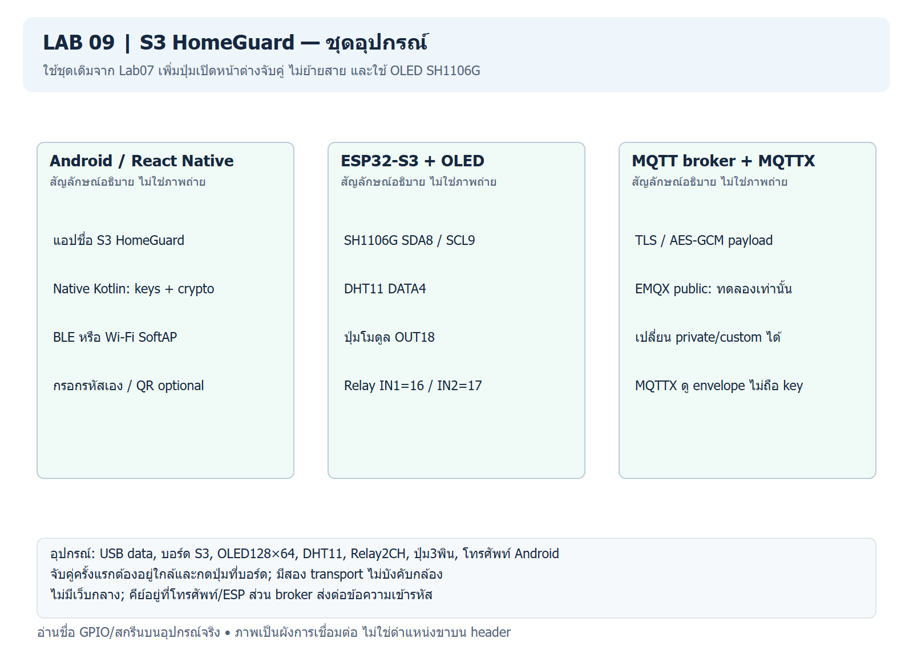
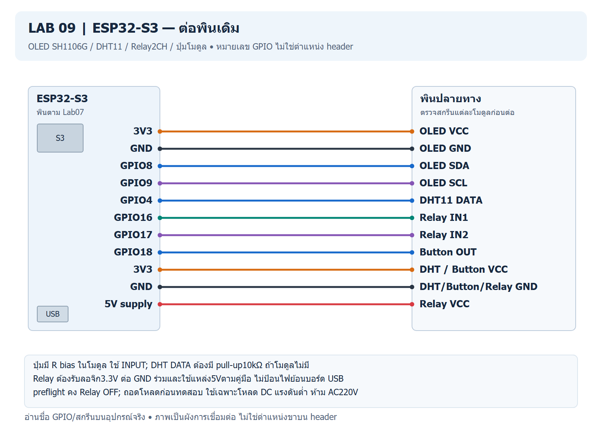
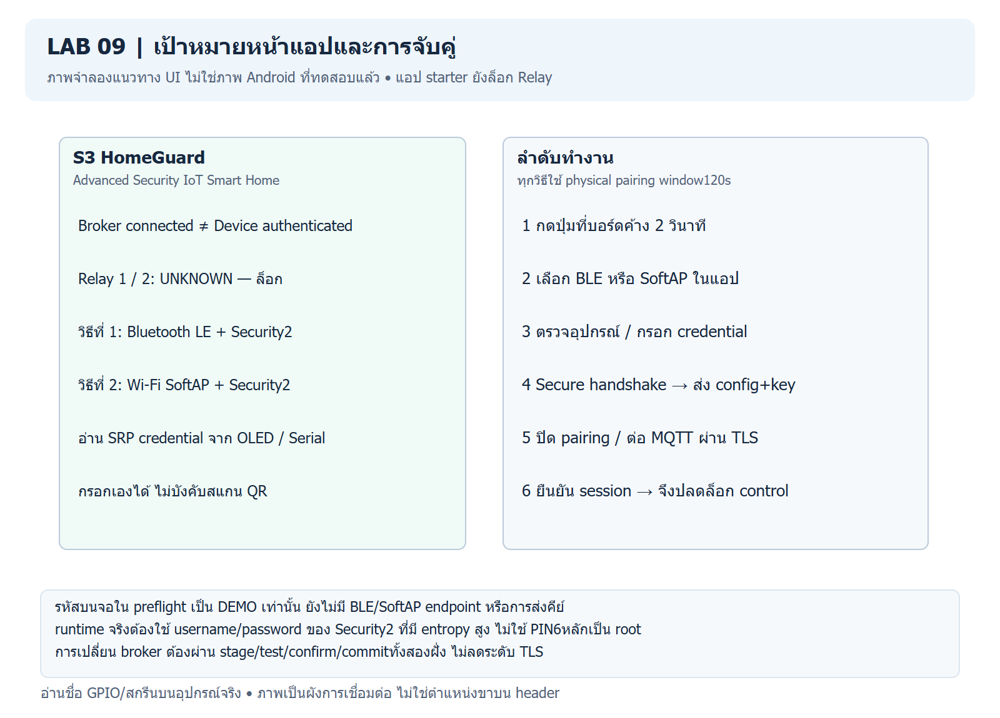
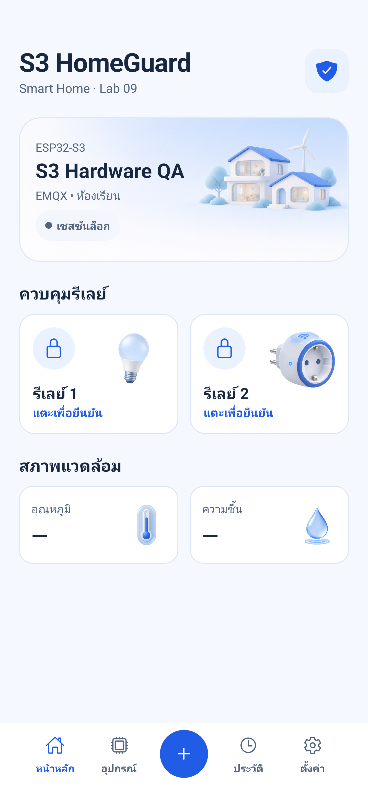
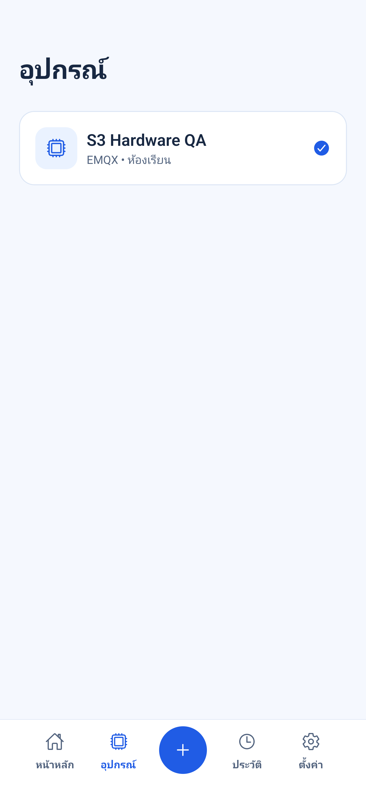
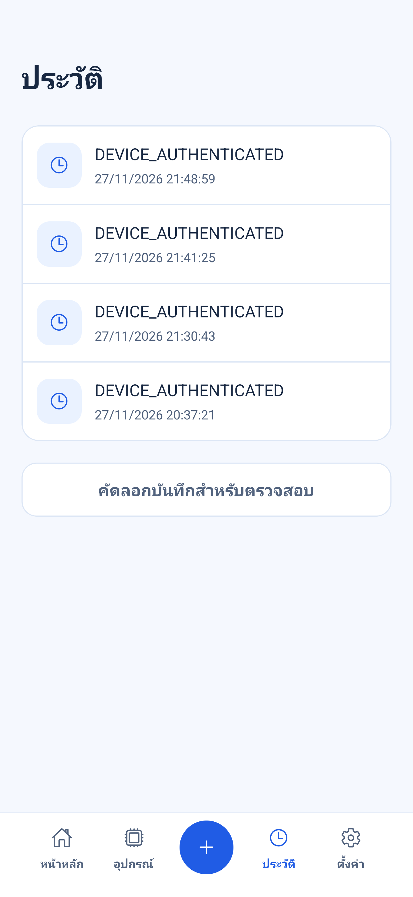
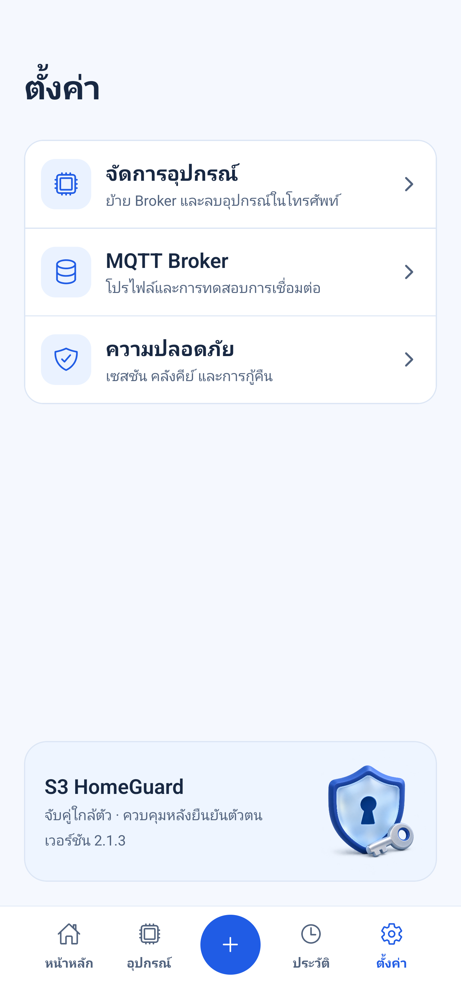
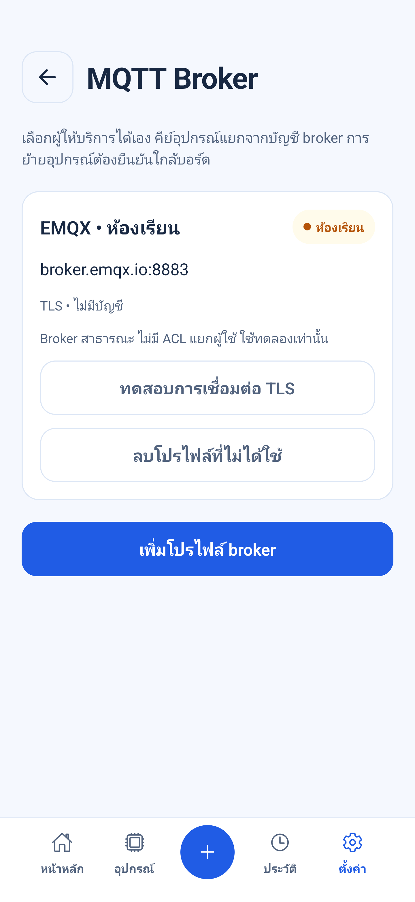
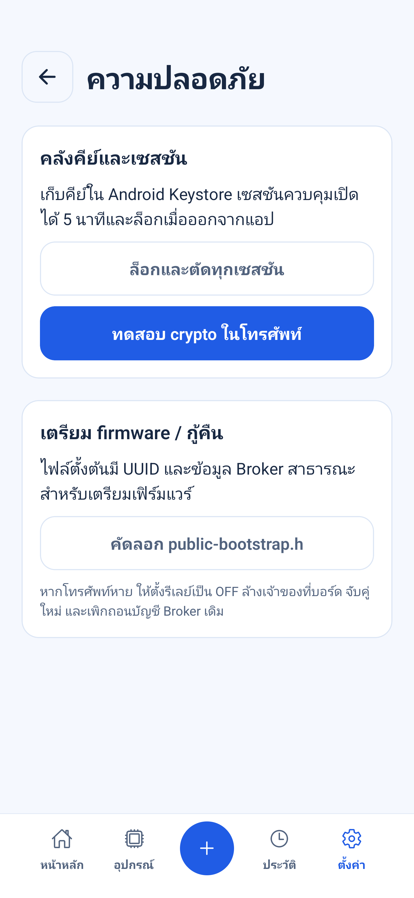

# Lab 09: S3 HomeGuard — Advanced Security IoT Smart Home

> ระดับ: ⭐⭐⭐ | ต่อจาก Lab07 | รูปแบบ: ลงมือทำทีละขั้น ไม่เน้นทฤษฎี
>
> **สถานะ: บทเรียนและสเปกสำหรับสร้างแอปเอง** มีภาพ/ผลตรวจจากแอปผู้สอนเป็นตัวอย่าง ไม่แจก source หรือ APK รุ่น Security2 ดู [แนวทางสร้างแอป](app-blueprint/README.md) และ [ผลอ้างอิง](TEST_REPORT.md) ไม่อ้างว่าผ่าน Level5 ครบหรือพร้อม production


## เริ่มสร้างแอปของตนเอง

ชุดสาธารณะมีใบงาน สเปก ขั้นตอน และภาพผลลัพธ์ให้เรียนรู้ ไม่มี source แอปสำเร็จหรือ Native security implementation ของผู้สอนให้คัดลอก และไม่แจก APK รุ่น Security2 ของ Lab09

1. เริ่มที่ [สารบัญการพัฒนา](app-blueprint/README.md) อ่าน requirements/design/implementation แล้วสร้างโปรเจกต์ใหม่ของกลุ่ม
2. ตั้งค่าบอร์ด/พินตามบทนี้และตรวจ preflight สามชุดด้านล่าง โค้ด ESP32 พื้นฐานสำหรับการเรียนยังอยู่ครบ
3. ทำ P0–P9 ทีละ gate สร้าง Native module/transport/UI/tests ของตนจากข้อกำหนด ไม่ใช้ helper คัดลอกแอปสำเร็จ
4. ใช้ [ภาพท้ายบท](#app-preview) เป็นเป้าหมาย UI; ถ้าต้องการทดลองแอปพื้นฐานดู [APK Lab07](../../downloads/README.md) ซึ่งไม่ใช่แอป security ของ Lab09
5. ตรวจ Release SRP/self-test, TLS, pairing, Session และ GPIO ของผลงานตนตาม test-plan ก่อนอ้างว่าผ่าน

ผลอ้างอิงจากเครื่องผู้สอนใน TEST_REPORT เป็นหลักฐานตัวอย่าง ไม่ทำให้แอปของผู้เรียนผ่านโดยอัตโนมัติ รายละเอียดกลไกและข้อความอยู่ใน [SYSTEM_WORKFLOW](SYSTEM_WORKFLOW.md)

## 🎯 วัตถุประสงค์

ต่อยอดแอป Lab07 เป็น **S3 HomeGuard** เปลี่ยนชื่อ/package/icon ใช้ ESP32-S3 จับคู่ใกล้ตัวผ่าน **BLE หรือ Wi-Fi SoftAP** กรอกรหัสเองจาก OLED/Serial ได้ และเปลี่ยน MQTT broker ได้ ไม่มีเว็บกลางบังคับ

## 🧰 อุปกรณ์ที่ใช้

| อุปกรณ์ | จำนวน | หมายเหตุ |
|---|---:|---|
| ESP32-S3 + USB data | 1 | บอร์ดเดิมจาก Lab07 |
| OLED SH1106/SH1106G I2C128×64 | 1 | จอเดิม SDA8/SCL9 |
| DHT11 | 1 | DATA4 |
| Relay2CH | 1 | IN1=16/IN2=17; เริ่มโดยถอดโหลด |
| ปุ่มโมดูล GND/VCC/OUT | 1 | OUT18 มี R ในตัว |
| Android + PC | 1 ชุด | React Native เดิม, PowerShell7, Node/Java/Androidตาม Lab07 |



## ❓ คำถามก่อนเริ่มต้น

<details>
<summary><b>คลิกเพื่อดูคำถามก่อนเรียน</b></summary>

1. เราจะยืนยันได้อย่างไรว่าจับคู่กับบอร์ดของตนเอง?
2. ถ้าโทรศัพท์ใช้กล้องหรือ Bluetooth ไม่ได้ จะเชื่อมต่ออย่างไร?
3. broker เห็นข้อมูลอะไรของอุปกรณ์บ้าง?
4. ถ้าข้อความเปิด Relay ถูกส่งซ้ำ จะเกิดอะไรขึ้น?
5. ถ้าเปลี่ยน broker ต้องแก้ข้อมูลที่อุปกรณ์ใดบ้าง?
6. ถ้าโทรศัพท์หาย จะยกเลิกสิทธิ์ของเครื่องเดิมอย่างไร?

</details>

## 📖 ทฤษฎี

จำเฉพาะ 4 จุดก่อนทำ: **TLS ตรวจ broker**, **Security2 จับคู่ใกล้ตัว**, **AES-GCM ป้องกันข้อความ**, **session/sequence/deadline กันคำสั่งเก่าหรือซ้ำ** รายละเอียดสำหรับ AI อยู่ใน [ชุดพัฒนา](app-blueprint/README.md) และ [ข้อปรับจากไฟล์ Level5](DECISIONS.md)

MQTTX เป็น client สำหรับตรวจ MQTT; broker ฟรีเริ่มต้นคือ **EMQX Public Broker** ใช้ ESPผ่านTLS8883 และ Androidผ่านTLSหรือWSS8084 `/mqtt` โปรไฟล์นี้ใช้ห้องเรียน ส่วนเกณฑ์ใช้งานจริงต้อง private broker ที่มีบัญชี/ACL แยก client [ข้อมูลบริการ](https://www.emqx.com/en/mqtt/public-mqtt5-broker)

## 🔌 การต่อวงจร



| จาก ESP32-S3/แหล่งจ่าย | ไปพินโมดูล |
|---|---|
| 3V3 / GND / GPIO8 / GPIO9 | OLED VCC / GND / SDA / SCL ตามลำดับ |
| 3V3 / GND / GPIO4 | DHT11 VCC / GND / DATA ตามลำดับ |
| 3V3 / GND / GPIO18 | ปุ่ม VCC / GND / OUT ตามลำดับ |
| GPIO16 / GPIO17 | Relay IN1 / IN2 |
| แหล่งจ่ายโมดูล5V / GNDร่วม | Relay VCC / GND ตามคู่มือรุ่นจริง |

ใช้สายเดิมตาม [PINOUT](../../assets/PINOUT.md) ปุ่มใช้ `INPUT`; DHTต้องมีpull-up10kΩถ้าโมดูลไม่มี Relayต้องรองรับลอจิก3.3V เริ่มโดยถอดโหลดออก ไม่ใช้ AC220V

## 🧪 การทดลอง

[ดาวน์โหลดโค้ดเริ่มต้น 3 ชุด (.zip)](downloads/lab09-starter-sketches.zip) — แตก ZIP ก่อนเปิดทีละโฟลเดอร์

### 9.1 ตรวจบอร์ดและหน้าจอก่อน

1. ติดตั้ง `Adafruit SH110X`, `Adafruit GFX Library`, `Adafruit BusIO`, `DHT sensor library`, `Adafruit Unified Sensor`, `PubSubClient`
2. [ดาวน์โหลดโค้ดเริ่มต้นทั้ง3ชุด](downloads/lab09-starter-sketches.zip) แตกZIP เปิด [lab09_hardware_preflight.ino](code/lab09_hardware_preflight/lab09_hardware_preflight.ino)
3. เลือก **ESP32S3 Dev Module**, core3.x, Flash/PSRAMตามบอร์ด; CH343ใช้ **USB CDC On Boot=Disabled**, Upload/Serial115200
4. Verify/Upload ตรวจ RelayคงOFF, OLEDแสดง `PREFLIGHT / NOT PAIRED`, DHTแสดงค่าทุก2s
5. กดปุ่มค้าง2s อ่านรหัส DEMOบนOLEDสองบรรทัดหรือSerial รอ120sต้องหาย หรือกดอีกครั้งเพื่อปิด ถ้ากดแล้วraw=1ให้ตั้ง `BUTTON_PRESSED_LEVEL=HIGH`

**ผ่านเมื่อ:** จออ่านได้/ปุ่มทำงาน/DHTอ่านได้/RelayOFF ข้อที่ไม่ได้ต่อให้จดแยก **รหัส DEMOนี้ยังไม่ได้ใช้จับคู่หรือส่งคีย์**

```text
[PREFLIGHT] Local demo only; BLE/SoftAP/MQTT not started
[DHT11] 28.0 C 65.0 %
```

| ส่วนสำคัญ | ทำอะไร |
|---|---|
| Relay16/17 | ตั้งOFFก่อนงานอื่น |
| ปุ่ม18/debounce/hold | เปิดหน้าต่างทดสอบ120s |
| SH1106G/Serial | แสดงรหัสทดสอบเดียวกัน ไม่ส่งออกทางเครือข่าย |

โจทย์สั้น: ถอดOLEDแล้วตรวจว่าSerialยังบอกสถานะได้

### 9.2 สร้างแอปชื่อใหม่จากโจทย์ Lab07

1. เปิดโฟลเดอร์โปรเจกต์ใหม่ เช่น `D:\AI\S3-HomeGuard` โดยไม่เขียนทับงาน Lab07
2. อ่านชุด Markdown ของ Lab07/Lab09 แล้วกำหนดชื่อ S3 HomeGuard, package ของกลุ่ม และพาธ mobile/ ที่จะสร้างเอง
3. ให้ OpenCode สร้าง skeleton และ native module ตาม P0 ตรวจ build/Release SRP packet ก่อนเริ่มจับคู่จริง
4. ทำ public export ตาม requirement ให้มีเฉพาะ UUID/endpoint/พิน ไม่ใช้ไฟล์ bootstrap แทน provisioning หรือ flash

ไม่ใช้ helper สำเนาแอปอ้างอิงในชุดสาธารณะ ผู้เรียนต้องสร้าง implementation และ lockfile ของตน


ภาพอุปกรณ์/วงจรและภาพแนวทางจับคู่ช่วงต้นเป็นงาน SVG ของโครงการ ส่วน [ภาพหน้าจอท้ายบท](#app-preview) จับจากแอป Android ที่รันจริง

### 9.3 ตรวจ crypto และ broker

1. Upload [lab09_crypto_selftest.ino](code/lab09_crypto_selftest/lab09_crypto_selftest.ino) ต้องเห็นผลด้านล่าง โค้ดนี้ใช้ **test keys** และคงRelayOFF ทุกsketchในLab09ตั้งOFFตามขั้วactive-lowของชุดผู้สอน ถ้าโมดูลต่างรุ่นให้ตรวจและตั้ง `RELAY_ACTIVE_LOW` ให้ตรงก่อนจ่ายไฟ
2. เปิด [lab09_mqtt_tls_probe.ino](code/lab09_mqtt_tls_probe/lab09_mqtt_tls_probe.ino) คัดลอก [secrets.example.h](code/lab09_mqtt_tls_probe/secrets.example.h) เป็น `secrets.h` ในโฟลเดอร์เดียวกัน
3. กรอกWi-Fi และCAเต็มจาก [CAของEMQX](https://assets.emqx.com/data/broker.emqx.io-ca.crt) เก็บเฉพาะในเครื่อง Verify/Upload ต้องเห็นTLS+MQTT connected
4. ลองCAผิด ต้องเชื่อมต่อไม่ผ่าน ห้ามแก้ด้วย `setInsecure()` โค้ดprobeไม่publish/subscribeหรือสั่งRelay
5. ต้องการทดสอบbrokerอื่น ให้เปลี่ยน **host/port/CA/username/password ให้ครบ** ในไฟล์local แล้วทำข้อ3–4ซ้ำ นี่ยังเป็นการตรวจendpoint ไม่ใช่ฟีเจอร์ย้ายbrokerสองฝั่งในแอป

```text
[CRYPTO] RFC5869-A1 PASS
[CRYPTO] AES256-GCM vector PASS
[CRYPTO] valid decrypt PASS
[CRYPTO] reject changed tag PASS
[CRYPTO] SUMMARY PASS; no network or actuator
[PROBE] TLS+MQTT CONNECTED; application identity NOT authenticated
```

ผลข้างต้นเป็นรูปแบบที่คาดหวัง ไม่ใช่ผลรันบนบอร์ดในงานสร้างบทเรียนนี้

| ส่วนสำคัญ | ทำอะไร |
|---|---|
| self-test | เทียบHKDF/AES-GCMกับreference และตรวจtagที่ถูกแก้ |
| TLS probe | ตรวจWi-Fi/เวลา/CA/hostname/MQTT ไม่รับคำสั่งควบคุม |
| PubSubClient | ใช้เฉพาะprobe; publishรองรับQoS0 ไม่ใช้แทนruntimeQoS1ของLevel5 |

โจทย์สั้น: บันทึกความต่างของlogเมื่อWi-Fiผิด/CAผิด/brokerใช้ได้ โดยไม่จดรหัสผ่าน

### 9.4 สั่ง AI พัฒนาระบบจริงทีละ Phase

เปิดOpenCodeที่โปรเจกต์ใหม่ ให้บริบทจาก [app-blueprint](app-blueprint/README.md) และ [Level5ต้นทาง](../../Secure-IoT-Level-5.md) ใช้ [ข้อความพร้อมคัดลอก](app-blueprint/opencode-prompts.md) ตามลำดับ ห้ามสั่งข้ามไปเปิดRelayทันที

| ทำตามลำดับ | งานที่ให้ AI ทำ | ตรวจอะไรจึงไปต่อ |
|---|---|---|
| P0 | แยก reference/starter, pinversions/localmodule/plugins และ build skeleton | JVM และ Release SRP packet/self-test บน Android ผ่านก่อนขอจับคู่จริง |
| P1 | Arduino3.3.13+ESP-IDF APIs สำหรับ safeRelay/DHT/SH1106G/local safety | compileและsafe stateตามอุปกรณ์จริง ไม่ใช้รหัสDEMOจากpreflightกับruntime |
| P2 | brokerprofiles/TLS/privateACL | wrongCA/hostname/timeและบัญชีอื่นต้องถูกปฏิเสธ |
| P3–P4 | NativeKotlinKeystore/AEAD/HKDF/session/replay/deadline/ACK | Kotlin/C/Pythonvectorsตรง และคำสั่งเก่า/ซ้ำไม่actuate |
| P5 | **BLEและSoftAPSecurity2**, manualcredential, physicalwindow120s | ทดสอบแต่ละวิธีจริง ไม่พึ่งกล้อง/ไม่ลดSecurity0 |
| P6 | ผูกDashboardเดิมกับnativebridge, เปลี่ยนbrokerสองฝั่ง | ไม่มีlegacyplaintextfallback; ย้ายและrollbackได้ |
| P7–P9 | Androidจริง/fault/soak/revoke/OTA/recovery | ใช้ [ใบตรวจรับ](app-blueprint/test-plan.md) พร้อมผลจริง/NOTRUN |

### 9.5 จับคู่อุปกรณ์ — ตรวจ P5 แยกตาม transport

ผู้เรียนใช้ขั้นนี้ตรวจงานของตนหลัง build/security gates พร้อม ส่วนผู้รันแอปอ้างอิงเริ่ม BLE ตามขั้นด้านบนและบันทึกผลใหม่ของตน อย่าใช้ผล BLE แทน SoftAP



1. อยู่ใกล้ESP กดปุ่มบนบอร์ดค้าง2sเพื่อเปิดpairing120s
2. เลือก **BLE** ให้แอปค้นหาอุปกรณ์ หรือเลือก **SoftAP** แล้วเชื่อมWi-Fiชั่วคราวของESP
3. อ่าน **Security2 username/password** จากOLED หรือSerialท้องถิ่น แล้วกรอกเอง QRเป็นทางเลือกเท่านั้น รหัสจริงต้องสุ่มentropyสูงและสร้างsalt/verifierตามSDK ไม่ใช้PIN6หลักเป็นrootkey
4. ให้nativeSDKทำhandshakeสำเร็จก่อนส่งWi-Fi/brokerconfigและrootkeyในช่องทางเข้ารหัส Rootkeyสร้างในnativeไม่ผ่านJS
5. ESPบันทึกconfigแบบatomicแล้วปิดpairing โทรศัพท์เก็บwrappedkeyผ่านKeystore
6. ต่อbrokerผ่านTLS ทำauthenticatedsessionแล้วตรวจACK/state จึงปลดล็อกRelay หากผิด/หมดเวลาให้เริ่มใหม่โดยกดปุ่มที่บอร์ด

**LAN discoveryเป็นส่วนเสริม:** mDNSหรือกรอกIPช่วยหาendpoint แต่ยังต้องphysicalconfirm+authenticatedtransportก่อนส่งคีย์ ห้ามเปิดHTTPรับkeyโดยเพียงอยู่Wi-Fiเดียวกัน การจับคู่ครั้งแรกผ่านอินเทอร์เน็ตยังไม่อยู่ในV1

### 9.6 เปลี่ยน broker — ใช้หลัง P6 ผ่านแล้ว

1. ในแอปสร้างcandidateprofileใหม่ กรอกendpoint/port/path/CA/credentialแยกของโทรศัพท์และESP
2. อยู่ใกล้ESP เปิดlocalpairing ส่งcandidateผ่านช่องทางที่ยืนยันตัวตนแล้ว ไม่ส่งrootkeyใหม่ผ่านMQTT
3. ให้ESPและโทรศัพท์ทดสอบTLS/สิทธิ์/sessionที่brokerใหม่โดยยังไม่commit
4. ตรวจtransactionIDตรงกันแล้วกดยืนยัน จึงcommitทั้งสองฝั่ง Rootkeyของอุปกรณ์แยกจากbrokerpassword
5. ทดลองCAผิด/ไฟดับ/หมดเวลา ต้องกลับconfigที่commitล่าสุดหรือเข้าสถานะรอกู้คืนตามtransaction ไม่กลับpublic/ปิดTLSเงียบ ๆ

**ส่งงาน:** sourceแอป+firmware, lockfiles, debugAPK/firmwarebinเมื่อbuildได้, ผลจับคู่สองวิธี, ผลเปลี่ยนbroker/rollback, ผลreplay/wrongtag/revoke และ [TEST_REPORT](TEST_REPORT.md) ไม่แนบsecret

### โค้ดเริ่มต้นฉบับเต็ม

เปิดอ่านเฉพาะชุดที่กำลังทำ หรือดาวน์โหลดZIPด้านบน ไม่ต้องอ่านทุกโค้ดก่อนเริ่ม

<!-- FULL_STARTER_CODE -->

<details><summary>lab09_crypto_selftest — โค้ดเต็ม</summary>

[เปิดไฟล์ .ino](code/lab09_crypto_selftest/lab09_crypto_selftest.ino)

```cpp
/*
 * Lab09.2 ESP32-S3: HKDF-SHA256 และ AES-256-GCM self-test ด้วย test keys เท่านั้น
 * คง Relay16/17 OFF ไม่ใช้เครือข่าย; mbedTLS มากับ Arduino-ESP32 core3.x
 * เปรียบเทียบกับ protocol/vectors.json; Serial115200; ห้ามใช้ test keys กับอุปกรณ์จริง
 */
#include <Arduino.h>
#include <mbedtls/gcm.h>
#include <mbedtls/hkdf.h>
#include <mbedtls/md.h>
#include <mbedtls/platform_util.h>
#if !defined(CONFIG_IDF_TARGET_ESP32S3)
#error "Select ESP32S3 Dev Module"
#endif
constexpr uint8_t RELAY_1_PIN = 16;
constexpr uint8_t RELAY_2_PIN = 17;
constexpr bool RELAY_ACTIVE_LOW = true;

bool decodeHex(const char *text, uint8_t *output, size_t length) {
  if (strlen(text) != length * 2) return false;
  for (size_t i = 0; i < length; ++i) {
    unsigned int value;
    if (sscanf(text + i * 2, "%2x", &value) != 1) return false;
    output[i] = static_cast<uint8_t>(value);
  }
  return true;
}

void setup() {
  const uint8_t offLevel = RELAY_ACTIVE_LOW ? HIGH : LOW;
  digitalWrite(RELAY_1_PIN, offLevel);
  digitalWrite(RELAY_2_PIN, offLevel);
  pinMode(RELAY_1_PIN, OUTPUT);
  pinMode(RELAY_2_PIN, OUTPUT);
  Serial.begin(115200);
  // RFC5869 Appendix A.1: ต้องตรงค่าอ้างอิง ไม่ตรวจแค่ encrypt/decrypt ตัวเอง
  uint8_t ikm[22], salt[13], info[10], expected[42], derived[42];
  memset(ikm, 0x0b, sizeof(ikm));
  for (size_t i = 0; i < sizeof(salt); ++i) salt[i] = i;
  for (size_t i = 0; i < sizeof(info); ++i) info[i] = 0xf0 + i;
  bool ok = decodeHex("3cb25f25faacd57a90434f64d0362f2a2d2d0a90cf1a5a4c5db02d56ecc4c5bf34007208d5b887185865", expected, sizeof(expected));
  ok = ok && mbedtls_hkdf(mbedtls_md_info_from_type(MBEDTLS_MD_SHA256), salt, sizeof(salt),
                          ikm, sizeof(ikm), info, sizeof(info), derived, sizeof(derived)) == 0;
  ok = ok && memcmp(derived, expected, sizeof(expected)) == 0;
  Serial.printf("[CRYPTO] RFC5869-A1 %s\n", ok ? "PASS" : "FAIL");
  bool allPassed = ok;

  // Test vector สังเคราะห์ร่วม Python: key00..1f, nonce=00000000 || uint64BE(1)
  uint8_t key[32], nonce[12] = {}, ciphertext[16], tag[16], plain[16] = {};
  uint8_t expectedCipher[16], expectedTag[16], recovered[16];
  for (size_t i = 0; i < sizeof(key); ++i) key[i] = i;
  nonce[11] = 1;
  constexpr char AAD[] = "v1|1|00112233445566778899aabbccddeeff|1|iot/v1/00112233-4455-4677-8899-aabbccddeeff/cmd";
  // ค่าสองบรรทัดนี้เติมจาก generator แล้วบันทึกให้ตรวจข้ามภาษา
  ok = decodeHex("15d6bffc44f4301e0e2e5139eca63af7", expectedCipher, sizeof(expectedCipher));
  ok = decodeHex("d43e7347262aede7fd6f28ef716bda66", expectedTag, sizeof(expectedTag)) && ok;
  mbedtls_gcm_context gcm;
  mbedtls_gcm_init(&gcm);
  ok = mbedtls_gcm_setkey(&gcm, MBEDTLS_CIPHER_ID_AES, key, 256) == 0 && ok;
  const int encryptResult = mbedtls_gcm_crypt_and_tag(&gcm, MBEDTLS_GCM_ENCRYPT, sizeof(plain),
      nonce, sizeof(nonce), reinterpret_cast<const uint8_t *>(AAD), strlen(AAD),
      plain, ciphertext, sizeof(tag), tag);
  ok = ok && encryptResult == 0 && memcmp(ciphertext, expectedCipher, sizeof(ciphertext)) == 0 &&
       memcmp(tag, expectedTag, sizeof(tag)) == 0;
  Serial.printf("[CRYPTO] AES256-GCM vector %s\n", ok ? "PASS" : "FAIL");
  allPassed = allPassed && ok;
  const int validResult = mbedtls_gcm_auth_decrypt(&gcm, sizeof(ciphertext), nonce, sizeof(nonce),
      reinterpret_cast<const uint8_t *>(AAD), strlen(AAD), tag, sizeof(tag), ciphertext, recovered);
  ok = validResult == 0 && memcmp(recovered, plain, sizeof(plain)) == 0;
  Serial.printf("[CRYPTO] valid decrypt %s\n", ok ? "PASS" : "FAIL");
  allPassed = allPassed && ok;
  tag[0] ^= 1;
  const int invalidResult = mbedtls_gcm_auth_decrypt(&gcm, sizeof(ciphertext), nonce, sizeof(nonce),
      reinterpret_cast<const uint8_t *>(AAD), strlen(AAD), tag, sizeof(tag), ciphertext, recovered);
  ok = invalidResult == MBEDTLS_ERR_GCM_AUTH_FAILED;
  Serial.printf("[CRYPTO] reject changed tag %s\n", ok ? "PASS" : "FAIL");
  allPassed = allPassed && ok;
  mbedtls_gcm_free(&gcm);
  mbedtls_platform_zeroize(key, sizeof(key));
  mbedtls_platform_zeroize(derived, sizeof(derived));
  mbedtls_platform_zeroize(recovered, sizeof(recovered));
  Serial.printf("[CRYPTO] SUMMARY %s; no network or actuator\n", allPassed ? "PASS" : "FAIL");
}

void loop() { delay(1000); }
```

</details>

<details><summary>lab09_hardware_preflight — โค้ดเต็ม</summary>

[เปิดไฟล์ .ino](code/lab09_hardware_preflight/lab09_hardware_preflight.ino)

```cpp
/*
 * Lab09.1 S3 HomeGuard: ตรวจวงจรและ UX รหัสจับคู่ท้องถิ่น
 * ESP32-S3: SH1106G SDA8/SCL9/VCC3V3/GND, DHT11 DATA4/VCC3V3/GND
 * Relay IN1=16/IN2=17/VCC5V/GNDร่วม; ปุ่ม OUT18/VCC3V3/GND
 * Libraries: Adafruit SH110X/GFX/BusIO, DHT sensor library/Unified Sensor
 * กดค้าง 2s เปิดหน้าต่าง DEMO 120s; รหัสนี้ยังไม่ใช่ SRP credential/root key
 * ไม่เปิด BLE/SoftAP/MQTT และคง Relay OFF ไม่มีการสั่งโหลดจากเครือข่าย
 * Arduino-ESP32 core3.x; Serial115200; CH343: USB CDC On Boot Disabled
 */
#include <Arduino.h>
#include <Wire.h>
#include <Adafruit_GFX.h>
#include <Adafruit_SH110X.h>
#include <DHT.h>
#include <esp_random.h>
#include <bootloader_random.h>
#include <mbedtls/platform_util.h>

#if !defined(CONFIG_IDF_TARGET_ESP32S3)
#error "Select ESP32S3 Dev Module"
#endif
constexpr uint8_t SDA_PIN = 8;
constexpr uint8_t SCL_PIN = 9;
constexpr uint8_t DHT_PIN = 4;
constexpr uint8_t RELAY1_PIN = 16;
constexpr uint8_t RELAY2_PIN = 17;
constexpr uint8_t BUTTON_PIN = 18;
constexpr uint8_t BUTTON_PRESSED_LEVEL = LOW;
constexpr bool RELAY_ACTIVE_LOW = true;
constexpr uint32_t WINDOW_MS = 120000;
Adafruit_SH1106G display(128, 64, &Wire, -1, 100000, 100000);
DHT dht(DHT_PIN, DHT11);
bool oledReady = false;
bool windowOpen = false;
bool buttonArmed = false;
bool holdHandled = false;
int rawButton = HIGH;
int stableButton = HIGH;
uint32_t rawChangedMs = 0;
uint32_t heldSinceMs = 0;
uint32_t openedMs = 0;
uint32_t previousUiMs = 0;
uint32_t previousSensorMs = 0;
char demoCode[33] = {};

void closeWindow() {
  windowOpen = false;
  mbedtls_platform_zeroize(demoCode, sizeof(demoCode));
  Serial.println("[PAIR DEMO] CLOSED; relays remain OFF");
}

void openWindow(uint32_t now) {
  uint8_t randomBytes[16];
  // สเก็ตช์นี้ไม่เปิด RF/ADC จึงเปิด entropy ชั่วคราวแล้วปิดก่อนใช้ peripheral อื่น
  bootloader_random_enable();
  esp_fill_random(randomBytes, sizeof(randomBytes));
  bootloader_random_disable();
  constexpr char HEX_DIGITS[] = "0123456789abcdef";
  for (size_t i = 0; i < sizeof(randomBytes); ++i) {
    demoCode[i * 2] = HEX_DIGITS[randomBytes[i] >> 4];
    demoCode[i * 2 + 1] = HEX_DIGITS[randomBytes[i] & 15];
  }
  demoCode[32] = '\0';
  mbedtls_platform_zeroize(randomBytes, sizeof(randomBytes));
  openedMs = now;
  windowOpen = true;
  Serial.println("[PAIR DEMO] LOCAL ONLY / 120s / no network endpoint");
  // ผู้สอนต้องการอ่านรหัสจาก Serial แทนกล้อง: เฉพาะ DEMO ที่กดปุ่มบนบอร์ด
  Serial.printf("[PAIR DEMO] code=%s\n", demoCode);
}

void drawStatus(uint32_t now) {
  if (!oledReady) return;
  display.clearDisplay();
  display.setTextSize(1);
  display.setCursor(0, 0);
  display.println("S3 HomeGuard");
  display.println("PREFLIGHT / NOT PAIRED");
  display.println("Relay1/2: OFF LOCKED");
  if (windowOpen) {
    char firstLine[17];
    memcpy(firstLine, demoCode, 16);
    firstLine[16] = '\0';
    display.printf("DEMO %lu s\n", static_cast<unsigned long>((WINDOW_MS - (now - openedMs)) / 1000));
    display.println(firstLine);
    display.println(demoCode + 16);
    display.println("NO BLE/AP IN THIS TEST");
  } else {
    display.println("Hold button 2 seconds");
    display.println("for local code demo");
  }
  display.display();
}

void setup() {
  const uint8_t offLevel = RELAY_ACTIVE_LOW ? HIGH : LOW;
  // กำหนด OFF ก่อน network และก่อนทดสอบอื่น ยังต้องตรวจ glitch ช่วง boot จริง
  digitalWrite(RELAY1_PIN, offLevel);
  digitalWrite(RELAY2_PIN, offLevel);
  pinMode(RELAY1_PIN, OUTPUT);
  pinMode(RELAY2_PIN, OUTPUT);
  Serial.begin(115200);
  pinMode(BUTTON_PIN, INPUT);  // โมดูลมี R bias ในตัว
  rawButton = stableButton = digitalRead(BUTTON_PIN);
  buttonArmed = stableButton != BUTTON_PRESSED_LEVEL;
  dht.begin();
  if (Wire.begin(SDA_PIN, SCL_PIN, 100000)) {
    Wire.setTimeOut(50);
    for (uint8_t address : {0x3C, 0x3D}) {
      Wire.beginTransmission(address);
      if (Wire.endTransmission() == 0 && display.begin(address, true)) {
        oledReady = true;
        break;
      }
    }
  }
  if (oledReady) {
    display.setTextColor(SH110X_WHITE);
    display.setTextWrap(false);
  }
  Serial.printf("[PREFLIGHT] SH1106G=%s Relay16/17=OFF Button18 raw=%d\n",
                oledReady ? "init OK; inspect screen" : "not ready", rawButton);
  Serial.println("[PREFLIGHT] Local demo only; BLE/SoftAP/MQTT not started");
  drawStatus(millis());
}

void loop() {
  const uint32_t now = millis();
  if (windowOpen && now - openedMs >= WINDOW_MS) closeWindow();
  const int reading = digitalRead(BUTTON_PIN);
  if (reading != rawButton) {
    rawButton = reading;
    rawChangedMs = now;
  }
  if (now - rawChangedMs >= 40 && stableButton != rawButton) {
    stableButton = rawButton;
    if (stableButton != BUTTON_PRESSED_LEVEL) {
      buttonArmed = true;
      holdHandled = false;
    } else {
      heldSinceMs = now;
      if (windowOpen) {
        closeWindow();
        holdHandled = true;
      }
    }
  }
  if (buttonArmed && stableButton == BUTTON_PRESSED_LEVEL && !holdHandled &&
      now - heldSinceMs >= 2000) {
    holdHandled = true;
    openWindow(now);
  }
  if (now - previousSensorMs >= 2000) {
    previousSensorMs = now;
    const float humidity = dht.readHumidity();
    const float temperature = dht.readTemperature();
    if (isnan(humidity) || isnan(temperature)) Serial.println("[DHT11] READ FAILED");
    else Serial.printf("[DHT11] %.1f C %.1f %%\n", temperature, humidity);
  }
  if (now - previousUiMs >= 500) {
    previousUiMs = now;
    drawStatus(now);
  }
  delay(1);
}
```

</details>

<details><summary>lab09_mqtt_tls_probe — โค้ดเต็ม</summary>

[เปิดไฟล์ .ino](code/lab09_mqtt_tls_probe/lab09_mqtt_tls_probe.ino)

```cpp
/*
 * Lab09.3 ESP32-S3: ตรวจ Wi-Fi/time/TLS/MQTT broker ที่เปลี่ยน host/port/CA ได้
 * คง Relay16/17 OFF ไม่ publish/subscribe ไม่มีคำสั่งควบคุมหรือ application root key
 * Libraries: PubSubClient; WiFi/NetworkClientSecure มากับ Arduino-ESP32 core3.x
 * คัดลอก secrets.example.h เป็น secrets.h ใส่ Wi-Fi/CA ในเครื่อง; Serial115200
 */
#include <Arduino.h>
#include <WiFi.h>
#include <NetworkClientSecure.h>
#include <PubSubClient.h>
#include <esp_random.h>
#include <time.h>
#include "secrets.h"
#if !defined(CONFIG_IDF_TARGET_ESP32S3)
#error "Select ESP32S3 Dev Module"
#endif
constexpr uint8_t RELAY_1_PIN = 16;
constexpr uint8_t RELAY_2_PIN = 17;
constexpr bool RELAY_ACTIVE_LOW = true;
NetworkClientSecure tls;
PubSubClient mqtt(tls);
bool ready = false;
uint32_t nextAttemptMs = 0;
uint32_t backoffMs = 1000;
char clientId[64];

void setup() {
  const uint8_t offLevel = RELAY_ACTIVE_LOW ? HIGH : LOW;
  digitalWrite(RELAY_1_PIN, offLevel);
  digitalWrite(RELAY_2_PIN, offLevel);
  pinMode(RELAY_1_PIN, OUTPUT);
  pinMode(RELAY_2_PIN, OUTPUT);
  Serial.begin(115200);
  if (strncmp(WIFI_SSID, "REPLACE_", 8) == 0 ||
      strstr(MQTT_CA_PEM, "-----BEGIN CERTIFICATE-----") == nullptr) {
    Serial.println("[PROBE] CONFIG REQUIRED: Wi-Fi and trusted CA in local secrets.h");
    return;
  }
  WiFi.mode(WIFI_STA);
  WiFi.begin(WIFI_SSID, WIFI_PASSWORD);
  const uint32_t wifiStarted = millis();
  while (WiFi.status() != WL_CONNECTED && millis() - wifiStarted < 20000) delay(100);
  if (WiFi.status() != WL_CONNECTED) {
    Serial.println("[PROBE] Wi-Fi timeout; fix config then Reset");
    return;
  }
  // เวลาใช้ตรวจ TLS certificate เท่านั้น ไม่ใช้แทน monotonic anti-replay ของ protocol
  configTime(0, 0, "pool.ntp.org", "time.google.com");
  const uint32_t timeStarted = millis();
  while (time(nullptr) < 1767225600 && millis() - timeStarted < 15000) delay(100);
  if (time(nullptr) < 1767225600) {
    Serial.println("[PROBE] CLOCK INVALID; stop, no insecure fallback");
    return;
  }
  tls.setCACert(MQTT_CA_PEM);
  tls.setHandshakeTimeout(10);
  mqtt.setServer(MQTT_HOST, MQTT_PORT);  // ใช้ hostname เพื่อให้ TLS ตรวจชื่อด้วย
  mqtt.setSocketTimeout(3);
  mqtt.setKeepAlive(60);
  const uint64_t chipId = ESP.getEfuseMac();  // client ID ไม่ใช่ secret หรือการ authenticate
  snprintf(clientId, sizeof(clientId), "hg-probe-%08lx%08lx-%08lx",
      static_cast<unsigned long>(chipId >> 32), static_cast<unsigned long>(chipId),
      static_cast<unsigned long>(esp_random()));
  ready = true;
  Serial.printf("[PROBE] host=%s port=%u TLS verification enabled\n", MQTT_HOST, MQTT_PORT);
}

void loop() {
  if (!ready) { delay(10); return; }
  if (WiFi.status() != WL_CONNECTED) {
    mqtt.disconnect();
    ready = false;
    Serial.println("[PROBE] network lost; Reset to repeat this diagnostic");
    return;
  }
  if (mqtt.connected()) { mqtt.loop(); delay(1); return; }
  const uint32_t now = millis();
  if (static_cast<int32_t>(now - nextAttemptMs) < 0) { delay(1); return; }
  // Probe ยอม block connect แบบมี timeout; runtime จริงต้องแยก network task จาก safety task
  const bool connected = strlen(MQTT_USERNAME) == 0
      ? mqtt.connect(clientId)
      : mqtt.connect(clientId, MQTT_USERNAME, MQTT_PASSWORD);
  if (connected) {
    backoffMs = 1000;
    Serial.println("[PROBE] TLS+MQTT CONNECTED; application identity NOT authenticated");
  } else {
    Serial.printf("[PROBE] CONNECT FAILED state=%d; no insecure retry\n", mqtt.state());
    nextAttemptMs = millis() + backoffMs + esp_random() % 501;
    backoffMs = min(backoffMs * 2, static_cast<uint32_t>(60000));
  }
}
```

</details>

<details><summary>secrets.example.h — คัดลอกเป็นไฟล์ local เท่านั้น</summary>

```cpp
#pragma once
// คัดลอกเป็น secrets.h ในเครื่องเท่านั้น ไฟล์จริงถูก gitignore
constexpr char WIFI_SSID[] = "REPLACE_WIFI_SSID";
constexpr char WIFI_PASSWORD[] = "REPLACE_WIFI_PASSWORD";
constexpr char MQTT_HOST[] = "broker.emqx.io";
constexpr uint16_t MQTT_PORT = 8883;
constexpr char MQTT_USERNAME[] = "";  // public profile เท่านั้น; private ใช้บัญชีเฉพาะ client
constexpr char MQTT_PASSWORD[] = "";
// ดาวน์โหลด CA จากผู้ให้บริการ ตรวจแหล่งที่มา แล้ววาง PEM เต็ม ห้าม setInsecure
constexpr char MQTT_CA_PEM[] = R"PEM(REPLACE_WITH_TRUSTED_CA_PEM)PEM";
```

</details>

<!-- END_STARTER_CODE -->

## 🛠️ Troubleshooting

| อาการ | จุดตรวจ | วิธีทำต่อ |
|---|---|---|
| OLEDเป็นเส้น | driver/พิน | ใช้SH1106G/SDA8/SCL9ตาม9.1 |
| กดแล้วไม่เปิดหน้าต่าง | raw/polarity/การกดค้าง | ต่อGND/VCC/OUTครบ ตรวจpressedlevel แล้วกดค้าง2s |
| BLE/SoftAP จับคู่ไม่สำเร็จ | เฟิร์มแวร์/รหัสเฉพาะเครื่อง/สิทธิ์ Android หรือหมดหน้าต่าง120s | ใช้แอปอ้างอิงพร้อมเฟิร์มแวร์ runtime และตรวจผลจริงใน TEST_REPORT; กดปุ่มเปิดใหม่ ไม่ลดระดับ security |
| BLEใช้ไม่ได้ | permission/transport/discovery | ตรวจตาม KNOWN_ISSUES แยก GATT/SRP; หากทดสอบ SoftAP ต้องตรวจ transport นั้นจริง ไม่ถือว่าเป็น fallback ที่ผ่านแล้ว |
| Buildผ่านแต่เริ่มSRPไม่ได้ | R8/ProtobufในRelease | คง consumer rules และตรวจ Release SRP self-test ก่อนจับคู่ |
| หาactionจับคู่ไม่พบ | เลื่อนฟอร์ม/คีย์บอร์ด | ปุ่มอยู่ท้ายฟอร์ม ต้องเลื่อนถึงและไม่ถูกเมนูล่างบัง |
| พบIPแล้วจับคู่ไม่ได้ | discoveryไม่ใช่authentication | เปิดphysicalwindowและทำhandshake ไม่ส่งkeyเข้าHTTPเปล่า |
| TLSไม่ผ่าน | CA/hostname/เวลา/port | แก้ให้ตรงprovider ห้ามsetInsecure |
| เปลี่ยนhostในโทรศัพท์แล้วESPหาย | configสองฝั่งไม่ตรง | ใช้transactionตาม9.6และlocalrecovery |
| Brokerconnectedแต่Relayล็อก | ยังไม่authenticatedsession | ตรวจhandshake/key/session/ACK ไม่ยึดLWTแทน |
| โทรศัพท์หาย | ownercredentialเดิม | physicalrevoke/re-pairและrevokeprivatebrokercredential |

## 🔍 คำถามค้นคว้าหลังเรียน

<details><summary>งานเสริมหลังทำครบ</summary>

1. เพิ่มLANdiscoveryโดยไม่ลดการยืนยันอุปกรณ์ได้อย่างไร? 🔎 คำค้นแนะนำ: mDNS, authenticated provisioning
2. ตรวจว่าbackupไม่รวมคีย์ได้อย่างไร? 🔎 คำค้นแนะนำ: Android backup rules, Keystore wrapped key
3. จะกู้broker migrationที่ไฟดับกลางทางอย่างไร? 🔎 คำค้นแนะนำ: atomic commit, transaction recovery
4. จะเพิ่มUSB-OTGส่งconfigแบบปลอดภัยอย่างไร? 🔎 คำค้นแนะนำ: Android USB host, authenticated key exchange

</details>

## 📝 แบบทดสอบหลังเรียน

<details><summary>แบบตรวจความเข้าใจ 10 ข้อ</summary>

**ข้อ 1 (ง่าย)** MQTTX ทำหน้าที่ใดในแล็บนี้?
- ก. เก็บrootkeyส่วนกลาง
- ข. เป็นclientตรวจMQTT
- ค. เป็นKeystoreของโทรศัพท์
- ง. ทำหน้าที่แฟลชESP

**ข้อ 2 (ง่าย)** ช่องทางจับคู่ขั้นต่ำที่ต้องทำให้ได้คือคู่ใด?
- ก. QRกับภาพหน้าจอ
- ข. MQTTกับอีเมล
- ค. BLEกับSoftAP
- ง. SQLiteกับSerialPlotter

**ข้อ 3 (ง่าย)** OLEDของผู้สอนใช้driverใดในLab09?
- ก. SH1106G
- ข. LCD16x2
- ค. ILI9341
- ง. MAX7219

**ข้อ 4 (ปานกลาง)** แอปขึ้นbrokerconnectedแต่ยังไม่มีauthenticatedsessionควรทำอย่างไร?
- ก. แสดงRelayONจากcache
- ข. ส่งtoggleเพื่อถามสถานะ
- ค. เปลี่ยนเป็นTCP1883
- ง. ล็อกคำสั่งและแสดงunknown

**ข้อ 5 (ปานกลาง)** ต้องการย้ายbrokerให้ESPทำงานกับโทรศัพท์ต่อได้ต้องแก้อะไร?
- ก. เปลี่ยนlabelในSQLiteอย่างเดียว
- ข. ย้ายprofileและตรวจsessionทั้งสองฝั่งก่อนcommit
- ค. เปลี่ยนrootkeyให้เท่ากับhostname
- ง. เปลี่ยนclientIDอย่างเดียว

**ข้อ 6 (ปานกลาง)** ไฟล์public-bootstrap.hควรมีข้อมูลใด?
- ก. RootkeyกับWi-Fi password
- ข. Private signing key
- ค. DeviceUUIDกับbrokerhostname
- ง. Sessionkeyปัจจุบัน

**ข้อ 7 (ปานกลาง)** TLSprobeแจ้งCAผิดควรทำอย่างไร?
- ก. ตรวจCA/hostnameจากproviderแล้วลองใหม่
- ข. ตั้งsetInsecureเพื่อให้ทดสอบผ่าน
- ค. เปลี่ยนไปใช้publicTCPโดยอัตโนมัติ
- ง. ใช้PINบนOLEDเป็นCA

**ข้อ 8 (ยาก)** หลังESPรีบูต ควรจัดการsessionอย่างไร?
- ก. โหลดseq0แล้วใช้sessionkeyเดิม
- ข. นำretainedcommandล่าสุดมาทำซ้ำ
- ค. ยอมรับทุกseqจนกว่าจะได้telemetry
- ง. สร้างfreshsessionและปฏิเสธpacketจากsessionเดิม

**ข้อ 9 (ยาก)** เมื่อQoS1ส่งcommandซ้ำและตรวจauthแล้วควรทำอย่างไร?
- ก. actuateซ้ำเพื่อรับรองการส่ง
- ข. deduprequestและอาจส่งACKซ้ำโดยไม่actuateซ้ำ
- ค. ล้างcounterในsessionเดิม
- ง. ข้ามtagเพื่อลดlatency

**ข้อ 10 (ยาก)** mDNSพบอุปกรณ์ในWi-Fiเดียวกันแล้วควรส่งrootkeyได้เมื่อใด?
- ก. ทันทีที่ชื่อเหมือนกัน
- ข. เมื่อpingตอบ
- ค. หลังphysicalconfirmationและauthenticatedencryptedchannel
- ง. เมื่อbrokerตอบCONNACK

</details>

## 📚 อ้างอิง

- [สเปกต้นทางที่ผู้สอนให้](../../Secure-IoT-Level-5.md) / [แผน](PLAN.md) / [ความคืบหน้า](PROGRESS.md) / [ผลตรวจจริง](TEST_REPORT.md)
- [Espressif protocomm Security2/transport](https://docs.espressif.com/projects/esp-idf/en/stable/esp32s3/api-reference/provisioning/protocomm.html)
- [Android provisioning SDK ของ Espressif](https://github.com/espressif/esp-idf-provisioning-android)
- [Android Keystore](https://developer.android.com/privacy-and-security/keystore)
- [HKDF RFC5869](https://www.rfc-editor.org/rfc/rfc5869) / [GCM NIST SP800-38D](https://csrc.nist.gov/pubs/sp/800/38/d/final)

## ➡️ แล็บถัดไป

กลับ [สารบัญคอร์ส](../../README.md) หรือทำPhaseถัดไปตาม [implementation](app-blueprint/implementation.md) โดยใช้ผลตรวจจริงเป็นเกณฑ์

<a id="app-preview"></a>

## 📱 หน้าตาแอปหลังทำเสร็จ

เมื่อทำตามขั้นตอนจนได้แอปอ้างอิง S3 HomeGuard หน้าตาจะเป็นตัวอย่างด้านล่าง **ภาพชุดนี้จับจากแอป Android รุ่น 2.1.3/code 10 ที่รันจริงบน Samsung Galaxy S25 Ultra** วันที่ 27 พฤศจิกายน 2569 ขนาดต้นฉบับ 1440 × 3120 pixels กดภาพเพื่อเปิดดูขนาดเต็มได้

| หน้าหลัก | อุปกรณ์ | ประวัติ |
|---|---|---|
| <a href="images/lab09-app-2.1.3-dashboard.png"></a> | <a href="images/lab09-app-2.1.3-devices.png"></a> | <a href="images/lab09-app-2.1.3-activity.png"></a> |
| การ์ดรีเลย์สองช่อง ข้อมูลสภาพแวดล้อม และเมนู Compact Center | รายการบอร์ดที่จับคู่ไว้และการเลือกบอร์ดที่ต้องการดู | เหตุการณ์ที่บันทึกไว้ เช่น การยืนยันอุปกรณ์ |

| ตั้งค่า | MQTT Broker | ความปลอดภัย |
|---|---|---|
| <a href="images/lab09-app-2.1.3-settings.png"></a> | <a href="images/lab09-app-2.1.3-brokers.png"></a> | <a href="images/lab09-app-2.1.3-security.png"></a> |
| ทางเข้าจัดการอุปกรณ์ MQTT Broker และความปลอดภัย | โปรไฟล์ปลายทาง TLS และปุ่มทดสอบการเชื่อมต่อ | การล็อก Session ทดสอบ crypto และคัดลอก public config |

หน้าแรกในภาพอยู่ในสถานะ **เซสชันล็อก / แตะเพื่อยืนยัน** จึงยังไม่มีค่าปัจจุบันจากเซ็นเซอร์ ส่วนประวัติเป็นเหตุการณ์ที่บันทึกไว้เดิม ไม่ใช่หลักฐานว่า Session ยังเปิดอยู่ขณะจับภาพ การจับภาพรอบนี้ไม่ได้จับคู่หรือส่งคำสั่ง GPIO เพิ่ม

หน้าจอกรอกรหัสจับคู่ยังใช้ `FLAG_SECURE` ป้องกันการจับภาพ จึงไม่รวมฟอร์มรหัสในแกลเลอรีนี้ วิธีใช้ฟอร์มอธิบายไว้ในคู่มือ ภาพตกแต่งบ้าน/อุปกรณ์ภายใน UI บางชิ้นสร้างด้วย AI ตามทะเบียนเดิม แต่ภาพหน้าจอทั้งหกเป็นภาพจากการรันแอปจริง

ที่มา: ภาพหน้าจอโดยทีม ESP32-LAB ผ่าน ADB screencap ดู [ทะเบียนภาพ](../../assets/IMAGE_SOURCES.md) และ [คู่มือใช้งานแอป](app-blueprint/USER_GUIDE.md)
