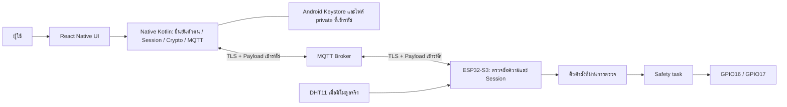
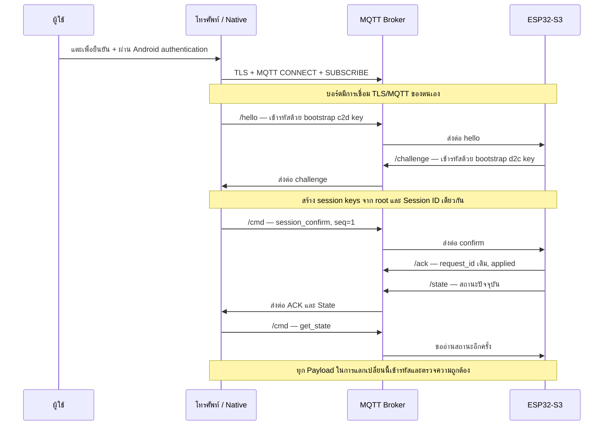
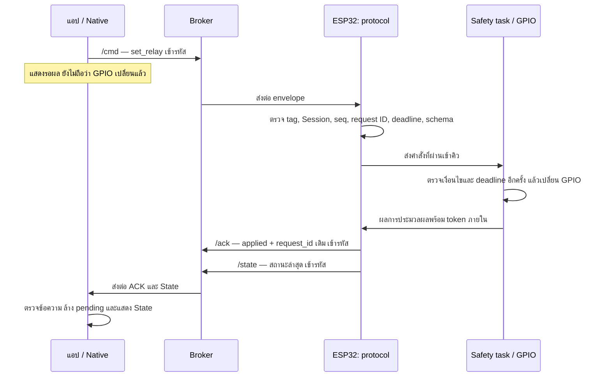

# S3 HomeGuard — หลักการทำงาน การส่งคำสั่ง และความปลอดภัยของ Lab09

> ฉบับสาธารณะ: เอกสารอธิบายแบบและผลอ้างอิงสำหรับผู้เรียนสร้างเอง source แอป/secure runtime สำเร็จเก็บแยกสำหรับผู้สอน ไม่ได้อยู่ใน repository นี้

วันที่ตรวจทาน: 27 พฤศจิกายน 2569 · แอปอ้างอิง: **2.1.3** · Firmware: `lab09_s3_homeguard` บน Arduino-ESP32 core **3.3.13**

เริ่มตามงานได้จาก [สารบัญเอกสาร](app-blueprint/README.md), [สร้าง APK](app-blueprint/BUILD_GUIDE.md), [ตั้งค่า](app-blueprint/CONFIGURATION.md), [คู่มือใช้งาน](app-blueprint/USER_GUIDE.md) และ [ปัญหาที่เคยพบ](app-blueprint/KNOWN_ISSUES.md) ส่วนเอกสารหน้านี้อธิบายกลไกและตัวอย่างเชิง protocol

เอกสารนี้อธิบายพฤติกรรมจาก source ของระบบที่สร้างใน repository นี้ ใช้ตัวอย่างที่มีโครงสร้างตรงกับ implementation และแยก **หลักการ**, **ค่าตัวอย่างสำหรับเรียน**, **ผลทดสอบจริง** และ **สิ่งที่ยังไม่ได้ตรวจรับ** ออกจากกัน

ตัวอย่าง UUID, Session ID, เวลา และข้อมูลใน JSON เป็นข้อมูลสมมติสำหรับอธิบาย รูปแบบ ciphertext ในหัวข้อ 9 คำนวณจริงด้วย **กุญแจทดสอบสาธารณะ** ไม่ได้คัดลอกจากอุปกรณ์ของผู้สอน และใช้เปิด Session หรือควบคุมบอร์ดจริงที่จับคู่ไว้ไม่ได้

สารบัญ:

1. [ภาพรวมและคำศัพท์](#overview)
2. [เหตุใดเปิดแอปแล้วต้องยืนยันก่อน](#startup)
3. [การจับคู่ครั้งแรก](#pairing)
4. [การเชื่อมต่อและเปิด Session](#session)
5. [Topics และรูปแบบข้อความ](#topics)
6. [ตัวอย่างเปิด Relay 1 ตั้งแต่กดจนได้รับผล](#command)
7. [การตรวจคำสั่งและกรณีปฏิเสธ](#validation)
8. [สถานะ เซ็นเซอร์ และตัวจับเวลา](#timers)
9. [ตัวอย่าง Payload ที่เข้ารหัสจริง](#wire-example)
10. [ขั้นตอนทดลองและคำสั่งที่ใช้ได้จริง](#practice)
11. [เปลี่ยน Broker และล้างเจ้าของ](#maintenance)
12. [เปรียบเทียบกับ Lab07](#comparison)
13. [ขอบเขตความปลอดภัยและผลทดสอบ](#limitations)
14. [Source และเอกสารอ้างอิง](#references)

<a id="overview"></a>

## 1. ภาพรวม: ใครทำหน้าที่อะไร



โทรศัพท์และ ESP32 เชื่อมต่อกับ Broker แยกกัน Broker รับข้อความจากผู้ส่งแล้วกระจายให้ผู้ที่ subscribe Topic ตรงกัน หลังจับคู่และตั้งเครือข่ายสำเร็จ โทรศัพท์กับบอร์ดจึงใช้อินเทอร์เน็ตคนละเครือข่ายได้ โดยต้องเข้าถึง Broker เดียวกัน

| ส่วน | หน้าที่ในระบบนี้ |
|---|---|
| React Native / TypeScript | แสดงหน้าจอ รับการแตะ และแสดงสถานะจาก Native module |
| Native Kotlin | เปิดหน้าต่างยืนยันตัวตน จัดการกุญแจ สร้าง Session เข้ารหัส/ตรวจข้อความ และเชื่อม MQTT |
| MQTT Broker | ส่งต่อข้อความตาม Topic; Public Broker ไม่ได้เป็นผู้ตัดสินว่าใครมีสิทธิ์สั่ง GPIO |
| ESP32-S3 | ตรวจสิทธิ์และความสดของข้อความ แล้วส่งคำสั่งที่ผ่านให้ Safety task |
| Safety task | เปลี่ยนระดับ GPIO และตั้ง OFF เมื่อเงื่อนไขความปลอดภัยไม่ครบ |
| SQLite ในโทรศัพท์ | เก็บ public metadata และเหตุการณ์ ไม่เก็บ root/session key |

### 1.1 คำศัพท์ที่จำเป็น

| คำ | ความหมาย |
|---|---|
| Authentication | การตรวจว่าฝ่ายที่สื่อสารพิสูจน์การถือกุญแจหรือผ่านวิธียืนยันตัวตนที่กำหนดได้ |
| Authorization | การอนุญาตให้ทำงาน เช่น เปิดสิทธิ์ส่งคำสั่งหลังยืนยันผู้ใช้และ Session สำเร็จ |
| Root key | ความลับสุ่ม 32 bytes ของคู่โทรศัพท์–อุปกรณ์ ใช้เป็นต้นทางสร้างกุญแจย่อย |
| Session | รอบการสื่อสารที่มีกุญแจ เลขลำดับ และอายุของตนเอง |
| AEAD | การเข้ารหัสที่ให้ทั้งความลับของเนื้อหาและการตรวจความถูกต้องของข้อความ/ข้อมูลประกอบ |
| ACK ของ HomeGuard | คำตอบระดับแอปพลิเคชันที่เข้ารหัส ส่งจากบอร์ดบน Topic `/ack` |
| MQTT PUBACK | คำตอบระดับ MQTT สำหรับ QoS 1 ว่าผู้รับในช่วงการส่งนั้นรับ PUBLISH แล้ว |
| Lease | สิทธิ์ควบคุมชั่วคราวที่ต้องต่ออายุเป็นระยะ หากหมดอายุบอร์ดตั้ง OFF |

**MQTT PUBACK จาก Broker ยังไม่ยืนยันว่า ESP32 สั่ง GPIO แล้ว** การยืนยันระดับคำสั่งใช้ ACK ของ HomeGuard และ State ที่บอร์ดส่งกลับ ตามการแบ่งชั้นของ [MQTT 3.1.1](https://docs.oasis-open.org/mqtt/mqtt/v3.1.1/os/mqtt-v3.1.1-os.html)

<a id="startup"></a>

## 2. เหตุใดเปิดแอปแล้วจึงยังไม่เชื่อมต่อเพื่อควบคุมทันที

แอปตั้งนโยบายให้ **การเปิดหน้าจอ** กับ **การอนุญาตควบคุมอุปกรณ์** เป็นคนละขั้นตอน

1. เมื่อเปิดแอป `useHomeGuard()` โหลดรายการอุปกรณ์ โปรไฟล์ Broker และประวัติที่บันทึกไว้
2. ขั้นตอนนี้ไม่ได้เรียกเปิด Session ของอุปกรณ์โดยอัตโนมัติ หน้าจอจึงแสดง **เซสชันล็อก** และ **แตะเพื่อยืนยัน**
3. เมื่อแตะการ์ดรีเลย์ขณะล็อก แอปเรียก `security.connect()` เพื่อยืนยันผู้ใช้และเปิด Session
4. Android แสดง `BiometricPrompt` โดยยอมรับ `BIOMETRIC_STRONG` หรือ `DEVICE_CREDENTIAL` เช่น ลายนิ้วมือหรือรหัสล็อกจอตามที่เครื่องรองรับ
5. หลังยืนยันสำเร็จ Native module ให้สิทธิ์ใช้งานรอบนั้นประมาณ **5 นาที** แล้วเริ่มเชื่อม Broker และยืนยันกับบอร์ด
6. เมื่อได้ State ที่ตรวจสอบแล้ว การแตะครั้งถัดไปจึงเป็นคำสั่งเปิดหรือปิดรีเลย์

ดังนั้น **การแตะครั้งแรกที่การ์ดขึ้นว่า “แตะเพื่อยืนยัน” มีหน้าที่เปิด Session ไม่ได้ส่ง ON ทันที** ให้รอ “ยืนยันแล้ว” และสถานะรีเลย์ก่อนแตะสั่งงาน

ฝั่ง ESP32 อาจเชื่อม Wi-Fi และ Broker อยู่แล้วระหว่างที่โทรศัพท์ยังล็อก การเชื่อมกับ Broker เป็นการเปิดทางส่งข้อมูล ส่วนการยืนยัน Session เป็นการพิสูจน์สิทธิ์ควบคุมปลายทาง

การต้องกดยืนยันเป็นนโยบายของแอปนี้ สามารถออกแบบ UX แบบอื่นได้ แต่ต้องรักษาการยืนยันและการจัดการกุญแจให้เหมาะสม การใช้ AES-GCM ไม่ได้บังคับให้ทุกแอปต้องมีปุ่มเชื่อมต่อแบบเดียวกัน

เมื่อแอปเข้า background ระบบยกเลิกสิทธิ์และปิด Session ควบคุม เมื่อกลับมาต้องยืนยันใหม่ ระหว่างสิทธิ์ยังใช้ได้และแอปอยู่ foreground ระบบมีการ reconnect หลังเครือข่ายขัดข้อง พร้อมเปิด Session ใหม่

### 2.1 ฝั่ง ESP32 ทำอะไรตั้งแต่เปิดเครื่อง

1. ตั้ง GPIO รีเลย์เป็น OFF ก่อนเริ่มเครือข่าย และเริ่ม Safety task
2. โหลด config และ UUID จาก NVS หากยังไม่มี config ที่อ่านได้จะสร้าง identity ใหม่ตามเงื่อนไขของ `Store.begin()`
3. เชื่อม Wi-Fi จาก config ที่จับคู่ไว้ หรือค่าท้องถิ่นสำหรับชุดทดสอบตามที่ตั้งใน firmware และเริ่มขอเวลาจาก NTP
4. เมื่อมีเจ้าของ/root key, Wi-Fi พร้อม และเวลาผ่านเกณฑ์ใน `startMqtt()` จึงเริ่ม TLS/MQTT ไปยัง Broker ที่กำหนด
5. เมื่อเชื่อม MQTT สำเร็จ subscribe `hello` และ `cmd` แล้วรอเปิด application Session รีเลย์ยังไม่เปิดจากการต่อ Broker สำเร็จเพียงอย่างเดียว

ข้อความที่ firmware พิมพ์เมื่อถึงขั้นที่ 5 คือ:

```text
[MQTT] TLS connected; waiting for application authentication
```

บอร์ดที่ยังไม่จับคู่จึงอาจมี `wifi=1` แต่ `mqtt=0` ได้ และบอร์ดที่ต่อ Broker แล้วแต่โทรศัพท์ยังไม่ยืนยันอาจมี `mqtt=1` แต่ `authenticated=0` ได้ แต่ละ flag อธิบายคนละชั้นของการทำงาน

<a id="pairing"></a>

## 3. การจับคู่ครั้งแรก: สร้างความเชื่อถือก่อนควบคุมผ่านอินเทอร์เน็ต

การจับคู่เป็นขั้นตอนที่ทำใกล้บอร์ด ใช้ **BLE หรือ SoftAP + Security2** การควบคุมรีเลย์หลังจับคู่ใช้ MQTT ผ่านอินเทอร์เน็ต ไม่ได้ส่งคำสั่งรีเลย์ทุกครั้งผ่าน BLE

1. **ผู้ใช้กดปุ่มจริงค้างประมาณ 2 วินาที** เพื่อเปิดหน้าต่างจับคู่ 120 วินาที ชุดโมดูลใช้ GPIO18; ชุดบอร์ดเปล่าที่เปิด `HG_BARE_BOARD` ใช้ BOOT/GPIO0
2. บอร์ดหยุด MQTT/Session เดิมและทำให้รีเลย์อยู่ในสภาวะปลอดภัย จากนั้นสร้างรหัส SRP สำหรับหน้าต่างนั้นด้วยแหล่งสุ่มของระบบ
3. ผู้ใช้เลือก BLE หรือ SoftAP และกรอก UUID, SRP username/password ที่บอร์ดแสดงในช่องทางท้องถิ่น สำหรับ SoftAP มีรหัส AP เพิ่มอีกชุด
4. ผู้ใช้ยืนยันตัวตนผ่านหน้าต่าง Android ก่อน Native module เริ่มงานจับคู่
5. โทรศัพท์และบอร์ดทำ **Security2 handshake** ซึ่งใช้ SRP6a และ AES-GCM ตาม [Espressif protocomm](https://docs.espressif.com/projects/esp-idf/en/v5.5.1/esp32s3/api-reference/provisioning/protocomm.html) จากนั้นแอปตรวจ UUID ผ่านช่องทางที่ยืนยันแล้ว
6. สำหรับการจับคู่ใหม่ Native Kotlin สร้าง root key สุ่ม **32 bytes** ไม่ใช้รหัส Wi-Fi, MAC address หรือ PIN สั้นเป็น root key
7. Native module ส่งข้อมูล Wi-Fi, โปรไฟล์ Broker, root key และ `kid=1` ผ่าน custom endpoint `hg-config` ภายใน Security2 โดยส่งลำดับ `begin → chunk → finish` ปัจจุบันแอปแบ่งข้อมูลครั้งละไม่เกิน 64 bytes ก่อนห่อและเข้ารหัสโดย SDK
8. บอร์ดบันทึก config แล้วตอบ `status="stored"` พร้อม proof จาก HMAC-SHA256:

   ```text
   proof = Base64(HMAC-SHA256(root_key,
           UTF-8("homeguard/provision/v1|" + tx + "|" + device_id)))
   ```

9. โทรศัพท์ตรวจ proof ว่าตรงกับ transaction และ UUID นี้ ก่อนบันทึกสถานะจับคู่สำเร็จ บอร์ดปิด transport หลังตอบผลตามเวลาที่ตั้งไว้ หรือเมื่อหน้าต่างหมดอายุ

Proof นี้ตรวจการถือกุญแจร่วมและผูกคำตอบกับรายการจับคู่ การทดสอบอ่าน config กลับหลัง reboot และทดสอบไฟดับยังเป็นการตรวจความคงทนอีกประเภทหนึ่ง

### 3.1 รหัสแต่ละชนิดทำหน้าที่ต่างกัน

| สิ่งที่ใช้ | หน้าที่ |
|---|---|
| SRP username/password | ยืนยันและป้องกันช่องทางจับคู่ Security2 |
| รหัส SoftAP | ใช้เข้าร่วม Wi-Fi ชั่วคราวของบอร์ดเมื่อเลือก SoftAP |
| Wi-Fi SSID/password | ให้ ESP32 เข้าสู่เครือข่ายที่ใช้ไปยัง Broker |
| Broker username/password | ใช้กับ Broker ที่มี authentication; โหมด Public lab ใช้การตั้งค่าตามโปรไฟล์ |
| Root key | ความลับของแอปพลิเคชันสำหรับสร้างกุญแจ bootstrap/session |
| ลายนิ้วมือ/รหัสล็อกจอ | ยืนยันผู้ใช้กับ Android ก่อนแอปเปิดสิทธิ์ |

### 3.2 การเก็บกุญแจ

โทรศัพท์เก็บ root key ภายในข้อมูลที่เข้ารหัสด้วย wrapping key จาก **Android Keystore** ไฟล์อยู่ใน app-private `noBackupFilesDir` และ JS รับเพียง opaque handle สำหรับอ้างอิงอุปกรณ์ กุญแจและการคำนวณเข้ารหัสอยู่ฝั่ง Native Kotlin

Wrapping key เป็นกุญแจที่ไม่ส่งออกเป็น raw bytes ผ่าน API ตามหลักของ [Android Keystore](https://developer.android.com/privacy-and-security/keystore) แต่ root/session key ที่ Native นำไปคำนวณยังต้องปรากฏในหน่วยความจำ Native ชั่วคราว จึงไม่ควรอ้างว่ากุญแจทุกชนิดอยู่ใน secure hardware ตลอดเวลา

ฝั่ง ESP32 รุ่นพัฒนาปัจจุบันเก็บ config ใน Preferences/NVS ที่ **ยังไม่ได้เข้ารหัส** ข้อจำกัดนี้มีผลต่อการป้องกันผู้เข้าถึง Flash ของบอร์ดโดยตรง

<a id="session"></a>

## 4. หลังยืนยันบนโทรศัพท์: เชื่อมต่อและเปิด Session ใหม่



### 4.1 TLS และ MQTT

ค่าเริ่มต้นของ Lab09 คือ `broker.emqx.io:8883` ผ่าน MQTT over TLS ส่วน WSS เลือกผ่านโปรไฟล์ได้ ระบบตรวจ certificate chain กับ CA ที่เชื่อถือและตรวจ hostname ไม่มีการตั้งให้ข้ามตรวจ certificate ในเส้นทางปกติ

ESP32 รอให้มีเวลาเพียงพอสำหรับเริ่ม TLS ตามเงื่อนไขใน `startMqtt()` และไม่มี insecure fallback ในฟังก์ชันนี้ ส่วนการตัดสินความสดของคำสั่งใช้ monotonic uptime ของบอร์ดตามหัวข้อ 7

โทรศัพท์ subscribe `challenge`, `ack`, `state`, `telemetry`, `presence` ของ UUID นั้นก่อนส่ง Hello ส่วนบอร์ด subscribe `hello` และ `cmd` เท่านั้น

### 4.2 Bootstrap handshake

JSON ต่อไปนี้แสดง **เนื้อหาก่อนเข้ารหัส/หลังถอดรหัส** ไม่ใช่ข้อความ plaintext ที่ให้ publish ลง MQTT

**โทรศัพท์ส่ง `/hello`:**

```json
{"type":"hello","client_challenge":"a1b2c3d4e5f60718293a4b5c6d7e8f90"}
```

**ESP32 ตอบ `/challenge`:**

```json
{"type":"challenge","client_challenge":"a1b2c3d4e5f60718293a4b5c6d7e8f90","session_id":"00112233445566778899aabbccddeeff","uptime_ms":"120000"}
```

โทรศัพท์ตรวจว่าคำตอบถอดรหัสและตรวจ tag ได้ มี challenge ที่ตรงกับค่าที่เพิ่งสุ่ม และกลับมาภายในเกณฑ์ RTT ปัจจุบัน 2 วินาที บอร์ดสุ่ม Session ID ใหม่ และยังไม่เปลี่ยน active session จนกว่า Confirm จะผ่าน

Hello/Challenge ใช้ envelope ที่ `sid` เป็นศูนย์ 32 ตัวและ `seq="0"` พร้อม nonce สุ่ม 12 bytes ต่อข้อความ ไม่ใช้กติกา nonce ของ Session ปกติ ทั้งสองฝั่งมีตัวนับการใช้ bootstrap แบบบันทึกถาวรเพื่อจำกัดปริมาณงานต่อ root key

### 4.3 สร้างกุญแจโดยไม่ส่ง Session key ผ่าน MQTT

ทั้งสองฝั่งคำนวณ HKDF-SHA256 ตาม [RFC 5869](https://www.rfc-editor.org/rfc/rfc5869) ด้วย root key ร่วมกัน กุญแจ output ยาว 32 bytes:

```text
Bootstrap c2d:
  IKM = root key, salt = UUID bytes 16 bytes
  info = "secure-iot/v1/bootstrap/c2d"

Bootstrap d2c:
  IKM = root key, salt = UUID bytes 16 bytes
  info = "secure-iot/v1/bootstrap/d2c"

Session c2d:
  IKM = root key, salt = Session ID bytes 16 bytes
  info = "secure-iot/v1/session/c2d"

Session d2c:
  IKM = root key, salt = Session ID bytes 16 bytes
  info = "secure-iot/v1/session/d2c"
```

`c2d` หมายถึงโทรศัพท์ไปบอร์ด และ `d2c` หมายถึงบอร์ดไปโทรศัพท์ การแยก info ทำให้ได้กุญแจแยกทิศทาง การส่ง Session ID จึงไม่ใช่การส่งกุญแจลับให้ Broker

### 4.4 Confirm และ ACK

**โทรศัพท์ส่ง `/cmd` ด้วย Session key ใหม่และ `seq="1"`:**

```json
{"type":"session_confirm","request_id":"11111111-2222-4333-8444-555555555555","deadline_device_ms":"125020"}
```

**บอร์ดตอบ `/ack` หลังยอมรับ Session:**

```json
{"type":"ack","request_id":"11111111-2222-4333-8444-555555555555","status":"applied"}
```

บอร์ดตรวจ tag, Session, seq, schema และ deadline ก่อนเปิด active session โทรศัพท์ต้องได้รับ ACK ที่ตรวจสอบได้ มี request ID ตรงกับ Confirm และอยู่ในช่วงยืนยัน 10 วินาที จึงถือว่า authenticated จากนั้นขอและแสดง State

ค่าเวลาในตัวอย่างเป็นคนละขณะของเหตุการณ์เดียวกัน เช่น `uptime_ms="120000"` คือค่าที่บอร์ดแนบมากับ Challenge ส่วน deadline คำนวณเพิ่มตามเวลาที่ผ่านไป ไม่ใช้เวลาปฏิทินของโทรศัพท์เป็นเลข deadline

<a id="topics"></a>

## 5. Topics และโครงสร้างข้อความที่ใช้จริง

ตัวอย่าง Device UUID ในเอกสารคือ `00112233-4455-4677-8899-aabbccddeeff` ซึ่งมีรูปแบบ UUIDv4 ถูกต้อง ให้ใช้ UUID จากบอร์ดของตนเมื่อทดลองจริง

| Topic ต่อท้าย `iot/v1/<UUID>/` | ผู้ส่ง | หน้าที่ |
|---|---|---|
| `hello` | โทรศัพท์ | เริ่ม bootstrap พร้อม challenge สุ่ม |
| `challenge` | ESP32 | ตอบ challenge พร้อม Session ID และ uptime |
| `cmd` | โทรศัพท์ | Confirm, สั่งรีเลย์, ขอ State, ต่อ Lease และยืนยัน/ยกเลิกการย้าย Broker |
| `ack` | ESP32 | ตอบผลที่ผูกกับ `request_id` |
| `state` | ESP32 | รายงานรีเลย์สองช่อง รุ่นสถานะ และ uptime |
| `telemetry` | ESP32 | ข้อมูลเซ็นเซอร์และความถูกต้องของค่า |
| `presence` | ESP32 | ข้อความยืนยันการมีอยู่ภายใน Session |

### 5.1 รูปแบบ Envelope บน MQTT

ข้อความ MQTT มีเพียง 7 fields ต่อไปนี้ ไม่มี `type` หรือ `relay` แบบ plaintext อยู่ภายนอก:

| Field | ชนิด | หน้าที่ |
|---|---|---|
| `v` | JSON number | รุ่น protocol ปัจจุบัน `1` |
| `kid` | JSON number | รุ่นกุญแจ; runtime ปัจจุบันใช้ `1` |
| `sid` | string | Session ID 32 ตัวอักษร hexadecimal ตัวเล็ก |
| `seq` | string | เลขลำดับฐานสิบ canonical เช่น `"7"`; ไม่ใช้ JSON number |
| `nonce` | string | Base64 ของ nonce 12 bytes |
| `ct` | string | Base64 ของ ciphertext |
| `tag` | string | Base64 ของ authentication tag 16 bytes |

Payload ก่อนเข้ารหัสยาวได้ไม่เกิน **1,024 bytes** และ envelope ไม่เกิน **2,048 bytes** ใช้ UTF-8 และ Base64 แบบ standard มี padding ตามความยาว

สำหรับ Session ปกติ:

```text
nonce = zero bytes 4 bytes || uint64_big_endian(seq)
AAD   = UTF-8("v1|" + kid + "|" + sid + "|" + seq + "|" + exactTopic)
```

AAD ตรวจความถูกต้องของ metadata และ Topic โดยไม่ได้ซ่อนค่าพวกนั้น การย้าย ciphertext จาก `/cmd` ไป `/state` ทำให้การตรวจ tag ไม่ผ่านเมื่อผู้รับใช้ Topic ปลายทางจริง

เลขลำดับ **ใช้ร่วมทุก Topic ในทิศทางเดียวกัน** เช่น ACK, State และ Telemetry ของบอร์ดใช้ตัวนับ d2c เดียวกัน จึงไม่จำเป็นต้องเห็น seq ติดกันเมื่อดูเฉพาะ `/state` แต่ละทิศทางใช้กุญแจต่างกัน

AES-GCM ให้ทั้งการเข้ารหัสและตรวจความถูกต้องตาม [NIST SP 800-38D](https://csrc.nist.gov/pubs/sp/800/38/d/final) ส่วน Base64 เป็นเพียงรูปแบบเขียน bytes เป็นข้อความ ไม่ได้เพิ่มความลับ การใช้ nonce ซ้ำกับกุญแจเดิมทำลายคุณสมบัติความปลอดภัยของ GCM

### 5.2 QoS และ Retain ตาม source ปัจจุบัน

Implementation ปัจจุบันส่งข้อความผ่าน `publishWire()` และ Native `publish()` ด้วย **QoS 1, retain=false** รวม Telemetry ด้วย ผู้รับปฏิเสธ retained messages

ในเอกสารเป้าหมายเดิมระบุ Telemetry QoS 0 แต่ source ที่อธิบายอยู่นี้ใช้ QoS 1 จึงยึดพฤติกรรม source ในเอกสารฉบับนี้ QoS 1 อาจส่งซ้ำได้ จึงยังต้องมี seq และการตรวจ request ID ระดับแอปพลิเคชัน

<a id="command"></a>

## 6. ตัวอย่างใช้งาน: เปิด Relay 1 และรอคำตอบ

สมมติจับคู่และเปิด Session สำเร็จแล้ว State ล่าสุดบอกว่า Relay 1 ปิดอยู่ ผู้ใช้แตะเพื่อเปิด โดยขณะบอร์ดตรวจคำสั่งมี uptime ประมาณ 120,040 ms



### 6.1 คำสั่งก่อนเข้ารหัส

Topic:

```text
iot/v1/00112233-4455-4677-8899-aabbccddeeff/cmd
```

```json
{"relay":1,"value":true,"type":"set_relay","request_id":"e4c0c189-8bc0-42d4-a071-7f3f8365af70","deadline_device_ms":"125000"}
```

| ส่วน | ความหมาย |
|---|---|
| `relay: 1` | เลือกช่อง 1 ซึ่งแมปไป GPIO16 |
| `value: true` | ต้องการ ON; `false` หมายถึง OFF เป็น boolean จริง |
| `type: "set_relay"` | ตั้งค่าอย่างชัดเจน ไม่ใช่คำสั่ง toggle บน wire |
| `request_id` | UUIDv4 ของคำสั่งนี้ ใช้จับคู่คำตอบและตรวจการทำซ้ำ |
| `deadline_device_ms` | เวลาหมดอายุในหน่วย uptime ของ ESP32 เขียนเป็น decimal string |

Native คำนวณ deadline จาก uptime ที่ได้ตอน handshake บวกเวลาที่ผ่านไปบน monotonic clock และอีก 5,000 ms ตัวอย่างนี้จึงผ่านได้เมื่อบอร์ดตรวจที่ 120,040 ms เพราะยังไม่หมดอายุและอยู่ไม่เกิน 5,000 ms ข้างหน้า

### 6.2 การเปลี่ยน GPIO

คำสั่งที่ผ่านจะเข้าคิว ไม่สั่ง GPIO จาก MQTT callback โดยตรง Safety task ตรวจสภาวะปลอดภัยและ deadline อีกครั้งก่อนเปลี่ยนขา

สำหรับชุดที่ตั้ง `HG_RELAY_ACTIVE_LOW=true`:

| คำสั่ง | ขา | ระดับที่สั่ง |
|---|---|---|
| Relay 1 ON | GPIO16 | LOW |
| Relay 1 OFF | GPIO16 | HIGH |
| Relay 2 ON | GPIO17 | LOW |
| Relay 2 OFF | GPIO17 | HIGH |

การแมป HIGH/LOW ขึ้นกับ active level ของชุดจริง ตารางนี้อธิบายชุด active LOW ที่ตรวจในรายงาน ไม่ใช่ข้อสรุปว่าโมดูลรีเลย์ทุกรุ่นทำงานเหมือนกัน

### 6.3 คำตอบ ACK

Topic ลงท้าย `/ack` และเนื้อหาหลังถอดรหัสเป็น:

```json
{"type":"ack","request_id":"e4c0c189-8bc0-42d4-a071-7f3f8365af70","status":"applied"}
```

`request_id` ต้องตรงกับคำสั่ง `applied` หมายถึงส่วนควบคุมรายงานว่าประมวลผลคำสั่ง GPIO แล้ว ACK ปัจจุบัน **ไม่มี** `relay`, `value` หรือ `state_version` เป็น fields เพิ่ม รายละเอียดสถานะอยู่ในข้อความ State

### 6.4 คำตอบ State

Topic ลงท้าย `/state` และเนื้อหาหลังถอดรหัสเป็น:

```json
{"type":"state","relay1":true,"relay2":false,"state_version":"42","uptime_ms":"120050"}
```

`state_version` เป็นเลขรุ่นสถานะ เขียนเป็น string แอปตรวจและไม่ให้รุ่นสถานะถอยหลังในรอบการเชื่อมต่อเดียวกัน ตัวเลข `42` ในที่นี้สมมติว่ามีการเปลี่ยนสถานะมาก่อนหน้า ไม่ใช่เลขที่ทุกบอร์ดต้องตอบหลังเปิดครั้งแรก

แอปตรวจ tag, Session, seq และชนิดข้อมูลของคำตอบก่อนใช้งาน เมื่อได้รับ ACK ของคำสั่งที่รออยู่ แอปล้าง pending และส่ง `get_state` เพิ่มเพื่ออ่านสถานะ การแสดง ON/OFF อ้างอิง State จากบอร์ด ไม่ตั้ง ON ตามนิ้วที่กดทันที

**State นี้เป็นสถานะคำสั่ง GPIO ใน firmware ยังไม่ยืนยันว่าหน้าสัมผัสรีเลย์ปิดจริงหรือหลอดไฟสว่างจริง** ต้องเพิ่ม feedback sensor หากต้องการยืนยันผลทางกายภาพ

### 6.5 ขอ State และต่ออายุ Lease

ตัวอย่าง plaintext ภายใน `/cmd` สำหรับขอ State:

```json
{"type":"get_state","request_id":"22222222-3333-4444-8555-666666666666","deadline_device_ms":"125100"}
```

ตัวอย่างต่ออายุสิทธิ์ควบคุม:

```json
{"type":"renew_lease","request_id":"33333333-4444-4555-8666-777777777777","deadline_device_ms":"135000"}
```

แต่ละคำสั่งสร้าง request ID และ seq ใหม่ พร้อม deadline ที่สัมพันธ์กับเวลา ณ ตอนนั้น บอร์ดตอบ ACK และ State สำหรับทั้งสองชนิด การต่อ Lease ไม่ได้สั่ง ON แทนผู้ใช้

<a id="validation"></a>

## 7. ESP32 ตรวจอะไร และตอบอย่างไรเมื่อคำสั่งผิด

ลำดับหลักใน `mqttEvent()`, `handleCmd()` และ `safetyTask()` คือ:

1. รับเฉพาะ Topic ของ UUID นี้ ข้าม retained packet และข้อความที่เกินขนาด MQTT callback ส่งข้อมูลเข้าคิวแทนการเปลี่ยน GPIO
2. ตรวจ JSON/envelope: fields ต้องครบและตรงรุ่น ตรวจชนิดข้อมูล ขนาด รูปแบบเลข และ Base64 รวมถึง JSON fields ซ้ำ
3. เลือกกุญแจจาก pending/live Session ที่ตรง `sid` แล้วตรวจ AES-GCM tag กับ AAD ของ Topic จริง
4. ตรวจ seq ว่ามากกว่าค่าที่รับแล้วและอยู่ในขอบเขต Session
5. ตรวจ request ID และสถานะ Confirm/active Session
6. ใน active Session ถ้า request ID อยู่ใน cache 32 รายการ ให้ตอบผลเดิมและ State โดยไม่สั่ง GPIO ซ้ำ
7. สำหรับคำสั่งใหม่ ตรวจ deadline, schema, ช่องรีเลย์, safety lock และสถานะคิว
8. ส่งคำสั่งเข้าคิว แล้ว Safety task ตรวจเงื่อนไข/เวลาอีกครั้งก่อน GPIO
9. ส่งผลเป็น ACK และ State ภายใน Session ที่เข้ารหัส

### 7.1 แยก “แพ็กเกตเดิมซ้ำ” กับ “request เดิมในข้อความใหม่”

| กรณี | พฤติกรรมปัจจุบัน |
|---|---|
| ส่ง envelope เดิมซ้ำ มี seq เท่าเดิมหรือต่ำกว่า | ปฏิเสธด้วย high-water sequence ไม่สั่งซ้ำ และไม่รับประกันว่าจะตอบ ACK ซ้ำให้แพ็กเกตนี้ |
| ข้อความใหม่มี seq สูงขึ้นและผ่าน authentication แต่ใช้ request ID ที่ยังอยู่ใน cache | ตอบผลที่ cache ไว้และส่ง State ไม่ actuate ซ้ำ |
| ส่งข้อความจาก Session ก่อน reboot/reconnect | sid/key ไม่ตรง Session ปัจจุบัน จึงไม่ใช้ควบคุม |
| ย้ายข้อความเข้ารหัสไป Topic อื่น | การตรวจ AAD/tag ไม่ผ่าน หรือ Topic ถูกกรองก่อนหน้า |

ทั้ง seq และ request ID จึงมีบทบาทต่างกัน โดย seq รับมือ replay/order ส่วน cache ช่วยรับมือคำขอเดิมที่ถูกห่อใหม่อย่างถูกต้องภายใน Session

### 7.2 ตัวอย่างคำสั่งหมดอายุ

หากบอร์ดตรวจคำสั่งใหม่เมื่อ uptime เป็น `125001` แต่ `deadline_device_ms` เป็น `"125000"` จะไม่สั่ง GPIO และอาจตอบ ACK ต่อไปนี้เมื่อข้อความผ่านการตรวจ cryptographic และรูปแบบเบื้องต้นแล้ว:

```json
{"type":"ack","request_id":"e4c0c189-8bc0-42d4-a071-7f3f8365af70","status":"expired"}
```

ตัวอย่างนี้เป็นอีกสถานการณ์หนึ่งของคำสั่ง ไม่ใช่การส่งซ้ำหลัง `applied` แล้วใน Session เดียวกัน กรณีหลังจะเข้ากติกา seq/cache ก่อน

### 7.3 ความหมายของผลลัพธ์

| ผล/เหตุการณ์ | ความหมายและพฤติกรรม |
|---|---|
| `applied` | คำสั่งชนิดนั้นผ่านและถูกดำเนินการ; สำหรับ `set_relay` หมายถึงผลจาก Safety task |
| `expired` | หมดอายุ/เกินกรอบ deadline; ผลจาก Safety task ปัจจุบันใช้ค่านี้เมื่อปฏิบัติคำสั่งที่รับเข้าคิวไม่ได้ด้วย |
| `invalid_schema` | fields หรือชนิดข้อมูลไม่ตรงรูปแบบที่รองรับ |
| `invalid_relay` | ช่องรีเลย์ไม่ใช่ 1 หรือ 2 |
| `safety_lock` | อยู่ในสถานะที่ล็อกการสั่ง เช่น กำลังทดสอบ candidate Broker |
| `busy` | มีคำสั่งรีเลย์รอผลอยู่แล้ว หรือส่งเข้าคิวไม่ได้ |
| `internal_error` | บันทึกข้อมูล/ประมวลผลภายในไม่สำเร็จตามเงื่อนไขที่โค้ดตรวจ |
| tag ผิด / sid ไม่ตรง / replay / packet ผิดรูปแบบบางประเภท | ทิ้งข้อความโดยไม่สะท้อนเนื้อหาหรือรายละเอียดกลับไปยังผู้ส่ง |
| รอเกิน 8 วินาทีที่แอป | `COMMAND_TIMEOUT_UNKNOWN`; ล้าง pending ทำค่าที่รู้ไม่แน่ชัดเป็น unknown แล้วขอ State |

ฝั่งโทรศัพท์ยอมรับ status `unauthorized` ใน allowlist ด้วย แต่ไม่ควรสรุปว่าทุก failure ของ firmware จะตอบค่านี้ หลายกรณีทิ้งข้อความเงียบ

**Timeout ไม่พิสูจน์ว่าบอร์ดไม่เคยเปลี่ยน GPIO** คำสั่งอาจทำงานแล้วแต่คำตอบหาย แอปจึงขอสถานะและไม่ส่งคำสั่ง ON ซ้ำโดยอัตโนมัติ

<a id="timers"></a>

## 8. State, เซ็นเซอร์ และตัวจับเวลาที่เกี่ยวข้อง

### 8.1 ตัวอย่าง Telemetry และ Presence

เมื่อมี DHT11 และอ่านค่าได้ เนื้อหาภายใน `/telemetry` เช่น:

```json
{"type":"telemetry","uptime_ms":"130000","valid":true,"temperature_c":28.5,"humidity_pct":61}
```

เมื่อไม่มีโมดูลหรืออ่านค่าไม่ได้:

```json
{"type":"telemetry","uptime_ms":"140000","valid":false,"temperature_c":null,"humidity_pct":null}
```

ตัวอย่าง `/presence` ภายใน Session:

```json
{"type":"presence","uptime_ms":"135000"}
```

ทุกตัวอย่างถูกห่อด้วย envelope และเข้ารหัสก่อนส่ง Presence นี้มาจากแอปพลิเคชันบนบอร์ดและต้องผ่านการตรวจ Session/tag ไม่ใช่ข้อความ LWT ธรรมดาจาก Broker ส่วน `valid=false` บอกความถูกต้องของค่าเซ็นเซอร์ ไม่ได้หมายความว่าเครือข่ายหลุด

### 8.2 ค่าตาม implementation ปัจจุบัน

| กลไก | ค่าปัจจุบัน | ผลที่ควรเข้าใจ |
|---|---|---|
| หน้าต่างจับคู่ | 120 s | ต้องทำภายในช่วงที่เปิดด้วยปุ่มจริง |
| ตรวจ BLE discovery | 20 s | ฝั่งแอปแจ้ง timeout หากยังไม่เริ่ม handshake ตามเงื่อนไข |
| Cooldown การจับคู่ฝั่งแอป | ผิดพลาดสะสม 3 ครั้ง พัก 30 s | เป็นกลไกใน `ProvisioningBridge` ไม่ใช่หลักฐาน server-side lockout บนบอร์ด |
| สิทธิ์หลังยืนยัน Android | 300 s | ประมาณ 5 นาที; background ยกเลิกได้ก่อนครบเวลา |
| Hello/Challenge RTT | ไม่เกิน 2 s | คำตอบที่ช้าเกินเกณฑ์ไม่ใช้เปิด Session นั้น |
| Pending confirmation / รอ handshake | ประมาณ 10 s | ยังไม่เปิดสิทธิ์ควบคุมหากยืนยันไม่ครบ |
| Deadline คำสั่ง | `now <= deadline <= now+5000 ms` | ตรวจตอนรับคำสั่งใหม่และก่อน GPIO |
| แอปรอผลคำสั่ง | 8 s | เมื่อเกินให้ unknown แล้วขอ State |
| ต่อ Lease | ประมาณทุก 10 s | โทรศัพท์ส่ง `renew_lease` ที่เข้ารหัส |
| อายุ Lease | 30 s จากการต่ออายุล่าสุด | หมดอายุแล้ว Safety task ตั้ง OFF |
| State จากบอร์ด | เมื่อเปลี่ยนรุ่นสถานะ/ตามคำขอ และประมาณทุก 5 s | ไม่ควรถือว่า State เป็นข้อมูลเซ็นเซอร์หน้าสัมผัส |
| Presence จากบอร์ด | ประมาณทุก 5 s | ใช้ตรวจความสดร่วมกับข้อความที่ผ่าน authentication อื่น |
| Telemetry จากบอร์ด | ประมาณทุก 10 s | มี `valid` และค่า null เมื่ออ่านไม่ได้ |
| Native ตรวจความสดของบอร์ด | 15 s | นับจากข้อความ authenticated ที่ยอมรับล่าสุด; นานกว่านี้จะไม่เปิดควบคุม |
| UI ตรวจอายุค่าเซ็นเซอร์ | ไม่เกิน 30 s และ `sensorValid=true` | เกินแล้วไม่แสดงเป็นค่าปัจจุบัน |
| อายุ/จำนวนข้อความใน Session | สูงสุด 24 h หรือถึงขีดจำกัดประมาณ 2^20 ต่อทิศทาง | ค่าอายุนี้ไม่ยืดสิทธิ์ผู้ใช้ 5 นาทีให้ยาวขึ้น |
| คิวรับ/คิว actuation/คิวผลใน firmware | คิวละ 8 entries | จำกัดหน่วยความจำ; มีการปฏิเสธเมื่อรับงานต่อไม่ได้ |
| กรองอัตราข้อความใน firmware loop | ไม่เกิน 20 packets ในช่วงนับ 1 s | นับ Hello/Cmd รวมกันตาม source; ไม่ใช่ผลวัดต้าน DoS |
| Safety task | วนด้วย delay ที่กำหนด 10 ms | เป็นค่าตั้ง ไม่ใช่ผลรับรอง worst-case latency |
| MQTT keepalive | โทรศัพท์ 60 s; ESP32 30 s | เป็นการดูแล MQTT connection แยกจาก Lease และ authenticated freshness |

ค่าบางรายการเป็นคาบจาก loop/timer จึงมีความคลาดเคลื่อนจาก scheduling และเครือข่าย ตารางนี้อธิบายค่าที่ตั้งในโค้ด ไม่ใช่ผล benchmark

### 8.3 ออกจากแอปแล้วรีเลย์ปิดเมื่อใด

โทรศัพท์หยุด Session และหยุดต่อ Lease เมื่อแอปเข้า background แต่ ESP32 มี MQTT connection ของตนเอง การปิดแอปจึงไม่ทำให้บอร์ดทราบทันทีทุกกรณี หากไม่มีเหตุอื่นให้ปิดก่อน บอร์ดจะตั้ง OFF เมื่อ Lease หมด โดยปกติไม่เกินประมาณ 30 วินาทีจากการต่ออายุครั้งสุดท้าย บวกเวลาประมวลผลของระบบ

เมื่อ ESP32 ตรวจพบ MQTT/Wi-Fi หลุด หรือ Session ถูก reset จะมีเงื่อนไขตั้ง OFF เพิ่มเติม ไม่จำเป็นต้องรอ Lease ครบทุกกรณี เมื่อเชื่อมกลับไม่มีการนำ ON เดิมมาส่งซ้ำโดยอัตโนมัติ

<a id="wire-example"></a>

## 9. ตัวอย่าง Payload ที่เข้ารหัสจริงและทำซ้ำได้

### 9.1 เงื่อนไขของตัวอย่าง

ชุดนี้เป็น **ตัวอย่าง offline ด้วยกุญแจสาธารณะสำหรับทดสอบเท่านั้น** ห้ามนำกุญแจหรือ Session ID ชุดนี้ไป provision อุปกรณ์ใช้งานจริง ตัวอย่างสมมติว่ามี Session สำเร็จแล้วและมีข้อความอื่นก่อนหน้า จึงใช้ c2d seq 7 และ d2c seq 11–12

```text
TEST_ROOT = bytes 0x00, 0x01, ... , 0x1f รวม 32 bytes
device_id = 00112233-4455-4677-8899-aabbccddeeff
sid       = 00112233445566778899aabbccddeeff
kid       = 1
```

กุญแจ c2d/d2c สร้างด้วย HKDF ตามหัวข้อ 4.3 Plaintext ใช้ UTF-8, JSON แบบ compact ไม่มี whitespace และเรียง fields ตามตัวอย่างในหัวข้อ 6 หากเปลี่ยน serialization จะได้ ciphertext ต่างออกไปแม้ความหมาย JSON เดิม

### 9.2 Envelope ของคำสั่งเปิด Relay 1

Topic: `iot/v1/00112233-4455-4677-8899-aabbccddeeff/cmd`

```json
{
  "v": 1,
  "kid": 1,
  "sid": "00112233445566778899aabbccddeeff",
  "seq": "7",
  "nonce": "AAAAAAAAAAAAAAAH",
  "ct": "KcrlHREsvs9Kxyb8IuX5n0Vv4w+tJvDD52M1IokCwHU/ivs/CtVt7ZnxerKFC0xek5WcCUYRprI7j1Y3X7LEpvOStep39a6tmQ0VJxVDVveQSg0hv4wHTaQ3hMHR6rst1ybHAp50ippzytazRe/lQ2rk+ZaUNnpHXSc+RgU=",
  "tag": "ETMZDa/6quuVXRLZ5C+kyw=="
}
```

ถอดรหัสแล้วได้ JSON ในหัวข้อ 6.1 และใช้ nonce `000000000000000000000007` ในรูป hexadecimal โดย AAD คือ:

```text
v1|1|00112233445566778899aabbccddeeff|7|iot/v1/00112233-4455-4677-8899-aabbccddeeff/cmd
```

### 9.3 Envelope ของ ACK

Topic: `iot/v1/00112233-4455-4677-8899-aabbccddeeff/ack`

```json
{
  "v": 1,
  "kid": 1,
  "sid": "00112233445566778899aabbccddeeff",
  "seq": "11",
  "nonce": "AAAAAAAAAAAAAAAL",
  "ct": "JI3UZIGfIH7tR+1wCdBR4rrV0foOaerQzYQlw34LHAuW5knwq59JFB18tq6Gu0dOGrlL05PZps66DF8J8YmrKhQDNfMd23dLsULHhkkIcN1B5WyIWw==",
  "tag": "K6VUlYf/irNIjkuQ+wglsg=="
}
```

ถอดรหัสด้วยกุญแจ d2c แล้วได้ ACK 3 fields ในหัวข้อ 6.3 กุญแจที่ใช้ตอบแยกจากกุญแจส่งคำสั่ง แม้ใช้ sid เดียวกัน

### 9.4 Envelope ของ State

Topic: `iot/v1/00112233-4455-4677-8899-aabbccddeeff/state`

```json
{
  "v": 1,
  "kid": 1,
  "sid": "00112233445566778899aabbccddeeff",
  "seq": "12",
  "nonce": "AAAAAAAAAAAAAAAM",
  "ct": "ZaaaSGsjHh289eZdtcEhRwpq0MLtpuLMgJuthWKOw6kHTSE0xJ/t8MPxxQ8pwQXcMwa/WW+kGXdIW1l0PETC8VXeAJOgDu8QHowalUJnr6aD+YS7cFVr",
  "tag": "jJWnR2w7pHBmClB7hapbkQ=="
}
```

ถอดรหัสแล้วได้ State ในหัวข้อ 6.4 การมี ciphertext ที่ถูกต้องทางคณิตศาสตร์ยังไม่ทำให้บอร์ดจริงยอมรับ เพราะต้องมี root key, active Session, seq และ deadline ที่ตรงกับบอร์ดในขณะนั้นด้วย

### 9.5 โค้ดทำซ้ำตัวอย่างบนคอมพิวเตอร์

รันจากราก repository ใช้ Python environment ที่ติดตั้ง [protocol/requirements.txt](protocol/requirements.txt) โค้ดนี้ไม่มี MQTT และไม่มีการเชื่อมบอร์ด ไม่อ่านกุญแจจริงจากอุปกรณ์

```python
import base64
import json
import sys
from pathlib import Path

from cryptography.hazmat.primitives.ciphers.aead import AESGCM

sys.path.insert(0, str(Path("labs/lab09-secure-homeguard/protocol").resolve()))
from reference import derive, receive

TEST_ROOT = bytes(range(32))  # PUBLIC TEST KEY ONLY
SID = "00112233445566778899aabbccddeeff"
PREFIX = "iot/v1/00112233-4455-4677-8899-aabbccddeeff/"
REQUEST = "e4c0c189-8bc0-42d4-a071-7f3f8365af70"

samples = [
    ("c2d", "cmd", 7, {
        "relay": 1, "value": True, "type": "set_relay",
        "request_id": REQUEST, "deadline_device_ms": "125000",
    }),
    ("d2c", "ack", 11, {
        "type": "ack", "request_id": REQUEST, "status": "applied",
    }),
    ("d2c", "state", 12, {
        "type": "state", "relay1": True, "relay2": False,
        "state_version": "42", "uptime_ms": "120050",
    }),
]

def b64(data):
    return base64.b64encode(data).decode("ascii")

for direction, suffix, seq, body in samples:
    key = derive(TEST_ROOT, bytes.fromhex(SID),
                 f"secure-iot/v1/session/{direction}".encode("ascii"))
    topic = PREFIX + suffix
    nonce = bytes(4) + seq.to_bytes(8, "big")
    aad = f"v1|1|{SID}|{seq}|{topic}".encode("ascii")
    plain = json.dumps(body, separators=(",", ":")).encode("utf-8")
    combined = AESGCM(key).encrypt(nonce, plain, aad)
    envelope = {
        "v": 1, "kid": 1, "sid": SID, "seq": str(seq),
        "nonce": b64(nonce), "ct": b64(combined[:-16]),
        "tag": b64(combined[-16:]),
    }
    wire = json.dumps(envelope, separators=(",", ":")).encode("utf-8")
    assert receive(wire, key, topic, SID, seq - 1) == (plain, seq)
    print(suffix, wire.decode("utf-8"))

print("PASS: 3 envelopes round-trip through existing reference.receive")
```

| ส่วนของโค้ด | หน้าที่ |
|---|---|
| `TEST_ROOT` และ `samples` | กำหนดข้อมูลสาธารณะสำหรับสร้างผลเดิมซ้ำในงานทดสอบ |
| `derive()` | เรียก HKDF ของ host reference ด้วย salt/info ตรงกับ Native และ firmware |
| `nonce`, `aad`, `plain` | เตรียม bytes ที่ป้อนเข้า AES-GCM |
| `AESGCM.encrypt()` | ได้ ciphertext รวม tag; แยก 16 bytes ท้ายเป็น `tag` |
| `receive()` และ `assert` | ตรวจ envelope/ถอดกลับด้วย receiver ที่มีอยู่ และเปรียบเทียบ plaintext/seq |

ผลที่คาดหวังคือพิมพ์ envelope ของ `cmd`, `ack`, `state` ตรงกับหัวข้อ 9.2–9.4 แล้วจบด้วยบรรทัด `PASS` ข้างต้น หลักการใช้ API อ้างอิง [cryptography AESGCM](https://cryptography.io/en/46.0.3/hazmat/primitives/aead/#cryptography.hazmat.primitives.ciphers.aead.AESGCM)

การทำตัวอย่างเดิมซ้ำด้วยกุญแจสาธารณะเป็น test vector เท่านั้น ในระบบจริงต้องไม่เข้ารหัส **ข้อความใหม่** ด้วยคู่กุญแจ/nonce ที่เคยใช้ และไม่ใช้ค่าคงที่ในตัวอย่างแทน CSPRNG หรือ Session management

<a id="practice"></a>

## 10. ทดลองใช้งานจริงและตรวจผลอย่างถูกต้อง

### 10.1 เตรียมและตรวจซอฟต์แวร์บนคอมพิวเตอร์

ตัวอย่างคำสั่ง PowerShell จากเครื่อง Windows ให้ปรับตำแหน่ง repository ตามเครื่องของตน:

```powershell
Set-Location D:\AI\ESP32-LAB

# เตรียม Python environment เมื่อยังไม่มี
python -m venv build/lab09-python
./build/lab09-python/Scripts/python.exe -m pip install -r labs/lab09-secure-homeguard/protocol/requirements.txt

# ตรวจ reference และ negative cases ที่มีอยู่ใน repository
./build/lab09-python/Scripts/python.exe -m unittest discover -s labs/lab09-secure-homeguard/protocol -p test_reference.py -v

# ตรวจพินและความตรงกันของ README/โค้ดตามตัวตรวจของคอร์ส
python scripts/validate-pinout.py
```

โค้ด Python ในหัวข้อ 9.5 สามารถบันทึกเป็น `build/homeguard-wire-example.py` แล้วรันด้วย:

```powershell
./build/lab09-python/Scripts/python.exe build/homeguard-wire-example.py
```

การตรวจแอปอ้างอิง:

```powershell
Set-Location D:\AI\ESP32-LAB\labs\lab09-secure-homeguard\app-blueprint\mobile
npm run typecheck
npm run lint
npm test
```

การสร้าง APK ใช้ environment ที่ตั้ง Android SDK/JDK ตาม [คู่มือแอป](app-blueprint/mobile/README.md) และ build script เดิม:

```powershell
pwsh -File scripts/build-homeguard.ps1 -BuildRoot D:\AI\hg09\app -Architectures arm64-v8a
```

คำสั่งเหล่านี้ตรวจ host/build ไม่ได้ยืนยันผล GPIO บน hardware ด้วยตัวเอง ขั้นตอนต่อไปสมมติว่าบอร์ดมี development firmware และโทรศัพท์ติดตั้งแอปแล้ว

### 10.2 ตรวจบอร์ดและเปิดหน้าต่างจับคู่

1. เปิด Serial Monitor ของ Arduino IDE ที่ **115200 baud** เลือก COM ของบอร์ดจริง ตัวอย่างผู้สอนเคยใช้ COM7 แต่ไม่ควรสมมติว่าทุกเครื่องใช้ COM เดียวกัน
2. ตั้งให้ส่ง newline แล้วพิมพ์คำสั่ง `identity` หรือ `status` ตรวจว่าติดต่อบอร์ดถูกตัว
3. หากจะเลือกวิธีจับคู่ ให้พิมพ์ `transport ble` หรือ `transport softap` ก่อนเปิดหน้าต่างด้วยปุ่มจริง
4. กดปุ่มจริงค้างประมาณ 2 วินาที แล้วปล่อย อย่าค้างต่อจนถึงขั้นล้างเจ้าของ 10 วินาที
5. กรอกข้อมูลที่หน้าจอ **เพิ่ม** ให้ตรงกับ UUID, transport และรหัสท้องถิ่นที่บอร์ดแสดง เลือก Broker/Wi-Fi แล้วกดจับคู่ ยืนยันบนโทรศัพท์

คำสั่งที่ firmware รองรับทาง USB Serial มีดังนี้:

| คำสั่งที่พิมพ์ | ความหมาย | ผลลัพธ์รูปแบบตัวอย่าง |
|---|---|---|
| `identity` | อ่าน UUID ของบอร์ด | `[IDENTITY] 00112233-4455-4677-8899-aabbccddeeff` |
| `status` | อ่านสถานะและระดับ GPIO ปัจจุบัน | บรรทัด `[STATUS] ...` ตามตัวอย่างด้านล่าง |
| `transport ble` | เลือก BLE สำหรับหน้าต่าง physical ครั้งถัดไป | `[PAIR] Next physical window: BLE` |
| `transport softap` | เลือก SoftAP สำหรับหน้าต่าง physical ครั้งถัดไป | `[PAIR] Next physical window: SoftAP` |

`transport ...` เลือกวิธีของหน้าต่างครั้งถัดไป ยังไม่เปิด pairing เอง Firmware นี้ไม่มีคำสั่ง Serial `relay on` หรือ `connect` สำหรับข้าม authentication

ข้อมูล `[LOCAL_PAIR]` มีรหัสสำหรับจับคู่ ให้ดูเฉพาะท้องถิ่น ไม่คัดลอกบรรทัดดังกล่าวไปแชต ภาพหลักฐาน หรือ repository เอกสารนี้จึงไม่ใส่ log รหัสจริง

### 10.3 เปิด Session แล้วสั่งเปิด–ปิด

1. กลับหน้า **หน้าหลัก** เลือกบอร์ดที่จับคู่แล้ว
2. เมื่อการ์ดแสดง **แตะเพื่อยืนยัน** แตะการ์ดและผ่านหน้าต่าง Android
3. รอ **กำลังยืนยัน → ยืนยันแล้ว** และเห็น State ของรีเลย์ก่อนสั่งงาน
4. แตะ Relay 1 เพื่อเปิด รอ **รอผลจากบอร์ด** แล้วดู State ON
5. พิมพ์ `status` ที่ Serial Monitor ตรวจระดับ GPIO16
6. แตะ Relay 1 อีกครั้งเพื่อปิด แล้วตรวจ GPIO16 กลับ HIGH สำหรับ active LOW
7. ทำแบบเดียวกันกับ Relay 2 / GPIO17

ตัวอย่างต่อไปนี้เป็น **log สมมติที่มีรูปแบบตรง source** ค่า accepted/dropped/version จริงขึ้นกับจำนวนข้อความและเหตุการณ์:

```text
# จับคู่แล้วและบอร์ดต่อ Broker แต่ยังไม่เปิด Session ควบคุม
[STATUS] paired=1 wifi=1 mqtt=1 authenticated=0 gpio16=1 gpio17=1 version=1 accepted=0 dropped=0 candidate=0

# บอร์ดยืนยัน Session สำเร็จ
[AUTH] Fresh application session confirmed

# ตัวอย่างหลังเปิด Relay 1 ในชุด active LOW
[STATUS] paired=1 wifi=1 mqtt=1 authenticated=1 gpio16=0 gpio17=1 version=2 accepted=6 dropped=0 candidate=0
```

บรรทัดที่เริ่ม `#` ในกรอบข้างต้นเป็นคำอธิบายของเอกสาร ไม่ใช่ output จาก firmware หรือคำสั่งให้พิมพ์

`authenticated=1` ใน Serial คือ flag Session ฝั่ง firmware ส่วนแอปยังตรวจอายุ heartbeat และสิทธิ์ผู้ใช้ของตนเองด้วย จึงไม่ควรใช้ flag นี้เพียงตัวเดียวแทนการตรวจระบบครบทุกส่วน

### 10.4 ใช้ MQTTX ดูสิ่งที่ส่งผ่าน Broker

สำหรับ Public lab ตั้ง MQTTX ให้ใช้ MQTT over TLS ไปยัง `broker.emqx.io:8883` ตรวจ certificate/hostname ตามปกติ และใช้ client ID ของมอนิเตอร์ที่ไม่ซ้ำกับโทรศัพท์หรือบอร์ด

Subscribe เฉพาะ 7 Topics ของ **UUID ที่ตนมีสิทธิ์ตรวจ** ตามหัวข้อ 5 จากนั้นกดเปิด Session และเปิด–ปิดจากแอป จะเห็น Hello, Challenge, Cmd, ACK, State และข้อความตามรอบที่มี envelope เข้ารหัส

MQTTX ไม่มีกุญแจ application ของบอร์ด จึงอ่าน `ct` เป็นคำสั่งหรือค่าเซ็นเซอร์ไม่ได้ หากใส่ root key จริงลง MQTTX หรือเครื่องมือทั่วไป ก็เท่ากับขยายขอบเขตผู้ถือความลับของระบบ

**ห้ามนำ plaintext เช่น `{"type":"set_relay",...}` หรือ `ON` ไป publish ลง `/cmd` แล้วคาดว่าจะควบคุมได้** บอร์ดรับเฉพาะ envelope ที่ผ่าน Session/crypto/policy การทดลองส่งซ้ำ แก้ tag หรือ flood ให้ทำ offline หรือกับ Broker ส่วนตัวที่มีสิทธิ์ และใช้แผนทดสอบที่กำหนดไว้

### 10.5 Troubleshooting

| อาการ | สิ่งที่ควรตรวจ | แนวทางดำเนินการ |
|---|---|---|
| เปิดแอปแล้วขึ้นเซสชันล็อก | เป็นสถานะเริ่มต้นตาม policy | แตะเพื่อยืนยัน ผ่าน Android แล้วรอ State ก่อนสั่งรีเลย์ |
| ทดสอบ Broker ผ่านแต่ยังควบคุมไม่ได้ | Broker probe ไม่ได้เปิด Session กับ ESP32 | ตรวจว่าบอร์ดจับคู่แล้ว ต่อเครือข่ายอยู่ และเปิด Session จาก Dashboard |
| กำลังยืนยันแล้ว timeout | บอร์ด/Topic/UUID/กุญแจ/เครือข่ายไม่พร้อม หรือ Challenge กลับช้า | ตรวจ `identity`, `status` และเครือข่าย แล้วเริ่ม Session ใหม่ ไม่ปิดการตรวจ TLS เพื่อแก้ปัญหา |
| ส่งคำสั่งแล้วขึ้นไม่ทราบผล | ACK/State อาจหายหรือช้า | รอการขอ State และตรวจ `status`; ไม่กด ON ซ้ำเพื่อเดาผล |
| กลับมาจากแอปอื่นแล้วต้องยืนยันอีก | background ยกเลิกสิทธิ์ตาม policy | ยืนยันใหม่และรอ Session/State รอบใหม่ |
| ค่าอุณหภูมิ/ความชื้นเป็นขีด | ไม่มีโมดูล อ่านค่าไม่ได้ หรือค่าเก่าเกินเกณฑ์ | ตรวจโมดูล DHT11/สายและ `valid`; ไม่ใส่ค่าจำลองเป็นผลวัดจริง |
| GPIO เป็น LOW แต่โหลดไม่ทำงาน | active level, แหล่งจ่าย, หน้าสัมผัส หรือการต่อโหลด | ตรวจวงจรด้วยโหลด DC ที่กำหนด และเพิ่ม feedback หากต้องการยืนยันการทำงานจริง |
| เริ่ม pairing ไม่ได้ | ปุ่ม/transport/window/สิทธิ์ BLE หรือ cooldown | ตรวจการเลือก transport กดปุ่มจริงแล้วปล่อย ตรวจ permission และรอ cooldown ตามข้อความ |

<a id="maintenance"></a>

## 11. เปลี่ยน Broker ล้างเจ้าของ และกู้คืน

### 11.1 เปลี่ยน Broker

1. สร้างโปรไฟล์ Broker ใหม่ใน **ตั้งค่า → MQTT Broker** และตรวจ TLS/MQTT ของปลายทาง
2. เปิดหน้าต่าง physical ใกล้บอร์ดและใช้ Security2 ส่ง `stage_broker` เป็น candidate โดยคง root key ของอุปกรณ์
3. บอร์ดตั้ง safe state และลองเชื่อม candidate ส่วนโทรศัพท์เปิด Session ผ่าน candidate Broker
4. หลังตรวจการเชื่อมและยืนยันกับบอร์ด ผู้ใช้กด **ยืนยันใช้ Broker ใหม่** ภายในหน้าต่าง candidate ประมาณ 60 วินาที
5. Native ส่ง `commit_broker` พร้อม `tx`, request ID และ deadline ภายใน envelope บอร์ดบันทึก config และตอบ ACK
6. หากหมดเวลา หรือบอร์ด reboot ก่อน commit จะยกเลิก candidate และกลับ config ที่ commit ล่าสุด ไม่มีการลดไปใช้ plaintext เพื่อให้เชื่อมได้

ตัวอย่างเนื้อหาภายใน `/cmd` สำหรับ commit:

```json
{"tx":"44444444-5555-4666-8777-888888888888","type":"commit_broker","request_id":"55555555-6666-4777-8888-999999999999","deadline_device_ms":"185000"}
```

การตั้ง `tx` สุ่มในข้อความอย่างเดียวไม่พอ ต้องตรง transaction ที่ stage ไว้จริง หากจะยกเลิกผ่านคำสั่งใช้ `type="rollback_broker"` และ fields ชุดเดียวกัน

Source มี workflow นี้แล้ว แต่ **การย้าย Broker สองฝั่งบน hardware ยังไม่ผ่านการตรวจครบ** การผ่านปุ่มทดสอบ TLS ของโปรไฟล์ยังเป็นเพียงการตรวจปลายทาง Broker และระบบบันทึกสองฝั่งไม่ได้เป็น distributed transaction ที่พิสูจน์แล้วว่าปลอดจากทุกกรณีไฟดับ/ACK หาย

### 11.2 ล้างเจ้าของและโทรศัพท์หาย

การลบรายการอุปกรณ์ในโทรศัพท์ลบข้อมูล/กุญแจฝั่งโทรศัพท์ ไม่ได้ล้างสิทธิ์บน ESP32 อัตโนมัติ เมื่อต้องการเพิกถอนเจ้าของ ให้ใช้ขั้นตอน physical ของบอร์ด: กดปุ่มค้างประมาณ 10 วินาทีเพื่อล้าง config เจ้าของ แล้วจับคู่ใหม่ด้วย root key ใหม่

สำหรับ Private Broker ให้เพิกถอน credentials ของโทรศัพท์เดิมกับผู้ให้บริการด้วย ไม่ควรถือว่าการเปลี่ยนชื่ออุปกรณ์ เปลี่ยน Topic หรือเปลี่ยน Wi-Fi เป็นการเพิกถอนกุญแจเก่า

Runtime รุ่นนี้ยังไม่มี workflow หมุน root key อัตโนมัติครบตาม production policy และค่า `kid` ที่ใช้งานปัจจุบันคือ 1 การมี field `kid` ไม่ได้ยืนยันว่าระบบ rotation หลายรุ่นผ่านการทดสอบแล้ว

<a id="comparison"></a>

## 12. เปรียบเทียบ Lab07 กับ Lab09

| ประเด็น | Lab07 อ้างอิง | Lab09 อ้างอิงปัจจุบัน |
|---|---|---|
| การเริ่มใช้งาน | เชื่อมจากโปรไฟล์เพื่อรับ MQTT ตามเงื่อนไขแอป | โหลดรายการก่อน แล้วผู้ใช้ยืนยันเพื่อเปิด Session ควบคุม |
| ความเป็นเจ้าของ | Public Broker ไม่ได้มี application key ต่ออุปกรณ์แบบ Lab09 | physical pairing + root key ต่ออุปกรณ์ |
| เส้นทางเครือข่าย | แอปใช้ WSS; ESP32 ใช้ TCP1883 | ใช้ TLS/WSS ตามโปรไฟล์ทั้งสองฝั่ง |
| เนื้อหาคำสั่ง | `ON` / `OFF` บน Topic ของช่องนั้น | `set_relay` + request ID + deadline ภายใน AES-GCM envelope |
| ผู้ที่รู้ Topic | บน Public Broker สามารถลอง publish ON/OFF ที่ firmware รับได้ | ยังต้องมีความลับและ Session ที่ใช้สร้างข้อความถูกต้อง |
| Broker อ่านข้อมูล | อ่าน Payload ได้ | ไม่มี root/session key จึงอ่าน plaintext ของ application envelope ไม่ได้ภายใต้สมมติฐานกุญแจไม่รั่ว |
| การตรวจข้อมูลถูกแก้ | ตรวจ Topic/schema | เพิ่ม AEAD tag ที่ผูก metadata และ exact Topic |
| คำสั่งเก่าหรือซ้ำ | ไม่มี application Session/seq/deadline แบบ Lab09 | Session ใหม่ + seq + deadline + cache request ID |
| ยืนยันผลคำสั่ง | รอ live State ตรงค่าที่สั่ง ไม่มี wire command ID | ACK ผูก request ID และ State ที่ตรวจ authentication |
| กุญแจบนโทรศัพท์ | ไม่มี owner key workflow แบบนี้ | root ถูก wrap ด้วย Android Keystore; Native ทำ crypto |
| เกิด network loss | firmware Lab07 คงสถานะรีเลย์ตาม policy เดิม | firmware Lab09 มี OFF policy เมื่อขาด connection/Session/Lease |
| หลักฐานทางกายภาพ | รายงาน GPIO | รายงาน GPIO เช่นกัน ต้องมี feedback เพิ่มหากจะยืนยันหน้าสัมผัส/โหลด |

Lab07 มีการตรวจ freshness, pending/timeout, ห้าม replay คำสั่ง offline ในแอป และตรวจ schema อยู่แล้ว จึงไม่ควรกล่าวว่าไม่มีมาตรการเลย จุดที่เพิ่มใน Lab09 คือการพิสูจน์การถือกุญแจและความถูกต้องของข้อความแบบ cryptographic รวมถึงนโยบายความปลอดภัยปลายทาง

<a id="limitations"></a>

## 13. ความปลอดภัยเพิ่มจริงด้านใด และขอบเขตที่ยังเหลือ

### 13.1 สิ่งที่เพิ่มขึ้นและภัยที่ลดลง

| มาตรการ | ภัยที่ลดลง | เงื่อนไข/ขอบเขต |
|---|---|---|
| Physical pairing + Security2 | บุคคลภายนอกตั้งเจ้าของใหม่ผ่าน MQTT เพียงอย่างเดียว | ต้องดูแลรหัสท้องถิ่นและการเข้าถึงปุ่ม/Serial |
| Android authentication | ผู้หยิบโทรศัพท์มาเปิดสิทธิ์ควบคุมโดยไม่ผ่านการยืนยันที่กำหนด | เป็น policy ของแอปและสถานะระบบปฏิบัติการ |
| TLS | ผู้ดักฟัง/แก้การเชื่อมต่อระหว่าง client กับ Broker | ตรวจ CA/hostname และรักษา trust configuration |
| AES-GCM ใน application | Broker/ผู้ subscribe อื่นอ่านหรือแก้คำสั่งแล้วให้ปลายทางยอมรับ | root/session key ต้องไม่รั่ว และ nonce ต้องไม่ซ้ำกับกุญแจเดิม |
| Session/seq/deadline/cache | นำแพ็กเกตเก่าหรือคำสั่งเดิมมาใช้เปลี่ยน GPIO ซ้ำ | ใช้ตามอายุ Session, high-water sequence และ cache ที่จำกัด |
| Lease + Safety task | คง ON จากสิทธิ์ remote ที่ไม่มีการต่ออายุ หรือสั่งงานหลังเงื่อนไขไม่ครบ | OFF เป็น policy สำหรับโหลดทดลอง; โหลดจริงต้องวิเคราะห์ว่าปลอดภัยหรือไม่ |

ระบบนี้ใช้กุญแจสมมาตรพิสูจน์การถือความลับร่วม ไม่ใช่ digital signature เพื่อพิสูจน์ต่อบุคคลที่สามว่าใครเป็นผู้ส่ง และไม่ให้คุณสมบัติ non-repudiation

### 13.2 ข้อจำกัดของรุ่นพัฒนา

1. **Public Broker ยังขัดขวางการสื่อสารได้:** เห็น Topic/UUID ขนาด เวลา และ metadata ที่มองเห็นได้ รวมถึง drop/delay ข้อความ การเข้ารหัสไม่ได้รับประกัน availability และ Public profile ยังไม่มี private ACL แยก client
2. **Flash/NVS ของ ESP32 ยังไม่เข้ารหัส:** ผู้เข้าถึงเครื่องและอ่าน Flash ได้อาจได้ config/root key รุ่นนี้ยังไม่เปิด Secure Boot, Flash Encryption หรือ Signed OTA และไม่ได้เปลี่ยน eFuse
3. **Biometric gate กับ Keystore authorization ต้องแยกกัน:** source ใช้ `BiometricPrompt` ก่อนเปิดสิทธิ์ แต่ wrapping key ยังไม่ได้ตั้ง `setUserAuthenticationRequired` เพื่อบังคับการใช้กุญแจผ่าน Keystore ทุกครั้ง และยังไม่ได้ยืนยัน StrongBox/TEE ของกุญแจนี้จาก KeyInfo ผลนี้จึงไม่รับประกันการป้องกันเมื่อแอป/OS ถูกยึด
4. **Application Session ไม่ได้ให้ forward secrecy โดยอัตโนมัติ:** กุญแจ Session คำนวณจาก root และ sid หาก root รั่วในภายหลัง ผู้ที่มี envelope และ sid เก่าอาจคำนวณกุญแจ Session เก่าเพื่อถอดข้อมูลได้ การเปลี่ยน Session ไม่ใช่การแก้ปัญหา root รั่ว
5. **มาตรการ rate limit/cooldown ยังไม่เท่ากับผ่าน DoS/brute-force acceptance:** source ที่ตรวจมี rate filter 20 packets/s และ cooldown ฝั่งแอป แต่เกณฑ์เดิมระบุ command rate 10/s และ server-side controls เพิ่มเติม จึงไม่ควรอ้างว่าครบเกณฑ์นั้นจากโค้ดชุดนี้
6. **ผล GPIO ไม่แทนผลโหลด:** รุ่นที่ทดสอบเป็นบอร์ดเปล่า การยืนยันหน้าสัมผัสรีเลย์ การอ่าน DHT11 จริง OLED และปุ่มโมดูลต้องตรวจพร้อมอุปกรณ์
7. **การย้าย Broker, rotation/recovery และ fault cases ยังต้องตรวจเพิ่ม:** โดยเฉพาะไฟดับ, ข้อความหาย, โทรศัพท์หาย, reboot, replay/Lease บน hardware, 1000 commands และ soak 24 ชั่วโมง
8. **พารามิเตอร์และการผ่าน unit tests ไม่ใช่ใบรับรอง:** ยังต้องมีการตรวจ implementation, secret handling, backup, release signing และ independent security review ก่อนอ้างความพร้อม production

รายละเอียดเกี่ยวกับ hardware-backed keys และการกำหนด user authentication อ้างอิง [Android Keystore](https://developer.android.com/privacy-and-security/keystore) และ [Biometric authentication](https://developer.android.com/identity/sign-in/biometric-auth)

### 13.3 ผลทดสอบที่ยืนยันแล้วกับสิ่งที่ยังไม่ยืนยัน

อ้างอิง [TEST_REPORT.md](TEST_REPORT.md) โดยอ่านผลพัฒนารอบใหม่ที่ต่อท้ายรายงานด้วย ตารางช่วงต้นเป็นประวัติของ starter ไม่ใช่สถานะล่าสุดทั้งหมด

| เรื่อง | หลักฐานที่มี |
|---|---|
| BLE Security2 จาก Samsung ไป ESP32-S3 บอร์ดเปล่า | จับคู่ บันทึกเจ้าของ และตอบ proof สำเร็จในรายงานรุ่น 2.0.5 |
| เปิด Session ผ่าน EMQX TLS | บอร์ดรายงาน `Fresh application session confirmed` และ authenticated |
| สั่งเปิด–ปิดสองช่อง | ทดสอบ GPIO16/17 LOW/HIGH และสถานะบนแอปแล้ว; ไม่ใช่การตรวจโมดูลรีเลย์จริง |
| รุ่นแอป 2.1.3 | Build/ติดตั้ง Samsung และตรวจเมนูห้าปุ่ม; รอบ UI นี้ไม่ได้ทดสอบคำสั่ง GPIO ซ้ำ |
| Unit/host tests | มี Python negative tests และ JVM tests ตามรายงาน ขอบเขตนี้ไม่ใช่ hardware acceptance ทุกกรณี |
| SoftAP pairing และ Broker migration ครบสองฝั่ง | ยังไม่มีผลผ่าน hardware ครบ workflow ในรายงานล่าสุดที่ตรวจ |
| Private ACL, encrypted NVS, Secure Boot, Signed OTA, soak/audit | ยังไม่ผ่าน production gate |

การตรวจเอกสารรอบนี้เป็น HOST/เอกสาร: JSON ทั้ง 17 กรอบอ่านได้, envelope ของ Cmd/ACK/State ทั้ง 3 ชุดคำนวณและถอดกลับตรงตัวอย่าง, โค้ด Python ในเอกสารรันได้, reference tests เดิมผ่าน 11/11 และตรวจพิน/ลิงก์ภายในผ่าน ไม่ได้แฟลช firmware จับคู่ หรือสั่ง GPIO เพิ่มจากการเขียนเอกสารนี้

ข้อสรุปเชิงวิศวกรรมคือ **Lab09 เพิ่มกลไกป้องกันการอ่าน แก้ไข ปลอม และนำข้อความเก่ากลับมาใช้ได้ชัดเจนกว่า Lab07 ภายใต้สมมติฐานว่ากุญแจและ endpoint ยังปลอดภัย** ส่วนระดับความมั่นใจในการใช้งานจริงต้องพิจารณาผลทดสอบและช่องว่างข้างต้นร่วมกัน

<a id="references"></a>

## 14. Source ที่ใช้ตรวจและเอกสารวิชาการอ้างอิง

### 14.1 Source ของระบบนี้

| แหล่ง | ส่วนที่ตรวจ |
|---|---|
| `Dashboard.tsx` (องค์ประกอบที่ผู้เรียนพัฒนาเอง; source อ้างอิงเก็บสำหรับผู้สอน) | แตะครั้งแรกเพื่อเปิด Session และแสดงผลจาก State |
| `useHomeGuard.ts` (องค์ประกอบที่ผู้เรียนพัฒนาเอง; source อ้างอิงเก็บสำหรับผู้สอน) | โหลด metadata และ disconnect เมื่อ background |
| `HomeGuardSecurityModule.kt` (องค์ประกอบที่ผู้เรียนพัฒนาเอง; source อ้างอิงเก็บสำหรับผู้สอน) | Android authentication, lifecycle, provision/connect |
| `HomeGuardRuntime.kt` (องค์ประกอบที่ผู้เรียนพัฒนาเอง; source อ้างอิงเก็บสำหรับผู้สอน) | TLS/MQTT, pending/ACK/State, Lease, timeout และสิทธิ์ 5 นาที |
| `PhoneSession.kt` (องค์ประกอบที่ผู้เรียนพัฒนาเอง; source อ้างอิงเก็บสำหรับผู้สอน) | Hello/Challenge/Confirm, directional keys, deadline และ freshness |
| `SecureCodec.kt` (องค์ประกอบที่ผู้เรียนพัฒนาเอง; source อ้างอิงเก็บสำหรับผู้สอน) | Kotlin HKDF/AES-GCM/AAD/nonce/strict parser |
| `KeyVault.kt` (องค์ประกอบที่ผู้เรียนพัฒนาเอง; source อ้างอิงเก็บสำหรับผู้สอน) | wrapping key และที่เก็บ secrets ฝั่งโทรศัพท์ |
| `ProvisioningBridge.kt` (องค์ประกอบที่ผู้เรียนพัฒนาเอง; source อ้างอิงเก็บสำหรับผู้สอน) | Security2, identity, chunk64, proof และ client cooldown |
| `lab09_s3_homeguard.ino` (องค์ประกอบที่ผู้เรียนพัฒนาเอง; source อ้างอิงเก็บสำหรับผู้สอน) | Serial commands, local pairing, MQTT, replay/cache, ACK, State, telemetry และ Safety task |
| `HgWire.h` (องค์ประกอบที่ผู้เรียนพัฒนาเอง; source อ้างอิงเก็บสำหรับผู้สอน) / `HgStore.h` (องค์ประกอบที่ผู้เรียนพัฒนาเอง; source อ้างอิงเก็บสำหรับผู้สอน) | mbedTLS/format validation/HKDF/proof และ NVS development |
| [Python reference](protocol/reference.py) / [negative tests](protocol/test_reference.py) | ใช้ตรวจตัวอย่าง byte contract แบบ offline |
| [Lab07 MQTT contract](../lab07-smart-home-project/app-blueprint/mqtt-contract.md) | เปรียบเทียบ ON/OFF, State, freshness และข้อจำกัดของบทเดิม |
| [TEST_REPORT](TEST_REPORT.md) / [DECISIONS](DECISIONS.md) | ขอบเขตผลจริงและข้อปรับจากสเปกต้นทาง |

### 14.2 เอกสารต้นทาง

- [Espressif: protocomm / Security2](https://docs.espressif.com/projects/esp-idf/en/v5.5.1/esp32s3/api-reference/provisioning/protocomm.html) — กลไก SRP6a/AES-GCM และ transport; ใช้อธิบายหลักการ ไม่ใช้แทนผลทดสอบ SDK ที่ vendor ในแอป
- [NIST SP 800-38D](https://csrc.nist.gov/pubs/sp/800/38/d/final) — GCM และ authenticated encryption with associated data
- [RFC 5869: HKDF](https://www.rfc-editor.org/rfc/rfc5869) — การสร้างกุญแจย่อยด้วย HMAC
- [OASIS MQTT 3.1.1](https://docs.oasis-open.org/mqtt/mqtt/v3.1.1/os/mqtt-v3.1.1-os.html) — PUBLISH, QoS 1, PUBACK และ retained messages
- [Android Keystore](https://developer.android.com/privacy-and-security/keystore) — non-exportable keys, hardware security และข้อกำหนดการใช้กุญแจ
- [Android biometric authentication](https://developer.android.com/identity/sign-in/biometric-auth) — BiometricPrompt และ device credential
- [cryptography 46.0.3: AESGCM](https://cryptography.io/en/46.0.3/hazmat/primitives/aead/#cryptography.hazmat.primitives.ciphers.aead.AESGCM) — API ที่ใช้ทำตัวอย่างและ host tests; รุ่น dependency จริงล็อกใน `protocol/requirements.txt`

เอกสารนี้ไม่เปลี่ยน firmware หรือ security policy ของแอป การนำไปพัฒนาต่อต้องตรวจ source/เวอร์ชันอีกครั้งเมื่อ protocol หรือค่าตั้งเปลี่ยน
