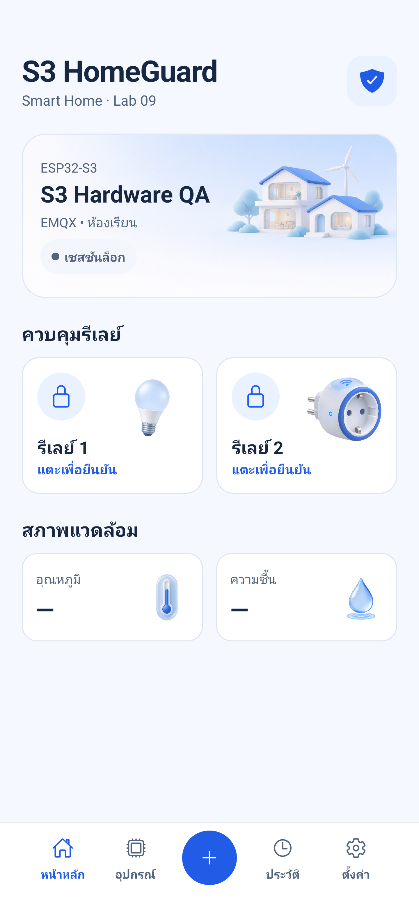
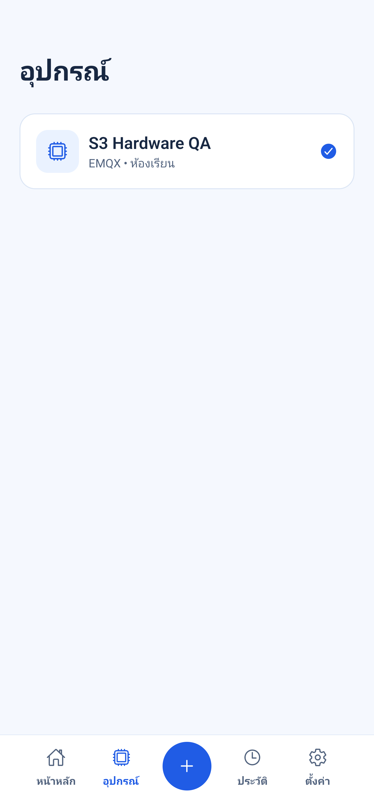
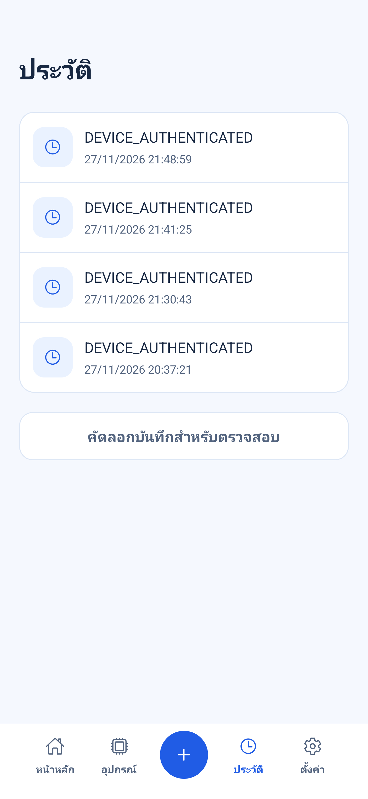
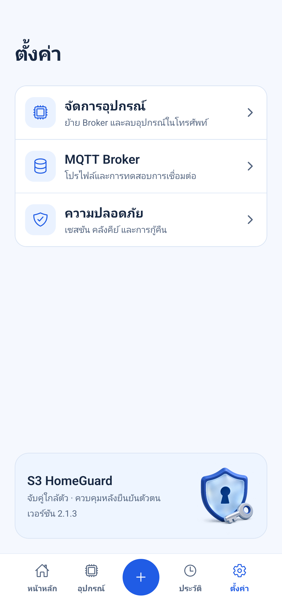
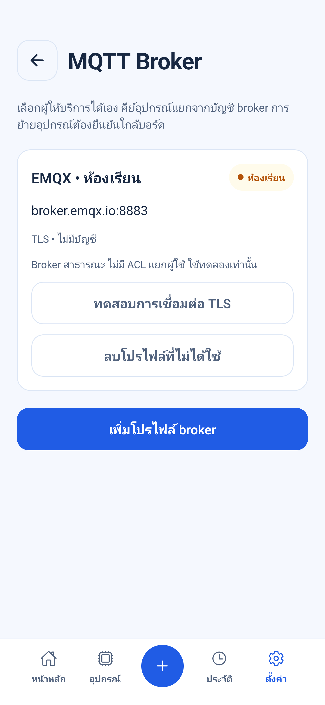
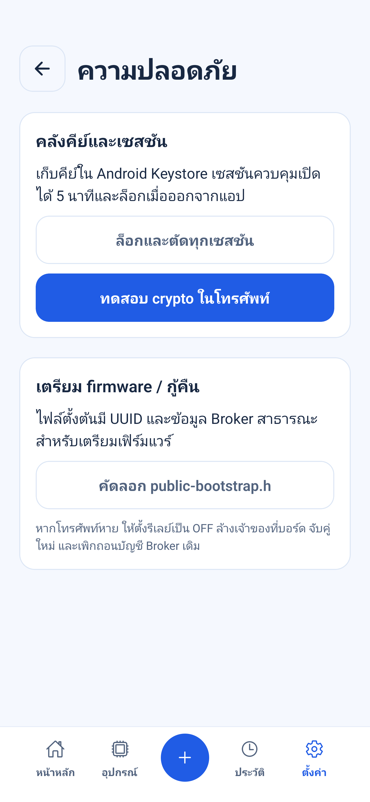

# Lab09 — สเปกและกระบวนการสร้างแอปของผู้เรียน

ชุดสาธารณะมี Markdown/ภาพ/โจทย์ให้สร้างแอปด้วยตนเอง ไม่มี implementation แอปหรือ secure firmware สำเร็จของผู้สอน และไม่แจก APK รุ่น Security2 ของ Lab09

| ลำดับ | ไฟล์ / หน้าที่ |
|---|---|
| 1 | [requirements](requirements.md), [design](design.md), [implementation](implementation.md): เกณฑ์/โครงสร้าง/P0–P9 |
| 2 | [BUILD_GUIDE](BUILD_GUIDE.md): environment และ gate สำหรับโปรเจกต์ที่ผู้เรียนสร้าง |
| 3 | [CONFIGURATION](CONFIGURATION.md): ค่าตั้ง app/board/Broker และขอบเขตต่างจากเป้าหมาย |
| 4 | [mqtt-contract](mqtt-contract.md), [data-model](data-model.md): รูปแบบข้อความ/ข้อมูลที่ต้อง implement |
| 5 | [opencode-prompts](opencode-prompts.md): สั่ง AI ทีละขั้น โดยไม่คัดลอก source สำเร็จ |
| 6 | [USER_GUIDE](USER_GUIDE.md), [KNOWN_ISSUES](KNOWN_ISSUES.md): พฤติกรรมเป้าหมายและบทเรียนจากบั๊กจริง |
| 7 | [test-plan](test-plan.md): ตรวจผลงานตน แยก HOST/BUILD/PHONE/BOARD/NOT RUN |
| กลไก | [SYSTEM_WORKFLOW](../SYSTEM_WORKFLOW.md): ตัวอย่าง Cmd/ACK/State สำหรับเรียน protocol |

เริ่มด้วยโฟลเดอร์โปรเจกต์ใหม่ของกลุ่ม ให้ AI สร้าง skeleton, native module, config/plugins, scripts และ tests ตาม P0 แล้วทำ phase ถัดไป ภาพ/ผลอ้างอิงไม่ทำให้ checklist ของแอปใหม่ผ่านเอง คำว่าไฟล์ source ในเอกสารออกแบบหมายถึงองค์ประกอบที่ต้องสร้าง ไม่ใช่ไฟล์สำเร็จให้ดาวน์โหลด

[บทเรียนหลัก](../README.md) · [APK พื้นฐาน Lab07 สำหรับทดลอง](../../../downloads/README.md) · [นโยบายเผยแพร่](../../../PUBLISHING.md)

## 📱 หน้าตาแอปหลังทำเสร็จ

เมื่อทำตามขั้นตอนจนได้แอปอ้างอิง S3 HomeGuard หน้าตาจะเป็นตัวอย่างด้านล่าง **ภาพชุดนี้จับจากแอป Android รุ่น 2.1.3/code 10 ที่รันจริงบน Samsung Galaxy S25 Ultra** วันที่ 27 พฤศจิกายน 2569 ขนาดต้นฉบับ 1440 × 3120 pixels กดภาพเพื่อเปิดดูขนาดเต็มได้

| หน้าหลัก | อุปกรณ์ | ประวัติ |
|---|---|---|
|  |  |  |
| การ์ดรีเลย์สองช่อง ข้อมูลสภาพแวดล้อม และเมนู Compact Center | รายการบอร์ดที่จับคู่ไว้และการเลือกบอร์ดที่ต้องการดู | เหตุการณ์ที่บันทึกไว้ เช่น การยืนยันอุปกรณ์ |

| ตั้งค่า | MQTT Broker | ความปลอดภัย |
|---|---|---|
|  |  |  |
| ทางเข้าจัดการอุปกรณ์ MQTT Broker และความปลอดภัย | โปรไฟล์ปลายทาง TLS และปุ่มทดสอบการเชื่อมต่อ | การล็อก Session ทดสอบ crypto และคัดลอก public config |

หน้าแรกในภาพอยู่ในสถานะ **เซสชันล็อก / แตะเพื่อยืนยัน** จึงยังไม่มีค่าปัจจุบันจากเซ็นเซอร์ ส่วนประวัติเป็นเหตุการณ์ที่บันทึกไว้เดิม ไม่ใช่หลักฐานว่า Session ยังเปิดอยู่ขณะจับภาพ การจับภาพรอบนี้ไม่ได้จับคู่หรือส่งคำสั่ง GPIO เพิ่ม

หน้าจอกรอกรหัสจับคู่ยังใช้ `FLAG_SECURE` ป้องกันการจับภาพ จึงไม่รวมฟอร์มรหัสในแกลเลอรีนี้ วิธีใช้ฟอร์มอธิบายไว้ในคู่มือ ภาพตกแต่งบ้าน/อุปกรณ์ภายใน UI บางชิ้นสร้างด้วย AI ตามทะเบียนเดิม แต่ภาพหน้าจอทั้งหกเป็นภาพจากการรันแอปจริง

ที่มา: ภาพหน้าจอโดยทีม ESP32-LAB ผ่าน ADB screencap ดู [ทะเบียนภาพ](../../../assets/IMAGE_SOURCES.md) และ [คู่มือใช้งาน](USER_GUIDE.md)
